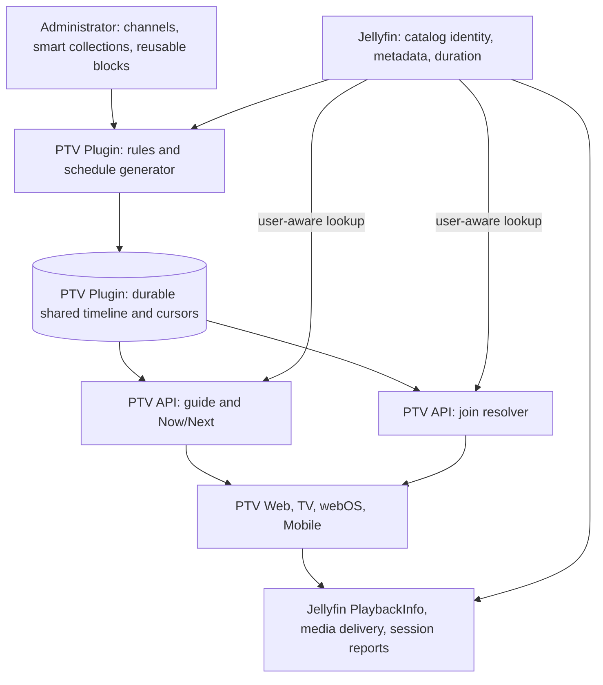

# PTV Channels Architecture RFC v1

Date: 2026-10-18

Status: **Architecture approved 2026-10-18; machine-readable contract review pending**

Decision boundary: architecture and API design **GO**; scheduler prototype **DEFERRED**; production engine, native client integration, and IPTV gateway **HOLD**.

## Purpose and evidence

PTV Channels is a shared, scheduled way to watch existing Jellyfin media. This RFC defines the server-owned timeline, scheduling rules, shared client contract, and native playback handoff needed before implementation is considered. It does not authorize product code, a new service, a deployment, or a device installation.

The October 16 roadmap review reports production Jellyfin 12.2.0 and Plugin 0.5.20.0 as healthy, Web 0.5.67 in production with 0.5.71 locally validated, Plugin 0.5.22.0 as a candidate, Android TV / Fire TV 0.8.12-beta.1 with 652 local tests, webOS 0.1.19 as a blocked candidate, and Android Mobile 0.2.71 as a local candidate. These are **reported results**, not a live-server or physical-device check. At the October 18 completion audit, source commit `3cc67cd3f7bf9ddc1c18f9f2bdade9dd868ce0d4` has Web `0.5.75` and Plugin `0.5.23.0`; source versions do not prove promotion. The review also reports Android Auto reconnect and media-control regressions. Channels should not add another playback lifecycle while the dependent release gates remain open.

No PTV Channels RFC, scheduler prototype, or Channels Plugin API was found in this checkout before this document. Existing Web channel and guide code uses **stock Jellyfin Live TV**. PTV Channels is a separate feature and must never infer ownership of `/LiveTv/Channels`, `/Programs`, tuner configuration, or Jellyfin Live TV permissions from similar names.

The [ErsatzTV Next README](https://github.com/ErsatzTV/next#readme) and [overview](https://ersatztv.org/next-docs/) establish a useful precedent: library/scheduling/playout creation can be separate from a streaming engine, and Next consumes versioned JSON playouts. This is an architectural analogy only. It does not prove that Jellyfin can join at a precise offset, cross a program boundary, or maintain sessions on every PTV device.

## Goals and scope

The first native version is designed to provide:

1. Administrator-defined **shared channels** using Jellyfin media IDs.
2. Reusable schedule blocks and smart collections that select movies and sequential television episodes.
3. A durable, deterministic program timeline with UTC start/end timestamps, a durable episode cursor, bounded repeat avoidance, and restart recovery.
4. A single versioned Plugin API for Web, Android TV / Fire TV, webOS, and Android Mobile to read channels, Now/Next, guide entries, and a join resolution.
5. A native guide and a playback handoff to each client's existing Jellyfin player. Joining a running program requests its current offset; subsequent playback uses Jellyfin negotiation, delivery, and session reporting.

The first version does not include a PTV transcoder, continuous channel stream, external IPTV/M3U/XMLTV gateway, recording, multi-server federation, user-authored channels, per-user schedule variations, or a replacement for stock Live TV. Smart collections here are **channel scheduling inputs**, not an assertion that an existing PTV Collections feature already implements them.

## Chosen architecture and alternatives



| Approach | Benefit | Cost / decision |
| --- | --- | --- |
| **Plugin-owned schedule with native Jellyfin playback** | One shared timeline; reuses existing identity, authorization, delivery, and players; no new streaming infrastructure | Boundary changes are client-managed and device acceptance is required. **Selected for v1 design.** |
| Client-generated schedules | Little server work | Client clocks, permissions, restarts, and episode cursors would produce different channels. Rejected. |
| Continuous PTV/IPTV stream first | Natural channel continuity and external clients | Adds encoding, capacity, stream identity, and operational lifecycle before native acceptance. Deferred to a future gateway. |

### Ownership boundary

| State or action | Authority in the proposed design |
| --- | --- |
| Authentication, user ID, user policy, visible item set, media IDs/metadata/duration | Jellyfin Server. Generation reads an administrator-configured catalog scope; each viewer response and join uses a fresh user-aware lookup. |
| Channel definitions, collection rules, schedule blocks, timeline/entry revisions, generated entries, episode cursors, repeat history | One PTV Plugin Channels owner. This owner is **proposed**, not an existing Atlas implementation. |
| Channel guide, Now/Next, clock sample, join resolution | PTV Plugin API, derived only from the committed timeline and the requesting user's current permissions. |
| Device profile, playable source, transcode/remux/direct-play choice, media delivery, play session | Jellyfin playback APIs and the current client player. A PTV join response is not a playback session. |
| Start/progress/ping/stop reports and watched/resume state | Jellyfin session/user-data contract; each existing client playback owner must keep its normal report lifecycle. |
| Channel UI, focus and remote controls, guide refresh, channel change | Each native client, using the shared API and its existing player integration. |

V1 uses a Plugin-owned SQLite store under Jellyfin's Plugin data area, using the Plugin's existing SQLite dependency. It holds schema version, definitions, collection/block revisions, observed input hashes, timeline entries, and checkpoints in one transaction domain; there is no separate database host or streaming service. The later implementation plan must fix the file layout, migration steps, backup verification, and restore procedure before any production enablement. No state is persisted by this RFC.

## Schedule model and invariants

The Plugin has one shared timeline per channel. A channel is never regenerated per viewer. All persisted instants are UTC; the channel owns one IANA time zone for its reusable weekly block assignments. The Plugin is the clock authority. Clients may display local time but cannot select the current program from their own clocks.

| Record | Required logical fields | Rule |
| --- | --- | --- |
| Channel definition | opaque `channelId`, name, IANA `timeZone`, enabled flag, ordered block assignments, persisted `scheduleAnchorUtc`, `definitionRevision` | Shared across authenticated viewers. The administrator owns edits; the anchor is set once at first publication. |
| Smart collection | opaque `collectionId`, administrator-selected Jellyfin library IDs, media type, eligible-item predicates, ordering policy | Resolve from a Plugin service catalog query; retain the observed input set and its hash for each generated window. No viewer-specific generation or client-side rule evaluation. |
| Reusable block template | opaque `blockId`, days of week, `localStart`, elapsed `windowDurationMs`, source collection, `selectionMode`, `repeatWindowMs` | Has no channel or time zone. A channel assignment places it in that channel's zone; overlaps are rejected per channel after UTC expansion. Uncovered windows produce an explicit gap. |
| Program entry | opaque `programId`, channel, Jellyfin `itemId` when playable, UTC `[startUtc, endUtc)`, catalog runtime, block/collection source, `entryRevision`, state | Once its start passes, identity and timestamps are immutable. IDs are never reused for different media. |
| Generator checkpoint | channel, committed entry `endUtc`, `timelineRevision`, sequential series cursors, next-series pointer, recent item history | Retain a checkpoint after **every committed program or gap entry**. Timeline rows and cursor/history advancement commit atomically. A retry is idempotent. |

The initial design supports movies and TV episodes with a known positive runtime. A smart collection requires library IDs and one media type (`movie` or `episode`); it may constrain series IDs, included/excluded genre and tag values, and a duration range. Predicates are AND across fields and OR within each supplied set; exclusion wins. Arbitrary query scripts and mixed movie/episode collections are outside v1. A block uses `seededShuffle` for movies or `sequentialTv` for episodes, and its recent-item exclusion defaults to 24 hours (configurable from zero to seven days). A block fills with **whole items that fit** before its end; no v1 item is cut at a block boundary. If nothing fits, the remaining interval is an explicit gap. An unavailable or deleted item already on the committed timeline also becomes an unavailable entry for resolution; it does not silently shift later timestamps. Future entries can be regenerated after the current program boundary under a new revision. A currently playing entry is not rewritten by an admin edit or catalog refresh.

The generator reads only the library IDs selected by an administrator. Its server-internal catalog query is a scheduling input, **not** a substitute for a viewer's permission check. It cannot reuse the Plugin's current request-bound `GetLibraryItems()` helper, which now scopes discovery to the resolved current user. It enumerates pages, deduplicates item IDs, pins the observed IDs, runtime, ordering fields, and a hash for one generation pass, then sorts by stable IDs before selection. Jellyfin does not promise an atomic catalog snapshot across pages; changed or deleted items are handled by the fixed-timeline unavailability rule below. The exact 12.2 service catalog query and its scope must be characterized before implementation.

The generator pins an input set and uses `SHA-256(channelId, blockId, occurrenceStartUtc, definitionRevision, inputHash)` as the stable seed; `seededShuffle` ranks movies by `SHA-256(seed, itemId)` with item ID as the final tie-break. In `sequentialTv` mode, it round-robins eligible series by stable series ID, then advances a **shared cursor per channel and series** in season number, episode number, item ID order only when an episode is committed. Episodes without the ordering metadata required for that mode are excluded. After a series' last episode, its next cursor wraps to its first eligible episode. If the next episode is still inside the recent-history window, the series is deferred without advancing its cursor while other series are tried once; if all candidates are repeats, the first deterministic candidate is used and marked `repeatRelaxed`. A movie uses the same avoid-then-relax rule in seeded order. An item that does not fit is skipped for that slot without advancing its episode cursor; if no whole item fits, the remainder is a gap. The generator never loops indefinitely. Replanning discards only future rows from the effective boundary, restores the last retained committed checkpoint, then writes replacement rows and new checkpoints in one transaction.

The v1 guide horizon is 48 hours ahead, with at least 24 hours of past entries retained for reconciliation and diagnostics. At first publication, `scheduleAnchorUtc` is the start of an assigned block whose UTC interval contains server time, or server time if none does; generation fills from that anchor through the horizon, so a channel enabled mid-block has a stable current offset. A channel is visible only after that first full horizon, including explicit gaps, commits atomically. A background refill extends the horizon before it expires. If refill fails, committed entries remain valid through their `endUtc`; after the horizon expires, guide and resolve return `503 HORIZON_EXPIRED` and the channel list marks it unavailable. On restart the Plugin loads committed entries and checkpoint, validates revision and non-overlap, and replays any missing elapsed interval from the last checkpoint before extending the future horizon. Replay advances cursors/history without pretending the server streamed while offline. It commits at most 24 hours of elapsed schedule per recovery transaction and can resume from its last checkpoint after another interruption; the channel remains unavailable until caught up. Pruning past rows retains the checkpoint needed to continue generation. A corrupt or unmigratable store disables Channels and reports a diagnostic error instead of inventing a new schedule. Schema upgrades require a verified backup and rollback path before any production enablement.

Weekly blocks use the channel's IANA time zone; the weekday applies to `localStart`, including for an overnight block. Each occurrence resolves its local start to one UTC instant, then adds elapsed `windowDurationMs` to obtain an exclusive UTC end; there is no second local-time end to resolve. A nonexistent local start during a daylight-saving jump is skipped, and an ambiguous repeated local start uses its earlier offset once. Windows can cross midnight or a clock transition; all overlaps are checked on expanded UTC intervals at save and again during generation. A time-zone database change that creates an overlap fails the new generation while retaining committed entries. This rule and the resulting UTC entries need deterministic tests before implementation. A server clock correction must not rewrite started entries; monitoring should expose clock drift and refuse an unsafe join if the server's timeline/clock state is inconsistent.

### Revisions and mutation visibility

An admin save checks `If-Match` against the edited resource revision, validates rules and overlap, and returns the new revision only after the durable write. A collection or block edit discovers every dependent channel through collection → block → channel assignments. It stages candidate future windows for **all** affected channels from each channel's next program boundary and atomically activates the resource and all affected timelines/checkpoints together. If any affected channel cannot be regenerated, the save fails and the prior resource and timelines remain authoritative. A channel still recovering from an expired horizon cannot accept an edit. Current entries are never replaced. The caller then reads back the effective resource and guide snapshots. A Jellyfin catalog change during staging cannot be locked with the PTV transaction: the staged input hashes remain evidence of what was selected, and later user-aware reads can mark a committed item unavailable without shifting the timeline.

Each replacement future entry gets a new `entryRevision`, while retained past/current entries keep their own. `timelineRevision` is a **per-channel** atomic timeline token; `listRevision` is a Plugin-wide token for the set of channel definitions and timeline pointers. Neither token represents a user's permissions or identifies the exact redacted response body. List and guide responses read one consistent set of committed pointers, but entries within a guide can have different `entryRevision` values. A join compares optional `expectedProgramId` and `expectedEntryRevision` against the current entry; an unrelated future edit does not invalidate an unchanged current program. A mismatch produces a refreshable conflict, never playback of a different item under the old ID. User-specific reads use `no-store`, so v1 does not expose HTTP ETags for list or guide caching.

## Shared API contract v1 (design complete; unimplemented)

The following routes and response semantics are the approved v1 architecture decision, **not** an implemented API. They follow the current [PTV Core contract conventions](../../contracts/ptv-core/README.md): camelCase JSON, opaque IDs, RFC 3339 UTC timestamps, integer milliseconds for durations/positions, additive optional v1 fields, and unknown-field tolerance. The namespace is `/Ptv/v1/channels`, distinct from stock `/LiveTv/*`; `contractVersion: "1.0"` labels Channels payloads. Missing optional fields are omitted, not serialized as `null`. The [machine-readable contract and fixtures](../../contracts/ptv-channels/v1/README.md) express these decisions for review; supported clients must validate against them before implementation.

| Operation | Proposed route | Result |
| --- | --- | --- |
| Capability discovery | `GET /Ptv/v1/channels/capabilities` | Enabled state, contract version, guide limits. An older Plugin without this route is unsupported; a disabled feature returns `enabled: false`. |
| Channel list / Now-Next | `GET /Ptv/v1/channels` | `contractVersion`, `serverTimeUtc`, Plugin-wide `listRevision`, and visible channels with their own `timelineRevision`, state, `now`, and `next`. |
| Guide | `GET /Ptv/v1/channels/{channelId}/guide?fromUtc=...&toUtc=...[&cursor=...]` | One channel's `timelineRevision`, requested `[fromUtc, toUtc)` window, ordered entries, and optional `nextCursor`. Maximum 24-hour window and 500 entries per page within the committed past/future horizon. |
| Join / Go Live | `POST /Ptv/v1/channels/{channelId}/resolve` | Current committed program, user-authorized Jellyfin item ID, position and end time; no stream URL or claimed session. Optional `expectedProgramId` and `expectedEntryRevision` guard a stale guide click. |
| Admin read / save / preview | `/Ptv/v1/channels/admin/...` | Administrator-only definition, collection, and block reads/writes plus side-effect-free schedule preview. |

List/guide entries use one discriminated shape: `programId` (an opaque PTV slot ID unrelated to the Jellyfin item ID), `entryRevision`, `startUtc`, `endUtc`, and `availability`. `availability: "playable"` permits user-authorized title, series, and description fields; `"unavailable"` and `"gap"` omit item ID, title, artwork, series, and description. The list's `now` and `next` follow the **same redaction rule** as guide entries. Among user-facing routes, item IDs are returned only by a successful resolve; an administrator preview may show candidate IDs. Artwork is deferred from the v1 wire schema until a user-scoped image transport is designed without exposing item IDs. A guide includes entries intersecting its requested window without clipping their stored timestamps, sorted by start time and program ID. A cursor is opaque and bound to the user, channel, window, and per-channel `timelineRevision`; a changed timeline makes it stale. Each page rechecks current permissions, so a constant timeline revision does not promise an unchanged user-visible projection after a policy change. `nextCursor` is omitted on the last page.

The minimum capability, list, and guide payloads are illustrated below. `title` is optional only for `playable` entries; all other fields shown are required for the applicable response or entry type. A published `ready` channel has `now`, with `next` omitted only when the horizon contains no later entry. An expired or recovering channel remains in the list with `state: "horizonExpired"` or `"recovering"` and omits `now` and `next`. An unpublished channel is absent from the user list.

```json
{
  "contractVersion": "1.0",
  "serverTimeUtc": "2026-10-18T20:30:00Z",
  "enabled": true,
  "guidePastHours": 24,
  "guideFutureHours": 48,
  "maxGuideWindowHours": 24,
  "maxEntriesPerPage": 500
}
```

```json
{
  "contractVersion": "1.0",
  "serverTimeUtc": "2026-10-18T20:30:00Z",
  "listRevision": "list-opaque-9",
  "channels": [{
    "channelId": "ch-opaque-1",
    "name": "PTV Cinema",
    "state": "ready",
    "timelineRevision": "tl-opaque-7",
    "now": {"programId": "pg-opaque-42", "entryRevision": "entry-opaque-3", "startUtc": "2026-10-18T20:00:00Z", "endUtc": "2026-10-18T22:00:00Z", "availability": "playable", "title": "Example Movie"},
    "next": {"programId": "pg-opaque-43", "entryRevision": "entry-opaque-3", "startUtc": "2026-10-18T22:00:00Z", "endUtc": "2026-10-18T22:30:00Z", "availability": "unavailable"}
  }]
}
```

```json
{
  "contractVersion": "1.0",
  "serverTimeUtc": "2026-10-18T20:30:00Z",
  "channelId": "ch-opaque-1",
  "timelineRevision": "tl-opaque-7",
  "fromUtc": "2026-10-18T20:00:00Z",
  "toUtc": "2026-10-18T23:00:00Z",
  "entries": [
    {"programId": "pg-opaque-42", "entryRevision": "entry-opaque-3", "startUtc": "2026-10-18T20:00:00Z", "endUtc": "2026-10-18T22:00:00Z", "availability": "playable", "title": "Example Movie"},
    {"programId": "pg-opaque-43", "entryRevision": "entry-opaque-3", "startUtc": "2026-10-18T22:00:00Z", "endUtc": "2026-10-18T22:30:00Z", "availability": "unavailable"},
    {"programId": "pg-opaque-44", "entryRevision": "entry-opaque-3", "startUtc": "2026-10-18T22:30:00Z", "endUtc": "2026-10-18T23:00:00Z", "availability": "gap"}
  ]
}
```

For administration, `GET` and `POST` on each of `/Ptv/v1/channels/admin/definitions`, `/Ptv/v1/channels/admin/collections`, and `/Ptv/v1/channels/admin/blocks` list and create resources. `GET` and `PUT /Ptv/v1/channels/admin/{resource}/{id}` read and revise one. The server creates opaque IDs; `POST` returns `201` with the effective resource and its opaque revision, and single-resource `GET` returns `200` with that revision in both the body and an ETag. `PUT` requires `If-Match` containing the last read revision and returns `200`, a new revision/ETag, and the effective resource; the client then performs an authoritative `GET` before treating the mutation as converged. `POST /Ptv/v1/channels/admin/preview` returns `200` with up to 48 hours of candidate entries and input hashes without persisting entries or advancing cursors. V1 has no hard delete: disable or replace a resource while committed entries reference it. Every admin operation requires a current, unambiguous, nondeleted Jellyfin **administrator user** as well as administrator policy; an API key carrying an elevated role without a resolved user is insufficient. The server validates referenced library IDs and block overlaps.

Resolve accepts only `contractVersion` plus optional expected current-entry identity. It never accepts a caller-supplied user ID, clock, item ID, or offset. A channel change or Go Live sends only `contractVersion`; a guide click may also send the expected values:

```json
{
  "contractVersion": "1.0",
  "expectedProgramId": "pg-opaque-42",
  "expectedEntryRevision": "entry-opaque-3"
}
```

Successful resolve returns `200` with these required fields:

```json
{
  "contractVersion": "1.0",
  "serverTimeUtc": "2026-10-18T20:30:00Z",
  "channelId": "ch-opaque-1",
  "timelineRevision": "tl-opaque-7",
  "programId": "pg-opaque-42",
  "entryRevision": "entry-opaque-3",
  "itemId": "jf-opaque-88",
  "startUtc": "2026-10-18T20:00:00Z",
  "endUtc": "2026-10-18T22:00:00Z",
  "positionMs": 1800000,
  "remainingMs": 5400000
}
```

The resolver selects the entry containing the Plugin's current time (`startUtc <= now < endUtc`) and computes `positionMs = now - startUtc` and `remainingMs = endUtc - now` from committed timestamps. The committed catalog runtime determines the scheduled slot; the resolver never clamps a successful offset to that runtime. It rechecks the item's current Jellyfin runtime before returning an item ID and returns `409 PROGRAM_UNAVAILABLE` if the runtime is unknown or does not extend beyond `positionMs`. The client adjusts for elapsed monotonic time before its first frame and resynchronizes only through a fresh resolve. For a playable entry with at most 10 seconds of scheduled time remaining, resolve returns `409 PROGRAM_ROLLOVER` with `retryAtUtc: endUtc` instead of starting a program about to end. The client waits until that server-relative boundary and resolves once more **without** the old expected program ID; if it cannot obtain a playable entry, it refreshes Now/Next and stops automatic retry. The response does not reserve a media source, force a Jellyfin seek to succeed, or prove that a frame appeared.

Errors use a common JSON envelope with required `contractVersion`, `serverTimeUtc`, and `error.code`; `error.retryAtUtc` is present only when a retry boundary is known. The server returns no item metadata in an error. For example:

```json
{
  "contractVersion": "1.0",
  "serverTimeUtc": "2026-10-18T21:59:55Z",
  "error": {"code": "PROGRAM_ROLLOVER", "retryAtUtc": "2026-10-18T22:00:00Z"}
}
```

| HTTP status | Stable `error.code` | Client meaning |
| --- | --- | --- |
| `400` | `INVALID_REQUEST`, `UNSUPPORTED_CONTRACT` | Malformed or out-of-horizon guide window, invalid cursor shape, or unsupported request contract. Correct the request. |
| `401` | `UNAUTHENTICATED`, `PRINCIPAL_UNAVAILABLE` | Missing credentials or no current unambiguous, enabled Jellyfin user. Clear user-scoped state; do not retry under an inferred user. |
| `403` | `ADMIN_REQUIRED` | A resolved user lacks administrator policy for an admin route. |
| `404` | `CHANNEL_NOT_FOUND` | Channel absent or unauthorized; the response does not distinguish them. An older Plugin may instead have no Channels route at all. |
| `404` | `RESOURCE_NOT_FOUND` | Requested admin definition, collection, or block ID does not exist. The admin request must already have passed administrator authorization. |
| `409` | `PROGRAM_CHANGED` | Expected program/entry revision or guide cursor is stale. Refetch the authoritative snapshot. |
| `409` | `PROGRAM_UNAVAILABLE` | Gap, missing media, current item runtime exhausted, or item inaccessible to this user. Show an unavailable slot without item metadata. |
| `409` | `PROGRAM_ROLLOVER` | A playable entry has fewer than or exactly 10 seconds of scheduled time left; wait for `retryAtUtc` and resolve once as specified above. |
| `409` | `TIMELINE_RECOVERING` | An admin edit cannot publish while an affected channel is recovering; keep the old resource and retry after recovery. |
| `412`, `428` | `REVISION_CONFLICT`, `PRECONDITION_REQUIRED` | Admin `If-Match` mismatched or absent; read back before retrying a mutation. |
| `422` | `INVALID_DEFINITION` | Admin rule, library reference, time zone, or expanded block overlap is invalid. No partial write occurs. |
| `503` | `CHANNELS_DISABLED`, `HORIZON_EXPIRED`, `TIMELINE_UNAVAILABLE` | User-facing feature disabled, committed horizon expired, or store/clock invalid. Do not invent a client timeline. |

A supporting Plugin returns `enabled: false` from capabilities when Channels is disabled; its user-facing Channels routes use `503 CHANNELS_DISABLED`. An older Plugin without capabilities is treated as unsupported. A Jellyfin playback-negotiation failure remains a playback failure and is not rewritten as a successful Channels join. These codes and required fields are the v1 design contract; later schemas and fixtures verify them rather than decide them.

All reads and resolves use the **actual authenticated Jellyfin user**. A missing, ambiguous, disabled, or deleted principal fails closed before item lookup, cache use, or serialization. A channel name can be visible to all authenticated users in v1, but list Now/Next and guide entries receive a fresh user-aware lookup before serialization and redact item-derived metadata when that user cannot see the item. Resolve rechecks item visibility immediately before returning an item ID; Jellyfin PlaybackInfo remains responsible for user playback/transcoding policy and device-specific source feasibility. The Plugin does not trust a supplied user ID or a Web filter. User-specific list, guide, and resolve responses set `Cache-Control: private, no-store`; clients keep only short-lived in-memory state scoped by known server, user, and list/timeline revision. Logout and server/user switch clear it. An observed permission change triggers discard and refetch, but Jellyfin does not provide a proven immediate policy-revision signal to every client: already rendered metadata may remain until that client refreshes. Production review must accept or solve that revocation limit. No shared public guide cache may contain user-specific metadata.

Guide and Now/Next are authoritative HTTP snapshots. A client refetches on foreground, reconnect, channel change, revision conflict, and the next known boundary. Optional WebSocket hints may trigger refetch, but have no replay/ordering guarantee. Successful snapshots carry `serverTimeUtc` so a client can estimate skew; clients never persist a private replacement timeline.

## Native playback contract

1. Client requests `resolve` with its current Jellyfin authentication. The Plugin verifies the channel and current item for that user and returns an item ID, offset, program identity, and boundary.
2. The client's **existing** player calls Jellyfin `POST /Items/{id}/PlaybackInfo` with its real device profile and the intended start position, then uses Jellyfin's negotiated source/delivery path. A candidate media source or `PlaySessionId` is a plan, not proof of playback.
3. The client starts the selected source, checks its actual first-frame position against server time, and uses the normal Jellyfin start/progress/ping/stopped reporting lifecycle with one coherent source/session identity. Direct play, remux, and transcode are separate acceptance paths; seeking in HLS may restart FFmpeg.
4. While following live channel time, the client watches the committed `endUtc` and refetches before transition. At the boundary it reports/stops the old session, resolves the new current program, negotiates a new Jellyfin session, and starts it. A gap or denial yields a clear guide/player state. Native v1 does **not** promise seamless frames or an always-on stream.
5. User pause or manual seek leaves live-follow mode and turns the item into ordinary delayed playback under the existing player. A visible **Go Live** action re-resolves the channel and returns to live-follow mode. Channel change always stops/reports the old item and creates a new resolution; restarting the client always refetches rather than trusting a saved offset.

If Jellyfin's negotiated source duration cannot cover the resolved offset after start-up delay, the client refuses that join and displays the same unavailable state; it does not substitute another program. If the selected source ends early or the player fails, the client first stops playback, sends the normal stopped report for that attempt, and releases its media source, `PlaySessionId`, and transcode job through the existing player lifecycle. Only after confirming the failed attempt is no longer active may it re-resolve and negotiate a fresh Jellyfin session for the **same current entry** once. If cleanup cannot be confirmed, the entry changed, or the retry fails, it reports/stops any active attempt and shows an unavailable remainder until the next committed boundary or an explicit Go Live retry. A source that runs longer is stopped at the scheduled boundary while live-follow mode is active. None of these viewer-local outcomes advances the shared timeline or episode cursor.

The target for physical acceptance is a first-frame position within 10 seconds of the server-authoritative program position and a program-boundary handoff within 15 seconds on each supported device and on each supported delivery mode. These are proposed acceptance thresholds, not measured results. Record actual offset, time-to-first-frame, buffering, session/report identity, and transcode job outcome. If a platform cannot meet these thresholds, keep its Channels integration held rather than claim universal support.

## Verification and release gates

| Gate | Required proof before moving forward |
| --- | --- |
| Architecture/API review | RFC v1 is approved. Review the companion schemas and fixtures for ownership, privacy behavior, v1 wire shapes and error codes, and stock Live TV separation before client or Plugin implementation; resolve every `UNKNOWN` that affects that work. |
| Isolated scheduler prototype | Remains deferred now. When permitted later, use only the approved checkout/workflow and test deterministic generation, cursor transaction/idempotence, repeat exhaustion, DST, catalog deletion, revision conflicts, restart, and corruption without production integration. |
| Plugin integration | Complete acceptance of the current Plugin candidate, including 0.5.23.0 user-scope hardening; prove authentication, administrator writes, restricted-user redaction, current-policy recheck, cross-user cache isolation, readback, and old/new Plugin capability behavior. |
| Web/client integration | Current Web candidate promoted; stable authentication and playback; contract fixtures pass on Web, Android TV / Fire TV, webOS, and Android Mobile. Android Auto reconnect/media-control regressions are addressed to the extent they share the playback/session lifecycle. |
| Physical playback acceptance | On each supported physical device: mid-program movie and episode join, cold restart/reconnect, channel change, user pause/seek/Go Live, permission change, missing media, direct play/remux/transcode, boundary transition, and session/progress/job cleanup. webOS build/package and LG acceptance, Android TV/Fire TV physical validation, and Mobile Room migration device validation remain open per the October review. |
| Production promotion | Exact artifact/source provenance, deployment authorization, rollback evidence, and the repository's normal release gates. This RFC grants none of them. |

The acceptance matrix must include an administrator, a normal user, a restricted user, anonymous requests, API-key-only requests, missing/ambiguous/deleted user identity, account switching, and permission changes during guide display and playback. Tests must prove no guide metadata or join item ID leaks across users and that one user's playback does not advance the shared schedule cursor. The scheduler's full timeline is tested independently from every client renderer.

## Atlas impact preview and unresolved evidence

This is documentation-only. The mandatory [Change Protocol](jellyfin-reference/CHANGE-PROTOCOL.md) pre-code record will be required before future shipped Plugin or Web changes. The current Atlas identifies Jellyfin as the owner of user-aware media access, PlaybackInfo, transcoding, sessions, and Live TV; PTV's proposed Channels timeline is a **new owner** that has not been registered as shipped behavior. The future change impact includes Plugin API/storage and security, catalog lookup, Web/native guide caches, player and session lifecycle, and physical-device behavior. It must be reconciled against the actual implementation diff at that time.

Relevant Atlas risks include [ownership conflicts](jellyfin-reference/21-ownership-conflicts.md), [playback/session non-guarantees](jellyfin-reference/25-known-jellyfin-non-guarantees.md), and the existing Live TV configuration mutation backlog. Channels admin writes must not reuse or duplicate the stock Live TV full-document mutation owner. The Atlas stock baseline is Jellyfin 10.11.11; [12.2 compatibility](jellyfin-reference/27-jellyfin-12-2-compatibility.md) is separate evidence. Historical Atlas deviations and backlog order are risk context, not a fresh October status report.

The following remain `UNKNOWN` for Channels until focused proof exists:

- Exact Jellyfin 12.2 start-offset behavior through each current client player and each delivery mode, including slow transcoding startup.
- Whether each physical client can meet the proposed first-frame and boundary tolerances without conflicting with its existing queue, autoplay, remote-control, or session owner.
- The exact Jellyfin 12.2 server-internal catalog query, cross-page consistency, and cost for administrator-scoped smart collection generation at the expected channel/catalog size.
- The exact permission behavior when a shared channel's current item becomes invisible or unplayable after guide delivery.
- Whether a supported permission-change signal can shorten the interval in which already rendered guide metadata remains visible on a remote client.
- The storage migration/backup and crash-recovery behavior of the eventual Plugin implementation.

**Atlas update: not required for this RFC.** It proposes future ownership and contracts but changes no shipped owner, route, schema, cache, security boundary, or runtime behavior. The Atlas and `system-map.json` must be updated in the work item that implements those changes. No active deviation or stabilization-backlog entry is closed or reordered here.

## Decision and next checkpoint

RFC v1 is approved for architecture planning. The [Channels v1 contract package](../../contracts/ptv-channels/v1/README.md) is the next review gate; its local schema validation does not resolve the Jellyfin 12.2 and physical playback unknowns. Neither approval unlocks a scheduler prototype or production Channels work. Those require their separate dependent Plugin, Web, and physical-client acceptance gates. Continuous IPTV broadcasting remains future work.

## References

- [Jellyfin reference index](jellyfin-reference/INDEX.md), [system map](jellyfin-reference/system-map.json), [PTV versus stock map](jellyfin-reference/20-ptv-vs-stock-map.md), [change-impact matrix](jellyfin-reference/22-change-impact-matrix.md), [pre-change checklists](jellyfin-reference/23-before-you-modify-checklists.md), and [stock API contract reference](jellyfin-reference/24-stock-api-contract-reference.md).
- [Stock permissions and library access](jellyfin-reference/04-user-permissions-library-access.md), [playback/session/transcoding](jellyfin-reference/14-playback-session-transcoding.md), and [known non-guarantees](jellyfin-reference/25-known-jellyfin-non-guarantees.md).
- [PTV Core contract conventions](../../contracts/ptv-core/README.md), [current Plugin route inventory](../../src/ptv/plugin/Jellyfin.Plugin.PiggieTV/Api/PtvApiRoutes.cs), [current user-scoped library discovery](../../src/ptv/plugin/Jellyfin.Plugin.PiggieTV/Api/PtvStatusController.cs), and [ErsatzTV Next](https://github.com/ErsatzTV/next#readme).
