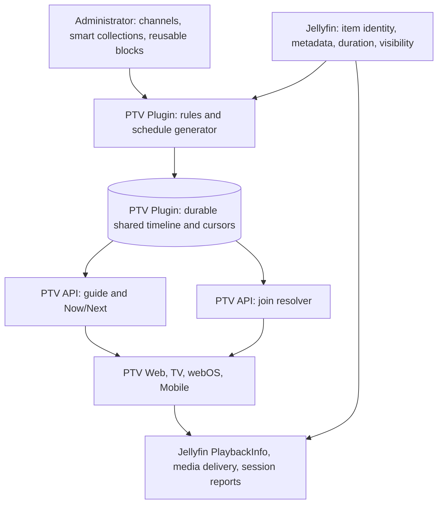

# PTV Channels Architecture RFC v1

Date: 2026-10-17

Status: **Draft for architecture review**

Decision boundary: architecture and API design **GO**; scheduler prototype **DEFERRED**; production engine, native client integration, and IPTV gateway **HOLD**.

## Purpose and evidence

PTV Channels is a shared, scheduled way to watch existing Jellyfin media. This RFC defines the server-owned timeline, scheduling rules, shared client contract, and native playback handoff needed before implementation is considered. It does not authorize product code, a new service, a deployment, or a device installation.

The October 16 roadmap review reports production Jellyfin 12.2.0 and Plugin 0.5.20.0 as healthy, Web 0.5.67 in production with 0.5.71 locally validated, Plugin 0.5.22.0 as a candidate, Android TV / Fire TV 0.8.12-beta.1 with 652 local tests, webOS 0.1.19 as a blocked candidate, and Android Mobile 0.2.71 as a local candidate. These are **reported results**, not a live-server or physical-device check. At this RFC's source baseline, this checkout has Web `0.5.75` and Plugin `0.5.22.0`; those source versions do not prove promotion. The review also reports Android Auto reconnect and media-control regressions. Channels should not add another playback lifecycle while the dependent release gates remain open.

No PTV Channels RFC, scheduler prototype, or Channels Plugin API was found in this checkout before this document. Existing Web channel and guide code uses **stock Jellyfin Live TV**. PTV Channels is a separate feature and must never infer ownership of `/LiveTv/Channels`, `/Programs`, tuner configuration, or Jellyfin Live TV permissions from similar names.

The [ErsatzTV Next README](https://github.com/ErsatzTV/next#readme) and [overview](https://ersatztv.org/next-docs/) establish a useful precedent: library/scheduling/playout creation can be separate from a streaming engine, and Next consumes versioned JSON playouts. This is an architectural analogy only. It does not prove that Jellyfin can join at a precise offset, cross a program boundary, or maintain sessions on every PTV device.

## Goals and scope

The first native version is designed to provide:

1. Administrator-defined **shared channels** using Jellyfin media IDs.
2. Reusable schedule blocks and smart collections that select movies and sequential television episodes.
3. A durable, deterministic program timeline with UTC start/end timestamps, a durable episode cursor, bounded repeat avoidance, and restart recovery.
4. A single versioned Plugin API for Web, Android TV / Fire TV, webOS, and Android Mobile to read channels, Now/Next, guide entries, and a join resolution.
5. A native guide and a playback handoff to each client's existing Jellyfin player. Joining a running program requests its current offset; subsequent playback uses Jellyfin negotiation, delivery, and session reporting.

The first version does not include a PTV transcoder, continuous channel stream, external IPTV/M3U/XMLTV gateway, recording, multi-server federation, user-authored channels, per-user schedule variations, or a replacement for stock Live TV. Smart collections here are **channel scheduling inputs**, not an assertion that an existing PTV Collections feature already implements them.

## Chosen architecture and alternatives



| Approach | Benefit | Cost / decision |
| --- | --- | --- |
| **Plugin-owned schedule with native Jellyfin playback** | One shared timeline; reuses existing identity, authorization, delivery, and players; no new streaming infrastructure | Boundary changes are client-managed and device acceptance is required. **Selected for v1 design.** |
| Client-generated schedules | Little server work | Client clocks, permissions, restarts, and episode cursors would produce different channels. Rejected. |
| Continuous PTV/IPTV stream first | Natural channel continuity and external clients | Adds encoding, capacity, stream identity, and operational lifecycle before native acceptance. Deferred to a future gateway. |

### Ownership boundary

| State or action | Authority in the proposed design |
| --- | --- |
| Authentication, user ID, user policy, visible item set, media IDs/metadata/duration | Jellyfin Server. Generation reads an administrator-configured catalog scope; each viewer response and join uses a fresh user-aware lookup. |
| Channel definitions, collection rules, schedule blocks, schedule revisions, generated entries, episode cursors, repeat history | One PTV Plugin Channels owner. This owner is **proposed**, not an existing Atlas implementation. |
| Channel guide, Now/Next, clock sample, join resolution | PTV Plugin API, derived only from the committed timeline and the requesting user's current permissions. |
| Device profile, playable source, transcode/remux/direct-play choice, media delivery, play session | Jellyfin playback APIs and the current client player. A PTV join response is not a playback session. |
| Start/progress/ping/stop reports and watched/resume state | Jellyfin session/user-data contract; each existing client playback owner must keep its normal report lifecycle. |
| Channel UI, focus and remote controls, guide refresh, channel change | Each native client, using the shared API and its existing player integration. |

The proposed Plugin store can use the Plugin's existing SQLite dependency under its Jellyfin plugin data area; it must not introduce another service or database host. That storage choice requires a later implementation design and migration review. No state is persisted by this RFC.

## Schedule model and invariants

The Plugin has one shared timeline per channel. A channel is never regenerated per viewer. All persisted instants are UTC; the channel owns one IANA time zone for its reusable weekly block assignments. The Plugin is the clock authority. Clients may display local time but cannot select the current program from their own clocks.

| Record | Required logical fields | Rule |
| --- | --- | --- |
| Channel definition | opaque `channelId`, name, IANA `timeZone`, enabled flag, ordered block assignments, `definitionRevision` | Shared across authenticated viewers. The administrator owns edits. |
| Smart collection | opaque `collectionId`, administrator-selected Jellyfin library IDs, media type, eligible-item predicates, ordering policy | Resolve from a Plugin service catalog query; retain the observed input set and its hash for each generated window. No viewer-specific generation or client-side rule evaluation. |
| Reusable block template | opaque `blockId`, recurring local window, source collection, selection mode, repeat policy | Has no channel or time zone. A channel assignment places it in that channel's zone; overlaps are rejected per channel at save. Uncovered windows produce an explicit gap. |
| Program entry | opaque `programId`, channel, Jellyfin `itemId` when playable, UTC `[startUtc, endUtc)`, catalog runtime, block/collection source, `entryRevision`, state | Once its start passes, identity and timestamps are immutable. IDs are never reused for different media. |
| Generator checkpoint | channel, committed entry `endUtc`, `timelineRevision`, sequential series cursors, recent item history | Retain a checkpoint after **every committed program or gap entry**. Timeline rows and cursor/history advancement commit atomically. A retry is idempotent. |

The initial design supports movies and TV episodes with a known positive runtime. A block fills with **whole items that fit** before its end; no v1 item is cut at a block boundary. If nothing fits, the remaining interval is an explicit gap. An unavailable or deleted item already on the committed timeline also becomes an unavailable entry for resolution; it does not silently shift later timestamps. Future entries can be regenerated after the current program boundary under a new revision. A currently playing entry is not rewritten by an admin edit or catalog refresh.

The generator reads only the library IDs selected by an administrator. Its server-internal catalog query is a scheduling input, **not** a substitute for a viewer's permission check. It enumerates pages, deduplicates item IDs, pins the observed IDs, runtime, ordering fields, and a hash for one generation pass, then sorts by stable IDs before selection. Jellyfin does not promise an atomic catalog snapshot across pages; changed or deleted items are handled by the fixed-timeline unavailability rule below. The exact 12.2 catalog query and its scope must be characterized before implementation.

The generator uses a stable channel/block/window seed and that pinned input set, with a documented total ordering for ties. In `sequentialTv` mode, it round-robins eligible series by stable series ID, then advances a **shared cursor per channel and series** in season number, episode number, item ID order only when an episode is committed. Episodes without the ordering metadata required for that mode are excluded. If a candidate does not fit, the generator tries each other eligible series once and then emits a gap. A configurable recent-history window prevents repeat selection when alternatives exist; when a small catalog exhausts that window, the generator marks a deterministic relaxed repeat in the entry. It never loops indefinitely searching for a non-repeat. Replanning discards only future rows from the effective boundary, restores the last retained committed checkpoint, then writes replacement rows and new checkpoints in one transaction.

The v1 guide horizon is proposed as 48 hours ahead, with at least 24 hours of past entries retained for reconciliation and diagnostics. A channel is published only after its first full horizon, including explicit gaps, commits atomically. A background refill extends the horizon before it expires. If refill fails, committed entries remain valid through their `endUtc`; after the horizon expires, guide and resolve return `503 HORIZON_EXPIRED` and the channel shows an unavailable state until recovery. On restart the Plugin loads committed entries and checkpoint, validates their revision and non-overlap, and fills only missing future time in a transaction. It does not advance the cursor twice or reconstruct a different currently playing program. A corrupt or unmigratable store disables Channels and reports a diagnostic error instead of inventing a new schedule. Schema upgrades require a verified backup and rollback path before any production enablement.

Weekly blocks use the channel's IANA time zone; program rows remain UTC. For the v1 proposal, a nonexistent local start during a daylight-saving jump is skipped, and an ambiguous repeated local start uses its earlier offset once. This rule and the resulting UTC entries need deterministic tests before implementation. A server clock correction must not rewrite started entries; monitoring should expose clock drift and refuse an unsafe join if the server's timeline/clock state is inconsistent.

### Revisions and mutation visibility

An admin save checks `If-Match` against the edited resource revision, validates rules and overlap, and returns the new revision only after the durable write. A collection or block edit discovers every dependent channel through collection → block → channel assignments. It stages candidate future windows for **all** affected channels from each channel's next program boundary and atomically activates the resource and all affected timelines/checkpoints together. If any affected channel cannot be regenerated, the save fails and the prior resource and timelines remain authoritative. Current entries are never replaced. The caller then reads back the effective resource and guide snapshots. Each replacement future entry gets a new `entryRevision`, while retained past/current entries keep their own. Each list/guide response carries one `timelineRevision` and ETag for its atomic snapshot, even though its entries may have different `entryRevision` values. A join compares optional `expectedProgramId` and `expectedEntryRevision` against the current entry; an unrelated future edit does not invalidate an unchanged current program. A mismatch produces a refreshable conflict, never playback of a different item under the old ID.

## Proposed shared API contract

The wire contract is a **proposal** for later schema work, not an implemented route. It follows the current [PTV Core contract conventions](../../contracts/ptv-core/README.md): camelCase JSON, opaque IDs, RFC 3339 UTC timestamps, integer milliseconds for durations/positions, additive optional v1 fields, and unknown-field tolerance. The proposed namespace is `/Ptv/v1/channels`, distinct from stock `/LiveTv/*`; `contractVersion: "1.0"` labels Channels payloads. Before implementation, publish machine-readable schemas and fixtures in the existing contract workflow and validate each supported client against them.

| Operation | Proposed route | Result |
| --- | --- | --- |
| Capability discovery | `GET /Ptv/v1/channels/capabilities` | Enabled state, contract version, supported operations, guide horizon. Older Plugin or disabled feature means clients hide Channels. |
| Channel list / Now-Next | `GET /Ptv/v1/channels` | `contractVersion`, `serverTimeUtc`, atomic `timelineRevision`, and visible channels with `channelId`, name, `now`, and `next` entries. |
| Guide | `GET /Ptv/v1/channels/{channelId}/guide?fromUtc=...&toUtc=...` | `contractVersion`, `serverTimeUtc`, `timelineRevision`, requested window, ordered entries, and optional `nextCursor`. Maximum 24-hour window and 500 entries per page within the committed 48-hour horizon. A cursor is opaque and bound to user, channel, window, and revision. |
| Join / Go Live | `POST /Ptv/v1/channels/{channelId}/resolve` | Current committed program, user-authorized Jellyfin item ID, position and end time; no stream URL or claimed session. Optional `expectedProgramId` and `expectedEntryRevision` guard a stale guide click. |
| Admin read / save / preview | `/Ptv/v1/channels/admin/...` | Administrator-only definition, collection, and block reads/writes plus side-effect-free schedule preview. |

List/guide entries use one discriminated shape: `programId` (an opaque PTV slot ID unrelated to the Jellyfin item ID), `entryRevision`, `startUtc`, `endUtc`, and `availability`. `availability: "playable"` permits user-authorized title and artwork fields; `"unavailable"` and `"gap"` omit item ID, title, artwork, series, and description. The list's `now` and `next` follow the **same redaction rule** as guide entries. Item IDs are returned only by a successful resolve. A guide page is sorted by start time and program ID, and all pages for a cursor chain have the same atomic `timelineRevision`; a revision change makes the cursor stale and requires a fresh query. The list and guide ETags identify response snapshots, not individual program revisions.

For administration, `GET/POST /Ptv/v1/channels/admin/definitions`, `/collections`, and `/blocks` list/create those resources; `GET/PUT /Ptv/v1/channels/admin/{resource}/{id}` read/revise one resource; and `POST /Ptv/v1/channels/admin/preview` calculates a bounded candidate timeline without persisting entries or advancing cursors. The server creates opaque IDs. `PUT` requires `If-Match` and returns the new definition/resource revision followed by authoritative readback; disabling or replacing a resource is preferred to hard deletion while committed entries reference it. These operations require Jellyfin administrator authorization and validate referenced library IDs and block overlaps on the server.

Illustrative successful join response (all fields shown are proposed required fields):

```json
{
  "contractVersion": "1.0",
  "serverTimeUtc": "2026-10-17T20:30:00Z",
  "channelId": "ch-opaque-1",
  "timelineRevision": "tl-opaque-7",
  "programId": "pg-opaque-42",
  "entryRevision": "entry-opaque-3",
  "itemId": "jf-opaque-88",
  "startUtc": "2026-10-17T20:00:00Z",
  "endUtc": "2026-10-17T22:00:00Z",
  "positionMs": 1800000,
  "remainingMs": 5400000
}
```

The resolver selects the entry containing the Plugin's current time (`startUtc <= now < endUtc`) and computes `positionMs` from that time, bounded by the item's known runtime. The client adjusts for elapsed monotonic time before its first frame and resynchronizes only through a fresh resolve. Within a short terminal interval near a boundary, the resolver may return a `PROGRAM_ROLLOVER` response with the next boundary instead of starting a program that is about to end; that interval is fixed in the eventual contract and physically tested. The response does not reserve a media source, force a Jellyfin seek to succeed, or prove that a frame appeared.

Errors have stable machine-readable codes: unauthenticated `401`; channel absent or unauthorized `404` (no enumeration); stale guide program/entry revision or cursor `409 PROGRAM_CHANGED`; gap, missing media, or an item inaccessible to this user `409 PROGRAM_UNAVAILABLE` without item metadata; expired horizon `503 HORIZON_EXPIRED`; invalid store/clock `503 TIMELINE_UNAVAILABLE`. A supporting Plugin reports `enabled: false` in capabilities when Channels is disabled; an older Plugin without the route is treated as unsupported. A Jellyfin playback-negotiation failure remains a playback failure and is not rewritten as a successful Channels join. The exact status/code matrix is a schema-review gate before implementation.

All reads and resolves use the **actual authenticated Jellyfin user**. A channel name can be visible to all authenticated users in v1, but list Now/Next and guide entries receive a fresh user-aware lookup before serialization and redact item-derived metadata when that user cannot see the item. Resolve rechecks item visibility immediately before returning an item ID; Jellyfin PlaybackInfo remains responsible for user playback/transcoding policy and device-specific source feasibility. The Plugin does not trust a supplied user ID or a Web filter. User-specific list, guide, and resolve responses set `Cache-Control: private, no-store`; clients keep only short-lived in-memory state scoped by known server, user, and timeline revision. Logout and server/user switch clear it. An observed permission change triggers discard and refetch, but Jellyfin does not provide a proven immediate policy-revision signal to every client: already rendered metadata may remain until that client refreshes. Production review must accept or solve that revocation limit. No shared public guide cache may contain user-specific metadata.

Guide and Now/Next are authoritative HTTP snapshots. A client refetches on foreground, reconnect, channel change, revision conflict, and the next known boundary. Optional WebSocket hints may trigger refetch, but have no replay/ordering guarantee. Successful snapshots carry `serverTimeUtc` so a client can estimate skew; clients never persist a private replacement timeline.

## Native playback contract

1. Client requests `resolve` with its current Jellyfin authentication. The Plugin verifies the channel and current item for that user and returns an item ID, offset, program identity, and boundary.
2. The client's **existing** player calls Jellyfin `POST /Items/{id}/PlaybackInfo` with its real device profile and the intended start position, then uses Jellyfin's negotiated source/delivery path. A candidate media source or `PlaySessionId` is a plan, not proof of playback.
3. The client starts the selected source, checks its actual first-frame position against server time, and uses the normal Jellyfin start/progress/ping/stopped reporting lifecycle with one coherent source/session identity. Direct play, remux, and transcode are separate acceptance paths; seeking in HLS may restart FFmpeg.
4. While following live channel time, the client watches the committed `endUtc` and refetches before transition. At the boundary it reports/stops the old session, resolves the new current program, negotiates a new Jellyfin session, and starts it. A gap or denial yields a clear guide/player state. Native v1 does **not** promise seamless frames or an always-on stream.
5. User pause or manual seek leaves live-follow mode and turns the item into ordinary delayed playback under the existing player. A visible **Go Live** action re-resolves the channel and returns to live-follow mode. Channel change always stops/reports the old item and creates a new resolution; restarting the client always refetches rather than trusting a saved offset.

If Jellyfin's negotiated source duration cannot cover the resolved offset, the client refuses that join and displays the same unavailable state; it does not substitute another program. If the selected source ends early or the player fails, the client may re-resolve and retry the **same current entry** once, then reports/stops the session and shows an unavailable remainder until the next committed boundary or an explicit Go Live retry. A source that runs longer is stopped at the scheduled boundary while live-follow mode is active. None of these viewer-local outcomes advances the shared timeline or episode cursor.

The target for physical acceptance is a first-frame position within 10 seconds of the server-authoritative program position and a program-boundary handoff within 15 seconds on each supported device and on each supported delivery mode. These are proposed acceptance thresholds, not measured results. Record actual offset, time-to-first-frame, buffering, session/report identity, and transcode job outcome. If a platform cannot meet these thresholds, keep its Channels integration held rather than claim universal support.

## Verification and release gates

| Gate | Required proof before moving forward |
| --- | --- |
| Architecture/API review | Approve ownership, schedule invariants, privacy behavior, versioned schema, error codes, restart/migration plan, and the stock Live TV separation. Resolve every `UNKNOWN` below that affects implementation safety. |
| Isolated scheduler prototype | Remains deferred now. When permitted later, use only the approved checkout/workflow and test deterministic generation, cursor transaction/idempotence, repeat exhaustion, DST, catalog deletion, revision conflicts, restart, and corruption without production integration. |
| Plugin integration | Complete Plugin 0.5.22.0 acceptance; prove authentication, administrator writes, restricted-user redaction, current-policy recheck, cross-user cache isolation, readback, and old/new Plugin capability behavior. |
| Web/client integration | Current Web candidate promoted; stable authentication and playback; contract fixtures pass on Web, Android TV / Fire TV, webOS, and Android Mobile. Android Auto reconnect/media-control regressions are addressed to the extent they share the playback/session lifecycle. |
| Physical playback acceptance | On each supported physical device: mid-program movie and episode join, cold restart/reconnect, channel change, user pause/seek/Go Live, permission change, missing media, direct play/remux/transcode, boundary transition, and session/progress/job cleanup. webOS build/package and LG acceptance, Android TV/Fire TV physical validation, and Mobile Room migration device validation remain open per the October review. |
| Production promotion | Exact artifact/source provenance, deployment authorization, rollback evidence, and the repository's normal release gates. This RFC grants none of them. |

The acceptance matrix must include an administrator, a normal user, a restricted user, anonymous requests, account switching, and permission changes during guide display and playback. Tests must prove no guide metadata or join item ID leaks across users and that one user's playback does not advance the shared schedule cursor. The scheduler's full timeline is tested independently from every client renderer.

## Atlas impact preview and unresolved evidence

This is documentation-only. The mandatory [Change Protocol](jellyfin-reference/CHANGE-PROTOCOL.md) pre-code record will be required before future shipped Plugin or Web changes. The current Atlas identifies Jellyfin as the owner of user-aware media access, PlaybackInfo, transcoding, sessions, and Live TV; PTV's proposed Channels timeline is a **new owner** that has not been registered as shipped behavior. The future change impact includes Plugin API/storage and security, catalog lookup, Web/native guide caches, player and session lifecycle, and physical-device behavior. It must be reconciled against the actual implementation diff at that time.

Relevant Atlas risks include [ownership conflicts](jellyfin-reference/21-ownership-conflicts.md), [playback/session non-guarantees](jellyfin-reference/25-known-jellyfin-non-guarantees.md), and the existing Live TV configuration mutation backlog. Channels admin writes must not reuse or duplicate the stock Live TV full-document mutation owner. The Atlas stock baseline is Jellyfin 10.11.11; [12.2 compatibility](jellyfin-reference/27-jellyfin-12-2-compatibility.md) is separate evidence. Historical Atlas deviations and backlog order are risk context, not a fresh October status report.

The following remain `UNKNOWN` for Channels until focused proof exists:

- Exact Jellyfin 12.2 start-offset behavior through each current client player and each delivery mode, including slow transcoding startup.
- Whether each physical client can meet the proposed first-frame and boundary tolerances without conflicting with its existing queue, autoplay, remote-control, or session owner.
- The exact Jellyfin 12.2 server-internal catalog query, cross-page consistency, and cost for administrator-scoped smart collection generation at the expected channel/catalog size.
- The exact permission behavior when a shared channel's current item becomes invisible or unplayable after guide delivery.
- Whether a supported permission-change signal can shorten the interval in which already rendered guide metadata remains visible on a remote client.
- The storage migration/backup and crash-recovery behavior of the eventual Plugin implementation.

**Atlas update: not required for this RFC.** It proposes future ownership and contracts but changes no shipped owner, route, schema, cache, security boundary, or runtime behavior. The Atlas and `system-map.json` must be updated in the work item that implements those changes. No active deviation or stabilization-backlog entry is closed or reordered here.

## Decision and next checkpoint

RFC v1 is ready for architecture review. Its decisions do not unlock a scheduler prototype or production Channels work. The next checkpoint is approval of this design and its API/security boundaries, followed by evidence that the dependent Plugin, Web, and physical client release gates have improved enough to authorize an isolated scheduler prototype. Continuous IPTV broadcasting remains future work.

## References

- [Jellyfin reference index](jellyfin-reference/INDEX.md), [system map](jellyfin-reference/system-map.json), [PTV versus stock map](jellyfin-reference/20-ptv-vs-stock-map.md), [change-impact matrix](jellyfin-reference/22-change-impact-matrix.md), [pre-change checklists](jellyfin-reference/23-before-you-modify-checklists.md), and [stock API contract reference](jellyfin-reference/24-stock-api-contract-reference.md).
- [Stock permissions and library access](jellyfin-reference/04-user-permissions-library-access.md), [playback/session/transcoding](jellyfin-reference/14-playback-session-transcoding.md), and [known non-guarantees](jellyfin-reference/25-known-jellyfin-non-guarantees.md).
- [PTV Core contract conventions](../../contracts/ptv-core/README.md), [current Plugin route inventory](../../src/ptv/plugin/Jellyfin.Plugin.PiggieTV/Api/PtvApiRoutes.cs), and [ErsatzTV Next](https://github.com/ErsatzTV/next#readme).
