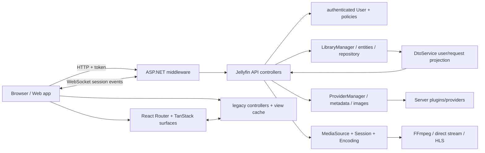
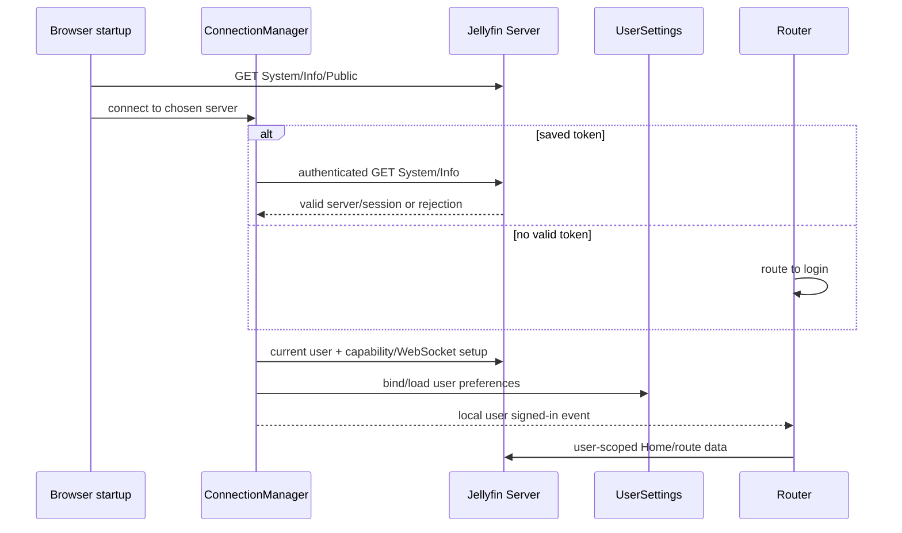
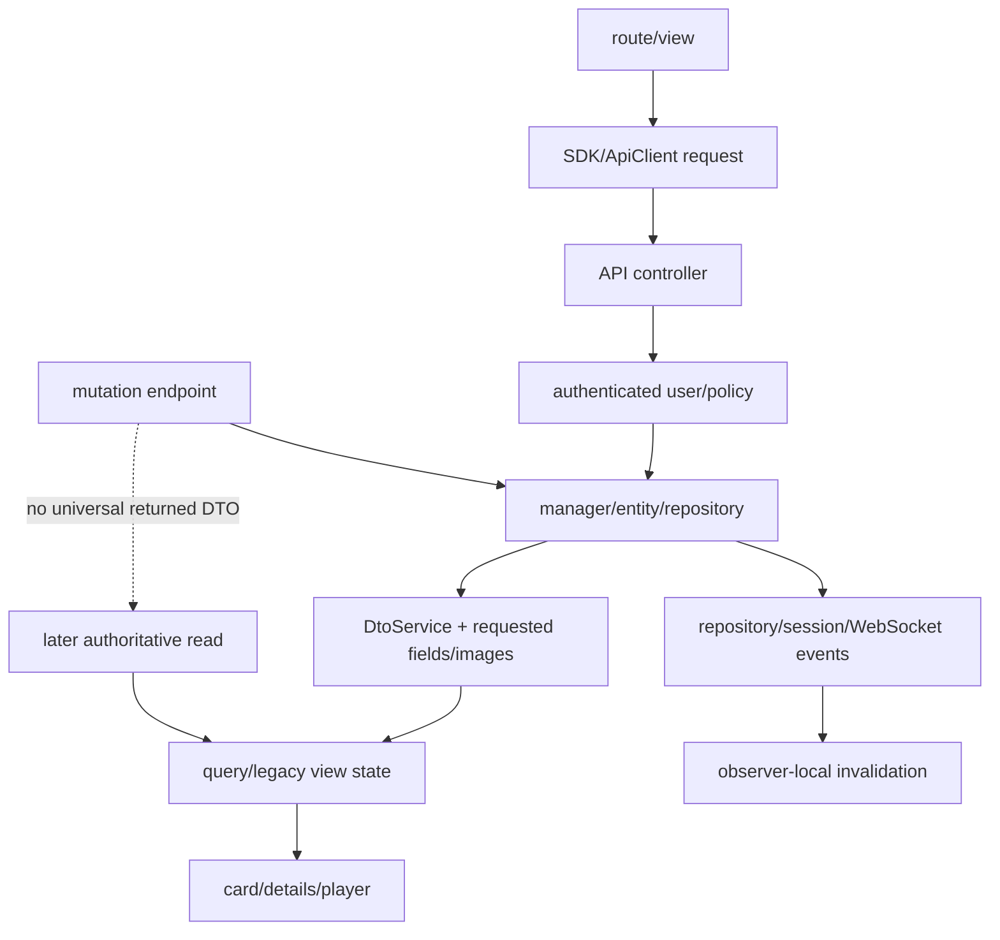

# Stock System Overview (Jellyfin 10.11.11)

## Top-level architecture

`VERIFIED_FROM_SOURCE` — Server request pipeline: Jellyfin Server 10.11.11 @ `1fbd8739292cce610231be93daf43368733edf63` (`S@1fbd873`), `Jellyfin.Server/Startup.cs`, `Configure`, lines 145-234. Web dual routing/view model: Jellyfin Web 10.11.11 @ `35c0793ece3adbd247eab290ae1effab851f3d37` (`W@35c0793`), `src/RootAppRouter.tsx`, lines 21-65; `src/components/viewManager/ViewManagerPage.tsx`, lines 36-141; `src/components/AppBody.tsx`, lines 8-21.

## Server boot and composition

Server startup validates storage, applies startup migration, builds a .NET host around `CoreAppHost`, prepares database/migrations, initializes application services, starts the web host, runs startup tasks, then waits for shutdown/restart. `VERIFIED_FROM_SOURCE` — S@1fbd873, `Jellyfin.Server/Program.cs`, `StartServer`, lines 136-152 and 157-238.

`ApplicationHost.Init` discovers types, loads configuration parts, registers stock services, and lets enabled Plugin service registrators add DI services before the service provider is built. `VERIFIED_FROM_SOURCE` — S@1fbd873, `Emby.Server.Implementations/ApplicationHost.cs`, `Init`/`RegisterServices`, lines 432-485; `Emby.Server.Implementations/Plugins/PluginManager.cs`, `RegisterServices`, lines 201-235.

After DI exists, `InitializeServices` loads localization, assigns selected services to legacy static entity properties, discovers parts, and creates Plugin instances. `VERIFIED_FROM_SOURCE` — S@1fbd873, `ApplicationHost.cs`, `InitializeServices`/`SetStaticProperties`/`FindParts`, lines 585-675.

Startup tasks register scheduled tasks, watch configuration changes, validate FFmpeg, and only then mark core startup complete. `VERIFIED_FROM_SOURCE` — S@1fbd873, `ApplicationHost.cs`, `RunStartupTasksAsync`, lines 404-428.

## Server HTTP authority

The Server registers API controllers, database context, custom authentication, and authorization. The runtime pipeline applies base URL mapping, exception/response-time middleware, WebSockets, compression/CORS/HTTPS, Web/static assets, authentication, routing, authorization, IP validation, WebSocket handling, startup gating, controllers, metrics, and health. `VERIFIED_FROM_SOURCE` — S@1fbd873, `Jellyfin.Server/Startup.cs`, `ConfigureServices`, lines 60-80; `Configure`, lines 145-234.

This order makes controller/policy authorization the authoritative response boundary. Web feature visibility and client-side reconciliation remain views/defense-in-depth, not a substitute for Server filtering. `INFERRED` from the verified pipeline and the user-scoped controller examples in chapters 04, 05, 12, and 24.

## Web boot and composition

Web loads the connection singleton before other app code, initializes the host, resolves/probes server address, initializes localization/plugins/request handlers, renders React, then enables platform/navigation features. `VERIFIED_FROM_SOURCE` — W@35c0793, `src/index.jsx`, module imports and startup sequence, lines 1-125; `src/utils/dashboard.js`, `serverAddress`, lines 26-88.

React composition is `QueryClientProvider → ApiProvider → UserSettingsProvider → WebConfigProvider → RootAppRouter`. `VERIFIED_FROM_SOURCE` — W@35c0793, `src/RootApp.tsx`, lines 16-29.

The URL is owned by a hash-based React Router. Stable and experimental route trees contain both modern lazy React routes and legacy `ViewManagerPage` routes. `VERIFIED_FROM_SOURCE` — W@35c0793, `src/RootAppRouter.tsx`, lines 21-42; `src/apps/stable/routes/routes.tsx`, lines 15-47; `src/components/viewManager/ViewManagerPage.tsx`, lines 36-141.

Modern pages still emit legacy page/view events so global navigation/header code can observe them. Legacy views use a three-slot DOM cache with explicit show/hide/destroy events. `VERIFIED_FROM_SOURCE` — W@35c0793, `src/components/Page.tsx`, lines 19-85; `src/components/viewManager/viewManager.js`, lines 8-65; `src/components/viewContainer.js`, lines 31-49 and 187-247.

## Session establishment

`VERIFIED_FROM_SOURCE` — W@35c0793, `src/lib/jellyfin-apiclient/connectionManager.js`, saved-server selection/token validation/connection completion, lines 78-128, 204-258, 424-628; `src/lib/jellyfin-apiclient/ServerConnections.js`, sign-in completion, lines 137-146; `src/components/ConnectionRequired.tsx`, route gate, lines 53-226.

Web route gating checks login/admin/wizard state, but every sensitive Server controller must still resolve the authenticated user and enforce policies. `VERIFIED_FROM_SOURCE` — W@35c0793, `ConnectionRequired.tsx`, lines 53-226; S@1fbd873, `Jellyfin.Api/Controllers/ItemLookupController.cs`, elevated Apply, lines 244-253; `Jellyfin.Api/Controllers/ImageController.cs`, user-scoped item image, lines 546-574.

## Canonical data flow

The stock item DTO is assembled from domain entities under `DtoOptions`; images, genres, relationships, inherited art, media sources, and user data are projection concerns, not a globally complete object guarantee. `VERIFIED_FROM_SOURCE` — S@1fbd873, `Emby.Server.Implementations/Dto/DtoService.cs`, `AttachBasicFields`, lines 818-882 and relationship attachment lines 1010-1097; `MediaBrowser.Model/Dto/BaseItemDto.cs`, lines 285-499.

Web has both React-query caches and legacy view/controller state. Query data is cleared and cached legacy views reset at explicit logout. `VERIFIED_FROM_SOURCE` — W@35c0793, `src/utils/query/queryClient.ts`, lines 1-12; `src/utils/dashboard.js`, `logout`, lines 104-111.

## Major authority boundaries

| Resource | Authoritative owner | Important derived/view owners | Invalidator/retirement | Detailed chapter |
|---|---|---|---|---|
| Authenticated principal/token | Server authentication for requests; ConnectionManager/Credentials for client session material | ApiProvider/current ApiClient | logout, token rejection, connection switch | 02, 04 |
| User permissions/library access | Server User policy + library/query managers | Web route/feature gates | server policy change; user-scoped refetch/logout | 04, 05 |
| Route/dialog history | React Router hash history | AppRouter compatibility bridge, dialog tokens, view cache | navigation/back/dialog close | 03 |
| Library/item metadata | Server repository/entities | DTO/list/detail/query/view projections | scan/mutation/event/refetch | 05, 07, 08, 10, 11, 13 |
| Home sections | user preferences + Server query results | Home controllers/components | route refresh/events/preferences | 06 |
| Artwork | Server item/image data | DTO tags, Web resolver/lazy state, browser cache | new tag/readback/cache headers | 12 |
| Playback/media source | Server playback-info/encoding plus active Web player | queue, controls, Now Playing view | play/stop/session events | 14 |
| Configuration | Server configuration managers/documents | dashboard forms/query snapshots | save/reload/config events | 15 |
| WebSocket events | Server session/WebSocket managers | ApiClient listeners/feature observers | disconnect/reconnect/unsubscribe | 17 |
| Built assets | Web build output deployed under Server web path | service worker/browser caches | new build asset identity/cache policy | 18 |

The table is an index; exact evidence is in the referenced chapters.

## Dependency hotspots

1. **Item adoption:** metadata, relationships, children, `UserData`, images, playback/queue references, and recommendations can be different projections of one item ID. Chapters 05, 07, 08, 10, 12, 13, 16.
2. **User Views/library discovery:** startup/navigation, Home, every library family, permissions, and PTV feature discovery depend on user-scoped view identity. Chapters 04-06, 20-24.
3. **Image resolution:** cards, Home, Details, Music, Reading, metadata mutation, browser cache, and diagnostics all depend on owner/type/tag semantics. Chapters 07, 08, 10-13, 16, 22.
4. **Route teardown:** React Router, AppRouter, view cache, dialogs, global document listeners, pending requests, and players overlap. Chapters 03, 11, 14, 17, 19.
5. **Session/playback:** media-source selection, player capability, queue, playback reports, WebSocket updates, and Server transcoding are a single workflow with multiple owners. Chapter 14.
6. **Configuration mutations:** full-document forms, query caches, Server save events, scheduled tasks, library scans, Live TV, and Plugin config have separate concurrency/refresh semantics. Chapters 15, 20, 21, 24.

These hotspot summaries are `INFERRED` from the source-verified dependency edges in the linked chapters.

## Architecture limitations to keep visible

- Stock 10.11.11 intentionally carries compatibility bridges and legacy static service assignments. `VERIFIED_FROM_SOURCE` — S@1fbd873, `ApplicationHost.cs`, `SetStaticProperties`, lines 633-659; W@35c0793, `routerHistory.ts`, lines 9-71.
- No one cache or lifecycle manager owns all React and legacy state. `VERIFIED_FROM_SOURCE` — W@35c0793, QueryClient, ViewManager, and controller citations above.
- No single HTTP transaction covers metadata providers, artwork, client readback, image-cache identity, and final UI adoption. `VERIFIED_FROM_SOURCE` — S@1fbd873, `MetadataService.cs`, lines 89-222; `ItemLookupController.cs`, lines 244-280; W@35c0793, `itemidentifier.js`, lines 258-282.
- Plugin DI registration occurs before service-provider build and Plugin instances/parts are discovered later; a Plugin can participate at multiple boot phases. `VERIFIED_FROM_SOURCE` — S@1fbd873, `ApplicationHost.cs`, lines 432-463 and 590-675; `PluginManager.cs`, lines 193-235.

See chapter 25 for the full non-guarantee register and chapters 20-23 before changing PTV behavior.
