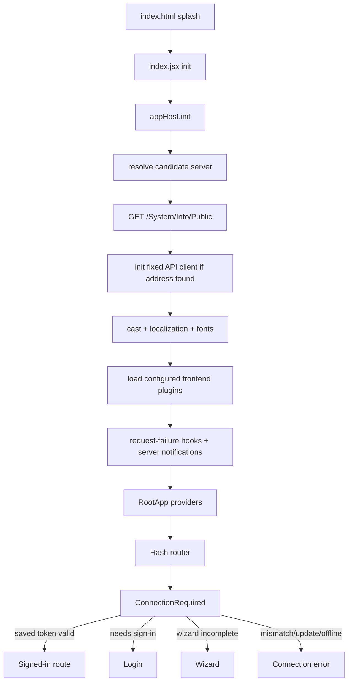
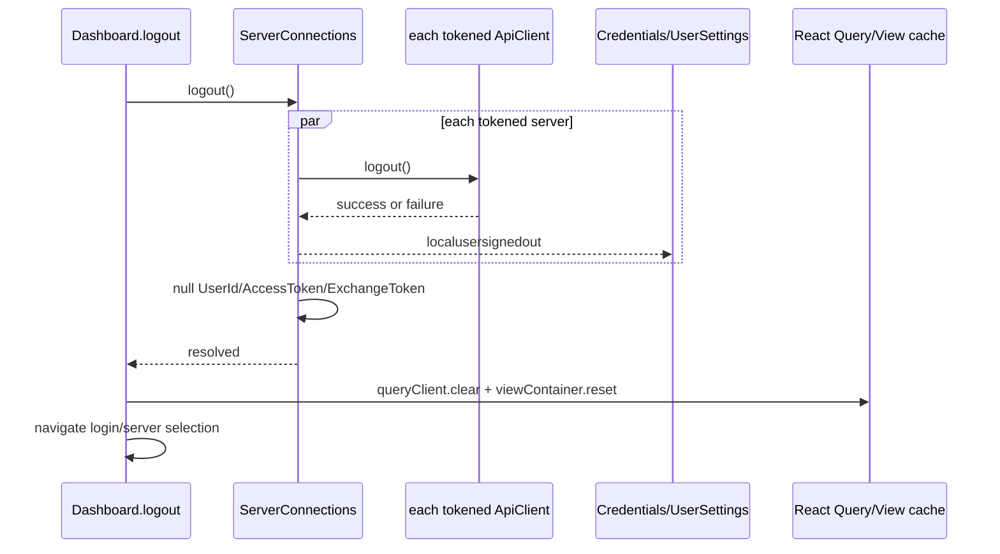

# 02 — Stock startup, session and authentication

## Reference boundary

- **Corpus:** `jellyfin/jellyfin-web` **v10.11.11**, commit **`35c0793ece3adbd247eab290ae1effab851f3d37`**. `[VERIFIED_FROM_SOURCE]` `package.json`, lines 2–5; commit identity from the Phase-1 blob inventory. The exported copy has no `.git`, so the commit cannot be independently re-derived inside it.
- Client-side route checks described here are navigation gates, not substitutes for Jellyfin server authorization. `[VERIFIED_FROM_SOURCE]` `src/components/ConnectionRequired.tsx`, component contract, lines 53–60.

## Ordered boot

1. `index.html` supplies the splash and `#reactRoot`. The entry imports legacy polyfills and `ServerConnections` before other application modules. `[VERIFIED_FROM_SOURCE]` `src/index.html`, lines 88–91; `src/index.jsx`, lines 1–14.
2. `init` initializes host support, resolves the server address, optionally creates a fixed API client, initializes cast/localization/fonts/plugins, binds WebSocket/request-failure behavior, mounts React, then enables platform and navigation features. `[VERIFIED_FROM_SOURCE]` `src/index.jsx`, `init`, lines 49–125.
3. `serverAddress` prefers an existing `window.ApiClient`, then configured server URLs, then the origin before `/web`. It probes every candidate with uncached `GET {candidate}/System/Info/Public` and selects an incomplete-wizard server first, otherwise the first valid response. `[VERIFIED_FROM_SOURCE]` `src/utils/dashboard.js`, `serverAddress`, lines 25–88.
4. `initApiClient` creates a manual-address-only `ApiClient`, disables automatic networking, registers it and sets it as the current legacy client. `[VERIFIED_FROM_SOURCE]` `src/lib/jellyfin-apiclient/ServerConnections.js`, lines 57–76.
5. React provider order is global Query Client → API/user bridge → User Settings → Web Config → Router. `[VERIFIED_FROM_SOURCE]` `src/RootApp.tsx`, lines 16–29. `WebConfigProvider` independently fetches uncached `config.json` after mount; the pre-render `webSettings` module maintains its own one-time cache. `[VERIFIED_FROM_SOURCE]` `src/hooks/useWebConfig.tsx`, lines 10–39; `src/scripts/settings/webSettings.js`, lines 4–24.
6. Hash-router selection between stable and experimental route trees is made once from `localStorage.layout` at module evaluation. `[VERIFIED_FROM_SOURCE]` `src/RootAppRouter.tsx`, lines 21–42.

`[INFERRED]` The startup candidate probe uses `Promise.all` with no source-level timeout/abort, so one never-settling fetch can hold pre-render boot. Awaited host/localization work can do the same; plugin-load rejection itself is caught. `[VERIFIED_FROM_SOURCE]` `src/utils/dashboard.js`, lines 57–87; `src/index.jsx`, lines 69–117 and `loadPlugins`, lines 141–168.

## Session restoration state machine

```mermaid
stateDiagram-v2
    [*] --> DiscoverSavedServers
    DiscoverSavedServers --> ServerSelection: none
    DiscoverSavedServers --> Reconnect: newest saved server
    Reconnect --> Unavailable: every address fails
    Reconnect --> ServerMismatch: unexpected server id
    Reconnect --> ServerUpdateNeeded: version too old
    Reconnect --> ValidateToken: saved access token + auto-login
    Reconnect --> ServerSignIn: no token
    ValidateToken --> ServerSignIn: authenticated System/Info fails; clear token
    ValidateToken --> SignedIn: authenticated System/Info succeeds
    SignedIn --> CurrentUser
    CurrentUser --> UserPreferences
    UserPreferences --> SignInEvent
```

- `ConnectionManager` owns the saved-server connection state; its possible results are `SignedIn`, `ServerMismatch`, `ServerSignIn`, `ServerSelection`, `ServerUpdateNeeded`, and `Unavailable`. `[VERIFIED_FROM_SOURCE]` `src/lib/jellyfin-apiclient/connectionState.ts`, `ConnectionState`, lines 1–10; `src/lib/jellyfin-apiclient/connectionManager.js`, `ConnectionManager` constructor, lines 56–94.
- Saved servers are copied/sorted by `DateLastAccessed`; only the first is selected by `connectToServers`. Native discovery is merged into credentials before sorting. `[VERIFIED_FROM_SOURCE]` `src/lib/jellyfin-apiclient/connectionManager.js`, lines 349–377 and 424–440.
- Reconnect races unique Local, Manual and Remote addresses after 0/100/200 ms staggering. Each uses `GET /System/Info/Public` with a 20-second timeout; first success wins. `[VERIFIED_FROM_SOURCE]` `src/lib/jellyfin-apiclient/connectionManager.js`, `getTryConnectPromise/tryReconnect`, lines 442–530.
- Server minimum version and expected server id are checked before acceptance. `[VERIFIED_FROM_SOURCE]` `src/lib/jellyfin-apiclient/connectionManager.js`, `connectToServer`, lines 533–568.
- With a saved token, `validateAuthentication` sends an authenticated `GET /System/Info`; rejection clears saved `UserId` and `AccessToken` before state is recalculated. Disabling auto-login also clears those fields. `[VERIFIED_FROM_SOURCE]` `src/lib/jellyfin-apiclient/connectionManager.js`, `validateAuthentication/onSuccessfulConnection`, lines 229–257 and 571–603.
- A successful signed-in restoration updates/persists server data, creates/updates the API client, attaches auth, reports capabilities, ensures WebSocket, obtains the current user, binds user display preferences/native sign-in, then emits `localusersignedin`. `[VERIFIED_FROM_SOURCE]` `src/lib/jellyfin-apiclient/connectionManager.js`, `onSuccessfulConnection/afterConnected/onLocalUserSignIn`, lines 571–627 and 204–227; `src/lib/jellyfin-apiclient/ServerConnections.js`, `onLocalUserSignedIn`, lines 137–146.
- Host resume calls `ensureWebSocket` on the current client. `[VERIFIED_FROM_SOURCE]` `src/index.jsx`, lines 98–101.

## Route authentication gate

`ConnectionRequired` is the route-level state owner:

1. On first matched guarded route it calls `ServerConnections.connect`; `firstConnection` prevents the normal initial connect from being repeated by later guards. `[VERIFIED_FROM_SOURCE]` `src/components/ConnectionRequired.tsx`, effect, lines 185–216.
2. Mismatch, required update and unavailable states render `ConnectionErrorPage`. `[VERIFIED_FROM_SOURCE]` `src/components/ConnectionRequired.tsx`, `ERROR_STATES` and component render, lines 34–38 and 218–226.
3. Wizard access rechecks uncached `GET /System/Info/Public`; an incomplete wizard is routed to `/wizard/start`, while a completed one is routed Home. `[VERIFIED_FROM_SOURCE]` `src/components/ConnectionRequired.tsx`, `fetchPublicSystemInfo/handleWizard/handleIncompleteWizard`, lines 40–51 and 102–145.
4. User/Admin branches require `client.isLoggedIn()`. Admin additionally fetches the current user and checks `Policy.IsAdministrator`. `[VERIFIED_FROM_SOURCE]` `src/components/ConnectionRequired.tsx`, `validateUserAccess`, lines 147–183.
5. `ServerSignIn` redirects to `/login?serverid=...&url=<original pathname+search>`; signed-in/public bounce destinations are Home/server selection as appropriate. `[VERIFIED_FROM_SOURCE]` `src/components/ConnectionRequired.tsx`, `bounce`, lines 67–100.

## Interactive authentication

### Username/password

- The login form calls external `apiClient.authenticateUserByName(username,password)`. On 401/403 it distinguishes invalid versus unauthorized user; other failure shows connection failure. `[VERIFIED_FROM_SOURCE]` `src/controllers/session/login/index.js`, `authenticateUserByName`, lines 27–48.
- `ConnectionManager` installs `ApiClient.onAuthenticated`. It persists `ServerId`, user id and access token, attaches authentication to the client, reports capabilities, opens WebSocket, binds settings/native shell and emits the local sign-in event. `[VERIFIED_FROM_SOURCE]` `src/lib/jellyfin-apiclient/connectionManager.js`, lines 96–128 and `onAuthenticated`, lines 172–227.
- The remembered destination is URL-decoded with `/home` fallback; UI completion makes the API client current and navigates there. `[VERIFIED_FROM_SOURCE]` `src/controllers/session/login/index.js`, lines 115–118 and 188–209.
- Login UI concurrently fetches Quick Connect enabled state, public users and Branding configuration. `[VERIFIED_FROM_SOURCE]` `src/controllers/session/login/index.js`, `viewshow`, lines 265–313.
- Remember-me writes global `enableAutoLogin` to local storage; stock default is true. `[VERIFIED_FROM_SOURCE]` `src/scripts/settings/appSettings.js`, `enableAutoLogin`, lines 14–20 and `set/get`, lines 263–274; login submit lines 243–248.

### Quick Connect requester

1. Explicit `POST /QuickConnect/Initiate` returns secret/code.
2. The login page polls explicit `GET /QuickConnect/Connect?Secret=...` every five seconds.
3. Once authenticated, external `apiClient.quickConnect(secret)` performs credential exchange and enters normal login completion.

`[VERIFIED_FROM_SOURCE]` `src/controllers/session/login/index.js`, `authenticateQuickConnect`, lines 51–113. Exact exchange route used inside `quickConnect` is `[UNKNOWN]` because `jellyfin-apiclient` implementation is not in this corpus.

### Quick Connect approver

- The approver is an authenticated user route, normalizes the code, chooses URL `userId` or current user, and calls generated SDK `authorizeQuickConnect`. Success/error are local component state. `[VERIFIED_FROM_SOURCE]` `src/apps/stable/routes/quickConnect/index.tsx`, lines 13–55; route registration `src/apps/stable/routes/asyncRoutes/user.ts`, lines 3–7.
- Enabled state uses React Query key `['QuickConnect','Enabled']` and forwards its abort signal. `[VERIFIED_FROM_SOURCE]` `src/hooks/useQuickConnect.ts`, lines 7–24.
- Exact generated approval/enabled paths are `[UNKNOWN]` from this source export; only their SDK methods are present.

## Logout and cleanup

- Connection logout calls `logout()` for every API client with an access token; both remote success and failure emit `localusersignedout`, then non-guest credential records have user/access/exchange tokens nulled. `[VERIFIED_FROM_SOURCE]` `src/lib/jellyfin-apiclient/connectionManager.js`, lines 306–347.
- `ServerConnections` handles sign-out by clearing UserSettings, forcing credential persistence through the provider and notifying NativeShell. `[VERIFIED_FROM_SOURCE]` `src/lib/jellyfin-apiclient/ServerConnections.js`, lines 41–49.
- `ApiProvider` clears React API/user context on that event and removes its listeners on provider unmount. `[VERIFIED_FROM_SOURCE]` `src/hooks/useApi.tsx`, lines 30–62.
- `Dashboard.logout` clears the entire global React Query cache, resets cached legacy views, then navigates to selection/login. `[VERIFIED_FROM_SOURCE]` `src/utils/dashboard.js`, lines 104–112.

## State ownership map

| State | Owner / writer | Readers | Invalidation / lifetime |
|---|---|---|---|
| Saved servers/user IDs/tokens | external `Credentials`; `ConnectionManager` mutates its records | restoration/server selection | cleared on validation failure, logout, auto-login off; storage medium/at-rest protection `[UNKNOWN]`. `[VERIFIED_FROM_SOURCE]` `src/lib/jellyfin-apiclient/connectionManager.js`, constructor/`onAuthenticated`/`validateAuthentication`, lines 76–94, 172–192 and 229–257 |
| API clients | `ConnectionManager._apiClients` | legacy global, hooks, playback, notifications | process lifetime; deleting a saved server does not remove an existing client. `[VERIFIED_FROM_SOURCE]` `src/lib/jellyfin-apiclient/connectionManager.js`, constructor/`addApiClient`/`deleteServer`, lines 61, 96–128, 693–715 and 744–777 |
| Current client | `ServerConnections.localApiClient` + `window.ApiClient` | legacy code and React bridge | replaced on selection/sign-in; no explicit null assignment in logout path. `[VERIFIED_FROM_SOURCE]` `src/lib/jellyfin-apiclient/ServerConnections.js`, module state/`setLocalApiClient`, lines 35–40 and 85–112 |
| React API/user | `ApiProvider` sign-in/out event handlers | modern hooks/routes | cleared on sign-out; provider listeners cleaned on unmount. `[VERIFIED_FROM_SOURCE]` `src/hooks/useApi.tsx`, lines 19–68 |
| User preferences | `UserSettings` local storage + cached DisplayPreferences | UI/data queries | rebound on sign-in; 50 ms server-save debounce; cleared on sign-out. `[VERIFIED_FROM_SOURCE]` `src/scripts/settings/userSettings.js`, module state/save path, lines 6–18 and 49–73; `src/lib/jellyfin-apiclient/ServerConnections.js`, sign-out/sign-in handlers, lines 41–44 and 137–145 |
| Query cache | one global `queryClient` | React hooks and legacy query bridges | explicit full clear only in Dashboard logout. `[VERIFIED_FROM_SOURCE]` `src/utils/query/queryClient.ts`, module singleton, lines 1–12; `src/utils/dashboard.js`, `logout`, lines 104–112 |
| Web configuration | `webSettings` module cache and separate `WebConfigProvider` state | boot/plugins/UI | module cache has no invalidation; provider fetches once per mount. `[VERIFIED_FROM_SOURCE]` `src/scripts/settings/webSettings.js`, `getWebConfig`, lines 4–24; `src/hooks/useWebConfig.tsx`, `WebConfigProvider`, lines 10–39 |

## API surface established from source

| Operation | Exact route status |
|---|---|
| Public discovery/wizard/reconnect | `GET /System/Info/Public` — `[VERIFIED_FROM_SOURCE]` `src/utils/dashboard.js`, `serverAddress`, lines 57–59; `src/lib/jellyfin-apiclient/connectionManager.js`, `getTryConnectPromise`, lines 442–450; `src/components/ConnectionRequired.tsx`, `fetchPublicSystemInfo`, lines 40–50 |
| Saved-token validation | authenticated `GET /System/Info` — `[VERIFIED_FROM_SOURCE]` `src/lib/jellyfin-apiclient/connectionManager.js`, `validateAuthentication`, lines 229–257 |
| Quick Connect initiate/poll | `POST /QuickConnect/Initiate`; `GET /QuickConnect/Connect?Secret=...` — `[VERIFIED_FROM_SOURCE]` `src/controllers/session/login/index.js`, `authenticateQuickConnect`, lines 51–70 |
| Branding | `GET /Branding/Configuration` — `[VERIFIED_FROM_SOURCE]` `src/controllers/session/login/index.js`, `viewshow`, lines 296–313 |
| Username auth, Quick Connect exchange, current/public users, display preferences, logout, WebSocket/capabilities | client methods are source-verified; exact dependency routes `[UNKNOWN]` |

## Failure, stale and concurrency cases

- `[VERIFIED_FROM_SOURCE]` `ConnectionRequired` starts async work in an effect with no cancel flag/cleanup; several catches only log and do not clear loading/set an error. `src/components/ConnectionRequired.tsx`, lines 120–145, 147–180 and 185–216. `[INFERRED]` A rejected wizard/current-user/connect path can leave the guard spinner; an older completion can navigate after route change.
- `[VERIFIED_FROM_SOURCE]` Reconnect loser requests are not aborted after the first address resolves. `src/lib/jellyfin-apiclient/connectionManager.js`, `getTryConnectPromise/tryReconnect`, lines 442–530.
- `[VERIFIED_FROM_SOURCE]` If restored `getCurrentUser()` fails, `onSuccessfulConnection` still calls `resolveActions`, leaving connection result `SignedIn` without completing `onLocalUserSignIn`. `src/lib/jellyfin-apiclient/connectionManager.js`, `onSuccessfulConnection`, lines 613–627. `[INFERRED]` Route token state can be signed-in while React user/settings state remains unset.
- `[VERIFIED_FROM_SOURCE]` `ServerConnections.onLocalUserSignedIn` awaits display preferences/native callback before `localusersignedin`; rejection goes through `onLocalUserSignIn(...).then(resolveActions,resolveActions)` and can skip the event. `src/lib/jellyfin-apiclient/ServerConnections.js`, `onLocalUserSignedIn`, lines 137–146; `src/lib/jellyfin-apiclient/connectionManager.js`, `onLocalUserSignIn/onSuccessfulConnection`, lines 217–227 and 619–624.
- `[VERIFIED_FROM_SOURCE]` Quick Connect polling uses `setInterval`, has no `viewhide/viewdestroy` cleanup, and does not single-flight a slow prior poll. `src/controllers/session/login/index.js`, `authenticateQuickConnect` and lifecycle bindings, lines 51–101 and 315–317. `[INFERRED]` Polls can overlap or complete after navigation.
- `[VERIFIED_FROM_SOURCE]` Manual login submit has no disabled/single-flight guard. `src/controllers/session/login/index.js`, form submit binding, lines 243–248.
- `[VERIFIED_FROM_SOURCE]` Some shared query keys omit server authority: `['SystemInfo']`, `['Users']`; item keys include user but not server. `src/hooks/useSystemInfo.ts`, lines 17–25; `src/hooks/useUsers.ts`, lines 23–30; `src/hooks/useItem.ts`, lines 20–29. `[INFERRED]` A server switch without explicit logout/query clear can expose stale same-key cache data.
- `[VERIFIED_FROM_SOURCE]` The router's request-failure handler only reacts to parental-control `403`; generic 401 lifecycle is not owned here. `src/components/router/appRouter.js`, `onRequestFail`, lines 197–209. Generic runtime-401 behavior is `[UNKNOWN]` from this source path.
- Exact credential storage medium, encryption/at-rest guarantees, and external `ApiClient.logout` persistence semantics are `[UNKNOWN]`; implementations belong to `jellyfin-apiclient 1.11.0`, declared in `package.json`, line 111.

## Durable comparison points

1. Stock restoration validates a saved token against authenticated System Info, then asynchronously hydrates current user/preferences.
2. Authentication state is split among Credentials, API client, legacy current-client globals, UserSettings, React API context and query cache.
3. Explicit logout is the strong cleanup boundary: remote failure does not prevent local sign-out events/cache reset.
4. Route guards enforce presentation/access routing; Jellyfin endpoints remain the authorization authority.
