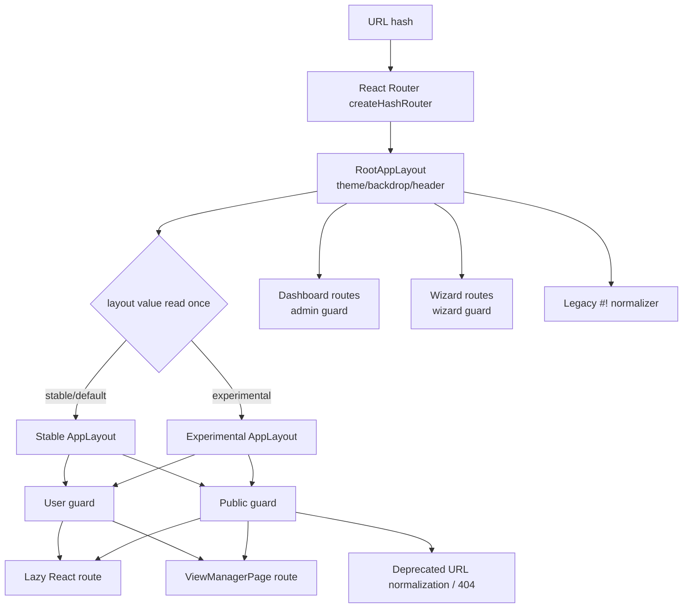
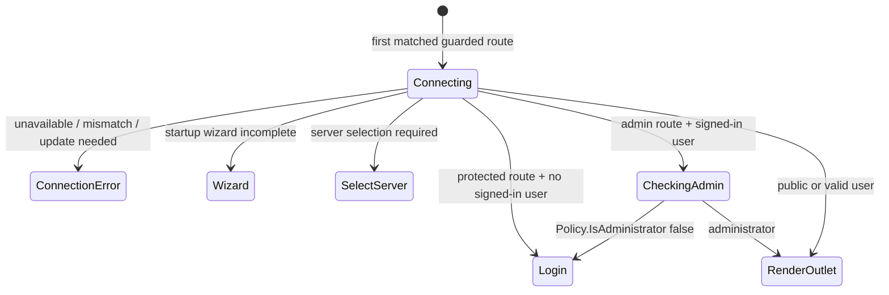
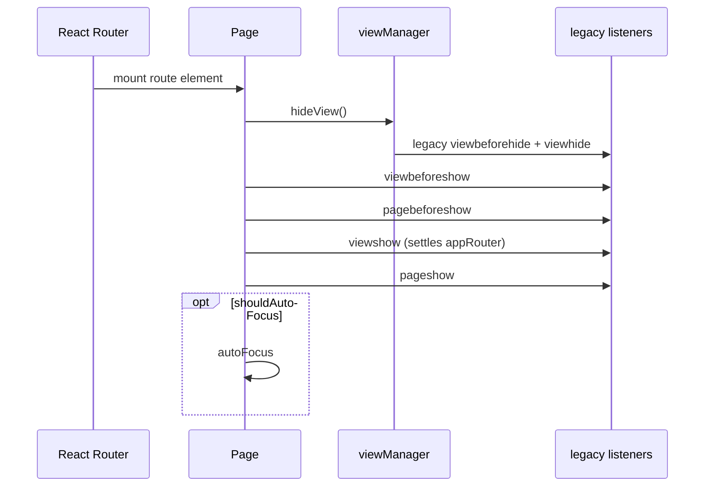
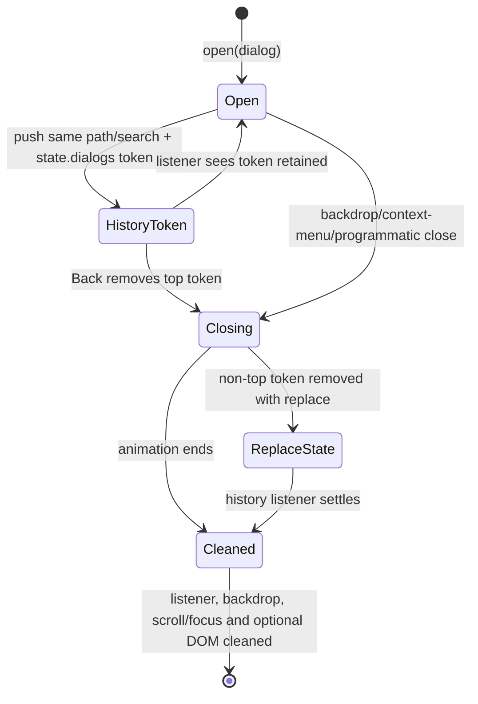

# 03 — Stock routing, navigation and page lifecycle

## Reference boundary

- **Corpus:** `jellyfin/jellyfin-web` **v10.11.11**, commit **`35c0793ece3adbd247eab290ae1effab851f3d37`**. `[VERIFIED_FROM_SOURCE]` Package identity: `package.json`, `name`/`version`, lines 2–5; commit identity: Phase-1 blob-verified corpus inventory.
- **Scope:** URL ownership, access-gated route composition, the modern/legacy navigation bridge, legacy view retention, dialogs, teardown, and navigation failure modes. API/session internals are covered in chapter 02.

## Route composition and ownership



1. `RootAppRouter` constructs one hash router at module evaluation. It chooses stable versus experimental route arrays from `localStorage.layout`, then appends dashboard, wizard and legacy-bang routes beneath one root layout. `[VERIFIED_FROM_SOURCE]` `src/RootAppRouter.tsx`, module initializers `layoutMode`/`router`, lines 21–39.
2. The root layout owns global theme, backdrop and legacy header. It hides the header for experimental mode or paths beginning with a dashboard-family prefix, and renders the matched branch through `Outlet`. `[VERIFIED_FROM_SOURCE]` `src/RootAppRouter.tsx`, `RootAppLayout`, lines 45–65.
3. Stable and experimental application trees both redirect their index to `/home`, place authenticated routes behind the default `ConnectionRequired` user guard, and public routes behind `level='public'`. The stable tree maps both public and user async routes; the experimental tree maps its selected React user routes but continues to reuse legacy public/user routes. `[VERIFIED_FROM_SOURCE]` `src/apps/stable/routes/routes.tsx`, `STABLE_APP_ROUTES`, lines 15–47; `src/apps/experimental/routes/routes.tsx`, `EXPERIMENTAL_APP_ROUTES`, lines 14–53.
4. Dashboard routes sit outside the stable/experimental branch and are protected by `level='admin'`; wizard routes are protected by `level='wizard'`. `[VERIFIED_FROM_SOURCE]` `src/apps/dashboard/routes/routes.tsx`, `DASHBOARD_APP_ROUTES`, lines 18–55; `src/apps/wizard/routes/routes.tsx`, `WIZARD_APP_ROUTES`, lines 61–75.
5. Route entries are declarative inventories, then adapters choose rendering. `toAsyncPageRoute` turns an entry into a React Router `lazy` import; `toViewManagerPageRoute` renders a `ViewManagerPage` with legacy controller/view properties. `[VERIFIED_FROM_SOURCE]` `src/components/router/AsyncRoute.tsx`, `importRoute/toAsyncPageRoute`, lines 17–47; `src/components/router/LegacyRoute.tsx`, `toViewManagerPageRoute`, lines 5–14.
6. The selected layout is not reactive: changing `localStorage.layout` after module evaluation cannot replace the already-created router tree. `[VERIFIED_FROM_SOURCE]` `src/RootAppRouter.tsx`, module-level `layoutMode`, `isExperimentalLayout`, and `router`, lines 21–39. A page reload/re-execution requirement is `[INFERRED]` from that ownership.

## Access gate before page rendering



- A module-global `ServerConnections.firstConnection` sentinel makes only the first mounted guard invoke `connect()`; later guards validate the current client. The component owns local `isLoading` and `errorState`, and renders no child outlet until validation succeeds. `[VERIFIED_FROM_SOURCE]` `src/components/ConnectionRequired.tsx`, `ConnectionRequired` effect/render, lines 185–226.
- An unauthenticated protected route redirects to `/login?serverid={id}&url={encoded pathname+search}`; successful prior authentication bounces public login flow to `/home`; server selection goes to `/selectserver`. `[VERIFIED_FROM_SOURCE]` `src/components/ConnectionRequired.tsx`, `bounce`, lines 67–100.
- Wizard state is checked with uncached `GET {serverAddress}/System/Info/Public`; an incomplete wizard selects that client and routes to `/wizard/start`. `[VERIFIED_FROM_SOURCE]` `src/components/ConnectionRequired.tsx`, `fetchPublicSystemInfo`, `handleWizard`, and `handleIncompleteWizard`, lines 40–50 and 102–145.
- Admin gating reads the current Jellyfin user and tests `Policy.IsAdministrator`. This is a UI route gate, not an alternate authorization system; the server remains authoritative for API authorization. `[VERIFIED_FROM_SOURCE]` `src/components/ConnectionRequired.tsx`, `validateUserAccess`, lines 147–183.
- The exact current-user HTTP route is `[UNKNOWN]` in this snapshot because the guard calls the external `jellyfin-apiclient` method. The public-system-info route above is literal and therefore source-verified.

## Navigation bridge: React Router plus legacy callers

```mermaid
sequenceDiagram
    participant Caller as Legacy/modern caller
    participant AR as appRouter
    participant RH as RouterHistory
    participant RR as React Router
    participant Page as Page or ViewManager
    participant Doc as document viewshow

    Caller->>AR: Dashboard.navigate / appRouter.show(path)
    AR->>AR: wait for prior promiseShow
    AR->>RH: history.push(path) on timer
    RH->>RR: router.navigate(to)
    RR-->>RH: subscribed RouterState
    RH-->>Caller: HISTORY_UPDATE to listeners
    RR->>Page: lazy render / legacy view load
    Page->>Doc: viewshow
    Doc-->>AR: resolveOnNextShow; clear promiseShow
```

1. `RouterHistory` adapts the React Router object to the `history` interface used by legacy code. It reads current action/location, maps back/forward/go/push/replace to `router.navigate`, and converts router subscriptions into a document-level `HISTORY_UPDATE` event with an explicit unsubscribe function. `[VERIFIED_FROM_SOURCE]` `src/components/router/routerHistory.ts`, `RouterHistory`, lines 9–66.
2. `appRouter.show` normalizes hash/hashbang, relative and base URLs; suppresses same-path navigation except Home; serializes after any active `promiseShow`; and defers `history.push` with `setTimeout`. `[VERIFIED_FROM_SOURCE]` `src/components/router/appRouter.js`, `AppRouter.show`, lines 73–104.
3. `appRouter` considers navigation complete only when a `viewshow` document event invokes `onViewShow`; its history listener also forces settlement when normalization produced no effective path change. `[VERIFIED_FROM_SOURCE]` `src/components/router/appRouter.js`, constructor/listen/onViewShow, lines 39–43, 106–118 and 170–177.
4. The public legacy facade `Dashboard.navigate` optionally preserves the current query string, then delegates to `appRouter.show`. `[VERIFIED_FROM_SOURCE]` `src/utils/dashboard.js`, `navigate`, lines 125–143.
5. Item-id navigation may first populate React Query through `getItemQuery`, then derive the route from the returned DTO. Failed fetches log and do not navigate. `[VERIFIED_FROM_SOURCE]` `src/components/router/appRouter.js`, `showItem`, lines 135–157. The hook calls generated `UserLibraryApi.getItem({userId,itemId})`; its route expansion is `[INFERRED]` as `GET /Users/{userId}/Items/{itemId}` from `src/hooks/useItem.ts`, `fetchItem/getItemQuery`, lines 9–29, because the external generated client owns exact URL serialization.
6. `RouterHistory` intentionally discards every promise returned by `router.navigate`; its compatibility callers observe location events or `viewshow`, not router completion/errors. `[VERIFIED_FROM_SOURCE]` `src/components/router/routerHistory.ts`, `back/forward/go/push/replace`, lines 32–50.

## Modern-page lifecycle



- `Page` first hides the active non-React view. In a separate effect it emits `viewbeforeshow`, `pagebeforeshow`, `viewshow`, and `pageshow`, carrying media-control/theme options used by legacy global listeners; an optional effect applies autofocus. `[VERIFIED_FROM_SOURCE]` `src/components/Page.tsx`, `Page` effects, lines 19–68.
- `Page` renders under React `StrictMode` but defines no unmount effect that emits `viewbeforehide`, `viewhide`, or `viewdestroy`. `[VERIFIED_FROM_SOURCE]` `src/components/Page.tsx`, `Page`, lines 37–85. Whether all listeners independently release page-scoped resources on React unmount is `[UNKNOWN]` without auditing each page/controller.
- Stable and experimental layouts both retain a `.mainAnimatedPages` element for legacy views alongside the modern `Outlet`. `AppBody` resets the legacy cache only when that layout unmounts. `[VERIFIED_FROM_SOURCE]` `src/components/AppBody.tsx`, `AppBody`, lines 4–21; `src/apps/stable/AppLayout.tsx`, `AppLayout`, lines 8–17; `src/apps/experimental/AppLayout.tsx`, `Component`, lines 63–77.
- Route errors under the guarded trees render `ErrorBoundary`; it hides the global loader and wraps the error view in `Page`, so the normal `viewshow` settlement path still runs. `[VERIFIED_FROM_SOURCE]` `src/components/router/ErrorBoundary.tsx`, `ErrorBoundary`, lines 17–64; route installation: `src/apps/stable/routes/routes.tsx`, lines 22–30 and `src/apps/experimental/routes/routes.tsx`, lines 21–35.

## Legacy-view lifecycle and three-slot cache

```mermaid
sequenceDiagram
    participant R as ViewManagerPage
    participant I as dynamic imports
    participant VM as viewManager
    participant VC as viewContainer
    participant Old as previous view
    participant New as new/restored view

    R->>I: import controller + translated HTML
    alt PUSH / REPLACE
        I->>VM: loadView(options)
        VM->>VC: loadView
        VC->>VC: choose next of 3 slots
        VC->>Old: viewdestroy if slot occupied
    else POP
        R->>VM: tryRestoreView(exact URL)
        VM->>VC: tryRestoreView
        VC-->>VM: cached view or rejection
        VM->>I: load fresh after ordinary miss
    end
    VM->>Old: viewbeforehide
    VM->>New: controller construct once; viewinit/pageinit
    VM->>New: viewbeforeshow/pagebeforeshow
    VM->>Old: viewhide
    VM->>New: restore focus or autofocus
    VM->>New: viewshow/pageshow
```

1. `ViewManagerPage` dynamically imports a controller module and translated HTML in parallel. PUSH/REPLACE always loads; POP tries exact-URL restoration and loads on a non-cancelled miss. It deliberately excludes `location.state` and `navigationType` from effect dependencies so dialog-only history-state changes do not reload the view. `[VERIFIED_FROM_SOURCE]` `src/components/viewManager/ViewManagerPage.tsx`, `importController/loadView/ViewManagerPage` effect, lines 36–76 and 82–139.
2. `viewContainer.loadView` rotates through three slots. Reusing an occupied slot emits `viewdestroy` before replacing the DOM node; retained non-selected slots are hidden, not destroyed. `[VERIFIED_FROM_SOURCE]` `src/components/viewContainer.js`, `loadView/beforeAnimate/afterAnimate/triggerDestroy`, lines 31–49, 94–118 and 167–181, 229–231; cache size/state lines 242–247.
3. New-view ordering is: old `viewbeforehide`; controller construction once and `viewinit`/`pageinit`; new `viewbeforeshow`/`pagebeforeshow`; old `viewhide`; focus handling; then new `viewshow`/`pageshow`. `[VERIFIED_FROM_SOURCE]` `src/components/viewManager/viewManager.js`, `setOnBeforeChange/onViewChange/dispatchViewEvent`, lines 8–65 and 77–99.
4. Restoration indexes `currentUrls` by exact `pathname + search`, reveals the matching retained element and preserves its controller/DOM; on non-mobile layouts it prefers the previously recorded focus target. `[VERIFIED_FROM_SOURCE]` `src/components/viewContainer.js`, `tryRestoreView`, lines 187–227; `src/components/viewManager/viewManager.js`, `loadView/onViewChange`, lines 38–58 and 133–149.
5. `viewContainer.reset` drops arrays, empties legacy DOM and resets the index, but does not emit `viewdestroy` for every retained view. It runs on skin unload, AppBody unmount and explicit logout. `[VERIFIED_FROM_SOURCE]` `src/components/viewContainer.js`, `reset`, lines 233–248; `src/components/viewManager/viewManager.js`, `resetCachedViews`, lines 126–131; `src/components/AppBody.tsx`, lines 8–12; `src/utils/dashboard.js`, `logout`, lines 104–112.

## Dialogs as history state, not route changes



- Dialog history is enabled by default. Opening moves the dialog into a body-level container, appends a timestamp token to `location.state.dialogs`, pushes the same path/search, and subscribes to history. `[VERIFIED_FROM_SOURCE]` `src/components/dialogHelper/dialogHelper.js`, `DialogHashHandler/open/createDialog`, lines 47–66, 157–197, 239–257 and 403–423.
- Closing the top history dialog calls `history.back`; closing a non-top dialog removes only its token with `history.replace`. Non-history dialogs instead intercept the input-manager Back command. `[VERIFIED_FROM_SOURCE]` `src/components/dialogHelper/dialogHelper.js`, `onBackCommand/onDialogClosed`, lines 84–131 and 193–196.
- Terminal cleanup removes the history/input listener, backdrop, global loader, scroll lock, focus scope and—by default—the dialog/container DOM, then resolves the `open()` promise. TV focus is returned to the element active at open time. `[VERIFIED_FROM_SOURCE]` `src/components/dialogHelper/dialogHelper.js`, `finishClose/onDialogClosed/close`, lines 68–155 and 264–283.
- `ViewManagerPage`'s intentional omission of `location.state` is the compatibility hinge that lets dialogs alter history without re-importing or restoring the underlying legacy page. `[VERIFIED_FROM_SOURCE]` `src/components/viewManager/ViewManagerPage.tsx`, effect dependency comment/list, lines 125–139.

## URL compatibility and fallback behavior

| Input | Result | Evidence |
|---|---|---|
| `#!/path` or `#!path` | replace with normalized `/path` | `[VERIFIED_FROM_SOURCE]` `src/components/router/BangRedirect.tsx`, `BangRedirect`, lines 4–31 |
| old `/wizard*.html` | replace with `/wizard/*` and retain search/hash | `[VERIFIED_FROM_SOURCE]` `src/components/router/FallbackRoute.tsx`, `FallbackRoute`, lines 8–37 |
| any `*.html` | replace after removing `.html`, retain search/hash | `[VERIFIED_FROM_SOURCE]` `src/components/router/FallbackRoute.tsx`, `FallbackRoute`, lines 11–37 |
| unmatched public route | Page-based 404 with Home link | `[VERIFIED_FROM_SOURCE]` `src/components/router/FallbackRoute.tsx`, `FallbackRoute`, lines 40–58 |
| index route | replace with `/home` | `[VERIFIED_FROM_SOURCE]` `src/apps/stable/routes/routes.tsx`, `STABLE_APP_ROUTES`, lines 15–21; `src/apps/experimental/routes/routes.tsx`, `EXPERIMENTAL_APP_ROUTES`, lines 14–20 |

## Owners, readers, writers and invalidation

| Concern | Owner / writer | Readers | Invalidation / cleanup |
|---|---|---|---|
| Route tree | module-level `createHashRouter` | `RouterProvider`, route guards/layouts | fixed for module lifetime; no dynamic reconstruction. `[VERIFIED_FROM_SOURCE]` `src/RootAppRouter.tsx`, lines 21–42 |
| URL/location | React Router | React hooks and `RouterHistory` consumers | browser/hash navigation replaces state; `listen` callers own unsubscribe. `[VERIFIED_FROM_SOURCE]` `src/components/router/routerHistory.ts`, lines 13–21 and 58–66 |
| Legacy navigation completion | singleton `appRouter.promiseShow/resolveOnNextShow` | `ready`, serialized `show` and `back` | `viewshow` or unchanged-path callback clears it. `[VERIFIED_FROM_SOURCE]` `src/components/router/appRouter.js`, lines 33–43, 54–70, 97–118 and 170–177 |
| Modern route DOM | React Router/React | page components and global page-event listeners | React unmount; Page itself has no teardown-event effect. `[VERIFIED_FROM_SOURCE]` `src/components/Page.tsx`, lines 37–85 |
| Legacy view DOM/controller | `viewContainer` + `viewManager` | controller listeners/global legacy UI | three-slot eviction emits `viewdestroy`; reset empties all; hidden slots remain live. `[VERIFIED_FROM_SOURCE]` `src/components/viewContainer.js`, lines 31–49, 167–181 and 229–247 |
| Dialog stack | `location.state.dialogs` + each `DialogHashHandler` | history listener/input manager | close removes token/listeners/backdrop/DOM and restores focus. `[VERIFIED_FROM_SOURCE]` `src/components/dialogHelper/dialogHelper.js`, lines 47–155 and 179–197 |
| Query data | global React Query client | modern hooks and selected legacy bridges | ordinary route change does not clear it; logout explicitly clears it. `[VERIFIED_FROM_SOURCE]` `src/utils/query/queryClient.ts`, lines 1–12; `src/utils/dashboard.js`, lines 104–112 |

## Async, stale-result, concurrency and failure cases

- `[VERIFIED_FROM_SOURCE]` `ViewManagerPage` launches `loadPage()` without returning a cleanup function, cancellation flag, AbortSignal or generation token. `src/components/viewManager/ViewManagerPage.tsx`, lines 95–139. `[INFERRED]` Rapid location changes can let an older dynamic import complete later and install a stale legacy view.
- `[VERIFIED_FROM_SOURCE]` legacy restoration is keyed only by exact URL, not current server/user/security scope. `src/components/viewContainer.js`, `tryRestoreView`, lines 187–227. Logout resets it, but no general server-switch invalidation is visible in this routing layer. Cross-server reuse outside logout is `[INFERRED]` risk, not a proven occurrence.
- `[VERIFIED_FROM_SOURCE]` `appRouter.show` stores one mutable `resolveOnNextShow`, and completion depends on a future `viewshow`. `src/components/router/appRouter.js`, lines 73–104 and 170–177. `[INFERRED]` A route/import/render failure that never renders `Page` or a legacy view can leave the promise pending; queued navigation then waits indefinitely. The installed React route error boundary mitigates errors it catches by rendering a `Page`, but coverage of every pre-render failure is `[UNKNOWN]`.
- `[VERIFIED_FROM_SOURCE]` `RouterHistory.block()` throws because blocking is unimplemented. `src/components/router/routerHistory.ts`, lines 52–56. No stock navigation-blocker/unsaved-change contract can be assumed from this adapter.
- `[VERIFIED_FROM_SOURCE]` the route guard's connection/validation effect has no cancellation cleanup, and several caught failures log without clearing `isLoading` or setting an error. `src/components/ConnectionRequired.tsx`, lines 120–145, 147–180 and 185–216. `[INFERRED]` a failed validation can leave the guard spinner; an older completion can act after dependency-driven rerun/unmount.
- `[VERIFIED_FROM_SOURCE]` retained legacy views remain attached but hidden, so their controller/document subscriptions continue unless the controller handles `viewhide`/`viewdestroy`. `src/components/viewContainer.js`, lines 167–181 and 242–247; event production `src/components/viewManager/viewManager.js`, lines 8–65. Each controller's cleanup quality is `[UNKNOWN]` without per-controller audit.
- `[VERIFIED_FROM_SOURCE]` `PUBLIC_PATHS` contains deprecated flat wizard paths such as `/wizardstart`, while active wizard routing is `/wizard/start`. `src/components/router/appRouter.js`, lines 18–31; `src/apps/wizard/routes/routes.tsx`, lines 61–75. Whether this mismatch causes a reachable parental-control bounce defect is `[UNKNOWN]`.

## Durable comparison points

1. React Router owns matching and URL state; `appRouter` is a compatibility coordinator whose promise settles on legacy page events.
2. Modern and legacy pages share global lifecycle events, but their teardown semantics differ: React unmount versus retained three-slot legacy DOM.
3. Dialogs mutate `location.state`, deliberately without changing the matched page URL; legacy route effects ignore that state.
4. Route guards decide what UI may render. They do not replace Jellyfin's endpoint authorization.
5. The strongest stock cleanup boundary is explicit logout: query data and retained legacy views are both reset.

## PTV worktree route-lifetime extension

This section describes the PTV worktree, not stock Jellyfin Web 10.11.11.

- `[VERIFIED_FROM_SOURCE]` `routeController` is the canonical PTV route-generation owner. `acquirePtvRouteLifetime(routeFamily)` returns a frozen identity containing the canonical route key, family, monotonically increasing generation, `AbortSignal`, and terminal active/retired accessors. A same-family remount retires the previous lifetime, and a canonical route change retires all active family lifetimes. `src/ptv/shell/routeController.ts`, `acquirePtvRouteLifetime/retirePtvRouteLifetime`, lines 581–670.
- `[VERIFIED_FROM_SOURCE]` The active legacy Home controller acquires that lifetime on resume and retires it before pause/destroy. Home section publication checks the exact lifetime object—not only the route string—before DOM writes, Hero mounts, shelf publication, listener/observer registration, timer callbacks, card/image mutation, or adoption of refreshed state. `src/controllers/hometab.js`, `onResume/onPause`; `src/ptv/pages/home/homesections.js`, `bindHomeRouteLifetime/loadSections/resume/destroySections`, lines 95–217 and 1394–1875.
- `[VERIFIED_FROM_SOURCE]` Every Hero remount receives a new route-owned request client and an `isCurrent` predicate closed over that exact immutable lifetime. A retired Hero generation therefore cannot borrow the currentness of a later Home generation after unmount/remount. `src/ptv/pages/home/homesections.js`, `createHomeHeroOptions`, lines 105–120 and `resume`, lines 1815–1842.
- `[VERIFIED_BY_TEST]` Same-route remount, delayed A-after-B completion, navigation churn, and repeated cleanup are covered by `src/ptv/shell/routeController.test.ts`, `src/controllers/hometab.lifecycle.test.ts`, and `src/ptv/pages/home/homesections.lifecycle.test.ts`.
- `[VERIFIED_FROM_SOURCE]` PTV route ownership is now derived from the canonical browser URL before presentation state. The Request matcher accepts only the supported Request hashes through `isPtvRequestFeatureRoute(hash)`; the transient `html.ptv-request-active` class remains presentation/teardown state and cannot claim a different URL. This closes the source-level cause of the 0.5.56 production Request→Manga split, where the old class-only matcher briefly classified `#/reading/manga` as Request before deferred class cleanup reclassified the same URL as Reading. `src/ptv/shell/routes.js`, lines 8 and 132–141; `src/ptv/modules/extendedFeatureRoutes.ts`, lines 5–7.
- `[VERIFIED_BY_TEST]` The intended 0.5.57 candidate keeps Request ownership before its presentation class mounts, keeps Manga under Reading while Request teardown lags, and emits only one new routeController generation when that stale class is later removed. Focused DIAG-01 selection passed **6 files / 86 tests**; full PTV passed **364 files / 3056 tests**; full repository tests passed **438 files / 3589 tests**; TypeScript, targeted ESLint, Stylelint baseline, version tests, diff checks, and the production build passed (standard asset-size warnings only). `npm run lint:ptv` remains a release blocker because unrelated, pre-existing `src/ptv/modules/music/musicPage.tsx` baseline violations produce two errors and three warnings; the DIAG-01 change does not touch Music. The version therefore remains 0.5.56, with no 0.5.57 bump or deployment. Physical validation remains `VALIDATION_PENDING`; production 0.5.56 remains `FAIL/HOLD` evidence.

## Stage 4 Web responsive shell geometry — isolated integration candidate

This addition integrates the reviewed Phase 2 behavior onto the Stage 3 candidate. It does not change the stock 10.11.11 contract or describe a deployed release.

- `[VERIFIED_FROM_SOURCE]` `PTVShell` measures the mounted `.ptv-shell-header` bottom edge and publishes `--ptv-shell-header-clearance` on the root element. A `ResizeObserver`, root route-class observer, window resize, and `visualViewport` resize republish the value; unmount disconnects them and removes or transfers the value to another mounted PTV header. `src/ptv/shell/PTVShell.tsx`, header-clearance layout effect.
- `[VERIFIED_FROM_SOURCE]` PTV shell, Browse, and cinematic Details styles consume that shared value for content and sticky/scroll offsets. Compact controls also account for safe-area insets. This is a presentation geometry owner: it does not own the route URL, data request identity, or authorization. `src/ptv/shell/ptvShell.scss`; `src/ptv/styles/shell.scss`; `src/ptv/pages/browse/nativeBrowse.scss`; `src/ptv/modules/details/details-shell.scss`; `details-sections.scss`.
- `[VERIFIED_BY_TEST]` Focused shell geometry and Playwright viewport/resize tests are in `src/ptv/styles/shellGeometry.test.ts`, `src/ptv/shell/ptvShellVisual.test.ts`, and `e2e/tests/shell-header-visual.spec.ts`. Actual iPad and Fold overlap/focus behavior remains `[UNKNOWN]` until physical testing.
- `[VERIFIED_FROM_SOURCE]` `clientProfile` now chooses a non-TV layout from measured visual/inner viewport width before mobile/tablet user-agent fallback. A coarse pointer at compact landscape/tablet dimensions can select tablet layout, while the separate client kind and Home rendering budget stay unchanged. Fold-like outer→inner→outer transitions therefore change shell presentation classes without expanding Home row or artwork budgets merely because the viewport widened. `src/ptv/core/clientProfile.ts`; `src/ptv/shell/ptvShell.scss`.
- `[VERIFIED_BY_TEST]` `clientProfile.test.ts` asserts Fold posture and unchanged Home budget; `e2e/tests/shell-header-visual.spec.ts` asserts local viewport resize, navigation hit testing and page overflow. These are simulated postures, not Galaxy Z Fold physical proof.
