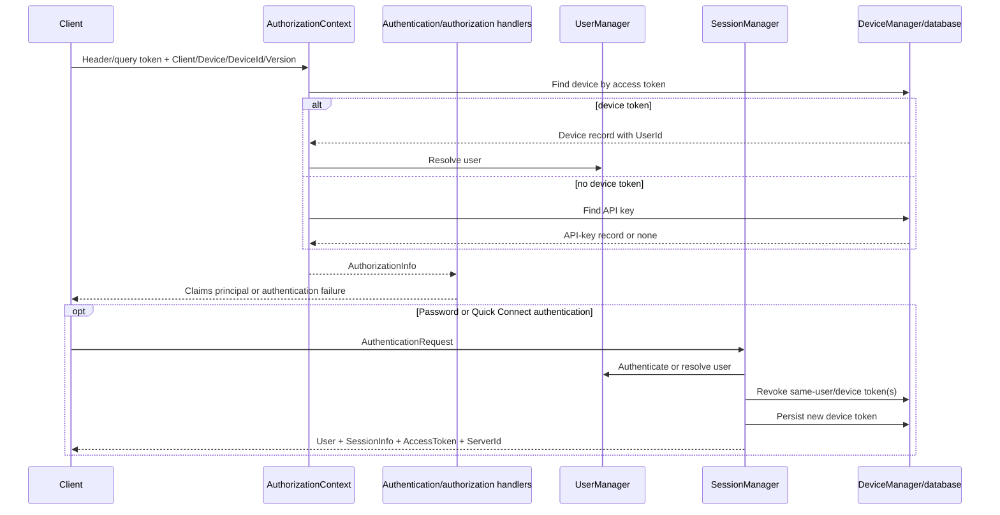
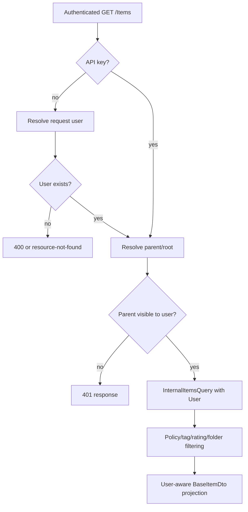

# Stock Jellyfin user, permission, and library-access architecture

## Scope and evidence convention

This chapter describes only the pristine Jellyfin Server `10.11.11` source tree at official commit `1fbd8739292cce610231be93daf43368733edf63`. `VERIFIED_FROM_SOURCE` means the stated behavior is directly implemented in a cited symbol. `INFERRED` means the consequence follows from two or more cited implementations but is not itself expressed as a contract. `UNKNOWN` means this source pass did not establish the behavior. Every architectural statement below carries an evidence reference whose ledger records repository, version, commit, file, symbol, and practical line range.

## Ownership map

| Concern | Stock owner | Effective rule | Evidence |
|---|---|---|---|
| HTTP credential extraction | `AuthorizationContext` | Parse Jellyfin authorization fields; optionally accept legacy headers/query names; resolve a device token before an API key. | `VERIFIED_FROM_SOURCE` [S04-01] |
| ASP.NET identity | `CustomAuthenticationHandler` | Convert resolved authorization data into user/device/token claims; API keys and admin users receive the Administrator role. | `VERIFIED_FROM_SOURCE` [S04-02] |
| Default request admission | `DefaultAuthorizationHandler` | API keys pass; ordinary users are checked for existence, remote-access permission, parental schedule, and admin role. | `VERIFIED_FROM_SOURCE` [S04-03] |
| Endpoint-specific permission | `UserPermissionHandler` and named policies | A policy checks one Jellyfin `PermissionKind`; an API key succeeds without a user. | `VERIFIED_FROM_SOURCE` [S04-04] [S04-05] |
| Login and device-token issuance | `SessionManager` plus `DeviceManager` | Validate client/device identity, authenticate a user, enforce device and session limits, revoke same-user/same-device tokens, persist a new device token, and create/update a live session. | `VERIFIED_FROM_SOURCE` [S04-06] [S04-07] |
| Quick Connect | `QuickConnectManager` | Pair an unauthenticated device identity with an authenticated approving user, then issue a normal device token through direct session authentication. | `VERIFIED_FROM_SOURCE` [S04-08] |
| User policy persistence | `UserManager` | Serialize policy fields into user permissions/preferences under a per-user async lock and database save. | `VERIFIED_FROM_SOURCE` [S04-09] |
| Library-root visibility | `Folder.IsVisible` | Enforce all-folders/enabled-folders or blocked-folder preferences for collection folders. | `VERIFIED_FROM_SOURCE` [S04-10] |
| Item visibility | `BaseItem` and `LibraryManager` | Enforce item/ancestor/tag/rating/collection-folder visibility when a real user is supplied. | `VERIFIED_FROM_SOURCE` [S04-11] [S04-12] |
| User-facing roots | `UserViewManager` | Build views from user-visible root children, optionally group views, add authorized external content, and apply user ordering/hiding preferences. | `VERIFIED_FROM_SOURCE` [S04-13] |
| Query authorization | `ItemsController` and `InternalItemsQuery` | Resolve the request user, reject non-API-key requests without one, validate the requested parent, carry user filters into the repository query, and produce user-aware DTOs. | `VERIFIED_FROM_SOURCE` [S04-14] [S04-15] |

## Authentication and token model

### Device tokens

`AuthorizationContext` first reads `DeviceId`, `Device`, `Client`, `Version`, and `Token` from the Jellyfin authorization header. With legacy authorization enabled it can fall back to `X-Emby-Token`, `X-MediaBrowser-Token`, and lowercase `api_key`; `ApiKey` is accepted from the query independently of the legacy flag. The resulting authorization object starts unauthenticated. [S04-01]

A token that matches an in-memory `DeviceManager` device record becomes an authenticated user request. Missing client/device/version fields are filled from that record; supplied device name and app version can update it, and the device's activity timestamp is refreshed after three minutes. The user is resolved from the device record's `UserId`. [S04-01] [S04-07]

The persisted `Device` entity binds one access token to a user ID, app name/version, device name/ID, active flag, and activity timestamps; its constructor generates a new random GUID-format token. [S04-16]

On password authentication, `SessionManager` requires nonempty app, device ID, device name, and app version, authenticates the user, checks device access and the user's active-session limit, then obtains a token and logs session activity. Before creating the token, it logs out every token for the same user and device. [S04-06]

`POST /Sessions/Logout` ultimately deletes the matching device row and reports every live session on that device ended. Disabling a user through the policy endpoint revokes the user's other device tokens before saving the disabled policy. [S04-06] [S04-17]

### API keys

If no device token matches, the authorization path searches persisted API keys. A match authenticates without a user, supplies server identity defaults for device fields, and marks `IsApiKey`. [S04-01]

The authentication handler gives an API-key principal the Administrator role; the default authorization handler calls API keys unrestricted; and the permission handler automatically succeeds every `PermissionKind` requirement for an API key. [S04-02] [S04-03] [S04-04]

API-key list/create/delete operations are elevation-protected and use the API key value itself as the delete route parameter. [S04-18]

`INFERRED`: an API key is a server-wide privileged credential, not a user-scoped bearer token. Code receiving an API-key request must not expect a user identity or user-library boundary unless it establishes one independently. [S04-01] [S04-03] [S04-04] [S04-14]

### Quick Connect

Quick Connect stores pending codes and authorized results in two process-local concurrent dictionaries. A pending request carries a cryptographically random secret, a six-digit code, and the initiating client/device identity. The normal timeout is ten minutes. [S04-08]

The approving call is authenticated and resolves the target user through request-user rules. Approval invokes `AuthenticateDirect` with the pending device identity; that path still applies device access and active-session limits, but intentionally skips password verification. The resulting normal `AuthenticationResult`, including its device token, is later retrieved with the initiating secret. [S04-08] [S04-06] [S04-19]

`INFERRED`: pending and authorized Quick Connect state does not survive a Jellyfin process restart because the only inspected state stores are instance dictionaries created by the singleton manager. [S04-08]

## End-to-end authentication workflow

The credential-resolution portion and its precedence are implemented in `AuthorizationContext`; claim creation and policy admission are separate; issuing a new device token happens only in the session-authentication workflow. `VERIFIED_FROM_SOURCE` [S04-01] [S04-02] [S04-03] [S04-06]

## Policy and library visibility

### Layers are cumulative

For an ordinary user, successful authentication does not by itself establish access to every item. The stock path has at least four independently enforced layers: request admission (remote access and schedule), endpoint permission policies, collection-folder enable/block preferences, and per-item parental/tag/ancestor visibility. `VERIFIED_FROM_SOURCE` [S04-03] [S04-04] [S04-10] [S04-11]

`UserManager.UpdatePolicyAsync` maps the incoming policy into explicit permissions for administrator, disabled, remote access, Live TV, playback/transcoding/remuxing, download/delete, device/folder/channel access, remote control, collection/subtitle/lyric management, and force-remote-transcode behavior. It separately persists access schedules and allowed/blocked folders, channels, devices, tags, unrated categories, and deletion folders. [S04-09]

A collection folder is visible if it is not explicitly blocked where blocked-folder preferences exist; otherwise the user needs `EnableAllFolders` or the folder ID in `EnabledFolders`. It still must pass base item visibility. [S04-10]

Standalone item visibility checks the item, every ancestor, and membership in at least one collection folder found among the user's visible root children. Base item visibility checks inherited blocked/allowed tags and parental ratings, including the configured behavior for unrated or unrecognized ratings. [S04-11]

User Views are projections, not the server's raw library tree: the manager starts with `GetUserRootFolder().GetChildren(user, true)`, applies playlist visibility, grouping/preset logic, optional channels and Live TV for the user, hidden-view preferences, and user order. [S04-13]

### User-aware item query workflow

`ItemsController.GetItems` explicitly keeps `user` null for API keys, rejects a non-API-key call without a user, adds tags when allowed-tag filtering needs them, verifies a non-root requested parent with `IsVisible`, creates `InternalItemsQuery(user)`, and serializes through `GetBaseItemDtos(..., user)`. `VERIFIED_FROM_SOURCE` [S04-14]

`InternalItemsQuery.SetUser` copies rating and inherited-tag constraints into query filters and retains the user reference. Folder post-filtering also calls `IsVisibleStandalone` when a query has a user. [S04-15] [S04-20]

### Important fail-open primitive

The low-level `LibraryManager.GetItemById(id, Guid userId)` maps `Guid.Empty` to `null`, and `ItemIsVisible(item, null)` returns true. `VERIFIED_FROM_SOURCE` [S04-12]

`INFERRED`: server extensions that call this low-level overload with an unresolved/empty user ID can bypass user-library visibility even if their HTTP endpoint is authenticated. Fail-closed extensions must resolve the authenticated Jellyfin user and pass that user to every item/query/DTO operation before serializing a response. [S04-12] [S04-14]

## Failure and race behavior

| Condition | Stock behavior | Status/evidence |
|---|---|---|
| Missing token | Authentication returns no result; an endpoint's authorization metadata decides whether the request can proceed. | `VERIFIED_FROM_SOURCE` [S04-01] [S04-02] |
| Unknown token | Neither device nor API-key resolution authenticates it. | `VERIFIED_FROM_SOURCE` [S04-01] |
| Deleted user referenced by a device token | The token is marked authenticated before user resolution, but ordinary default authorization later rejects a missing user. | `VERIFIED_FROM_SOURCE` [S04-01] [S04-03] |
| Remote-disabled user from a remote network | Login and default request admission reject the user. | `VERIFIED_FROM_SOURCE` [S04-03] [S04-21] |
| Disallowed parental schedule | Login and normal default authorization reject; explicitly schedule-ignoring policies are separate. | `VERIFIED_FROM_SOURCE` [S04-03] [S04-05] [S04-21] |
| Two logins for the same user/device | Existing device tokens are logged out before the new token is persisted; live sessions sharing the device ID are ended. | `VERIFIED_FROM_SOURCE` [S04-06] |
| Quick Connect expires or Jellyfin restarts | Expired entries are removed; process-local state has no inspected persistence path. | `VERIFIED_FROM_SOURCE` for expiry, `INFERRED` for restart loss [S04-08] |
| Folder access changes during a session | Subsequent user-aware queries recalculate visibility from current user policy/preferences. Whether every already-materialized client cache is immediately evicted is `UNKNOWN`. | `VERIFIED_FROM_SOURCE` / `UNKNOWN` [S04-09] [S04-14] |
| Empty user passed into low-level library lookup | Item is treated as visible. | `VERIFIED_FROM_SOURCE` [S04-12] |

## Contract guidance for server extensions

- Resolve the request identity from the authenticated Jellyfin request context; do not trust a client-supplied user ID as an authorization boundary. `INFERRED` [S04-01] [S04-14]
- For a user response, construct queries with `InternalItemsQuery(user)`, retrieve direct items with the user-aware overload, and build DTOs with that same user. `INFERRED` [S04-12] [S04-14] [S04-15]
- A shared candidate cache may contain globally discovered IDs, but a response must reapply authoritative user visibility before any metadata is serialized. Per-user filtered results must not overwrite the shared raw cache. This is an architectural requirement derived from the fail-open primitive and stock Items path, not a stock cache implementation. `INFERRED` [S04-12] [S04-14]
- Treat API keys as explicitly privileged, not as a substitute for a restricted user. `VERIFIED_FROM_SOURCE` [S04-03] [S04-04]

## Unknowns bounded by this pass

- Device-token expiration or rotation by elapsed time is `UNKNOWN`; the inspected 10.11.11 resolution path performs lookup/activity update but contains no TTL decision. [S04-01]
- Cross-process token revocation propagation in a hypothetical multi-process deployment is `UNKNOWN`; the inspected implementation combines database writes with process-local dictionaries and sessions. [S04-06] [S04-07]
- Client cache eviction timing after a policy change is `UNKNOWN`; this is outside the stock server-only request path. [S04-09]

## Evidence ledger

All entries: repository `jellyfin-server-stock-10.11.11`, version `10.11.11`, commit `1fbd8739292cce610231be93daf43368733edf63`.

| Ref | File | Symbol | Practical lines |
|---|---|---|---:|
| S04-01 | `Jellyfin.Server.Implementations/Security/AuthorizationContext.cs` | `GetAuthorizationInfo`, `GetAuthorizationInfoFromDictionary` | 43-217 |
| S04-02 | `Jellyfin.Api/Auth/CustomAuthenticationHandler.cs` | `HandleAuthenticateAsync` | 43-88 |
| S04-03 | `Jellyfin.Api/Auth/DefaultAuthorizationPolicy/DefaultAuthorizationHandler.cs` | `HandleRequirementAsync` | 41-93 |
| S04-04 | `Jellyfin.Api/Auth/UserPermissionPolicy/UserPermissionHandler.cs` | `HandleRequirementAsync` | 28-53 |
| S04-05 | `Jellyfin.Server/Extensions/ApiServiceCollectionExtensions.cs` | `AddJellyfinApiAuthorization` | 56-93 |
| S04-06 | `Emby.Server.Implementations/Session/SessionManager.cs` | `AuthenticateNewSessionInternal`, `GetAuthorizationToken`, `Logout`, `RevokeUserTokens` | 1570-1746 |
| S04-07 | `Jellyfin.Server.Implementations/Devices/DeviceManager.cs` | constructor, `CreateDevice`, `GetDevices`, `DeleteDevice` | 42-63, 98-108, 146-167, 210-218 |
| S04-08 | `Emby.Server.Implementations/QuickConnect/QuickConnectManager.cs` | fields/constants, `TryConnect`, `CheckRequestStatus`, `AuthorizeRequest`, `GetAuthorizedRequest`, `ExpireRequests` | 21-34, 57-110, 136-229 |
| S04-09 | `Jellyfin.Server.Implementations/Users/UserManager.cs` | `UpdatePolicyAsync` | 803-877 |
| S04-10 | `MediaBrowser.Controller/Entities/Folder.cs` | `IsVisible` | 232-255 |
| S04-11 | `MediaBrowser.Controller/Entities/BaseItem.cs` | `IsVisibleStandaloneInternal`, `IsParentalAllowed`, `IsVisibleViaTags`, `IsVisible`, `IsVisibleStandalone` | 1337-1370, 1591-1640, 1660-1699, 1736-1750 |
| S04-12 | `Emby.Server.Implementations/Library/LibraryManager.cs` | user-aware `GetItemById<T>`, `ItemIsVisible` | 1380-1406, 3355-3367 |
| S04-13 | `Emby.Server.Implementations/Library/UserViewManager.cs` | `GetUserViews` | 45-159 |
| S04-14 | `Jellyfin.Api/Controllers/ItemsController.cs` | `GetItems` | 160-340, 465-534 |
| S04-15 | `MediaBrowser.Controller/Entities/InternalItemsQuery.cs` | `SetUser` | 366-390 |
| S04-16 | `src/Jellyfin.Database/Jellyfin.Database.Implementations/Entities/Security/Device.cs` | `Device`, access-token and identity properties | 11-105 |
| S04-17 | `Jellyfin.Api/Controllers/UserController.cs` | `UpdateUserPolicy` | 433-477 |
| S04-18 | `Jellyfin.Api/Controllers/ApiKeyController.cs` | `GetKeys`, `CreateKey`, `RevokeKey` | 16-74 |
| S04-19 | `Jellyfin.Api/Controllers/QuickConnectController.cs` | Quick Connect endpoints | 40-128 |
| S04-20 | `MediaBrowser.Controller/Entities/Folder.cs` | `QueryWithPostFiltering2`, `GetChildren(User,...)` | 766-790, 1348-1369 |
| S04-21 | `Jellyfin.Server.Implementations/Users/UserManager.cs` | `AuthenticateUser` policy checks | 575-632 |
