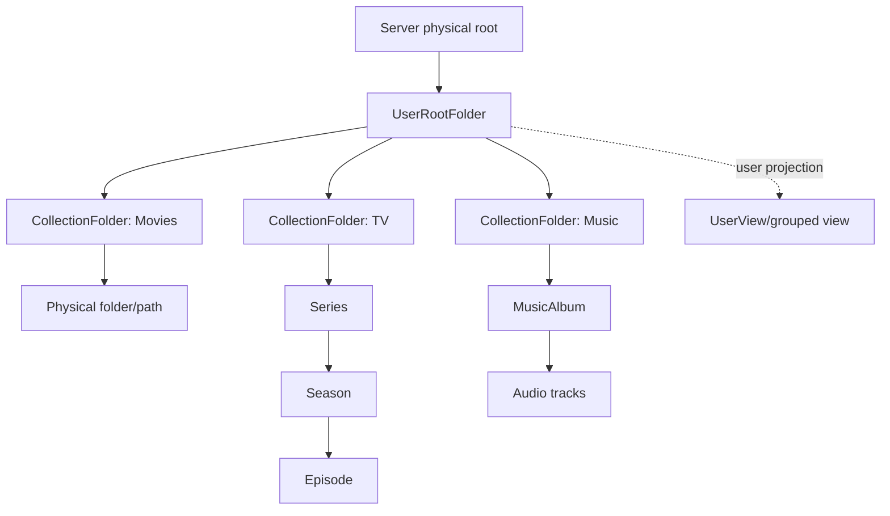
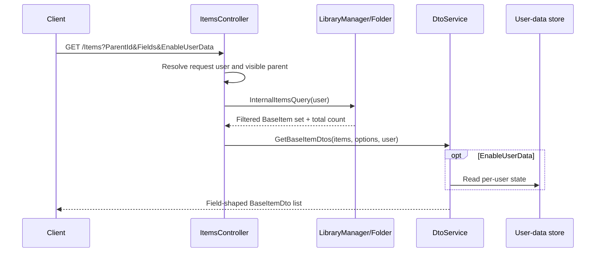
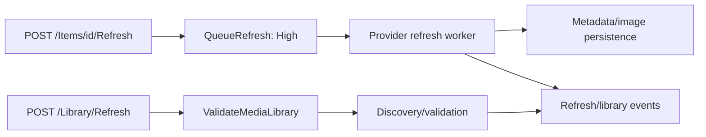

# Stock Jellyfin library and item relationships

## Scope and evidence convention

This is a stock-server reference for pristine Jellyfin Server `10.11.11`, official commit `1fbd8739292cce610231be93daf43368733edf63`. Claims are marked `VERIFIED_FROM_SOURCE`, `INFERRED`, or `UNKNOWN`; every claim points to the evidence ledger with repository/version/commit/file/symbol/line range.

## Ownership map

| Domain | Stock owner | Representation/behavior | Evidence |
|---|---|---|---|
| Library administration | `LibraryStructureController` + `LibraryManager` | Virtual folders have a collection type and one or more media paths; create/remove/rename/path/options operations are elevated. | `VERIFIED_FROM_SOURCE` [S05-01] |
| User-facing library roots | `UserViewManager` | Project user-visible collection folders into grouped/named views and external-content roots. | `VERIFIED_FROM_SOURCE` [S05-02] |
| Item graph | `BaseItem` / `Folder` subclasses | Physical containment uses parent/children; display/domain relationships also use type-specific IDs and names. | `VERIFIED_FROM_SOURCE` [S05-03] [S05-04] |
| Query engine | `InternalItemsQuery`, `Folder`, `LibraryManager` | Filter by parent, item IDs, relationship IDs, media type, user policy, and many other dimensions. | `VERIFIED_FROM_SOURCE` [S05-05] [S05-06] |
| Wire projection | `DtoService` -> `BaseItemDto` | Produce a field-sensitive, user-sensitive DTO containing selected scalar, relationship, user-data, image, and media-source fields. | `VERIFIED_FROM_SOURCE` [S05-07] [S05-08] |
| Metadata refresh | `ItemRefreshController` + provider queue | Queue a high-priority item refresh with separate metadata/image modes and replacement flags. | `VERIFIED_FROM_SOURCE` [S05-09] |
| Global scan | `LibraryController` + `LibraryManager` | Validate the whole media library; controller logs failures and returns 204. | `VERIFIED_FROM_SOURCE` [S05-10] |

## Library hierarchy

Stock collection kinds include movies, TV shows, music, music videos, trailers, home videos, box sets, books, photos, Live TV, playlists, and generic folders; internal view-specific collection types also exist. `VERIFIED_FROM_SOURCE` [S05-11]

Stock item kinds include aggregate/user roots, collection folders, generic folders, movies/videos/trailers, series/seasons/episodes, audio/albums/artists/genres, books/audiobooks, photos/albums, playlists, box sets, channels, Live TV channels/programs, recordings, people, studios, years, and related virtual types. `VERIFIED_FROM_SOURCE` [S05-12]

The diagram separates three concepts implemented by stock: collection-folder roots, physical/domain item containment, and user-specific projected views. A user view is not a second authoritative library database; it is produced from user-visible root children and grouping/preferences. `VERIFIED_FROM_SOURCE` [S05-01] [S05-02]

### Virtual-folder administration and identity

`GET /Library/VirtualFolders` returns `LibraryManager.GetVirtualFolders(true)`. Adding a folder takes a display name, collection type, and `LibraryOptions.PathInfos`; updating library options identifies the collection folder by item `Id`, while rename/path operations use the library name and paths. `VERIFIED_FROM_SOURCE` [S05-01]

`INFERRED`: “virtual-folder name,” collection-folder item ID, user-view ID, and filesystem path are not interchangeable identities. The controller itself uses different identifiers for different operations. A caller must use the identity required by the exact endpoint rather than infer one from a display label or array position. [S05-01]

Rename and add/remove-path methods stop the library monitor, perform the structural mutation, and launch later scan/restart work via `Task.Run`; the HTTP method can return before that background work completes. `VERIFIED_FROM_SOURCE` [S05-01]

## Item containment and domain relationships

### Generic containment

`BaseItem.ParentId` is persisted as the generic containing-parent relationship. A user-aware standalone visibility check walks all parents and validates that at least one collection folder containing the item is visible among the user's root children. `VERIFIED_FROM_SOURCE` [S05-03] [S05-13]

Folder children are query results rather than embedded children in a `BaseItemDto`. User-aware `GetChildren` attaches the user to the query; a query with a user receives a final `IsVisibleStandalone` filter when required. `VERIFIED_FROM_SOURCE` [S05-06]

### Television

An `Episode` stores/derives separate `SeasonId`, `SeriesId`, `SeasonName`, and `SeriesName` relationships. `FindSeasonId` first seeks a parent `Season`, then can match a season child of the series by season number; `FindSeriesId` seeks a parent `Series`. Those IDs are also added to ancestor IDs where needed. `VERIFIED_FROM_SOURCE` [S05-04]

`DtoService` emits episode series/season names and IDs independently and can attach the series primary image tag. These fields are distinct from `ParentId`. `VERIFIED_FROM_SOURCE` [S05-14]

`INFERRED`: an episode directly beneath a series may have `ParentId == SeriesId` while its logical `SeasonId` is found by number; therefore hierarchy navigation cannot safely treat `ParentId`, `SeasonId`, and `SeriesId` as aliases. [S05-04] [S05-14]

### Music

`MusicAlbum` is a `Folder` with independent string collections `Artists` and `AlbumArtists`. Its `Tracks` enumerate recursive `Audio` children. Its primary artist relationship is found first from a `MusicArtist` ancestor, then by looking up its first album-artist name. `VERIFIED_FROM_SOURCE` [S05-15]

An `Audio` item stores artists and album artists, and resolves its album through its containing `MusicAlbum`. `DtoService` derives `AlbumId` and `AlbumPrimaryImageTag` from that album parent, emits artist names and resolvable artist IDs, and independently emits album-artist name and IDs. `VERIFIED_FROM_SOURCE` [S05-16] [S05-17]

`INFERRED`: `AlbumId`, `AlbumArtist`, `AlbumArtists`, `Artists`, and `ArtistItems` are separate pieces of a music relationship. One can be present while another is empty; a sparse DTO must not be treated as proof that a previously loaded child collection or relationship was deleted. [S05-07] [S05-08] [S05-17]

### Books and reading media

`Book` is a single `BaseItem` with `MediaType.Book`, resume/play-state support, and optional `SeriesName`, `SeriesId`, and series presentation key. Unlike TV series or a music album, the stock `Book` type shown here is not a folder owning page/issue children. `VERIFIED_FROM_SOURCE` [S05-18]

`DtoService.SetBookProperties` emits the book's series name; `BaseItemDto` also has `SeriesId`, but whether every book response populates it is `UNKNOWN` from the inspected `SetBookProperties` implementation alone. [S05-18] [S05-19]

### Playlists and linked children

A playlist is a `Folder` whose entries are linked children rather than normal loaded children. It records an owner, an open-access flag, and shares; it filters linked children per user, and `GetChildren`/recursive children resolve playable items through a user-aware query. `VERIFIED_FROM_SOURCE` [S05-20]

`INFERRED`: playlist order/membership is relationship state, not identical to the contained media items' physical parentage. Consumers should use playlist endpoints/linked-child order rather than reconstruct membership from `ParentId`. [S05-20]

## DTO contract and sparse-shape rules

`BaseItemDto` can carry `ParentId`, type, provider IDs, user data, child count, series/season IDs and names, tags, artist names/items, album/album ID, image tags, album-artist fields, and media streams. The presence of properties in the model does not mean every response populates each one. `VERIFIED_FROM_SOURCE` [S05-07]

Many values are explicitly gated by requested `ItemFields`: overview, parent ID, path, provider IDs, child count, media streams, and other expensive fields are populated only when selected. Other domain fields, such as music relationships and episode IDs, are assigned when the runtime item implements the relevant interface/type. `VERIFIED_FROM_SOURCE` [S05-08] [S05-14] [S05-17]

For a collection folder or user view, requested `ChildCount` is intentionally a random value from 1 through 9 rather than a per-user count, because computing it is considered too slow. `VERIFIED_FROM_SOURCE` [S05-21]

`INFERRED`: a `BaseItemDto` is a request-shaped projection, not a complete authoritative graph snapshot. Absence of an optional field means “not returned or unavailable in this projection,” not necessarily “relationship removed.” Clients combining detail, list, refresh, and event responses need explicit merge/ownership rules. [S05-07] [S05-08] [S05-21]

### DTO workflow

This sequence is `VERIFIED_FROM_SOURCE` for the server pipeline. It does not imply any client cache policy. [S05-05] [S05-06] [S05-08] [S05-22]

## User state versus library metadata

`BaseItemDto.UserData` is documented as user-specific. The DTO service obtains it from the user-data repository when user data is enabled, and playback/reporting paths persist play position/count/favorite-like state separately from item metadata. `VERIFIED_FROM_SOURCE` [S05-07] [S05-22]

`INFERRED`: item metadata/cache invalidation and user-data invalidation are different concerns. Replacing a cached item projection with one that omitted `UserData` can erase client-visible state even though the server did not delete it. [S05-07] [S05-08] [S05-22]

## Refresh and scan workflows

An item refresh is explicitly queued and returns 204 after queue submission, not after provider work completes. Metadata and image refresh modes, replace-all flags, old-metadata removal, and trickplay regeneration are separate controls. `VERIFIED_FROM_SOURCE` [S05-09]

The global library refresh directly awaits `ValidateMediaLibrary`, but catches every exception, logs it, and still returns 204. `VERIFIED_FROM_SOURCE` [S05-10]

Structural library mutations may launch validation asynchronously in unobserved `Task.Run` work and return 204 immediately. `VERIFIED_FROM_SOURCE` [S05-01]

## Failure and race behavior

| Situation | Stock behavior / consequence | Evidence |
|---|---|---|
| A list call omits an optional field | DTO leaves that property unset/default; the server does not encode “unchanged” versus “absent.” | `VERIFIED_FROM_SOURCE` / `INFERRED` [S05-08] |
| A list call requests top-level child count | Collection-folder/user-view count may be synthetic 1-9. | `VERIFIED_FROM_SOURCE` [S05-21] |
| Parent access is denied | `GetItems` rejects a non-root invisible parent before querying children. | `VERIFIED_FROM_SOURCE` [S05-23] |
| Low-level lookup has no user | `LibraryManager.ItemIsVisible` accepts the item; extensions must avoid an empty-user lookup for restricted responses. | `VERIFIED_FROM_SOURCE` [S05-13] |
| Item refresh request returns 204 | The work is queued; completion/failure must be learned later. | `VERIFIED_FROM_SOURCE` [S05-09] |
| Global scan fails internally | Failure is logged but the controller still returns 204. | `VERIFIED_FROM_SOURCE` [S05-10] |
| Library rename/path mutation returns 204 | Monitor/scan work may still be running in a background task. | `VERIFIED_FROM_SOURCE` [S05-01] |
| Two DTO generations arrive out of order | Server source does not attach a general per-item generation/version to `BaseItemDto`; deterministic client merge ordering is `UNKNOWN` from stock server. | `INFERRED` / `UNKNOWN` [S05-07] [S05-08] |

## Explicit relationship rules for consumers

- Use `ParentId` for generic containment and the type-specific IDs for domain navigation; do not substitute one for another. `VERIFIED_FROM_SOURCE` [S05-03] [S05-04] [S05-07]
- Retrieve children with a user-aware query; do not expect them to be embedded in an album/series/folder DTO. `VERIFIED_FROM_SOURCE` [S05-06] [S05-07]
- Treat image tags as cache-generation signals tied to the returned item/parent image fields, not as the image bytes themselves. `VERIFIED_FROM_SOURCE` [S05-07] [S05-17]
- Preserve known relationship/user-data fields when adopting a demonstrably sparse response unless a separate authoritative mutation confirms deletion. `INFERRED` [S05-08] [S05-17]
- Re-read after a queued metadata refresh only when completion is established; a 204 alone is not authoritative readback. `INFERRED` [S05-09]

## Evidence ledger

All entries: repository `jellyfin-server-stock-10.11.11`, version `10.11.11`, commit `1fbd8739292cce610231be93daf43368733edf63`.

| Ref | File | Symbol | Practical lines |
|---|---|---|---:|
| S05-01 | `Jellyfin.Api/Controllers/LibraryStructureController.cs` | controller and virtual-folder/path/options actions | 29-357 |
| S05-02 | `Emby.Server.Implementations/Library/UserViewManager.cs` | `GetUserViews` | 45-159 |
| S05-03 | `MediaBrowser.Controller/Entities/BaseItem.cs` | `ParentId`, `IsVisibleStandaloneInternal` | 478, 1337-1370 |
| S05-04 | `MediaBrowser.Controller/Entities/TV/Episode.cs` | relationship properties and find methods | 95-139, 189-231, 264-281 |
| S05-05 | `MediaBrowser.Controller/Entities/InternalItemsQuery.cs` | relationship filters and `SetUser` | 246-390 |
| S05-06 | `MediaBrowser.Controller/Entities/Folder.cs` | user-aware filtering and children | 766-790, 1348-1369 |
| S05-07 | `MediaBrowser.Model/Dto/BaseItemDto.cs` | relationship/user/image/media DTO properties | 250-467 |
| S05-08 | `Emby.Server.Implementations/Dto/DtoService.cs` | field-sensitive DTO population | 470-525, 920-1098, 1144-1245 |
| S05-09 | `Jellyfin.Api/Controllers/ItemRefreshController.cs` | `RefreshItem` | 21-91 |
| S05-10 | `Jellyfin.Api/Controllers/LibraryController.cs` | `RefreshLibrary` | 326-345 |
| S05-11 | `Jellyfin.Data/Enums/CollectionType.cs` | `CollectionType` | 9-164 |
| S05-12 | `Jellyfin.Data/Enums/BaseItemKind.cs` | `BaseItemKind` | 9-203 |
| S05-13 | `Emby.Server.Implementations/Library/LibraryManager.cs` | user-aware `GetItemById<T>`, `ItemIsVisible` | 1380-1406, 3355-3367 |
| S05-14 | `Emby.Server.Implementations/Dto/DtoService.cs` | episode DTO population | 1194-1235 |
| S05-15 | `MediaBrowser.Controller/Entities/Audio/MusicAlbum.cs` | album artist/track relationships | 27-92 |
| S05-16 | `MediaBrowser.Controller/Entities/Audio/Audio.cs` | artist/album/media relationships | 20-68 |
| S05-17 | `Emby.Server.Implementations/Dto/DtoService.cs` | audio, artist, and album-artist DTO population | 1010-1098 |
| S05-18 | `MediaBrowser.Controller/Entities/Book.cs` | book media, resume, and series fields | 13-69 |
| S05-19 | `Emby.Server.Implementations/Dto/DtoService.cs` | `SetBookProperties` | 528-531 |
| S05-20 | `MediaBrowser.Controller/Playlists/Playlist.cs` | ownership/shares/linked children | 24-87, 121-170 |
| S05-21 | `Emby.Server.Implementations/Dto/DtoService.cs` | `GetChildCount` | 470-525 |
| S05-22 | `Emby.Server.Implementations/Dto/DtoService.cs` | user-data population | 470-513 |
| S05-23 | `Jellyfin.Api/Controllers/ItemsController.cs` | `GetItems` authorization/query/DTO path | 160-340, 465-534 |
