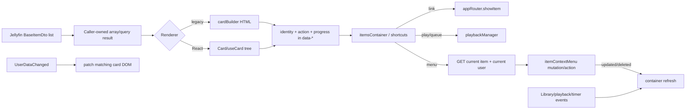

# 07 — Stock cards and item state

## Reference boundary

- **Corpus:** `jellyfin/jellyfin-web` **v10.11.11**, commit **`35c0793ece3adbd247eab290ae1effab851f3d37`**. `[VERIFIED_FROM_SOURCE]` `package.json`, lines 2–5; commit identity from the Phase-1 blob inventory.
- Stock contains two card renderers: the broadly used legacy string/DOM builder and a React `Card` component. Home and Search explicitly use the legacy builder. `[VERIFIED_FROM_SOURCE]` `src/components/cardbuilder/cardBuilder.js`, `getCardsHtml/buildCards`, lines 47–59 and 1207–1244; `src/components/cardbuilder/Card/Card.tsx`, `Card`, lines 9–23; `src/components/homesections/sections/resume.ts`, lines 47–69; `src/apps/stable/features/search/components/SearchResultsRow.tsx`, lines 25–40.

## Data-to-interaction workflow

## Rendering ownership

### Legacy builder

1. The caller owns the DTO array and options. `getCardsHtml` passes them to `buildCardsHtmlInternal`; `setCardData` mutates the **options object** to choose a shape, image width and aspect data from the set's median image ratio. `[VERIFIED_FROM_SOURCE]` `src/components/cardbuilder/cardBuilder.js`, `getCardsHtml/setCardData`, lines 47–59 and 73–131.
2. Each DTO is rendered using the API client selected by its `ServerId`. The builder writes item/server/type/media/collection/path/context/parent identity and playback position into DOM attributes. `[VERIFIED_FROM_SOURCE]` `src/components/cardbuilder/cardBuilder.js`, `buildCardsHtmlInternal`, lines 139–165 and `buildCard`, lines 1090–1139.
3. `buildCards` refuses to write into a container no longer in `document.body`, hides an empty parent, avoids replacing identical HTML via `itemsContainer.cardBuilderHtml`, and then starts lazy image loading. That HTML string is a render memo, not an authoritative item cache. `[VERIFIED_FROM_SOURCE]` `src/components/cardbuilder/cardBuilder.js`, `buildCards`, lines 1207–1244.

### React card

1. `Card` is a pure composition of `useCard`, `CardWrapper`, and `CardBox`; it receives a DTO and options from its parent and owns no remote query. `[VERIFIED_FROM_SOURCE]` `src/components/cardbuilder/Card/Card.tsx`, lines 9–23.
2. `useCard` derives action, shape, image information, CSS and the same interaction attributes; its output is a pair of prop factories. `[VERIFIED_FROM_SOURCE]` `src/components/cardbuilder/Card/useCard.ts`, `useCard`, lines 16–122.
3. Wrapper semantics differ by layout: TV renders a `<button>`, other layouts a `
`. `[VERIFIED_FROM_SOURCE]` `src/components/cardbuilder/Card/CardWrapper.tsx`, `CardWrapper`, lines 5–28.

## Image selection, cache identity and lazy lifecycle

- Both renderers choose among item, series, parent and album Primary/Thumb/Backdrop/Banner/Logo/Disc relationships in a fixed fallback chain. The React chain is explicit in `getCardImageInfo`; the legacy equivalent is `getCardImageUrl`. `[VERIFIED_FROM_SOURCE]` `src/components/cardbuilder/Card/useCardImageUrl.ts`, lines 13–53 and 156–252; `src/components/cardbuilder/cardBuilder.js`, lines 268–406.
- The generated image request includes the selected item id, image type, desired dimensions, quality 96 and the Jellyfin image tag. `[VERIFIED_FROM_SOURCE]` `src/components/cardbuilder/Card/useCardImageUrl.ts`, `useCardImageUrl`, lines 261–290. Exact API shape: `GET /Items/{itemId}/Images/{imageType}?tag=...&fillWidth=...&fillHeight=...&quality=96`. `[INFERRED]` The stock source calls the generated SDK URL builder; the dependency's generated route implementation is outside this snapshot.
- Cards carry URL and optional blurhash in `data-src`/`data-blurhash`; `imageLoader.lazyChildren` assigns an IntersectionObserver with a 50% root margin. `[VERIFIED_FROM_SOURCE]` `src/components/cardbuilder/cardBuilder.js`, `buildCard`, lines 1007–1026; `src/components/lazyLoader/lazyLoaderIntersectionObserver.js`, `LazyLoader/createObserver/lazyChildren`, lines 2–34 and 52–64.
- Entering the viewport creates a preloader `Image`; success writes `backgroundImage`/`src`, removes `data-src`, and animates in. Leaving after load clears the image and restores `data-src`, so a later re-entry can request it again. `[VERIFIED_FROM_SOURCE]` `src/components/images/imageLoader.js`, `fillImage/fillImageElement/emptyImageElement`, lines 72–161.
- The observer made by `lazyChildren` is not returned to the caller, stored on the DOM node, or explicitly disconnected by this path; failed preload images have no `error` handler. `[VERIFIED_FROM_SOURCE]` `src/components/lazyLoader/lazyLoaderIntersectionObserver.js`, lines 24–64; `src/components/images/imageLoader.js`, lines 108–136. `[INFERRED]` Re-entry, remount, or a persistently bad tagged URL can therefore cause another network attempt; browser HTTP caching may satisfy valid repeats.
- `[UNKNOWN]` HTTP cache policy, CDN/proxy behavior, and image endpoint response headers live outside the Web source and cannot be established here.

## Interaction and authoritative readback

| Action | Stock behavior | Evidence |
|---|---|---|
| Open/details | DOM attributes are sufficient; `appRouter.showItem` is called with context/parent. | `[VERIFIED_FROM_SOURCE]` `src/components/shortcuts.js`, `executeAction`, lines 213–243 |
| Play/resume/queue | Builds minimal item identity from the card, reads playback ticks and calls `playbackManager`; no item HTTP read is required. | `[VERIFIED_FROM_SOURCE]` `src/components/shortcuts.js`, `executeAction`, lines 223–279 |
| Context menu | Re-fetches the current item for the current user, then concurrently imports the menu, fetches current user, and optionally requests playlist permission. | `[VERIFIED_FROM_SOURCE]` `src/components/shortcuts.js`, `getItem/showContextMenu`, lines 80–177 |
| Menu mutation | Identify/edit/images/delete and other commands resolve `{updated, deleted}`; the shortcut requests a foreground container refresh. | `[VERIFIED_FROM_SOURCE]` `src/components/itemContextMenu.js`, `executeCommand`, lines 386–539; `src/components/shortcuts.js`, lines 170–175 |
| Mark/favorite | Custom rating/play-state elements own the mutation; server `UserDataChanged` is the reconciliation signal. | `[VERIFIED_FROM_SOURCE]` `src/components/cardbuilder/cardBuilder.js`, `getHoverMenuHtml`, lines 1148–1175; `src/elements/emby-itemscontainer/emby-itemscontainer.js`, lines 145–160 |

Relevant routes corresponding to those client calls are `GET /Users/{userId}/Items/{itemId}`, `GET /Users/Me`, `GET /Playlists/{playlistId}/Users/{userId}`, and mutation-specific Jellyfin routes. `[INFERRED]` The exact call sites are source-verified above; generated SDK/legacy client route bodies are dependency code outside the corpus.

## UserData and collection invalidation

1. Every connected legacy `emby-itemscontainer` attaches shortcut handlers plus `UserDataChanged`, timer, `LibraryChanged`, and `playbackstop` listeners. Detach removes every listener, destroys multi-select/sortable state, clears timers, and nulls rendering callbacks. `[VERIFIED_FROM_SOURCE]` `src/elements/emby-itemscontainer/emby-itemscontainer.js`, `attachedCallback/detachedCallback`, lines 280–338.
2. A user-data notification immediately calls `cardBuilder.onUserDataChanged`; for monitored favorite/played sections it additionally requests a full refresh. `[VERIFIED_FROM_SOURCE]` `src/elements/emby-itemscontainer/emby-itemscontainer.js`, `onUserDataChanged`, lines 145–160.
3. `onUserDataChanged` selects cards by `ItemId` and edits played, unplayed-count, progress and playback-position DOM state in place. `[VERIFIED_FROM_SOURCE]` `src/components/cardbuilder/cardBuilder.js`, `updateUserData/onUserDataChanged`, lines 1269–1359.
4. Stock intentionally omits `.card-withuserdata` for `MusicAlbum`, `MusicArtist`, and `Audio`, so this generic DOM patch does not target those types. `[VERIFIED_FROM_SOURCE]` `src/components/cardbuilder/cardBuilderUtils.ts`, `resolveCardCssClasses`, lines 87–99; React mirror: `src/components/cardbuilder/Card/useCard.ts`, lines 79–93.
5. The React `ItemsContainer` invalidates its supplied React Query key for user-data/timer events, filters LibraryChanged by parent, reloads immediately for foreground playback and after ten seconds for background library changes, and cleans up all subscriptions/timers on unmount. `[VERIFIED_FROM_SOURCE]` `src/elements/emby-itemscontainer/ItemsContainer.tsx`, lines 176–277 and 304–405.
6. The legacy container has equivalent notification behavior but refreshes its caller-supplied `fetchData`; pause defers with `needsRefresh`. `[VERIFIED_FROM_SOURCE]` `src/elements/emby-itemscontainer/emby-itemscontainer.js`, lines 219–260 and 340–396.

## State and cache map

| State | Writer | Readers | Lifetime / invalidation |
|---|---|---|---|
| Full DTO list | Page/section query or controller | card/list builder | Caller-defined; cards do not retain a DTO store. `[VERIFIED_FROM_SOURCE]` `src/components/cardbuilder/cardBuilder.js`, `getCardsHtml`, lines 47–59; `src/components/cardbuilder/Card/Card.tsx`, `Card`, lines 9–23 |
| Rendered card identity | builder | shortcuts, focus restoration, notification patches | DOM lifetime; rebuilt on list refresh. `[VERIFIED_FROM_SOURCE]` `src/components/cardbuilder/cardBuilder.js`, `buildCard`, lines 1098–1139 |
| Render memo | `buildCards` (`cardBuilderHtml`) | same method | replaced/cleared on render; used only to skip equal DOM writes. `[VERIFIED_FROM_SOURCE]` `src/components/cardbuilder/cardBuilder.js`, `buildCards`, lines 1227–1239 |
| UserData projection | initial DTO, then server notification | indicators/actions | patched by ItemId for eligible types; full container refresh for monitored changes. `[VERIFIED_FROM_SOURCE]` `src/components/cardbuilder/cardBuilder.js`, `updateUserData/onUserDataChanged`, lines 1269–1359; `src/elements/emby-itemscontainer/emby-itemscontainer.js`, `onUserDataChanged`, lines 145–160 |
| Image identity | DTO image relationship + tag | browser image request | URL tag is the version key; DOM unload/re-entry governs retries. `[VERIFIED_FROM_SOURCE]` `src/components/cardbuilder/Card/useCardImageUrl.ts`, `useCardImageUrl`, lines 261–290; `src/components/images/imageLoader.js`, `fillImageElement/emptyImageElement`, lines 108–161 |
| React query data | global `queryClient` | React list owners, not `Card` itself | caller key/invalidation. Global defaults set only `networkMode:'always'`. `[VERIFIED_FROM_SOURCE]` `src/utils/query/queryClient.ts`, lines 1–12 |

## Async, stale and failure behavior

- Context-menu setup uses `Promise.all`; playlist-permission 404 is converted to `{CanEdit:false}`, while a failed item/current-user/menu import ultimately falls into a silent no-op catch. `[VERIFIED_FROM_SOURCE]` `src/components/shortcuts.js`, lines 105–177.
- The card's quick play/link path acts from DOM-projected identity and may be older than the server; menu actions deliberately re-fetch the DTO first. `[VERIFIED_FROM_SOURCE]` `src/components/shortcuts.js`, `getItem/executeAction`, lines 80–106 and 213–302.
- `[VERIFIED_FROM_SOURCE]` Neither renderer owns a generation token. Freshness is a responsibility of the parent list/query/container; React rerender uses the supplied DTO, while a legacy refresh replaces the DOM. `src/components/cardbuilder/Card/Card.tsx`, `Card`, lines 9–23; `src/components/cardbuilder/cardBuilder.js`, `getCardsHtml/buildCards`, lines 47–59 and 1207–1244.
- `[INFERRED]` A late parent response can render stale DTOs unless that parent's request layer aborts or rejects obsolete work. `buildCards` only guards against a disposed target, not response order. `[VERIFIED_FROM_SOURCE]` `src/components/cardbuilder/cardBuilder.js`, lines 1207–1239.
- `[VERIFIED_FROM_SOURCE]` Image-load failure has no local fallback/error state in `fillImageElement`; the placeholder remains and the `data-src` remains available for a later observer transition. `src/components/images/imageLoader.js`, lines 108–136.

## Durable comparison points

1. A stock card is a **projection**, not an item authority; the caller/query remains authoritative.
2. Fast actions use DOM-projected identity, while context menus pay for a user-scoped item readback.
3. UserData has a targeted notification patch path, but Music cards are excluded and list membership still requires refresh.
4. Image tags are the cache-generation identity; viewport lifecycle can intentionally unload and later reload an image.
