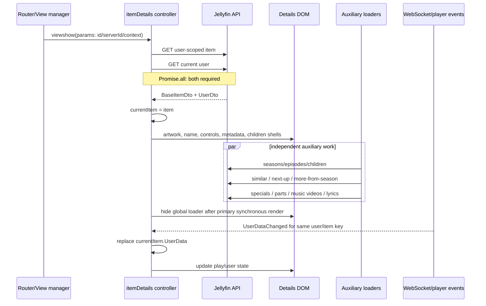

# 08 — Stock Details, seasons and episodes

## Reference boundary

- **Corpus:** `jellyfin/jellyfin-web` **v10.11.11**, commit **`35c0793ece3adbd247eab290ae1effab851f3d37`**. `[VERIFIED_FROM_SOURCE]` `package.json`, lines 2–5; commit identity from the Phase-1 blob inventory.
- Both stable and experimental applications route `details` through the same legacy controller/template. `[VERIFIED_FROM_SOURCE]` `src/apps/stable/routes/legacyRoutes/user.ts`, `LEGACY_USER_ROUTES`, lines 3–10; `src/apps/experimental/routes/legacyRoutes/user.ts`, `LEGACY_USER_ROUTES`, lines 3–10.

## Primary Details workflow

1. On a non-restored `viewshow`, `reload` shows the loader and concurrently resolves the target and current user. A normal id is fetched through `getItem(currentUserId,id)`; alternate parameter types resolve series timers or genre objects. `[VERIFIED_FROM_SOURCE]` `src/controllers/itemDetails/index.js`, `getPromise`, lines 62–80; controller `reload/viewshow`, lines 1921–1937 and 2117–2133.
2. The controller assigns the returned DTO to its closure-scoped `currentItem`, then `reloadFromItem` renders artwork first, main metadata/actions, playback source selection and item-type sections. `[VERIFIED_FROM_SOURCE]` `src/controllers/itemDetails/index.js`, `reload`, lines 1926–1934; `reloadFromItem`, lines 547–599.
3. `renderDetails` starts Similar, More From Season/Artist, channel guide and lyrics work without awaiting them, while `setInitialCollapsibleState` starts children, Next Up, specials, parts and music-video work according to type. `[VERIFIED_FROM_SOURCE]` `src/controllers/itemDetails/index.js`, `renderDetails`, lines 1085–1107; `setInitialCollapsibleState`, lines 812–875.
4. Primary render hides the global loader and focuses the page before those independent requests are necessarily complete. `[VERIFIED_FROM_SOURCE]` `src/controllers/itemDetails/index.js`, `reloadFromItem`, lines 658–666.

## Series → season → episode ownership

`renderChildren` owns the item-type switch:

| Parent DTO | Child read | Sort/render | Evidence |
|---|---|---|---|
| `Series` | `getSeasons(seriesId,{userId,Fields})` | portrait cards | `[VERIFIED_FROM_SOURCE]` `src/controllers/itemDetails/index.js`, `renderChildren`, lines 1354–1378 and 1418–1428 |
| `Season` | `getEpisodes(seriesId,{seasonId,userId,Fields+Overview})` | episode list | `[VERIFIED_FROM_SOURCE]` same symbol, lines 1379–1385 and 1429–1466 |
| `Episode` | its `IsFolder` path can query children; separately, More From Season requests all season episodes and scrolls near the current card | backdrop cards | `[VERIFIED_FROM_SOURCE]` `src/controllers/itemDetails/index.js`, `renderMoreFromSeason`, lines 1145–1187; `renderChildren`, lines 1429–1451 |
| Other folders | `getItems(userId,{ParentId,Fields,SortBy})` | cards/list according to type | `[VERIFIED_FROM_SOURCE]` `src/controllers/itemDetails/index.js`, `renderChildren`, lines 1358–1391 |

The child response is transformed to cards/list HTML and replaces the child container; images are then lazily loaded. There is no persistent child collection in this controller. `[VERIFIED_FROM_SOURCE]` same symbol, lines 1391–1519.

Series Details also requests Next Up and exposes the section only when non-empty. `[VERIFIED_FROM_SOURCE]` `src/controllers/itemDetails/index.js`, `renderNextUp`, lines 778–810. Child headings are derived locally (`Seasons`, `Episodes`, `Tracks`, or `Items`). `[VERIFIED_FROM_SOURCE]` `src/controllers/itemDetails/index.js`, `renderChildren`, lines 1521–1538.

## API route inventory

The source verifies each client call and parameters. Route expansion is marked `INFERRED` where the implementation is in the external `jellyfin-apiclient`/generated SDK dependency rather than this snapshot.

| Purpose | Client call | HTTP route |
|---|---|---|
| Primary item | `getItem(currentUserId,id)` | `GET /Users/{userId}/Items/{itemId}` `[INFERRED]` |
| Seasons | `getSeasons(seriesId,{userId,...})` | `GET /Shows/{seriesId}/Seasons` `[INFERRED]` |
| Episodes / More From Season | `getEpisodes(seriesId,{seasonId,userId,...})` | `GET /Shows/{seriesId}/Episodes` `[INFERRED]` |
| Next Up for series | `getNextUpEpisodes({SeriesId,UserId,...})` | `GET /Shows/NextUp` `[INFERRED]` |
| Generic children / music videos | `getItems(userId,query)` | `GET /Users/{userId}/Items` `[INFERRED]` |
| Similar | `getSimilarItems(itemId,{userId,...})` | `GET /Items/{itemId}/Similar` `[INFERRED]` |
| Additional parts | `getAdditionalVideoParts(userId,itemId)` | `GET /Videos/{itemId}/AdditionalParts?userId=...` `[INFERRED]` |
| Special features | `getSpecialFeatures(userId,itemId)` | `GET /Users/{userId}/Items/{itemId}/SpecialFeatures` `[INFERRED]` |
| Lyrics | explicit legacy AJAX | `GET /Audio/{itemId}/Lyrics` `[VERIFIED_FROM_SOURCE]` `src/controllers/itemDetails/index.js`, `renderLyricsContainer`, lines 1113–1141 |
| Split alternate sources | explicit legacy AJAX | `DELETE /Videos/{itemId}/AlternateSources` `[VERIFIED_FROM_SOURCE]` `src/controllers/itemDetails/index.js`, `splitVersions`, lines 1939–1948 |
| Images | scaled image URL by DTO image id/type/tag | `GET /Items/{itemId}/Images/{imageType}` `[INFERRED]`; call sites `renderBackdrop/logo`, lines 509–544 and 668–682 |

## Owners, readers, writers and cache lifetime

| State | Owner / writer | Readers | Invalidation / cleanup |
|---|---|---|---|
| Primary DTO | Jellyfin response; controller writes `currentItem` | render functions, playback/actions | Menu `updated` or timer cancellation calls full `reload`; destroy nulls it. `[VERIFIED_FROM_SOURCE]` `src/controllers/itemDetails/index.js`, `reload`/mutation/lifecycle paths, lines 1931–1934, 2016–2021, 2040–2063 and 2143–2147 |
| User DTO | current request only | permissions/action visibility/sections | fetched with each full reload; not retained as a controller field. `[VERIFIED_FROM_SOURCE]` `src/controllers/itemDetails/index.js`, `reload/reloadFromItem`, lines 1931–1934 and 547–599 |
| Child/auxiliary DTOs | each independent promise | its target DOM section | response replaces section DOM; no common cache or invalidation key. `[VERIFIED_FROM_SOURCE]` `src/controllers/itemDetails/index.js`, auxiliary render methods, lines 778–810, 1145–1187, 1246–1292 and 1354–1519 |
| UserData | initial `currentItem.UserData`; WebSocket can replace it | playback buttons and resume | message must match current user and item data key. `[VERIFIED_FROM_SOURCE]` `src/controllers/itemDetails/index.js`, `onWebSocketMessage`, lines 2074–2089 |
| Playback-source selection | controller instance fields + selects | play options/misc info | refreshed on restored view/player change; fields nulled at destroy. `[VERIFIED_FROM_SOURCE]` `src/controllers/itemDetails/index.js`, playback and lifecycle paths, lines 1952–1966, 2069–2072, 2111–2115, 2122–2127 and 2143–2147 |
| Restored Details view | retained `currentItem` | backdrop/track selections | restored `viewshow` does **not** refetch the item. `[VERIFIED_FROM_SOURCE]` `src/controllers/itemDetails/index.js`, `viewshow`, lines 2117–2130 |

## Mutation and reconciliation

- Play/resume/shuffle/instant mix consume `currentItem`; media-source/audio/subtitle selections are read at click time. `[VERIFIED_FROM_SOURCE]` `src/controllers/itemDetails/index.js`, lines 1952–2006.
- More Commands first reads the currently selected version with the current user, then opens the shared item context menu. Deletion navigates to a parent/home; an `updated` result reloads the Details authority. `[VERIFIED_FROM_SOURCE]` `src/controllers/itemDetails/index.js`, `onMoreCommandsClick`, lines 2040–2066.
- A matching WebSocket `UserDataChanged` mutates only `currentItem.UserData` and reloads play buttons. It does not refresh metadata, image tags, children or auxiliary rows. `[VERIFIED_FROM_SOURCE]` `src/controllers/itemDetails/index.js`, `onWebSocketMessage`, lines 2074–2089.
- View hide removes item shortcuts, API message listener and player-change listener; view destroy clears retained item/media/recording state. `[VERIFIED_FROM_SOURCE]` `src/controllers/itemDetails/index.js`, view lifecycle bindings, lines 2137–2147.

## Async, stale-result and failure behavior

- `[VERIFIED_FROM_SOURCE]` The primary `Promise.all` has a `catch` that only logs; it does not call `loading.hide()`. A failed item or current-user read can therefore leave the global loader active. `src/controllers/itemDetails/index.js`, `reload`, lines 1926–1937.
- `[VERIFIED_FROM_SOURCE]` Most auxiliary requests do not have a local catch and are neither awaited nor canceled by view hide/destroy. Examples in `src/controllers/itemDetails/index.js`: `renderNextUp`, lines 778–810; `renderMoreFromSeason`, lines 1145–1187; `renderSimilarItems`, lines 1246–1292; `renderChildren`, lines 1354–1519. Lyrics is an exception and hides its section on failure, lines 1113–1141.
- `[VERIFIED_FROM_SOURCE]` No request-generation token, active-item equality check, or `AbortSignal` appears in the legacy Details flow. The only retained authority is the latest assignment to `currentItem` at primary resolution. `src/controllers/itemDetails/index.js`, `reload`, lines 1926–1934.
- `[INFERRED]` If two reloads overlap, an older primary result can become `currentItem` after a newer one, and late auxiliary work can write into a still-existing/reused view. Stock cleanup prevents event-listener retention but does not establish latest-generation response ownership.
- `[VERIFIED_FROM_SOURCE]` A restored route uses retained state rather than an authority readback, so server metadata changes made elsewhere are stale until a full reload path runs. `src/controllers/itemDetails/index.js`, `viewshow`, lines 2122–2130.
- `[UNKNOWN]` Request retry, timeout, and transport cancellation defaults belong to the external API clients and are not established by this controller.

## Dedicated Episodes library tab

The shows Episodes tab is a separate legacy list controller, not the Details child list:

1. It owns a mutable query per `${topParentId}-episodes`, restores sort/filter/view preferences, and requests user-scoped recursive `Episode` items. `[VERIFIED_FROM_SOURCE]` `src/controllers/shows/episodes.js`, `getPageData`, lines 14–52.
2. `reloadItems` blocks duplicate pagination while `isLoading`, then replaces list/card HTML, lazy-loads images and persists query settings. `[VERIFIED_FROM_SOURCE]` `src/controllers/shows/episodes.js`, `reloadItems`, lines 69–165.
3. Page, sort, filter and layout operations mutate the shared query and run another full request. `[VERIFIED_FROM_SOURCE]` `src/controllers/shows/episodes.js`, filter/sort/layout handlers, lines 172–245.
4. `[VERIFIED_FROM_SOURCE]` The request has no catch/finally/abort/generation guard; rejection leaves `isLoading=true` and the loader visible. `src/controllers/shows/episodes.js`, `reloadItems`, lines 69–166.

Exact item route: `GET /Users/{userId}/Items?IncludeItemTypes=Episode&Recursive=true&ParentId=...` `[INFERRED]`; the source call and complete query are verified at `src/controllers/shows/episodes.js`, lines 20–40 and 69–76.

## Durable comparison points

1. Stock Details treats the primary DTO as controller-local authority and auxiliary rows as independent DOM projections.
2. A restored view reuses cached controller state; explicit mutation success is the principal metadata reload trigger.
3. Series/season/episode traversal is user-scoped but not a single transaction: each section can settle independently.
4. Cleanup removes subscriptions and retained references, but it does not cancel or generation-gate network work.
