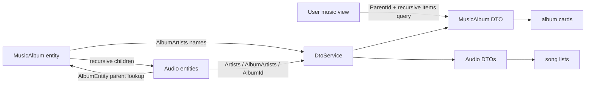
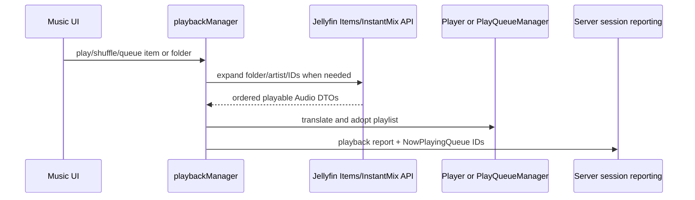

# Stock Music Architecture (Jellyfin 10.11.11)

## Scope and evidence key

This chapter describes stock Jellyfin Web 10.11.11 and Server 10.11.11. It does not describe PTV behavior. Citations use:

- `W@35c0793` — Jellyfin Web 10.11.11, commit `35c0793ece3adbd247eab290ae1effab851f3d37`.
- `S@1fbd873` — Jellyfin Server 10.11.11, commit `1fbd8739292cce610231be93daf43368733edf63`.

## Ownership summary

| Resource | Stock role | Owner and lifecycle | Evidence |
|---|---|---|---|
| Music library contents | `AUTHORITATIVE_OWNER` | Server library/database and user-filtered Items/Artists APIs. Web requests projections scoped by `ParentId`. | `VERIFIED_FROM_SOURCE` — W@35c0793, `src/controllers/music/musicalbums.js`, anonymous controller/getPageData/reloadItems, lines 31-55 and 83-89; `musicartists.js`, anonymous controller load, lines 17-75. |
| Album/track relationships | `AUTHORITATIVE_OWNER` | Server entities and DTO construction. `MusicAlbum` owns recursive `Audio` children; `Audio.AlbumEntity` finds the parent album. | `VERIFIED_FROM_SOURCE` — S@1fbd873, `MediaBrowser.Controller/Entities/Audio/MusicAlbum.cs`, `Tracks`, lines 62-67; `MediaBrowser.Controller/Entities/Audio/Audio.cs`, `AlbumEntity`, lines 57-68. |
| Album list/filter state | `VIEW_OWNER` plus local settings cache | Legacy Web controller keeps a mutable query and persists it under `<topParentId>-musicalbums`. | `VERIFIED_FROM_SOURCE` — W@35c0793, `src/controllers/music/musicalbums.js`, `getPageData`/`getSavedQueryKey`, lines 31-65. |
| Playback queue | `AUTHORITATIVE_OWNER` in active player/PlayQueueManager | Playback manager expands album/folder to playable children, then the active player or local queue manager owns the queue. | `VERIFIED_FROM_SOURCE` — W@35c0793, `src/components/playback/playbackmanager.js`, `getPlaybackPromise`/`getNonItemTypePromise`, lines 1833-1972; `queueAll`, lines 3199-3240. |
| Now Playing report | `DERIVED_OWNER` | Playback manager serializes queue item and playlist IDs into `NowPlayingQueue` for server session reports. | `VERIFIED_FROM_SOURCE` — W@35c0793, `src/components/playback/playbackmanager.js`, `addPlaylistToPlaybackReport`, lines 111-123. |
| Music images | `DERIVED_OWNER` in DTO, `CACHE_OWNER` in browser/server image layers | Server emits item/album/inherited tags; card resolver chooses a tagged source and constructs a sized URL. | `VERIFIED_FROM_SOURCE` — S@1fbd873, `Emby.Server.Implementations/Dto/DtoService.cs`, `AttachBasicFields`/audio block, lines 850-882 and 1010-1022; W@35c0793, `src/components/cardbuilder/Card/useCardImageUrl.ts`, `getCardImageInfo`, lines 156-252. |

## Domain relationships

`MusicAlbum`, `MusicArtist`, and `Audio` are distinct entities. A `MusicAlbum` implements both album-artist and artist contracts, stores arrays of names, and exposes child tracks separately. The first album-artist name is a convenience value, not the child collection. `Audio` separately stores track artists and album artists and resolves its album through the parent tree. `VERIFIED_FROM_SOURCE` — S@1fbd873, `MediaBrowser.Controller/Entities/Audio/MusicAlbum.cs`, class/properties/`AlbumArtist`/`Tracks`, lines 27-67; `MediaBrowser.Controller/Entities/Audio/Audio.cs`, class/properties/`AlbumEntity`, lines 20-68.

The public DTO keeps these concepts distinct: `Artists`, `ArtistItems`, `Album`, `AlbumId`, `AlbumPrimaryImageTag`, `AlbumArtist`, and `AlbumArtists` are separate fields. `VERIFIED_FROM_SOURCE` — S@1fbd873, `MediaBrowser.Model/Dto/BaseItemDto.cs`, properties, lines 395-455.

During DTO construction, stock Server:

1. Copies plain artist names from `IHasArtist`.
2. Resolves `ArtistItems` by name against library artist entities.
3. Copies the first album-artist name to `AlbumArtist`.
4. Resolves `AlbumArtists` by name against library artist entities.
5. For an `Audio` item, resolves `AlbumId` and `AlbumPrimaryImageTag` from its parent album.

`VERIFIED_FROM_SOURCE` — S@1fbd873, `Emby.Server.Implementations/Dto/DtoService.cs`, audio/artist/album-artist DTO attachment, lines 1010-1097.

This means a DTO can contain a plain relationship name while the corresponding `NameGuidPair` array is empty when no artist entity lookup succeeds. Treating `AlbumArtist` and `AlbumArtists` as interchangeable is therefore unsafe. `INFERRED` from S@1fbd873, `DtoService.cs`, lines 1066-1097.

## Discovery and list queries

The Albums tab issues a recursive Items query with `IncludeItemTypes=MusicAlbum`, `ParentId=topParentId`, sorting and requested image fields. Pagination mutates the retained query's `StartIndex`. `VERIFIED_FROM_SOURCE` — W@35c0793, `src/controllers/music/musicalbums.js`, `getPageData`/`reloadItems`, lines 31-55 and 83-108.

The Artists tab chooses between the dedicated Album Artists and Artists APIs, using the same `ParentId` scope. `VERIFIED_FROM_SOURCE` — W@35c0793, `src/controllers/music/musicartists.js`, anonymous controller query/load, lines 17-75.

The Songs tab independently issues a recursive Items query for `Audio`, also scoped by `ParentId`; it does not consume the Albums query result. `VERIFIED_FROM_SOURCE` — W@35c0793, `src/controllers/music/songs.js`, `getPageData`/`reloadItems`, lines 20-59.

The Suggestions tab deliberately fans out into at least three independent calls—latest, recently played, and frequently played—then separately renders favorites. Those calls are siblings rather than one authoritative aggregate. `VERIFIED_FROM_SOURCE` — W@35c0793, `src/controllers/music/musicrecommended.js`, `loadLatest`, `loadRecentlyPlayed`, `loadFrequentlyPlayed`, and `loadSuggestionsTab`, lines 45-79, 82-121, 124-163, and 166-174.

## Album playback and queues

Stock's Albums page "Play all" fetches the top music view and passes it to the playback manager; Shuffle does the same and lets the playback manager expand the folder. It does not build a queue from the currently rendered album-card array. `VERIFIED_FROM_SOURCE` — W@35c0793, `src/controllers/music/musicalbums.js`, `playAll`/`shuffle`, lines 15-28.

For a generic folder whose collection/media type is music/audio, playback expansion asks the server for recursive non-folder children sorted by album, disc, track, and sort name. `VERIFIED_FROM_SOURCE` — W@35c0793, `src/components/playback/playbackmanager.js`, `getNonItemTypePromise`, lines 1934-1972.

For a `MusicArtist`, expansion uses `ArtistIds`, recursive audio filtering, and album/disc/track ordering. `VERIFIED_FROM_SOURCE` — W@35c0793, `src/components/playback/playbackmanager.js`, `getPlaybackPromise`, lines 1846-1858.

Queue and queue-next translate item DTOs for playback and then update either a remote player, a player-managed local playlist, or the shared local `PlayQueueManager`. `VERIFIED_FROM_SOURCE` — W@35c0793, `src/components/playback/playbackmanager.js`, `queue`/`queueAll`, lines 3163-3240.

Instant Mix is a separate server request capped at 200 items and feeds the result into normal playback. `VERIFIED_FROM_SOURCE` — W@35c0793, `src/components/playback/playbackmanager.js`, `instantMix`, lines 4004-4023.

## Metadata and Identify interaction

Album lookup information is assembled from both album state and child tracks: album-artist names are copied, artist provider IDs may come from the resolved artist entity, and `SongInfos` comes from recursive audio children. The lookup name may be replaced by the first nonempty child album name. `VERIFIED_FROM_SOURCE` — S@1fbd873, `MediaBrowser.Controller/Entities/Audio/MusicAlbum.cs`, `GetLookupInfo`, lines 136-163.

Applying an Identify result is a full refresh with `ReplaceAllMetadata=true`, `RemoveOldMetadata=true`, and optional full image replacement. It returns HTTP 204, not an updated album DTO or child list. `VERIFIED_FROM_SOURCE` — S@1fbd873, `Jellyfin.Api/Controllers/ItemLookupController.cs`, `ApplySearchCriteria`, lines 244-280.

The server creates a temporary metadata item, runs providers, and merges it into the existing entity. With remove-old metadata/full replacement, preservation depends on the server merge and locked-field semantics; the response itself carries no proof that all relationship projections are immediately rehydrated. `VERIFIED_FROM_SOURCE` — S@1fbd873, `MediaBrowser.Providers/Manager/MetadataService.cs`, `RefreshWithProviders`, lines 749-862; `ItemLookupController.cs`, lines 267-280.

Stock Web closes the Identify dialog after the Apply promise settles, marks changes only on success, and resolves the caller without doing an authoritative item readback inside the component. The failure branch also closes the dialog. `VERIFIED_FROM_SOURCE` — W@35c0793, `src/components/itemidentifier/itemidentifier.js`, `submitIdentficationResult` and `onDialogClosed`, lines 258-282 and 395-401.

## Invalidation and stale-state behavior

- Legacy music tab controllers use mutable module/controller state and direct promises; the album and song request paths shown above do not supply an abort signal or generation check. `VERIFIED_FROM_SOURCE` — W@35c0793, `musicalbums.js`, lines 31-65 and 83-110; `songs.js`, lines 20-59.
- React-query item records, where used by newer surfaces, are keyed by user and item and become stale after one second. `VERIFIED_FROM_SOURCE` — W@35c0793, `src/hooks/useItem.ts`, `getItemQuery`, lines 20-29.
- Item mutation notifications can invalidate active ItemsContainer queries, but legacy music controllers are not automatically the same query owner. `VERIFIED_FROM_SOURCE` — W@35c0793, `src/elements/emby-itemscontainer/ItemsContainer.tsx`, `invalidateQueries` and event callbacks, lines 176-225.

## Stock non-guarantees important to Music

1. An Identify 204 response does **not** contain an authoritative, relationship-complete `MusicAlbum` DTO. `VERIFIED_FROM_SOURCE` — S@1fbd873, `ItemLookupController.cs`, lines 244-280.
2. `AlbumArtist` (string), `AlbumArtists` (resolved pairs), `Artists`, child tracks, and `AlbumId` are not one field and are not guaranteed to be populated together. `VERIFIED_FROM_SOURCE` — S@1fbd873, `BaseItemDto.cs`, lines 395-455; `DtoService.cs`, lines 1010-1097.
3. A list DTO is shaped by requested fields and image limits; it is not a promise of full Details/playback state. `VERIFIED_FROM_SOURCE` — W@35c0793, `musicalbums.js`, query lines 36-44; S@1fbd873, `DtoService.cs`, field-gated attachment lines 818-882.
4. Multiple Music sections do not share one load transaction, cancellation boundary, or aggregate error result. `VERIFIED_FROM_SOURCE` — W@35c0793, `musicrecommended.js`, lines 45-174.
5. Queue ownership is separate from the album view object's lifecycle. Replacing a displayed DTO does not authoritatively update the active queue. `VERIFIED_FROM_SOURCE` — W@35c0793, `playbackmanager.js`, lines 102-123 and 3163-3240.

## Before changing stock-compatible Music behavior

- Preserve the distinction between album entity, relationship DTO fields, and child query results.
- Do not replace a richer state object with an Identify result or a list projection merely because its item ID matches.
- Keep queue/Now Playing ownership separate from album rendering state.
- Scope all music enumeration by the authoritative user and `ParentId`/relationship ID.
- Treat suggestions as deliberate fan-out; coalescing must preserve section-specific filters and error independence.
- When refreshing artwork, adopt new image tags; a stable item ID alone cannot invalidate the one-year tagged URL cache.

These are modification guardrails derived from the verified ownership boundaries above (`INFERRED`).
