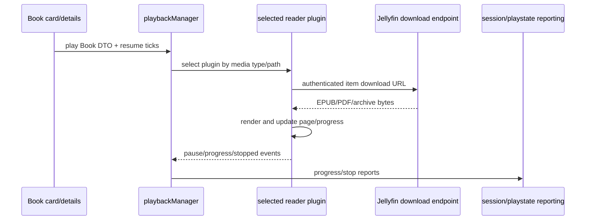

# Stock Reading / Books Architecture (Jellyfin 10.11.11)

## Baseline

- Web: Jellyfin Web 10.11.11 @ `35c0793ece3adbd247eab290ae1effab851f3d37` (`W@35c0793`).
- Server: Jellyfin Server 10.11.11 @ `1fbd8739292cce610231be93daf43368733edf63` (`S@1fbd873`).

## Ownership

The Server `Book` entity is the authoritative library item. It supports played status, resume position, people, series linkage, and user-policy classification as `Book`. `VERIFIED_FROM_SOURCE` — S@1fbd873, `MediaBrowser.Controller/Entities/Book.cs`, `Book` properties/methods, lines 13-38 and 60-85.

The Web reading players are media-player plugins selected by file type. They own transient render/page state while open; playback manager/session reporting observes their media-player interface. `VERIFIED_FROM_SOURCE` — W@35c0793, `src/plugins/bookPlayer/plugin.js`, `BookPlayer`, lines 29-60 and 99-115; `pdfPlayer/plugin.js`, `PdfPlayer`, lines 13-72; `comicsPlayer/plugin.js`, `ComicsPlayer`, lines 17-73.

| Format | Player | Selection evidence | Render source |
|---|---|---|---|
| EPUB | Book Player | `canPlayMediaType=book`; path ends with `epub`. `VERIFIED_FROM_SOURCE` — W@35c0793, `bookPlayer/plugin.js`, lines 390-395. | Authenticated item download URL passed to epub.js. `VERIFIED_FROM_SOURCE` — same file, `setCurrentSrc`, lines 327-349. |
| PDF | PDF Player | Path lowercased and ends with `pdf`. `VERIFIED_FROM_SOURCE` — W@35c0793, `pdfPlayer/plugin.js`, lines 324-329. | Authenticated item download URL passed to PDF.js with eval disabled. `VERIFIED_FROM_SOURCE` — same file, lines 195-223. |
| CBR/CBT/CBZ/CB7 | Comics Player | Explicit extension list. `VERIFIED_FROM_SOURCE` — W@35c0793, `comicsPlayer/plugin.js`, lines 12-15 and `canPlayItem`, lines 365-370. | Authenticated download is extracted client-side; supported image files are sorted and converted to object URLs. `VERIFIED_FROM_SOURCE` — same file, lines 276-310 and 381-419. |

## End-to-end open/read workflow

`INFERRED` integration edge: playback manager registers all `PluginType.MediaPlayer` plugins and treats them through the common interface. `VERIFIED_FROM_SOURCE` — W@35c0793, `src/components/playback/playbackmanager.js`, `initMediaPlayer` registration, lines 3608-3661; player implementations cited above.

## Resume/progress semantics

The Server permits both played state and position-tick resume for `Book`. `VERIFIED_FROM_SOURCE` — S@1fbd873, `Book.cs`, lines 21-29.

Each stock reader maps its internal unit into the playback interface differently:

- EPUB reports a normalized percentage multiplied by 1000 and advertises duration 1000. It restores by converting incoming ticks into a percentage/CFI. `VERIFIED_FROM_SOURCE` — W@35c0793, `bookPlayer/plugin.js`, `currentTime`/`duration`, lines 99-109; `setCurrentSrc`, lines 363-377.
- PDF reports a zero-based page-like progress and uses document page count as duration; incoming ticks are divided by 10000 and offset before loading a page. `VERIFIED_FROM_SOURCE` — W@35c0793, `pdfPlayer/plugin.js`, lines 63-73 and 223-234.
- Comics reports current page and page count and restores `startPositionTicks / 10000`. `VERIFIED_FROM_SOURCE` — W@35c0793, `comicsPlayer/plugin.js`, lines 67-73 and 303-310.

Those units are player contracts, not interchangeable raw Jellyfin media ticks. `INFERRED` from the three verified implementations.

## View state and preferences

The EPUB player owns transient theme and font-size state in the player instance. `VERIFIED_FROM_SOURCE` — W@35c0793, `bookPlayer/plugin.js`, constructor, lines 25-50.

The comics player persists reading direction and pages-per-view per media-source ID through Web user settings; the default is LTR/single page. `VERIFIED_FROM_SOURCE` — W@35c0793, `src/scripts/settings/userSettings.js`, `defaultComicsPlayerSettings` and get/set methods, lines 44-47 and 621-639; `comicsPlayer/plugin.js`, `play`/`stop`, lines 29-60.

`CACHE_OWNER`: those comics preferences are client settings, not authoritative Book metadata. `INFERRED` from W@35c0793 citations above.

## Cleanup and navigation

All three players use fullscreen dialogs and emit `stopped` on `stop`. Their stop methods unbind listeners and close the dialog. EPUB additionally destroys its rendition/table of contents, PDF sets a cancellation flag, and Comics releases archive object URLs. `VERIFIED_FROM_SOURCE` — W@35c0793, `bookPlayer/plugin.js`, `stop`, lines 63-93; `pdfPlayer/plugin.js`, `stop`, lines 37-57; `comicsPlayer/plugin.js`, `stop`, lines 40-61 and `ArchiveSource.release`, lines 415-419.

Document-level keyboard/touch listeners are explicitly bound and removed. `VERIFIED_FROM_SOURCE` — W@35c0793, `bookPlayer/plugin.js`, `bindEvents`/`unbindEvents`, lines 177-231; `pdfPlayer/plugin.js`, lines 132-160; `comicsPlayer/plugin.js`, lines 191-219.

One stock race risk is visible in EPUB cleanup: a listener registered with an inline arrow on `rendition.on('rendered', ...)` is removed using a newly created inline arrow, so listener identity is not demonstrably the same. `RACE_RISK`, `VERIFIED_FROM_SOURCE` — W@35c0793, `bookPlayer/plugin.js`, lines 197-202 and 227-229.

## Images and metadata

Books use the same generic item DTO image fields, card resolver, image editor, remote search, and Apply endpoint as other supported item types. The Server exposes Book remote search through `Items/RemoteSearch/Book`; Apply is the shared elevated endpoint. `VERIFIED_FROM_SOURCE` — S@1fbd873, `Jellyfin.Api/Controllers/ItemLookupController.cs`, `GetBookRemoteSearchResults` and `ApplySearchCriteria`, lines 215-280.

Book lookup carries series name from the explicit relationship or, if absent, the first parent name. `VERIFIED_FROM_SOURCE` — S@1fbd873, `MediaBrowser.Controller/Entities/Book.cs`, `GetLookupInfo`, lines 72-85.

Stock Identify Apply returns 204 with no updated Book DTO. The stock dialog does not itself read the item back; its caller must decide what to refresh. `VERIFIED_FROM_SOURCE` — S@1fbd873, `ItemLookupController.cs`, lines 244-280; W@35c0793, `src/components/itemidentifier/itemidentifier.js`, `submitIdentficationResult`, lines 258-282.

## Failure and non-guarantees

- A supported `Book` media type is not sufficient for playback; player selection also depends on path suffix. `VERIFIED_FROM_SOURCE` — W@35c0793, three `canPlayItem` implementations cited above.
- EPUB's explicit cancellation flag is checked after location generation, PDF's flag is checked after document load, and Comics' shown load chain has no equivalent cancellation token. Cancellation is cooperative and phase-specific. `VERIFIED_FROM_SOURCE` — W@35c0793, `bookPlayer/plugin.js`, lines 334-385; `pdfPlayer/plugin.js`, lines 211-225; `comicsPlayer/plugin.js`, lines 276-310.
- `destroy()` is a no-op for all three player classes; actual retirement depends on `stop()`/dialog events. `VERIFIED_FROM_SOURCE` — W@35c0793, `bookPlayer/plugin.js`, lines 95-97; `pdfPlayer/plugin.js`, lines 59-61; `comicsPlayer/plugin.js`, lines 63-65.
- Identify completion does not guarantee immediate grid-artwork replacement; a caller needs a new DTO/image tag and rerender. `INFERRED` from S@1fbd873 Apply 204 (`ItemLookupController.cs`, lines 244-280) and W@35c0793 tagged card URL construction (`useCardImageUrl.ts`, lines 261-290).

## Before modifying Reading

- Preserve Book `UserData` and resume semantics independently from metadata DTO adoption.
- Preserve the player-specific progress scale.
- Always execute the real `stop()` path on route/dialog teardown.
- Revoke Comics object URLs and avoid duplicate document listeners.
- Treat Identify metadata and artwork as server mutations requiring explicit authoritative readback/invalidation.
- Test EPUB, PDF, and each archive family separately; a shared `Book` type does not prove format support.

These are `INFERRED` guardrails based on the verified boundaries above.
