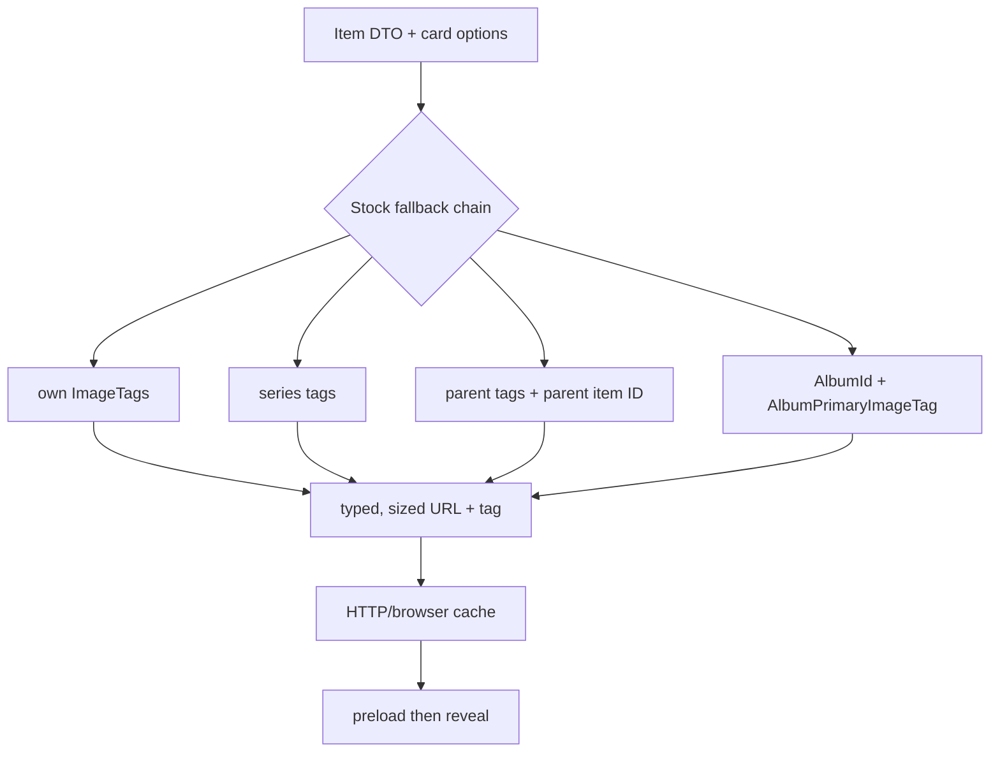
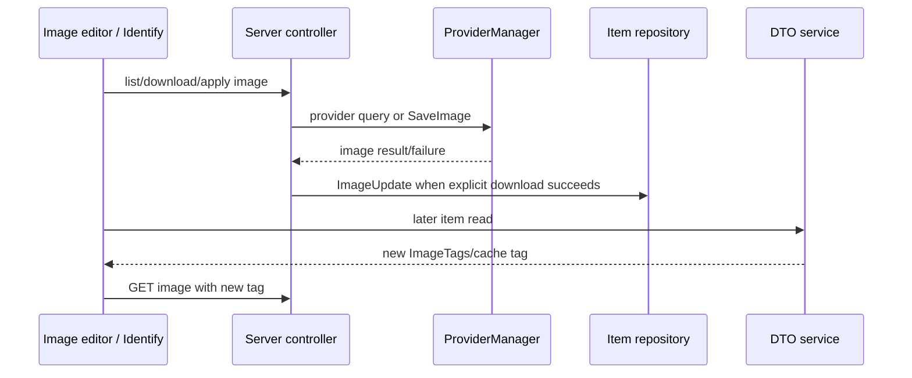

# Stock Images, Artwork, and Cache (Jellyfin 10.11.11)

## Baseline and owners

This chapter uses Web 10.11.11 @ `35c0793ece3adbd247eab290ae1effab851f3d37` and Server 10.11.11 @ `1fbd8739292cce610231be93daf43368733edf63`.

| State | Ownership | Evidence |
|---|---|---|
| Original/local item image | `AUTHORITATIVE_OWNER`: Server item image info/files | `VERIFIED_FROM_SOURCE` — Server `S@1fbd873`, `Jellyfin.Api/Controllers/ImageController.cs`, `GetImageInternal`, lines 1863-1890. |
| Image cache tag | `DERIVED_OWNER`: Server image processor/DTO service | `VERIFIED_FROM_SOURCE` — S@1fbd873, `Emby.Server.Implementations/Dto/DtoService.cs`, `GetImageTags`/`GetTagsAndFillBlurhashes`, lines 578-583 and 782-808. |
| Which image a card uses | `VIEW_OWNER`: Web card resolver | `VERIFIED_FROM_SOURCE` — Web `W@35c0793`, `src/components/cardbuilder/Card/useCardImageUrl.ts`, `getCardImageInfo`, lines 156-252. |
| HTTP/browser image response | `CACHE_OWNER`: browser/proxy under Server headers | `VERIFIED_FROM_SOURCE` — S@1fbd873, `ImageController.cs`, `GetImageInternal`/`GetImageResult`, lines 1872-1879 and 1992-2048. |
| Lazy-load observation | `OBSERVER`: Web intersection/lazy loader | `VERIFIED_FROM_SOURCE` — W@35c0793, `src/components/images/imageLoader.js`, `fillImage`/`lazyChildren`, lines 72-92 and 163-175. |
| Remote provider candidate | `DERIVED_OWNER`: provider manager | `VERIFIED_FROM_SOURCE` — S@1fbd873, `Jellyfin.Api/Controllers/RemoteImageController.cs`, `GetRemoteImages`, lines 62-117. |

## DTO image vocabulary

The item DTO has independent direct and inherited image fields: `ImageTags`, `BackdropImageTags`, parent logo/backdrop/primary IDs and tags, and album primary tag/ID. `VERIFIED_FROM_SOURCE` — S@1fbd873, `MediaBrowser.Model/Dto/BaseItemDto.cs`, image and relationship properties, lines 293-311, 431-455, 481-505, and 548-560.

Server DTO construction emits direct singular-image tags only for enabled image types/limits and separately walks eligible display parents for inherited Logo, Art, Thumb, and Backdrop. `VERIFIED_FROM_SOURCE` — S@1fbd873, `Emby.Server.Implementations/Dto/DtoService.cs`, `AttachBasicFields`, lines 850-882; inherited-image loop, lines 1375-1454.

For `Audio`, `AlbumPrimaryImageTag` is explicitly derived from the parent album. `VERIFIED_FROM_SOURCE` — S@1fbd873, `DtoService.cs`, audio attachment block, lines 1010-1022.

## Card selection order

Stock card selection is conditional on card options and item type. The resolver can choose:

1. preferred Thumb (self, series, parent, then backdrop fallbacks),
2. Banner,
3. Disc,
4. Logo,
5. an explicitly inherited parent Thumb,
6. own Primary,
7. series Primary,
8. alternate `PrimaryImageTag`/item,
9. parent Primary,
10. album Primary,
11. Season Thumb,
12. own Backdrop,
13. series or parent inherited Thumb/Backdrop.

`VERIFIED_FROM_SOURCE` — W@35c0793, `src/components/cardbuilder/Card/useCardImageUrl.ts`, helper functions and `getCardImageInfo`, lines 13-75 and 120-252.

The resolver uses the chosen item ID, type, tag, display dimensions multiplied by device pixel ratio, quality 96, and fill dimensions to construct the URL. `VERIFIED_FROM_SOURCE` — W@35c0793, same file, `useCardImageUrl`, lines 261-290.

## Image delivery and cache identity

The item-image endpoint resolves the item under the authenticated user's ID and returns 404 if it is inaccessible/missing or lacks that image type/index. `VERIFIED_FROM_SOURCE` — S@1fbd873, `Jellyfin.Api/Controllers/ImageController.cs`, `GetItemImage` and `GetImageInternal`, lines 546-595 and 1863-1869.

Supplying a nonempty `tag` gives the response a one-year cache duration. Without a tag, the response is merely public-cacheable. A request carrying `Cache-Control: no-cache` receives no-cache/no-store headers. `VERIFIED_FROM_SOURCE` — S@1fbd873, `ImageController.cs`, lines 1872-1879 and `GetImageResult`, lines 1992-2035.

The Server always processes/locates an output image before applying response cache headers; transformed output is keyed inside the image processor, while the browser-facing strong lifetime is activated by the tag. `VERIFIED_FROM_SOURCE` — S@1fbd873, `ImageController.cs`, `GetImageResult`, lines 1992-2048; image processor contract at `MediaBrowser.Controller/Drawing/IImageProcessor.cs`, cache-tag methods, lines 62-95.

Practical invariant: when artwork changes, clients must receive and use a different authoritative tag (or deliberately bypass cache). Reusing a stale tag can preserve the prior response for up to a year. `INFERRED` from S@1fbd873, `ImageController.cs`, lines 1872-1879 and 2024-2035.

## Lazy-load lifecycle and failures

The legacy Web image loader preloads the URL in a new `Image`, then installs it on the visible element only on `load`. Intersection changes can move the URL back to `data-src`. `VERIFIED_FROM_SOURCE` — W@35c0793, `src/components/images/imageLoader.js`, `fillImage`, `fillImageElement`, and `emptyImageElement`, lines 72-92 and 108-161.

The shown `fillImageElement` path registers a `load` listener but no `error` listener. Therefore a failed preloader does not reach a stock terminal fallback in this module. `VERIFIED_FROM_SOURCE` — W@35c0793, `imageLoader.js`, lines 108-136. This is a stock `RACE_RISK`/non-guarantee; other components may render placeholders before this layer.

Blurhash work is shared through one worker and a hash-to-elements dictionary; decoded pixels are broadcast to all current targets for that hash, then the dictionary entry is deleted. `VERIFIED_FROM_SOURCE` — W@35c0793, `imageLoader.js`, worker listener and `itemBlurhashing`, lines 6-18 and 50-69.

## PTV forced Home row-image lifetime extension

This section records a PTV owner extension; the stock lazy-loader contract above is unchanged.

PTV Home forced image loading retains each `loadPtvImage` consumer handle by row container and image element together with the exact route owner and URL. Cleanup or replacement cancels that consumer before lazy-image teardown. Settlement publishes to the visible image only when the same retained entry, URL and route owner are still current. The shared image manager owns URL-level work and cancels the physical task only after its final consumer retires, so one row's cleanup does not cancel another valid owner. `VERIFIED_FROM_SOURCE` — PTV-WEB, `src/ptv/pages/home/ptvRows.js`, `forcedRowImageLoads/retireForcedRowImageLoads/loadRowImageElementsNow`, lines 68 and 1429-1551; `src/ptv/core/imageManager.ts`, `attachTaskConsumer/cancelTask`, lines 224-274 and 351-396. `VERIFIED_BY_TEST` — `src/ptv/pages/home/ptvRows.lifecycle.test.ts`; `src/ptv/core/imageManager.test.ts`.

## Editing and provider images

The image editor reads remote provider availability and current image infos before rendering standard/backdrop lists. It builds preview URLs from current image tags. `VERIFIED_FROM_SOURCE` — W@35c0793, `src/components/imageeditor/imageeditor.js`, `reloadItem`/`getImageUrl`, lines 56-96.

Remote-image listing is authenticated; remote image download/replacement requires elevation, saves the image, then persists an `ImageUpdate`. `VERIFIED_FROM_SOURCE` — S@1fbd873, `Jellyfin.Api/Controllers/RemoteImageController.cs`, `GetRemoteImages` and `DownloadRemoteImage`, lines 62-117 and 151-170.

During metadata refresh, remote image providers are a distinct phase after metadata providers. A provider is skipped when existing enabled images satisfy the request unless replacement is requested. Provider exceptions are recorded/logged instead of being made atomic with metadata. `VERIFIED_FROM_SOURCE` — S@1fbd873, `MediaBrowser.Providers/Manager/MetadataService.cs`, lines 195-218; `ItemImageProvider.cs`, `RefreshFromProvider`, lines 280-343.

## Non-guarantees and impact boundaries

- Item ID is not image-version identity; cache tag and image type/index are material. `VERIFIED_FROM_SOURCE` — W@35c0793, `useCardImageUrl.ts`, lines 261-290; S@1fbd873, `ImageController.cs`, lines 1872-1879.
- A metadata Apply 204 does not carry new `ImageTags`. `VERIFIED_FROM_SOURCE` — S@1fbd873, `Jellyfin.Api/Controllers/ItemLookupController.cs`, `ApplySearchCriteria`, lines 244-280.
- Direct, album, series, and parent images are distinct owners; replacing one does not logically replace the others. `VERIFIED_FROM_SOURCE` — S@1fbd873, `BaseItemDto.cs`, cited fields; W@35c0793, card fallback lines 171-242.
- List endpoints can omit image types or inherited fields because the query controls fields/image limits. `VERIFIED_FROM_SOURCE` — W@35c0793, `src/controllers/music/musicalbums.js`, query lines 36-44; S@1fbd873, `DtoService.cs`, lines 850-882.
- The legacy lazy loader shown here does not establish a retry budget or known-bad URL registry. `VERIFIED_FROM_SOURCE` — W@35c0793, `imageLoader.js`, lines 72-175.

## Before modifying image behavior

- Identify the authoritative image owner (self, album, series, or parent).
- Carry the image type, owner item ID, and current tag together.
- Treat mutation success and DTO/tag refresh as separate phases.
- Bound error/retry behavior and retire observers on unmount.
- Test browser cache behavior with changed and unchanged tags.
- Verify card, Details, Music, Reading, hero/backdrop, and diagnostics consumers.

These are `INFERRED` guardrails from the verified dependency graph.
