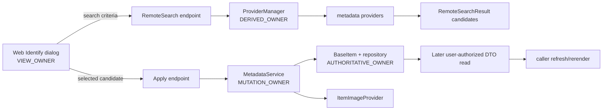

# Stock Metadata and Identify (Jellyfin 10.11.11)

## Baseline

Stock Web 10.11.11 @ `35c0793ece3adbd247eab290ae1effab851f3d37` (`W@35c0793`) and Server 10.11.11 @ `1fbd8739292cce610231be93daf43368733edf63` (`S@1fbd873`).

## Ownership graph

| State | Owner | Evidence |
|---|---|---|
| Search form and selected candidate | `VIEW_OWNER`: singleton stock Identify module | `VERIFIED_FROM_SOURCE` — W@35c0793, `src/components/itemidentifier/itemidentifier.js`, module state and search, lines 28-102; selection, lines 146-180. |
| Remote candidate aggregation | `DERIVED_OWNER`: Server ProviderManager | `VERIFIED_FROM_SOURCE` — S@1fbd873, `MediaBrowser.Providers/Manager/ProviderManager.cs`, `GetRemoteSearchResults`, lines 787-875. |
| Persisted item metadata | `AUTHORITATIVE_OWNER`: Server item/repository | `VERIFIED_FROM_SOURCE` — S@1fbd873, `MediaBrowser.Providers/Manager/MetadataService.cs`, `RefreshMetadata`/`SaveInternal`, lines 89-255. |
| Explicit manual edit | `MUTATION_OWNER`: ItemUpdateController | `VERIFIED_FROM_SOURCE` — S@1fbd873, `Jellyfin.Api/Controllers/ItemUpdateController.cs`, `UpdateItem`, lines 72-120 and private update lines 236-431. |
| Images during Identify | distinct mutation phase in metadata service | `VERIFIED_FROM_SOURCE` — S@1fbd873, `MetadataService.cs`, lines 112-143 and 195-218. |

## Search

The Web builds `SearchInfo` from name/year/provider IDs, includes the current item ID when available, and POSTs to the item-type-specific `Items/RemoteSearch/{type}` endpoint. `VERIFIED_FROM_SOURCE` — W@35c0793, `itemidentifier.js`, `searchForIdentificationResults`, lines 40-102.

The Server has type-specific search endpoints (including MusicAlbum and Book) that delegate to `ProviderManager.GetRemoteSearchResults`. `VERIFIED_FROM_SOURCE` — S@1fbd873, `Jellyfin.Api/Controllers/ItemLookupController.cs`, MusicAlbum/Book actions, lines 180-195 and 215-230.

ProviderManager selects providers using the reference item's library options (or a dummy item when no reference exists), applies optional provider-name filtering and default language/country, invokes providers sequentially, and merges candidates that share any provider ID. `VERIFIED_FROM_SOURCE` — S@1fbd873, `ProviderManager.cs`, `GetRemoteSearchResults`, lines 787-875.

`RemoteSearchResult` is a candidate description—not a full `BaseItemDto`. It contains name, provider IDs, date/year/index data, image URL, provider name, overview, and nested music artist candidates. It has no `UserData`, media sources, children, image-tag dictionary, or queue state. `VERIFIED_FROM_SOURCE` — S@1fbd873, `MediaBrowser.Model/Providers/RemoteSearchResult.cs`, class, lines 10-53.

## Apply

The Web sends the selected `RemoteSearchResult` and `ReplaceAllImages` flag to `Items/RemoteSearch/Apply/{itemId}`. `VERIFIED_FROM_SOURCE` — W@35c0793, `itemidentifier.js`, `submitIdentficationResult`, lines 258-272.

The Server resolves the item in the authenticated user's context, requires elevation, replaces provider IDs immediately, then runs a full metadata and image refresh with `ReplaceAllMetadata`, `RemoveOldMetadata`, and optional image replacement. `VERIFIED_FROM_SOURCE` — S@1fbd873, `ItemLookupController.cs`, `ApplySearchCriteria`, lines 244-278.

The HTTP contract is 204 No Content. It does not return a DTO, update generation, image result, or relationship-completeness marker. `VERIFIED_FROM_SOURCE` — S@1fbd873, same method, lines 246-280.

Inside MetadataService, stock processing is ordered:

1. validate/remove images as directed;
2. create a metadata result around the existing item;
3. obtain lookup info and apply candidate name/year/provider IDs;
4. run metadata providers into a temporary item;
5. merge provider output into the item;
6. run remote image providers as a separate phase;
7. save when changed/full replacement requires it;
8. run the type-specific post-refresh hook.

`VERIFIED_FROM_SOURCE` — S@1fbd873, `MetadataService.cs`, `RefreshMetadata`, lines 89-222; `RefreshWithProviders`, lines 720-871.

Search-result application itself maps only provider IDs, name, and year for normal items (series provider IDs for Episode/Season). Nested candidate overview/artists are not directly copied there; providers must produce authoritative metadata. `VERIFIED_FROM_SOURCE` — S@1fbd873, `MetadataService.cs`, `ApplySearchResult`, lines 257-276.

## Full replacement and field preservation

Remote-provider output is first built on a new temporary item with a small seed of identity/path/index/language fields. The merge into the existing item uses locked fields and a replace decision driven by refresh mode/`ReplaceAllMetadata`. `VERIFIED_FROM_SOURCE` — S@1fbd873, `MetadataService.cs`, `RefreshWithProviders`, lines 749-758 and 831-862.

Consequently, an Apply operation is not an atomic "patch only the selected fields" contract. It is a provider-driven full refresh whose exact relationship fields depend on item type, provider output, locked fields, and server merge behavior. `INFERRED` from S@1fbd873, `ItemLookupController.cs`, lines 265-278 and `MetadataService.cs`, lines 749-862.

Manual `POST Items/{itemId}` is a different mutation. It assigns many DTO fields directly, propagates selected rating/tag changes to album/series children, separately maps `AlbumArtists` and `ArtistItems`, calls `OnMetadataChanged`, and persists a metadata edit. `VERIFIED_FROM_SOURCE` — S@1fbd873, `ItemUpdateController.cs`, lines 72-120 and 236-431.

Do not conflate manual edit with Identify Apply: they have different payloads, merge semantics, and refresh side effects. `INFERRED` from the verified controller methods above.

## Web completion semantics

On successful Apply, stock Web marks `hasChanges`, hides the global loader, and closes the dialog. On rejected Apply, it also hides the loader and closes, but does not mark changes. The close handler resolves on change and rejects otherwise. `VERIFIED_FROM_SOURCE` — W@35c0793, `itemidentifier.js`, lines 258-282 and 395-401.

The component itself performs no authoritative item readback and has no cache invalidation in the success path. `VERIFIED_FROM_SOURCE` — W@35c0793, `itemidentifier.js`, lines 258-282. Any readback/rerender belongs to the caller.

The module stores `currentItem`, type, server, promise callbacks, change flag, and selected result at module scope. Concurrent dialogs would share that state; stock source does not include an operation/generation token here. `RACE_RISK`, `VERIFIED_FROM_SOURCE` — W@35c0793, `itemidentifier.js`, lines 28-38 and exported `show`, lines 471-488.

## Failure and partial-result semantics

Metadata-provider and image-provider success are tracked separately inside the service. `DateLastRefreshed` advances only when both phases report refreshed; the overall endpoint nevertheless has no structured partial-success response. `VERIFIED_FROM_SOURCE` — S@1fbd873, `MetadataService.cs`, lines 188-218; `ItemLookupController.cs`, lines 244-280.

Remote image provider exceptions are caught and stored/logged within image refresh. `VERIFIED_FROM_SOURCE` — S@1fbd873, `MediaBrowser.Providers/Manager/ItemImageProvider.cs`, lines 280-343. Whether an exception propagates to the Apply HTTP request depends on its layer; the 204 contract does not encode per-suboperation outcomes. `INFERRED`.

Stock Web's search call has a success handler but no rejection handler in the shown chain; a rejected search can leave the global loader dependent on outside handling. `VERIFIED_FROM_SOURCE` — W@35c0793, `itemidentifier.js`, lines 88-102.

## Explicit stock non-guarantees

1. A `RemoteSearchResult` is not safe to adopt as an item DTO. `VERIFIED_FROM_SOURCE` — S@1fbd873, `RemoteSearchResult.cs`, lines 10-53 compared with `BaseItemDto.cs`, relationship/image/user fields lines 285-499.
2. HTTP 204 means the refresh call completed; it does not prove a subsequent DTO is immediately relationship-complete or that every optional image provider succeeded. `VERIFIED_FROM_SOURCE` — S@1fbd873, `ItemLookupController.cs`, lines 244-280; `MetadataService.cs`, lines 188-218.
3. Metadata and artwork are separate suboperations without a structured HTTP partial-success body. Same evidence.
4. Apply does not return new image tags, child collections, or `UserData`. `VERIFIED_FROM_SOURCE` — S@1fbd873, Apply signature/result lines 248-280.
5. Stock Web does not guard overlapping Identify operations with an item/route generation. `VERIFIED_FROM_SOURCE` — W@35c0793, module globals/show lines 28-38 and 471-488.

## Before modifying Identify

- Keep candidate, mutation acknowledgment, and authoritative item DTO as three separate types/states.
- Preserve relationships, children, media sources, and `UserData` unless a user-scoped authoritative read proves replacement.
- Treat metadata and image outcomes separately and expose partial completion honestly.
- Establish explicit cancellation/operation ownership for overlapping dialogs and route teardown.
- Refresh the mutated item and its image tags without treating a list projection as a full DTO.
- Test locked fields, missing providers, provider partial failures, image replacement on/off, and permission loss.

These are `INFERRED` guardrails from the source-proven workflow.

## PTV overlay — Reading identity reassessment before manual save

The stock RemoteSearch Apply contract above is distinct from PTV's administrator Reading Identify path. PTV search returns source-labeled identity evidence and a bounded signed candidate context. A provider score or exact ID is advisory and cannot erase contradictory ComicInfo, filename or folder evidence. ComicInfo `Volume` is an explicit series-run label when available; issue publication year is not automatically a run year. Unknown provider run provenance remains unknown. The shared Metadata Manager/Metadata Quality review binds separate conflict and unverified acknowledgments to the exact administrator, server, item, candidate, search generation, archive revision and displayed assessment digest. A new selection or changed evidence retires the prior review. `VERIFIED_FROM_SOURCE` for the Reading lineage's assessor, candidate context, Web adapter and shared Identify controller; integrated tests are a separate gate.

Immediately before the existing manual `POST /Items/{id}` update, the Web checks the current form/item and calls administrator-only `POST /Ptv/v1/reading/metadata/reassess`. The Plugin validates the process-local signed context (maximum 15 minutes), resolves the current item/path and inspects fresh archive evidence without using the Reading search cache or refetching the provider. Missing route/context, denied or contradictory identity, stale or changed assessment, malformed response and transport failure block `updateItem`; changed evidence returns to review with acknowledgments cleared. A typed `Unverified` result may proceed only after its explicit acknowledgment. The guard does not alter the existing full supported metadata patch, locked fields, image phase or authoritative readback. It cannot make archive inspection and Jellyfin's later write atomic, and HTTP success does not prove all images, relationships or caches have converged. Stock Identify and explicit recursive stock Refresh writers are outside this PTV guard.

**Closed PTV dispatch bypass:** the earlier nonrecursive Book Scan path with a saved Reading provider ID performed exact-provider search and a PTV manual metadata save without passing through this guarded Identify path. Stage 3 now rejects that operation before search or mutation and gives an administrator-facing route to Identify. It does not treat the stored provider ID as fresh identity proof, invoke reassessment invisibly, or convert the request into stock Scan. Explicit recursive Scan and ordinary Jellyfin refresh are unchanged stock operations outside this guard; this preflight is not a universal constraint on every server metadata writer. `VERIFIED_FROM_SOURCE` — `useAdminMetadataManager.refreshItem`; `VERIFIED_BY_TEST` only after the integrated regression suite passes.
