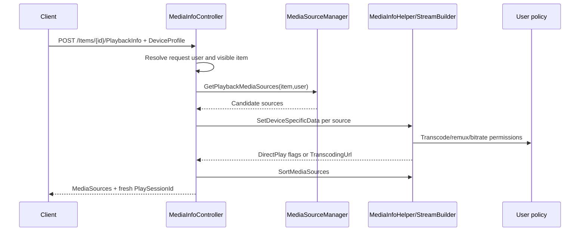
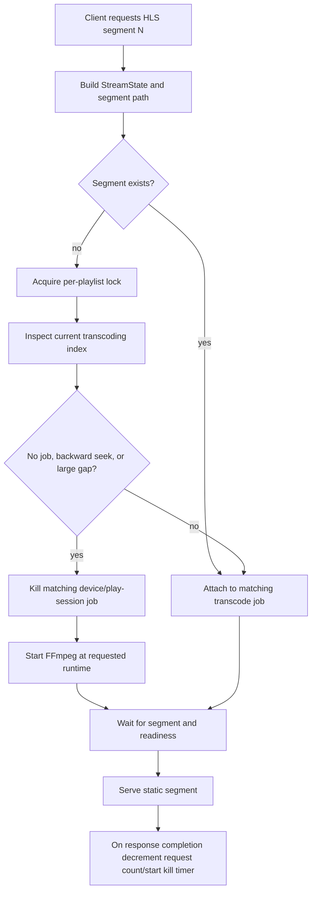

# Stock Jellyfin playback, sessions, and transcoding

## Scope and evidence convention

This chapter maps pristine Jellyfin Server `10.11.11` at official commit `1fbd8739292cce610231be93daf43368733edf63`. `VERIFIED_FROM_SOURCE` is direct implementation evidence, `INFERRED` is a bounded consequence of cited code, and `UNKNOWN` is not established by this server-only pass. Every claim cites the evidence ledger.

## Ownership map

| Concern | Stock owner | Responsibility | Evidence |
|---|---|---|---|
| Playback negotiation | `MediaInfoController` + `MediaInfoHelper` + `StreamBuilder` | Discover media sources and evaluate the requested device profile, stream selections, bitrate, user policy, and enabled play modes. | `VERIFIED_FROM_SOURCE` [S14-01] [S14-02] |
| Direct file/progressive delivery | `VideosController`, `AudioController`, streaming helpers | Serve original/static media or progressive remux/transcode routes selected by the negotiated URL. | `VERIFIED_FROM_SOURCE` [S14-03] |
| HLS playlists/segments | `DynamicHlsController` + `DynamicHlsPlaylistGenerator` | Build playlists, map segment requests to an output path/job, start/restart FFmpeg, and wait for ready segments. | `VERIFIED_FROM_SOURCE` [S14-04] [S14-05] |
| FFmpeg lifecycle | `TranscodeManager` | Start, track, ping, throttle, clean, report, and terminate transcoding jobs keyed by path/play session/device. | `VERIFIED_FROM_SOURCE` [S14-06] |
| Client playback reporting | `PlaystateController` + `SessionManager` | Accept start/progress/ping/stop, maintain session state/queue, persist user progress, publish events, and stop jobs. | `VERIFIED_FROM_SOURCE` [S14-07] [S14-08] |
| Remote control | `SessionController` + `SessionManager` | Validate control rights, expand folders/mixes/shuffle/next episodes, and send commands to a session controller. | `VERIFIED_FROM_SOURCE` [S14-09] |
| Autoplay/Next Up | User configuration + TV manager | Store the next-episode preference; remote Play may expand an episode queue; `NextUp` provides a separate user-aware recommendation query. | `VERIFIED_FROM_SOURCE` [S14-10] [S14-11] |

## Playback negotiation

`GET /Items/{itemId}/PlaybackInfo` resolves the request user, performs a user-aware item lookup, discovers playable media sources, and returns an error when no compatible source exists. A successful source discovery creates a fresh random `PlaySessionId`. `VERIFIED_FROM_SOURCE` [S14-01] [S14-12]

`POST /Items/{itemId}/PlaybackInfo` is the device-specific negotiation path. Body and obsolete query parameters are merged with query precedence; direct play, direct stream, transcoding, video stream copy, and audio stream copy default to enabled. The device profile comes from the body or the capabilities recorded for the request device. `VERIFIED_FROM_SOURCE` [S14-01]

For each source, `MediaInfoHelper.SetDeviceSpecificData` builds `MediaOptions` from the profile, item, device, selected source/streams, max channels, and copy controls; resolves the user; clears capabilities disabled by the request; applies user transcoding/remux permissions and the effective bitrate; and asks `StreamBuilder` for the optimal audio or video stream. `VERIFIED_FROM_SOURCE` [S14-02]

Stock 10.11.11 explicitly sets `MediaOptions.EnableDirectStream = false` unless `ForceDirectStream` is set, with a source comment that direct-stream HTTP streaming is broken. It still exposes `SupportsDirectStream` in a compatibility-oriented way and can generate a transcoding URL when direct play is unavailable. `VERIFIED_FROM_SOURCE` [S14-02]

If a source is remote and the user has `ForceRemoteSourceTranscoding`, direct play and direct stream are disabled and the generated URL disables both stream-copy options. Otherwise, a non-direct-play source that can transcode or direct-stream receives a `PlayMethod.Transcode` URL; burn-in and stream-copy flags are appended as needed. `VERIFIED_FROM_SOURCE` [S14-02]

Sources are sorted by direct playable file first, then direct play/direct stream, then file protocol, then whether bitrate fits the requested maximum, preserving original order as the final tie-break. `VERIFIED_FROM_SOURCE` [S14-13]

### Negotiation workflow

The response is capability negotiation, not a reservation of CPU, bandwidth, a decoder, or an FFmpeg process. `INFERRED` [S14-01] [S14-02] [S14-12]

## Delivery paths

The stock route families include `/Videos/{itemId}/stream[.{container}]` and `/Audio/{itemId}/stream[.{container}]`. Their parameters carry static/original mode, media source, device, `PlaySessionId`, start position, codecs, bitrates, stream indexes, subtitle method, and stream-copy controls. `VERIFIED_FROM_SOURCE` [S14-03]

HLS exposes video master and variant playlists and segment routes such as `/Videos/{itemId}/master.m3u8`, `/Videos/{itemId}/main.m3u8`, and `/Videos/{itemId}/hls1/{playlistId}/{segmentId}.{container}`. `VERIFIED_FROM_SOURCE` [S14-04]

The dynamic VOD playlist uses metadata keyframes for remuxed video when available; otherwise it computes equal-length segments. It emits fMP4 initialization mapping when appropriate and carries runtime/actual-segment-length data on segment URLs. `VERIFIED_FROM_SOURCE` [S14-05]

## HLS and FFmpeg lifecycle

On a segment miss, the controller locks by playlist output path, inspects the current segment index, and starts/restarts transcoding when no current index exists, the requested index is behind it, or the gap is too large. A restart kills matching jobs for the device/play session, changes start time to the requested runtime, and starts FFmpeg. `VERIFIED_FROM_SOURCE` [S14-14]

An existing job is reused and unpaused when no restart is needed. A segment is considered ready after the job exits or the next segment exists; the request otherwise polls every 100 ms until readiness, job exit, or cancellation. `VERIFIED_FROM_SOURCE` [S14-14] [S14-15]

`TranscodeManager.StartFfMpeg` verifies video-transcoding permission before launching an encoding job, creates a hidden FFmpeg process with redirected stderr/stdin, writes source/command information to a transcode log, starts the process, and waits in 100 ms intervals for the target output path or process exit. A nonzero early exit raises `FfmpegException`. `VERIFIED_FROM_SOURCE` [S14-06]

Each active job stores its output path, process, initial active request count, device ID, cancellation source, job ID, `PlaySessionId`, live stream ID, and media source under a lock. Segment/progressive request completion decrements the active request count and starts a kill timer when it reaches zero. HLS jobs are also pinged from playback progress by `PlaySessionId`. `VERIFIED_FROM_SOURCE` [S14-16]

Non-progressive jobs use a 60-second ping timeout; progressive jobs use 10 seconds with different check-in behavior. Kill removes the job under lock, cancels its token, stops the process, optionally deletes partial outputs, and optionally closes a live stream. `VERIFIED_FROM_SOURCE` [S14-17]

Transcode progress updates both the job and session-level `TranscodingInfo`, including codecs, container, rate, dimensions, stream-copy booleans, hardware acceleration type, and transcode reasons. `VERIFIED_FROM_SOURCE` [S14-18]

## Playback reporting and session state

Clients report:

| Endpoint | Server action | Evidence |
|---|---|---|
| `POST /Sessions/Playing` | Validate play method/derive session, update now-playing state, persist playback start, publish events, and start automatic progress. | `VERIFIED_FROM_SOURCE` [S14-07] [S14-19] |
| `POST /Sessions/Playing/Progress` | Update session/player state and queue; persist real client check-ins; publish progress; ping matching transcode job. | `VERIFIED_FROM_SOURCE` [S14-07] [S14-20] [S14-16] |
| `POST /Sessions/Playing/Ping` | Ping FFmpeg job by `PlaySessionId`. | `VERIFIED_FROM_SOURCE` [S14-07] |
| `POST /Sessions/Playing/Stopped` | Kill matching jobs, clear now-playing state, persist final progress/completion, close live stream, publish stop events. | `VERIFIED_FROM_SOURCE` [S14-07] [S14-21] |

The session adopts client-reported pause state, position, media/live-source IDs, seek/mute/volume, audio/subtitle indexes, play method, repeat/order, playlist item, and nonempty queue. When the queue changes, the server resolves full queue DTOs from the submitted IDs. `VERIFIED_FROM_SOURCE` [S14-22]

Progress for an unknown session returns without an error. Automated progress updates session state/events but does not persist user-data progress; actual client check-ins do. `VERIFIED_FROM_SOURCE` [S14-20]

On stop, negative position is rejected, the automatic progress timer stops, a missing media-source ID is normalized to the item ID, a supplied queue replaces session queue state, user completion is calculated, a live source may close, and stop events are emitted. `VERIFIED_FROM_SOURCE` [S14-21]

`INFERRED`: the session display is an eventually updated model of client reports, not telemetry sampled directly from the decoder. Missing/delayed/duplicated client reports can make it stale even while the HTTP media transfer continues. [S14-07] [S14-20] [S14-22]

## Remote control, queue, and autoplay

`POST /Sessions/{sessionId}/Playing` constructs a `PlayRequest`; `POST /Sessions/{sessionId}/Playing/{command}` constructs a play-state request. The server resolves the controlling session and calls `AssertCanControl` before forwarding commands. `VERIFIED_FROM_SOURCE` [S14-09]

`SessionManager.SendPlayCommand` expands instant mixes and folders into playable items, performs shuffle server-side, checks play access, and emits a WebSocket `Play` message. When the target user has next-episode autoplay enabled and exactly one episode is requested, it expands the command to that episode and subsequent nonvirtual episodes. `VERIFIED_FROM_SOURCE` [S14-23]

The user's `EnableNextEpisodeAutoPlay`, remember-audio, and remember-subtitle defaults are true. The independent `/Shows/NextUp` endpoint resolves the request user and returns a user-aware DTO query; it is a recommendation/list contract, not the same operation as remote queue expansion. `VERIFIED_FROM_SOURCE` [S14-10] [S14-11]

`UNKNOWN`: stock server source alone does not establish how every local client implements end-of-item autoplay, recovery after renderer failure, or queue persistence across client process death. [S14-10] [S14-23]

## Failure and race behavior

| Scenario | Stock behavior / guarantee boundary | Evidence |
|---|---|---|
| No media source | PlaybackInfo returns `NoCompatibleStream`. | `VERIFIED_FROM_SOURCE` [S14-12] |
| Profile/flags permit direct play | Source is marked direct-play compatible; runtime delivery success is not reserved. | `VERIFIED_FROM_SOURCE` / `INFERRED` [S14-02] |
| HTTP direct stream requested | Stock disables it unless forced; a transcode URL can still represent remux/stream-copy behavior. | `VERIFIED_FROM_SOURCE` [S14-02] |
| FFmpeg cannot start/nonzero early exit | Startup throws; failed job is removed and session transcode info cleared. | `VERIFIED_FROM_SOURCE` [S14-06] [S14-16] |
| HLS seek backward or far forward | The controller can kill/restart the transcode at a new start time. | `VERIFIED_FROM_SOURCE` [S14-14] |
| Segment is slow | Segment handler has a cancellation-bound 100 ms poll loop, not a fixed completion SLA. | `VERIFIED_FROM_SOURCE` [S14-15] |
| Client stops but omits `PlaySessionId` | Stop reporting does not use the explicit matching-job kill branch; job timeout/other lifecycle may still stop it. | `VERIFIED_FROM_SOURCE` / `INFERRED` [S14-07] [S14-17] |
| Request disconnects while FFmpeg output is pending | Cancellation can break polling/start waits; exact reverse-proxy/client timeout behavior is `UNKNOWN`. | `VERIFIED_FROM_SOURCE` / `UNKNOWN` [S14-06] [S14-15] |
| Playback progress reaches a missing session | Server silently returns. | `VERIFIED_FROM_SOURCE` [S14-20] |
| Remote control has no live WebSocket controller | The HTTP command can complete after server dispatch logic while actual client execution remains outside its guarantee. | `INFERRED` [S14-09] [S14-23] |

## Practical invariants

- Keep one logical `PlaySessionId` consistent across negotiated URL, HLS/progressive requests, progress/ping, and stop if the client wants deterministic job association. `INFERRED` [S14-01] [S14-07] [S14-16]
- Select playback from the returned device-specific media source flags/URL; do not derive direct-play eligibility from container/codec labels alone. `VERIFIED_FROM_SOURCE` [S14-02]
- Treat `204` from progress/ping/stop as server handling of the report, not proof that a renderer displayed a frame or that every background cleanup completed. `INFERRED` [S14-07] [S14-21]
- Report a final stop even after playback failure where possible so the session and FFmpeg lifecycle can converge. `INFERRED` [S14-07] [S14-21]
- Track queue/Now Playing state separately from sparse item metadata projections; session state comes from report DTOs and can be replaced independently. `VERIFIED_FROM_SOURCE` [S14-22]

## Evidence ledger

All entries: repository `jellyfin-server-stock-10.11.11`, version `10.11.11`, commit `1fbd8739292cce610231be93daf43368733edf63`.

| Ref | File | Symbol | Practical lines |
|---|---|---|---:|
| S14-01 | `Jellyfin.Api/Controllers/MediaInfoController.cs` | playback-info GET/POST and live-source actions | 64-248, 251-319 |
| S14-02 | `Jellyfin.Api/Helpers/MediaInfoHelper.cs` | `SetDeviceSpecificData` | 170-347 |
| S14-03 | `Jellyfin.Api/Controllers/VideosController.cs`; `Jellyfin.Api/Controllers/AudioController.cs` | stream route actions | 312-557; 89-160, 256-260 |
| S14-04 | `Jellyfin.Api/Controllers/DynamicHlsController.cs` | master, variant, and segment routes | 408-430, 755-780, 1102-1125 |
| S14-05 | `src/Jellyfin.MediaEncoding.Hls/Playlist/DynamicHlsPlaylistGenerator.cs` | `CreateMainPlaylist` | 34-104 |
| S14-06 | `MediaBrowser.MediaEncoding/Transcoding/TranscodeManager.cs` | `StartFfMpeg` | 371-539 |
| S14-07 | `Jellyfin.Api/Controllers/PlaystateController.cs` | playback report endpoints | 193-257 |
| S14-08 | `Emby.Server.Implementations/Session/SessionManager.cs` | playback state/progress/stop implementation | 420-480, 746-935, 1012-1113 |
| S14-09 | `Jellyfin.Api/Controllers/SessionController.cs` | sessions and remote-control endpoints | 52-200 |
| S14-10 | `MediaBrowser.Model/Configuration/UserConfiguration.cs` | playback preference defaults/properties | 11-71 |
| S14-11 | `Jellyfin.Api/Controllers/TvShowsController.cs` | `GetNextUp` | 76-125 |
| S14-12 | `Jellyfin.Api/Helpers/MediaInfoHelper.cs` | `GetPlaybackInfo` | 87-145 |
| S14-13 | `Jellyfin.Api/Helpers/MediaInfoHelper.cs` | `SortMediaSources` | 349-396 |
| S14-14 | `Jellyfin.Api/Controllers/DynamicHlsController.cs` | `GetDynamicSegment` | 1448-1567 |
| S14-15 | `Jellyfin.Api/Controllers/DynamicHlsController.cs` | `GetSegmentResult` | 1945-2036 |
| S14-16 | `MediaBrowser.MediaEncoding/Transcoding/TranscodeManager.cs` | active job, request count, playback ping | 576-715 |
| S14-17 | `MediaBrowser.MediaEncoding/Transcoding/TranscodeManager.cs` | `PingTranscodingJob`, timer, kill | 118-245 |
| S14-18 | `MediaBrowser.MediaEncoding/Transcoding/TranscodeManager.cs` | `ReportTranscodingProgress` | 323-367 |
| S14-19 | `Emby.Server.Implementations/Session/SessionManager.cs` | `OnPlaybackStart` | 746-830 |
| S14-20 | `Emby.Server.Implementations/Session/SessionManager.cs` | `OnPlaybackProgress` | 871-935 |
| S14-21 | `Emby.Server.Implementations/Session/SessionManager.cs` | `OnPlaybackStopped` | 1012-1113 |
| S14-22 | `Emby.Server.Implementations/Session/SessionManager.cs` | session player/queue adoption | 420-467 |
| S14-23 | `Emby.Server.Implementations/Session/SessionManager.cs` | `SendPlayCommand` | 1282-1365 |

## Stage 4 Web Up Next and fullscreen input — isolated integration candidate

This PTV/Web change leaves Jellyfin playback negotiation, session reports, user history and resume authority with the stock player/server paths. `[VERIFIED_FROM_SOURCE]` The Up Next dialog now owns input within its visible prompt, guards one Start Now/countdown claim and rejects a queue item that changed while the next DTO was loading. The stock `PlaybackManager` shares a per-playback-generation next-advance claim between prompt clicks and natural media end, preventing both paths from advancing the same episode. `src/components/upnextdialog/upnextdialog.js`; `src/controllers/playback/video/index.js`; `src/components/playback/playbackmanager.js`; `src/components/playback/queueItemIdentity.js`.

`[VERIFIED_FROM_SOURCE]` The PTV video wrapper temporarily exposes native controls during Safari `webkitbeginfullscreen`, then restores its previous controls flag and removes the fullscreen class on exit/release. It does not force PTV chrome over native iOS fullscreen. `src/ptv/modules/playback/index.js`. `[VERIFIED_BY_TEST]` Focused prompt, queue-race, fullscreen and five-transition fixture tests exercise the local client contract. Physical iPad Safari controls after five real episode handoffs and authoritative Jellyfin session/history readback remain `[UNKNOWN]`.

`[VERIFIED_FROM_SOURCE]` The inline PTV OSD now keeps its top/bottom controls inside CSS safe-area offsets and gives visible compact transport buttons and the seek row at least a 44 px touch box. Compact controls wrap instead of extending beyond the viewport; the inline volume cluster is hidden at the narrowest widths. This affects custom inline controls only and does not override native Safari fullscreen. `src/ptv/modules/playback/playback.scss`; `src/controllers/playback/video/index.html`. `[VERIFIED_BY_TEST]` `e2e/tests/player-controls-responsive.spec.ts` asserts synthetic pointer targets, overflow and portrait→landscape safe-area bounds; real device touch, native fullscreen and long autoplay remain open.

Stage 4 review also guards a delayed user-policy lookup after an episode ends: an explicit new playback request retires the older autoplay decision before the new title finishes preparing. A changed queue clears the old Up Next prompt latch so the replacement can be offered; contradictory fetched data on an unchanged queue stays latched to avoid repeat requests. Focused RED/GREEN tests prove these two client races. Authoritative Jellyfin playback/UserData convergence remains a separate hosted gate.
