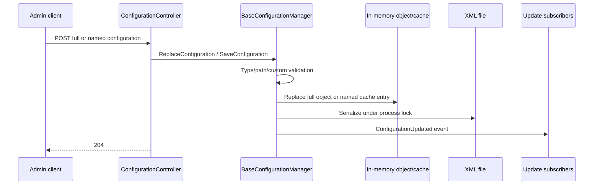
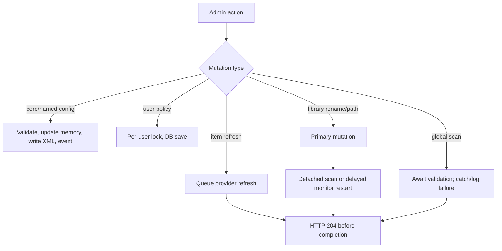
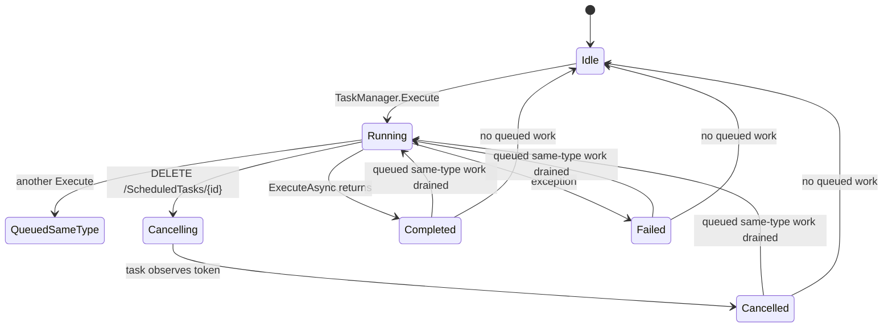

# Stock Jellyfin settings and administrator mutations

## Scope and evidence convention

This chapter covers pristine Jellyfin Server `10.11.11`, official commit `1fbd8739292cce610231be93daf43368733edf63`. `VERIFIED_FROM_SOURCE` is directly implemented, `INFERRED` is a bounded consequence of cited code, and `UNKNOWN` was not established. Every architectural claim is tied to the exact source ledger.

## Ownership map

| Settings family | Read owner | Mutation owner | Persistence/lifecycle | Evidence |
|---|---|---|---|---|
| Core system configuration | `ConfigurationController` / `ServerConfigurationManager` | Elevated `POST /System/Configuration` | Replace the in-memory configuration object, serialize XML under a process lock, then publish update. | `VERIFIED_FROM_SOURCE` [S15-01] [S15-02] |
| Named configuration | `BaseConfigurationManager` | Elevated `POST /System/Configuration/{key}` | Validate type/store, update a concurrent in-memory cache, serialize XML under the same lock, then publish named update. | `VERIFIED_FROM_SOURCE` [S15-01] [S15-03] |
| Branding | `ConfigurationController` | Elevated partial mutation | Read current named object, change three DTO-exposed properties, save named configuration. | `VERIFIED_FROM_SOURCE` [S15-01] |
| User profile/configuration | `UserController` / `UserManager` | User-self or admin checks | Per-user async lock plus EF database update for config/policy. | `VERIFIED_FROM_SOURCE` [S15-04] [S15-05] |
| Virtual folders/paths/options | `LibraryStructureController` / `LibraryManager` | Elevated controller | Immediate filesystem/config mutation plus, for several actions, detached background validation/monitor restart. | `VERIFIED_FROM_SOURCE` [S15-06] |
| Whole-library scan | `LibraryController` | Elevated `POST /Library/Refresh` | Await validation, log any exception, always return 204. | `VERIFIED_FROM_SOURCE` [S15-07] |
| Item refresh | `ItemRefreshController` | Elevated `POST /Items/{id}/Refresh` | Queue high-priority provider work and return 204. | `VERIFIED_FROM_SOURCE` [S15-08] |
| Scheduled tasks | `ScheduledTasksController` / `TaskManager` / `ScheduledTaskWorker` | Elevated start/stop/trigger actions | Start may execute or queue; stop requests cooperative cancellation; completion publishes state and drains queue. | `VERIFIED_FROM_SOURCE` [S15-09] [S15-10] [S15-11] |
| Plugins | `PluginsController`, `PluginManager`, `InstallationManager`, plugin instance | Elevated endpoints | Configuration XML writes; enable/disable changes manifests; uninstall removes plugin and marks pending restart. | `VERIFIED_FROM_SOURCE` [S15-12] [S15-13] [S15-14] [S15-15] |
| Live TV | `LiveTvController` and Live TV managers | Live-TV-management or elevation policies | Timers are manager operations; tuner/listing/channel-mapping settings use Live TV managers/named configuration. | `VERIFIED_FROM_SOURCE` [S15-16] |

## Core and named configuration

`GET /System/Configuration` and `GET /System/Configuration/{key}` require authentication through the controller but do not add an elevation policy. Their POST counterparts require elevation. `VERIFIED_FROM_SOURCE` [S15-01]

The full configuration endpoint accepts and replaces the whole `ServerConfiguration` object. `BaseConfigurationManager.ReplaceConfiguration` validates the cache path, assigns the new in-memory object, and calls `SaveConfiguration`; serialization is guarded by `_configurationSyncLock`, and the update event is emitted afterward. `VERIFIED_FROM_SOURCE` [S15-01] [S15-02]

Named configuration loads lazily through a `ConcurrentDictionary`; initial file deserialization is guarded by `_configurationSyncLock`. Saving validates the exact runtime type and any `IValidatingConfiguration`, emits a pre-update event, updates the dictionary, serializes XML under the lock, and emits the post-update event. `VERIFIED_FROM_SOURCE` [S15-03]

There is no revision, ETag, compare-and-swap value, or expected-baseline parameter in the inspected full/named POST actions or save methods. `VERIFIED_FROM_SOURCE` for the API shape; `INFERRED` that concurrent writers are last-call/last-write rather than conflict-detected [S15-01] [S15-02] [S15-03]

For a named configuration, the in-memory cache is updated before file serialization. `INFERRED`: if serialization throws, process memory can temporarily contain the new object while durable XML did not complete; there is no rollback in this method. [S15-03]

Branding is a narrower exception to full-object replacement: it reads the current branding object, changes login disclaimer, CSS, and splash-screen enabled state, then saves it, preserving the separately controlled splash-screen location. `VERIFIED_FROM_SOURCE` [S15-01]

The obsolete media-encoder-path endpoint returns 204 but its mutation is intentionally disabled as a no-op for security. `VERIFIED_FROM_SOURCE` [S15-01]

## User mutations

An authenticated user update resolves the target from query/user claims, checks `AssertCanUpdateUser`, optionally renames the user, and saves the full `UserConfiguration`. The dedicated configuration endpoint performs the same owner/admin authorization check. `VERIFIED_FROM_SOURCE` [S15-04]

Policy updates require elevation. They prevent removing the final administrator, prevent disabling an administrator, prevent disabling the final enabled user, and revoke a newly disabled user's other tokens before policy persistence. `VERIFIED_FROM_SOURCE` [S15-04]

`UserManager.UpdatePolicyAsync` serializes mutations for one user with a per-user async lock, loads a tracked user, maps policy permissions/preferences/schedules into the entity, and saves the database context. `VERIFIED_FROM_SOURCE` [S15-05]

`INFERRED`: the per-user lock prevents two policy writers inside this process from executing their database mapping simultaneously for the same user, but the HTTP contract still exposes no revision token for clients to distinguish a stale full policy document. [S15-04] [S15-05]

## Library mutations and scan lifecycle

Virtual-folder add/remove operations await their `LibraryManager` calls. Rename and add/remove path operations can stop the monitor, perform the primary mutation, launch later refresh or monitor-restart work with `Task.Run`, and return 204 before that later work finishes. `VERIFIED_FROM_SOURCE` [S15-06]

Updating a media path delegates to `LibraryManager.UpdateMediaPath`; updating library options identifies the collection folder by item ID, creates shortcuts for newly introduced paths, updates options, and returns 204. `VERIFIED_FROM_SOURCE` [S15-06]

The global scan endpoint awaits `ValidateMediaLibrary`, but catches every exception, logs it, and still returns 204. `VERIFIED_FROM_SOURCE` [S15-07]

The per-item refresh endpoint validates the item, builds independent metadata/image refresh controls, enqueues a high-priority refresh, and immediately returns 204. `VERIFIED_FROM_SOURCE` [S15-08]

`INFERRED`: a client must model “request accepted/primary mutation returned” separately from “scan/refresher reached terminal success.” A 204 is not a universal completion signal across these endpoints. [S15-06] [S15-07] [S15-08]

## Scheduled tasks

Scheduled-task endpoints require elevation. GET returns task snapshots; POST `/{taskId}` starts a task through `TaskManager.Execute`; DELETE calls `Cancel`; POST `/{taskId}/Triggers` replaces triggers. `VERIFIED_FROM_SOURCE` [S15-09]

`TaskManager.Execute` starts an idle worker or enqueues a task of the same type when it is already running. Queue draining deduplicates queued entries by scheduled-task type and starts each when its worker is idle. `VERIFIED_FROM_SOURCE` [S15-10]

`ScheduledTaskWorker.ExecuteInternal` creates a cancellation source, optionally schedules cancellation after a max runtime, awaits the task's `ExecuteAsync(progress, token)`, maps completion/cancellation/failure, clears running state, and publishes completion. `CancelIfRunning` only requests cancellation on that token. `VERIFIED_FROM_SOURCE` [S15-11]

`INFERRED`: a successful stop response means cancellation was requested, not that the task has already stopped. A task that does not promptly observe its cancellation token can remain running/cancelling. [S15-09] [S15-11]

## Plugin lifecycle and configuration

The Plugins controller is elevation-protected. It lists installed plugins, changes a selected ID/version to enabled or disabled, uninstalls, and reads/writes a plugin instance's configuration. `VERIFIED_FROM_SOURCE` [S15-12]

Enable/disable changes the selected plugin manifest status and reconciles alternative versions. The inspected methods do not unload or load the .NET assembly in place. `VERIFIED_FROM_SOURCE` for manifest change; `INFERRED` that a process restart can be required for runtime activation/deactivation [S15-13]

Uninstall calls the plugin's uninstall hook, removes the plugin, publishes an uninstall event, and explicitly marks the application as pending restart. `VERIFIED_FROM_SOURCE` [S15-14]

A configurable plugin assigns the new in-memory configuration, serializes its XML under a plugin-local lock, and then fires `ConfigurationChanged`. No revision/conflict token appears in this save path. `VERIFIED_FROM_SOURCE` / `INFERRED` [S15-15]

`INFERRED`: the generic plugin configuration endpoint serializes/deserializes an entire plugin-defined configuration object. Secret redaction is not supplied by this generic stock layer; whether secrets are safely omitted from a particular plugin's GET DTO is plugin-specific and therefore `UNKNOWN` here. [S15-12] [S15-15]

## Live TV settings and mutations

Live TV uses distinct policies: access/read operations commonly require `LiveTvAccess`, timer mutations require `LiveTvManagement`, and tuner/listing/channel-mapping administration requires elevation. `VERIFIED_FROM_SOURCE` [S15-16]

Deleting a tuner host loads named `livetv` configuration, filters the tuner by ID, and saves the named object. Listing-provider and channel-mapping mutations delegate to their managers; timer cancellation awaits the Live TV manager. `VERIFIED_FROM_SOURCE` [S15-16]

`INFERRED`: Live TV configuration shares the named-configuration no-revision behavior when the action mutates the `livetv` object, while manager-backed provider/timer calls can have their own asynchronous/external failure semantics. [S15-03] [S15-16]

## Failure and race matrix

| Condition | Stock behavior / guarantee boundary | Evidence |
|---|---|---|
| Two admins save full system configuration from stale snapshots | No revision comparison is present; a later replacement can overwrite fields from an earlier one. | `INFERRED` [S15-01] [S15-02] |
| Named config validation rejects input | Save throws before cache/file mutation. | `VERIFIED_FROM_SOURCE` [S15-03] |
| Named config disk serialization fails | Cache was already replaced; method has no rollback. | `INFERRED` [S15-03] |
| Branding save | Only the DTO-exposed fields are mutated on the currently loaded object. | `VERIFIED_FROM_SOURCE` [S15-01] |
| Obsolete encoder-path mutation | 204 with no change. | `VERIFIED_FROM_SOURCE` [S15-01] |
| Global library scan throws | Exception is logged; response remains 204. | `VERIFIED_FROM_SOURCE` [S15-07] |
| Item refresh returns 204 | Work is queued, not complete. | `VERIFIED_FROM_SOURCE` [S15-08] |
| Path/rename action returns 204 | Detached validation/monitor work may still be active. | `VERIFIED_FROM_SOURCE` [S15-06] |
| Start same scheduled task while running | Work is queued by type; completion drains a deduplicated queue. | `VERIFIED_FROM_SOURCE` [S15-10] |
| Stop scheduled task | Cooperative cancellation is requested; task controls observation latency. | `VERIFIED_FROM_SOURCE` / `INFERRED` [S15-11] |
| Disable plugin | Manifest changes immediately; in-process code-unload behavior is not established. | `VERIFIED_FROM_SOURCE` / `UNKNOWN` [S15-13] |
| Uninstall plugin | Plugin is removed and pending restart is set. | `VERIFIED_FROM_SOURCE` [S15-14] |
| Disable a user | Other tokens are revoked before policy save; a failure between those steps can revoke tokens without completing policy persistence. | `INFERRED` [S15-04] |

## Client-side mutation rules implied by stock

- Maintain a baseline snapshot and perform semantic conflict detection in the client if concurrent-edit protection is required; stock full/named configuration POSTs do not provide it. `INFERRED` [S15-01] [S15-02] [S15-03]
- Clear a save spinner when the primary HTTP mutation reaches a terminal result. Treat optional refetch/event convergence as a separate bounded phase so a failed secondary read does not leave the UI permanently pending. `INFERRED` [S15-01] [S15-06] [S15-08]
- Do not label a queued item refresh or detached library action “complete” based only on 204. `VERIFIED_FROM_SOURCE` / `INFERRED` [S15-06] [S15-08]
- For task stop, continue observing task state until it becomes terminal; do not equate DELETE completion with worker termination. `INFERRED` [S15-09] [S15-11]
- When mutating whole documents, merge only with an authoritative current read and exclude transient/client-only properties. `INFERRED` [S15-01] [S15-03]

## Unknowns bounded by this pass

- Cross-process serialization behavior is `UNKNOWN`; the inspected locks are ordinary in-process locks. [S15-02] [S15-03]
- Filesystem atomicity/durability of the XML serializer is `UNKNOWN` from these call sites. [S15-02] [S15-03] [S15-15]
- Runtime activation timing for every plugin after enable/disable is `UNKNOWN`; uninstall alone explicitly requests restart. [S15-13] [S15-14]
- Whether every Live TV provider operation is idempotent or cancellable is `UNKNOWN`; provider-specific implementations were outside this bounded pass. [S15-16]

## Evidence ledger

All entries: repository `jellyfin-server-stock-10.11.11`, version `10.11.11`, commit `1fbd8739292cce610231be93daf43368733edf63`.

| Ref | File | Symbol | Practical lines |
|---|---|---|---:|
| S15-01 | `Jellyfin.Api/Controllers/ConfigurationController.cs` | configuration read/write/branding/no-op endpoints | 23-162 |
| S15-02 | `Emby.Server.Implementations/AppBase/BaseConfigurationManager.cs` | `CommonConfiguration`, `SaveConfiguration`, `ReplaceConfiguration` | 94-197 |
| S15-03 | `Emby.Server.Implementations/AppBase/BaseConfigurationManager.cs` | named `GetConfiguration` / `SaveConfiguration` | 270-362 |
| S15-04 | `Jellyfin.Api/Controllers/UserController.cs` | user/config/policy/create mutations | 363-553 |
| S15-05 | `Jellyfin.Server.Implementations/Users/UserManager.cs` | `UpdatePolicyAsync` | 803-877 |
| S15-06 | `Jellyfin.Api/Controllers/LibraryStructureController.cs` | virtual-folder/path/options actions | 29-357 |
| S15-07 | `Jellyfin.Api/Controllers/LibraryController.cs` | `RefreshLibrary` | 326-345 |
| S15-08 | `Jellyfin.Api/Controllers/ItemRefreshController.cs` | `RefreshItem` | 21-91 |
| S15-09 | `Jellyfin.Api/Controllers/ScheduledTasksController.cs` | task list/start/stop/triggers endpoints | 17-159 |
| S15-10 | `Emby.Server.Implementations/ScheduledTasks/TaskManager.cs` | execute/queue/completion/drain | 52-173, 203-260 |
| S15-11 | `Emby.Server.Implementations/ScheduledTasks/ScheduledTaskWorker.cs` | `Execute`, `ExecuteInternal`, `Cancel`, `CancelIfRunning` | 284-396 |
| S15-12 | `Jellyfin.Api/Controllers/PluginsController.cs` | installed plugin/config/lifecycle endpoints | 25-239 |
| S15-13 | `Emby.Server.Implementations/Plugins/PluginManager.cs` | `EnablePlugin`, `DisablePlugin`, `ChangePluginState` | 313-342, 507-523 |
| S15-14 | `Emby.Server.Implementations/Updates/InstallationManager.cs` | `UninstallPlugin` | 378-403 |
| S15-15 | `MediaBrowser.Common/Plugins/BasePluginOfT.cs` | `SaveConfiguration`, `UpdateConfiguration` | 125-172 |
| S15-16 | `Jellyfin.Api/Controllers/LiveTvController.cs` | timer/tuner/listing/mapping actions and policies | 823-861, 985-1062, 1110-1137 |
