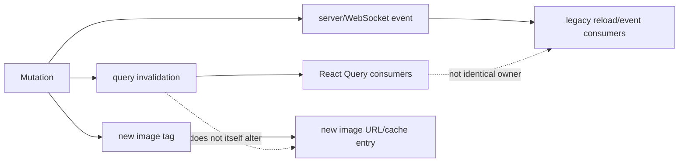

# Stock Caching and Invalidation (Jellyfin 10.11.11)

## Baseline

Web 10.11.11 @ `35c0793ece3adbd247eab290ae1effab851f3d37` (`W@35c0793`); Server 10.11.11 @ `1fbd8739292cce610231be93daf43368733edf63` (`S@1fbd873`).

Stock Jellyfin has multiple independent caches. There is no single application-wide invalidation owner. `VERIFIED_FROM_SOURCE` through the cache-specific evidence below.

## Cache inventory

| Cache/state | Key/scope | Invalidator/retirement | Evidence |
|---|---|---|---|
| TanStack Query item | `['User', userId, 'Items', itemId]` | stale after 1s; explicit query invalidation; all cleared at logout | `VERIFIED_FROM_SOURCE` — W@35c0793, `src/hooks/useItem.ts`, `getItemQuery`, lines 20-29; `src/utils/dashboard.js`, `logout`, lines 104-111. |
| TanStack Query User Views | `['User', userId, 'Views', params]` | 1s stale time coalesces three startup consumers | `VERIFIED_FROM_SOURCE` — W@35c0793, `src/hooks/useUserViews.ts`, `getUserViewsQuery`, lines 20-31. |
| TanStack Items | `['Items', parametersOptions]` | default query rules; random queries never GC and do not refetch on mount/focus | `VERIFIED_FROM_SOURCE` — W@35c0793, `src/hooks/useFetchItems.ts`, `useGetItems`, lines 55-72. |
| Query-client defaults | process-wide QueryClient | default TanStack lifetime/refetch behavior; `networkMode=always` | `VERIFIED_FROM_SOURCE` — W@35c0793, `src/utils/query/queryClient.ts`, lines 1-12. |
| Legacy view container | view object/route lifecycle | reset on skin unload and logout | `VERIFIED_FROM_SOURCE` — W@35c0793, `src/components/viewManager/viewManager.js`, `resetCachedViews`, lines 126-131; `src/utils/dashboard.js`, lines 104-111. |
| Legacy music query settings | user/library-specific string key | mutated by tab/controller and settings persistence | `VERIFIED_FROM_SOURCE` — W@35c0793, `src/controllers/music/musicalbums.js`, lines 31-65; `songs.js`, lines 20-50. |
| Comics preferences | one settings document keyed by media-source ID | written on reader stop | `VERIFIED_FROM_SOURCE` — W@35c0793, `src/scripts/settings/userSettings.js`, lines 621-639; `comicsPlayer/plugin.js`, lines 29-60. |
| Browser image | URL including owner/type/tag/transform | new tag or cache-bypass request | `VERIFIED_FROM_SOURCE` — W@35c0793, `useCardImageUrl.ts`, lines 261-290; S@1fbd873, `ImageController.cs`, lines 1872-1879 and 2019-2035. |
| Server processed image | image processor cache | image processing identity/cache tag | `VERIFIED_FROM_SOURCE` — S@1fbd873, `MediaBrowser.Controller/Drawing/IImageProcessor.cs`, cache-tag methods, lines 62-95; `ImageController.cs`, `GetImageResult`, lines 1992-2048. |
| Playback queue/session | active player or local queue manager | stop/replace/queue operations; session reports observe | `VERIFIED_FROM_SOURCE` — W@35c0793, `src/components/playback/playbackmanager.js`, lines 102-123 and 3163-3240. |

## Query ownership

The shared QueryClient only changes network mode; it does not globally set a long stale time, retry policy, or mutation invalidation rule. Each feature is responsible for its own key and invalidation. `VERIFIED_FROM_SOURCE` — W@35c0793, `src/utils/query/queryClient.ts`, lines 1-12.

Newer hooks accept TanStack's abort signal and pass it to the generated SDK request. Examples include item, User Views, and Items queries. `VERIFIED_FROM_SOURCE` — W@35c0793, `useItem.ts`, lines 9-27; `useUserViews.ts`, lines 9-29; `useFetchItems.ts`, lines 35-71.

Legacy controllers instead invoke `ApiClient` promises directly and retain mutable controller/module query state. The Albums and Songs paths shown do not accept a signal or compare a request generation before mutating DOM. `VERIFIED_FROM_SOURCE` — W@35c0793, `musicalbums.js`, lines 31-65 and 83-110; `songs.js`, lines 20-59.

Therefore React-query invalidation cannot be assumed to refresh every stock legacy view. `INFERRED` from the separate owners above.

## Event-driven invalidation

`ItemsContainer` can invalidate its configured query key on user-data/timer changes and can call its legacy `reloadItems` callback immediately in foreground or after ten seconds in background. `VERIFIED_FROM_SOURCE` — W@35c0793, `src/elements/emby-itemscontainer/ItemsContainer.tsx`, lines 176-225.

That is observer-local behavior. It does not establish a global item identity map: multiple list/detail/query projections may coexist with different fields and keys. `INFERRED` from W@35c0793, `useItem.ts`, key lines 20-29; `useFetchItems.ts`, key lines 55-72; legacy controller evidence above.

## Images as a separate cache domain

Server image DTO attachment is controlled by requested image limits and emits cache tags. `VERIFIED_FROM_SOURCE` — S@1fbd873, `Emby.Server.Implementations/Dto/DtoService.cs`, lines 782-808 and 850-882.

Card URLs include the tag and transform options; a nonempty tag leads to a one-year public response lifetime. `VERIFIED_FROM_SOURCE` — W@35c0793, `useCardImageUrl.ts`, lines 261-290; S@1fbd873, `ImageController.cs`, lines 1872-1879 and 2024-2035.

Invalidating an item query without adopting a changed image tag may therefore leave the effective image URL unchanged. Conversely, changing a tag creates a new browser-cache identity without clearing the old response. `INFERRED` from the verified URL/header behavior.

## Session/user boundary

Query keys commonly include the user for user-specific item/view data, but generic Items keys rely on the current API context inside the query function and do not show user/server in the key. `VERIFIED_FROM_SOURCE` — W@35c0793, `useItem.ts`, lines 20-29; `useUserViews.ts`, lines 20-31; `useFetchItems.ts`, lines 55-72.

Logout clears the whole QueryClient and resets cached views, which is the stock cross-user retirement boundary. `VERIFIED_FROM_SOURCE` — W@35c0793, `src/utils/dashboard.js`, lines 104-111.

Any new cache that survives logout or keys only by item ID must independently prove server/user isolation. `INFERRED` security guardrail from the verified boundary.

Phase 7 local Reader progress and bookmark records use a versioned key containing one verified Jellyfin server/user identity and the item stable ID. Missing or conflicting identity disables local persistence; old item-only records remain untouched and are never assigned to the current signer. This is browser-local isolation, not Jellyfin `UserData` or cross-device synchronization. `[VERIFIED_BY_TEST]` `src/ptv/modules/reader/readerProgressStore.test.ts`.

## PTV coordinated-request lifetime extension

This section describes the current PTV coordinator and does not change the stock cache contract.

- `[VERIFIED_FROM_SOURCE]` `requestPtvJson` always constructs a coordinator-owned authenticated `fetch` transport with its own 30-second upper bound. A route-scoped call must also supply a consumer `AbortSignal`; it fails before transport creation if the signal, exact server identity, or abort-capable transport is unavailable. There is no route/no-signal fallback to legacy `ApiClient.getJSON`. `src/ptv/api/client.ts`, `getPtvApiClient/requestPtvJson`, lines 74–103 and 405–462.
- `[VERIFIED_FROM_SOURCE]` The request coordinator keys physical work by method, authorization identity, and URL. Consumers are independent: one consumer can retire without cancelling another; final-consumer retirement aborts the physical transport once. If an underlying adapter ignores abort, the retired result is rejected as a stale completion and cannot become a successful publication or reusable settled entry. `src/ptv/services/requestCoordinator.ts`, `coordinatePtvJsonRequest`, lines 515–744.
- `[VERIFIED_FROM_SOURCE]` Route cancellation and the owned transport deadline preserve separate terminal causes. The Featured response chain now carries the same canonical `getPtvAuthenticatedDisplayIdentityKey` scope (one unambiguous immutable Jellyfin server ID plus authenticated user ID, normalized by `getPtvDisplayIdentityKey`) through the identity-bound fetcher, authenticated Plugin GET cache/coalescing, dashboard readback/hydration, and Featured memory/in-flight owner. `featuredContentCache` retains at most one active identity generation and clears that state on identity change or sign-in/out; every asynchronous write/finalizer and queued memory hit must still match its captured owner. Dashboard operations capture an identity guard and owner-bound document hydrator before transport/retry. `pluginApi` keys shareable authenticated work by transport/server root plus authorization identity, method, normalized path and stable parameters. Authenticated Featured GET candidate discovery is restricted to the active ApiClient root and compatibility paths on that root, preventing a same-key request from falling through to another configured/remembered server. Its short response cache is capped at 64 entries. An unresolved/ambiguous authenticated identity cannot read or join shared state. `src/ptv/services/displayIdentity.ts`, `getPtvAuthenticatedDisplayIdentityKey/getPtvDisplayIdentityKey`; `src/ptv/pages/home/ptvRows.js`, `createFeaturedContentFetcher`; `src/ptv/modules/cache/featuredContentCache.ts`, `requireCurrentFeaturedCacheOwner/resolveForFeaturedCacheOwner/createFeaturedContentCacheDocumentHydrator/createFeaturedContentCacheIdentityGuard`; `src/ptv/modules/dashboard/PiggieTvRowsPage.tsx`, Featured readback/observation helpers; `src/ptv/core/pluginApi.ts`, `getPluginRootCandidates/getPluginUrlCandidates/getPluginAuthenticatedIdentity/getPluginRequestCacheKey/setPluginReadResponseCacheEntry/retirePluginRequestIdentityState/requestPluginJson`.
- `[VERIFIED_BY_TEST]` Coalescing, one/all-consumer cancellation, ignored-abort stale rejection, replacement ordering, timeout versus route cancellation, missing-signal failure, exact server/user isolation, and background/route Home ownership are covered by `src/ptv/services/requestCoordinator.test.ts`, `src/ptv/api/client.test.ts`, and `src/ptv/pages/home/ptvRows.lifecycle.test.ts`. The response-cache boundary adds `src/ptv/modules/cache/featuredContentCacheIdentity.test.ts` and `src/ptv/core/pluginApiIdentityCache.test.ts`, including admin↔restricted isolation, same-user/different-server isolation, active-root-only Featured transport, same-identity coalescing, different-identity concurrency, late completion, queued memory, delayed readback hydration, logout and bounded retention.

## Mutation/readback contract

Identify Apply returns 204 and does not invalidate Web caches or return a new DTO. `VERIFIED_FROM_SOURCE` — S@1fbd873, `Jellyfin.Api/Controllers/ItemLookupController.cs`, lines 244-280; W@35c0793, `src/components/itemidentifier/itemidentifier.js`, lines 258-282.

Manual item update also returns no updated DTO after repository persistence. `VERIFIED_FROM_SOURCE` — S@1fbd873, `Jellyfin.Api/Controllers/ItemUpdateController.cs`, `UpdateItem`, lines 72-120.

Thus mutation acknowledgment, authoritative readback, relationship refresh, and image-cache refresh are separate lifecycle phases. `INFERRED` from those controller and cache contracts.

## Failure and race characteristics

- TanStack-managed queries can receive cancellation signals; direct legacy promises cannot be presumed cancellable. `VERIFIED_FROM_SOURCE` — Web hook/controller citations above.
- A stale response can still update a legacy DOM container after route/view change unless that controller has its own retirement check. The album/song paths shown do not demonstrate one. `INFERRED` from W@35c0793 controller lines cited above.
- Random Items queries are intentionally retained indefinitely and do not refetch on mount/focus, so their freshness contract differs from normal lists. `VERIFIED_FROM_SOURCE` — W@35c0793, `useFetchItems.ts`, lines 55-72.
- Image errors in the legacy lazy loader have no local error terminal/retry budget. `VERIFIED_FROM_SOURCE` — W@35c0793, `src/components/images/imageLoader.js`, `fillImageElement`, lines 108-136.
- Query invalidation and route teardown are separate mechanisms. `VERIFIED_FROM_SOURCE` — W@35c0793, `ItemsContainer.tsx`, lines 176-225; `viewManager.js`, lines 126-145.

## Before adding or changing a cache

- Name the authoritative data source and cache owner.
- Include server/user/security scope where results vary by principal.
- Define key equality, freshness, invalidation, logout, route-unmount, and hard-refresh behavior.
- Preserve field/projection distinctions; do not let a sparse response poison a richer cached object.
- Use abort/generation protection for async work that can outlive its view.
- Treat item data, relationships, image bytes/tags, queue, and diagnostics as distinct cache domains.

These are `INFERRED` check points grounded in the stock mechanisms above.

## PTV Web 0.5.78 local Featured diagnostic observation

`[VERIFIED_FROM_SOURCE]` `featuredContentCache` remains the sole Web Featured
cache owner. Its passive status reports read/adoption, write/readback, observed
counts, fallback memory, freshness, and dated failure history separately. A
per-user Plugin GET projection does not prove a Web write or authorize a
cross-user readback comparison; verified write readback compares stable cache
metadata and the requested refresh interval when present. Passive diagnostics
cannot establish an identity owner, fetch a
document, or persist one. `webDiagnosticPlatform` samples this status before
export and on a bounded visible cadence. `[VERIFIED_BY_TEST]` The local
`featuredContentCacheDiagnostics.test.ts` and
`webDiagnosticPlatform.test.ts` cover absent versus observed-empty counts,
recovery, overlapping writes, identity change, no-network export, low-power
sampling, and disposal. Plugin storage and same-session permission convergence
remain separate server-boundary questions.
