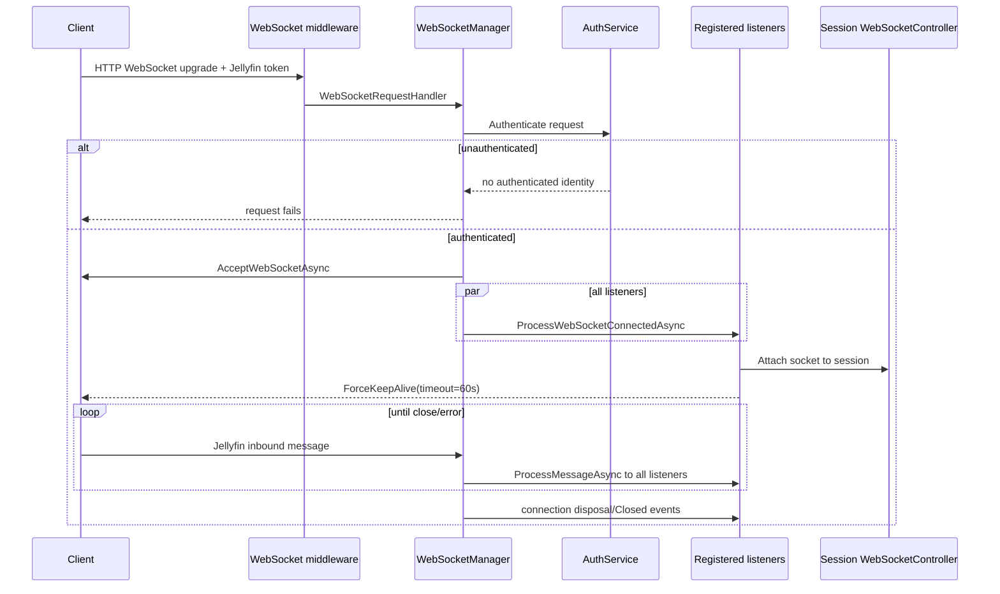
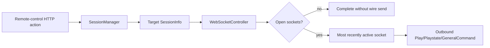

# Stock Jellyfin WebSocket and event architecture

## Scope and evidence convention

This chapter maps pristine Jellyfin Server `10.11.11` at official commit `1fbd8739292cce610231be93daf43368733edf63`. `VERIFIED_FROM_SOURCE` denotes direct implementation evidence, `INFERRED` a bounded consequence of cited code, and `UNKNOWN` an unestablished behavior. Every claim cites the source ledger.

## Ownership map

| Concern | Stock owner | Behavior | Evidence |
|---|---|---|---|
| Upgrade routing | `WebSocketHandlerMiddleware` | Any ASP.NET request recognized as a WebSocket upgrade is diverted to the Jellyfin WebSocket manager; other requests continue normally. | `VERIFIED_FROM_SOURCE` [S17-01] |
| Authentication/accept | `WebSocketManager` | Resolve the request token, reject unauthenticated requests, accept the socket, notify all registered listeners, then run the receive loop. | `VERIFIED_FROM_SOURCE` [S17-02] |
| Frame/message processing | `WebSocketConnection` | Reassemble frames, deserialize one Jellyfin message, handle KeepAlive locally, and fan other messages to listeners. | `VERIFIED_FROM_SOURCE` [S17-03] |
| Session attachment/keepalive | `SessionWebSocketListener` | Attach the socket to a Jellyfin session, send `ForceKeepAlive`, monitor last keepalive, and remove lost sockets. | `VERIFIED_FROM_SOURCE` [S17-04] |
| Remote-command transport | `WebSocketController` + `SessionManager` | A session can own multiple sockets; each command goes to its most recently active open socket. | `VERIFIED_FROM_SOURCE` [S17-05] [S17-06] |
| Periodic subscriptions | `BasePeriodicWebSocketListener` subclasses | Start/stop per-connection subscriptions and coalesce forced/due sends through a single channel consumer. | `VERIFIED_FROM_SOURCE` [S17-07] |
| Session snapshots | `SessionInfoWebSocketListener` | Push session state on session/playback/capability events, with per-user filtering for non-admin users. | `VERIFIED_FROM_SOURCE` [S17-08] |
| Scheduled-task snapshots | `ScheduledTasksWebSocketListener` | Push nonhidden task snapshots on start/progress/completion. | `VERIFIED_FROM_SOURCE` [S17-09] |
| Library changes | `LibraryChangedNotifier` | Debounce item changes, translate them for each active user, and send user-scoped `LibraryChanged`. | `VERIFIED_FROM_SOURCE` [S17-10] |
| User-data changes | `UserDataChangeNotifier` | Debounce non-progress user-data saves and send user-scoped DTOs for item and parent. | `VERIFIED_FROM_SOURCE` [S17-11] |

## Connection lifecycle

The middleware has no fixed path check in the inspected method; it tests `IsWebSocketRequest`. The manager authenticates before accepting, constructs a connection with the resolved `AuthorizationInfo`, calls every listener concurrently on connection, and then blocks in the receive loop. `VERIFIED_FROM_SOURCE` [S17-01] [S17-02]

`INFERRED`: `/socket` may be the conventional client URL, but this middleware method does not make that path part of the server-side contract. The protocol boundary is the authenticated WebSocket upgrade, not a path assertion in this component. [S17-01]

On a top-level manager exception, the error is logged; if the HTTP response has not started, status 500 is set. Once an upgrade has started, normal WebSocket close/error behavior applies instead of an ordinary JSON error response. `VERIFIED_FROM_SOURCE` / `INFERRED` [S17-02]

## Wire messages

The wire envelope carries a `SessionMessageType`, optional data, and for server commands often a generated `MessageId`. The enumerated server-to-client types include `ForceKeepAlive`, `GeneralCommand`, `UserDataChanged`, `Sessions`, `Play`, SyncPlay messages, `Playstate`, server restart/shutdown, `LibraryChanged`, user/timer events, `RefreshProgress`, task/package/activity events, and `ScheduledTasksInfo`. Client-to-server subscription controls include Sessions, Scheduled Tasks, and Activity Log start/stop; `KeepAlive` is shared. `VERIFIED_FROM_SOURCE` [S17-12]

`WebSocketConnection` serializes an outbound envelope as one complete text message. Its receive loop accumulates fragments in a pipe, updates `LastActivityDate`, and dispatches after `EndOfMessage`. JSON parse failure is logged and discarded; a listener exception is logged and swallowed without closing the connection in that method. `VERIFIED_FROM_SOURCE` [S17-03]

A client `KeepAlive` is answered with an outbound keepalive and updates `LastKeepAliveDate`; other messages are presented to every listener through `WebSocketManager.ProcessWebSocketMessageReceived`. `VERIFIED_FROM_SOURCE` [S17-02] [S17-03]

## Keepalive and loss detection

`SessionWebSocketListener` uses a 60-second lost threshold, checks at 20% of that interval, and sends `ForceKeepAlive` once a socket is between 75% and 100% of the threshold without a response. At or beyond 60 seconds, it removes the socket from its watchlist. `VERIFIED_FROM_SOURCE` [S17-04]

The same listener resolves/creates the Jellyfin session controller at connection time, attaches the socket, reports the controller connected, and initializes the keepalive timestamp. `VERIFIED_FROM_SOURCE` [S17-04]

The lost-socket branch contains a source TODO to handle the session relative to the lost socket; its immediate action is watchlist removal. `VERIFIED_FROM_SOURCE` [S17-04]

`INFERRED`: keepalive detection and session termination are not the same state transition. A socket can be removed as lost while additional session cleanup depends on controller close/session-manager paths. [S17-04] [S17-05]

## Session command transport

A `WebSocketController` is attached to one Jellyfin session and can contain several sockets. `SupportsMediaControl` and `IsSessionActive` are true while any socket is open. For an outbound command, it selects the open socket with the greatest `LastActivityDate`; if none is open, it returns a completed task without sending. `VERIFIED_FROM_SOURCE` [S17-05]

`SessionManager` creates one message ID per send and delegates to the session's controllers. Multi-session sends dispatch controller operations through `Task.WhenAll`; admin/user/device helpers select sessions and then use the same transport. `VERIFIED_FROM_SOURCE` [S17-06]

`INFERRED`: an HTTP endpoint that successfully dispatches a command proves only server-side acceptance/attempted send. The WebSocket protocol shown has no client execution acknowledgement tied to that `MessageId`; actual renderer execution is not guaranteed by the HTTP 204. [S17-05] [S17-06] [S17-12]

## Periodic subscription listeners

`BasePeriodicWebSocketListener` owns an unbounded channel with one reader and a list of connection/cancellation/state tuples. A matching Start message parses `Data` as `dueTimeMs,periodMs` using `long.Parse` and adds a subscription; Stop cancels/removes the first matching connection subscription. `VERIFIED_FROM_SOURCE` [S17-07]

Event triggers write a Boolean “force” marker to the channel. The single consumer finds open, uncancelled subscriptions whose interval is due (or all if forced), fetches data per connection, sends concurrently, then updates each subscription's last-send time. Send failures are logged and remove that subscription. `VERIFIED_FROM_SOURCE` [S17-07]

`INFERRED`: several quick triggers may produce fewer meaningful client snapshots than source events because consumers fetch current state and interval logic can skip a not-due connection. The mechanism is a state-notification transport, not an immutable event log. [S17-07]

Malformed subscription timing data can throw during `long.Parse`; the surrounding connection message dispatcher catches listener errors and logs them. `VERIFIED_FROM_SOURCE` [S17-03] [S17-07]

## Authorization of pushed state

The initial connection is token-authenticated, but each listener owns the authorization of its payload. `SessionInfoWebSocketListener` explicitly filters non-admin, non-API-key connections to sessions containing that user; admins and API keys receive all sessions. It refuses subscription only when both user and API-key identity are absent. `VERIFIED_FROM_SOURCE` [S17-08]

`LibraryChangedNotifier` waits for `LibraryUpdateDuration`, deduplicates accumulated items/folders, enumerates distinct user IDs with active sessions, translates physical changes through each user's library view, and sends only that user's result. `VERIFIED_FROM_SOURCE` [S17-10]

`UserDataChangeNotifier` partitions changes by user ID and sends the corresponding `UserDataChanged` DTOs only to that user's sessions. It intentionally ignores saves whose reason is `PlaybackProgress`, and it adds an item's owner/parent to the debounced update set for indicators. `VERIFIED_FROM_SOURCE` [S17-11]

`INFERRED`: authentication at socket acceptance is necessary but not sufficient for a safe extension listener; a plugin that publishes server-wide metadata must perform per-request/per-connection user authorization before serializing its payload, just as stock session and library listeners do. [S17-02] [S17-08] [S17-10]

## Major state streams

| Stream | Trigger/model | Delivery semantics | Evidence |
|---|---|---|---|
| `Sessions` | Session start/end/activity, capabilities, playback start/progress/stop | Current session snapshot; interval-aware except force events; per-user filtered. | `VERIFIED_FROM_SOURCE` [S17-08] |
| `ScheduledTasksInfo` | Task execute, progress, completion | Current nonhidden task snapshot; progress is interval-aware. | `VERIFIED_FROM_SOURCE` [S17-09] |
| `LibraryChanged` | Item added/updated/removed | Debounced/deduplicated IDs translated for each active user. | `VERIFIED_FROM_SOURCE` [S17-10] |
| `RefreshProgress` | Provider refresh start/progress/completion | Admin sessions only; intermediate messages limited to about one per second per item. | `VERIFIED_FROM_SOURCE` [S17-10] |
| `UserDataChanged` | Non-playback-progress user-data save | Debounced user-specific DTO list including affected parent/owner. | `VERIFIED_FROM_SOURCE` [S17-11] |
| `Play`, `Playstate`, `GeneralCommand` | Remote-control calls | Command to most recently active socket of target session. | `VERIFIED_FROM_SOURCE` [S17-05] [S17-06] |
| Shutdown/restart | Application stopping | Broadcast notification followed by session-controller disposal and connection clearing. | `VERIFIED_FROM_SOURCE` [S17-13] |

## Failure, ordering, and reconnect behavior

| Scenario | Stock behavior / guarantee boundary | Evidence |
|---|---|---|
| Invalid/absent token at upgrade | WebSocket manager rejects before acceptance. | `VERIFIED_FROM_SOURCE` [S17-02] |
| Fragmented message | Frames are accumulated until `EndOfMessage` before dispatch. | `VERIFIED_FROM_SOURCE` [S17-03] |
| Malformed JSON | Logged and discarded; receive loop remains available. | `VERIFIED_FROM_SOURCE` [S17-03] |
| One listener throws on an inbound message | Warning is logged and the exception is swallowed by connection dispatch. | `VERIFIED_FROM_SOURCE` [S17-03] |
| One periodic send fails | That subscription is disposed/removed; other connection sends are independently scheduled. | `VERIFIED_FROM_SOURCE` [S17-07] |
| Multiple sockets for one session | A command goes only to the most recently active open socket. | `VERIFIED_FROM_SOURCE` [S17-05] |
| No open socket | Command transport completes without a send. | `VERIFIED_FROM_SOURCE` [S17-05] |
| Library change burst | Events are delayed, accumulated, deduplicated, and translated into a later snapshot-like change message. | `VERIFIED_FROM_SOURCE` [S17-10] |
| Playback-progress user-data saves | No `UserDataChanged` notification from this notifier. | `VERIFIED_FROM_SOURCE` [S17-11] |
| Server stopping | Shutdown/restart message is attempted, then controllers are disposed and active connection maps cleared. | `VERIFIED_FROM_SOURCE` [S17-13] |
| Reconnect | A new connection is accepted and listeners attach again; persistence/replay of the old connection's subscription state is not implemented in the cited structures. | `VERIFIED_FROM_SOURCE` / `INFERRED` [S17-02] [S17-04] [S17-07] |

There is no durable event offset, acknowledgement store, replay cursor, or sequence-number gap recovery in the inspected envelope/listener paths. `INFERRED`: WebSockets are advisory invalidation/state transport; clients must refetch authoritative HTTP state after connect/reconnect and tolerate duplicates, coalescing, omission, and reordering across independent producers. [S17-03] [S17-07] [S17-10] [S17-12]

`UNKNOWN`: ordering between separate listener types under concurrent triggers is not specified; `Task.WhenAll` is used in listener fan-out and multi-session sends. [S17-02] [S17-06]

## Consumer rules implied by stock

- Authenticate the upgrade with the normal Jellyfin credential and send KeepAlive responses within the advertised window. `VERIFIED_FROM_SOURCE` [S17-02] [S17-04]
- Resubscribe after reconnect and perform an authoritative HTTP read; do not assume missed messages will replay. `INFERRED` [S17-07]
- Treat Library/UserData/Task/Session messages as cache-invalidation or current-snapshot hints, not globally ordered transactions. `INFERRED` [S17-08] [S17-09] [S17-10] [S17-11]
- A plugin listener must filter payloads using the connection's resolved Jellyfin user/security scope before serialization. `INFERRED` [S17-08] [S17-10]
- Do not treat successful remote-command HTTP dispatch as renderer acknowledgement. `INFERRED` [S17-05] [S17-06]

## Evidence ledger

All entries: repository `jellyfin-server-stock-10.11.11`, version `10.11.11`, commit `1fbd8739292cce610231be93daf43368733edf63`.

| Ref | File | Symbol | Practical lines |
|---|---|---|---:|
| S17-01 | `Jellyfin.Api/Middleware/WebSocketHandlerMiddleware.cs` | `Invoke` | 29-38 |
| S17-02 | `Emby.Server.Implementations/HttpServer/WebSocketManager.cs` | `WebSocketRequestHandler`, `ProcessWebSocketMessageReceived` | 37-95 |
| S17-03 | `Emby.Server.Implementations/HttpServer/WebSocketConnection.cs` | send/receive/process/keepalive/dispose | 48-280 |
| S17-04 | `Emby.Server.Implementations/Session/SessionWebSocketListener.cs` | connection attach, keepalive, loss detection | 21-80, 114-265 |
| S17-05 | `Emby.Server.Implementations/Session/WebSocketController.cs` | socket ownership and `SendMessage` | 17-129 |
| S17-06 | `Emby.Server.Implementations/Session/SessionManager.cs` | message dispatch helpers | 1237-1278, 2042-2085 |
| S17-07 | `MediaBrowser.Controller/Net/BasePeriodicWebSocketListener.cs` | subscription and channel send lifecycle | 25-56, 98-285 |
| S17-08 | `Jellyfin.Api/WebSocketListeners/SessionInfoWebSocketListener.cs` | session subscription/filter/triggers | 29-143 |
| S17-09 | `Jellyfin.Api/WebSocketListeners/ScheduledTasksWebSocketListener.cs` | task subscription/triggers | 30-87 |
| S17-10 | `Emby.Server.Implementations/EntryPoints/LibraryChangedNotifier.cs` | refresh throttling, debounce, user translation/send | 100-165, 167-330 |
| S17-11 | `Emby.Server.Implementations/EntryPoints/UserDataChangeNotifier.cs` | save filter, debounce, per-user send | 48-155 |
| S17-12 | `MediaBrowser.Model/Session/SessionMessageType.cs` | `SessionMessageType` | 8-49 |
| S17-13 | `Emby.Server.Implementations/Session/SessionManager.cs` | `OnApplicationStopping` | 2119-2139 |
