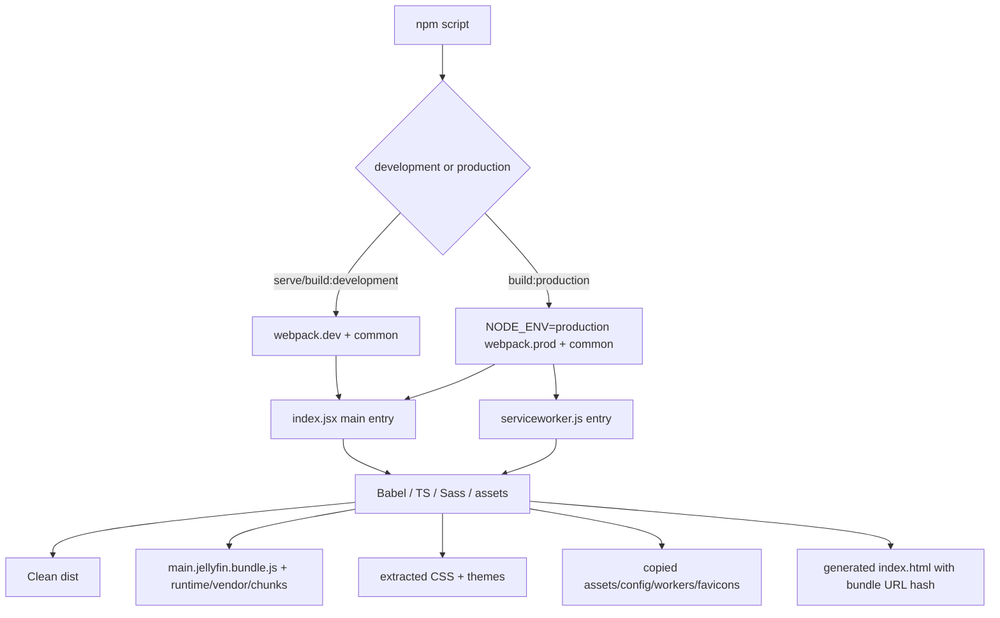
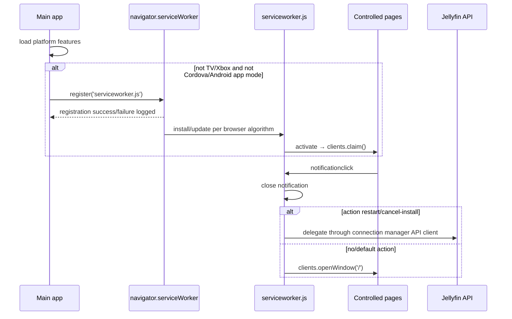

# 18 — Stock build, service worker and assets

## Reference boundary

- **Corpus:** `jellyfin/jellyfin-web` **v10.11.11**, commit **`35c0793ece3adbd247eab290ae1effab851f3d37`**. `[VERIFIED_FROM_SOURCE]` `package.json`, lines 2–5; commit identity from the Phase-1 blob inventory.
- The checked snapshot has no `.git` directory. `[VERIFIED_FROM_SOURCE]` Version is directly reproducible from `package.json`; commit provenance is corpus inventory metadata rather than something `git describe` can reproduce inside this copy.

## Build pipeline

1. Supported commands are webpack dev server, development build and production build; typecheck, ES compatibility, ESLint, Vitest and Stylelint are separate scripts. Node `>=20` and npm `>=9.6.4 <11` are declared. `[VERIFIED_FROM_SOURCE]` `package.json`, `scripts/engines`, lines 155–172.
2. Common webpack context is `src`, target is Browserslist, and entries are `main.jellyfin: ./index.jsx` plus every `src/themes/**/theme.scss`. Production adds `serviceworker: ./serviceworker.js`; development switches to webpack's `web` target only while serving. `[VERIFIED_FROM_SOURCE]` `webpack.common.js`, lines 35–55; `webpack.prod.js`, lines 1–10; `webpack.dev.js`, lines 5–28.
3. Babel applies preset-env with usage-based Core-JS 3 plus React; TypeScript targets ES5 and is strict while allowing JavaScript. `[VERIFIED_FROM_SOURCE]` `babel.config.js`, lines 1–18; `tsconfig.json`, lines 1–23.
4. Production mode extracts CSS; themes are always extracted. PostCSS applies preset-env, Autoprefixer and cssnano against the repository Browserslist. `[VERIFIED_FROM_SOURCE]` `webpack.common.js`, stylesheet rule, lines 310–352; `postcss.config.js`, lines 1–16; `package.json`, Browserslist, lines 139–154.
5. Type checking runs concurrently through `ForkTsCheckerWebpackPlugin`; JS/JSX and selected dependencies use Babel, TS/TSX use ts-loader, and `.worker.ts` uses worker-loader plus transpile-only ts-loader. `[VERIFIED_FROM_SOURCE]` `webpack.common.js`, lines 107–111 and module rules 186–309.

## Output and cache identity

| Output | Naming / identity | Source evidence |
|---|---|---|
| Main entry | `main.jellyfin.bundle.js` (stable filename) | `[VERIFIED_FROM_SOURCE]` `webpack.common.js`, `entry/output`, lines 43–49 and 122–137 |
| Service worker | `serviceworker.js` (stable filename) | `[VERIFIED_FROM_SOURCE]` `webpack.common.js`, `output.filename`, lines 122–126 |
| Runtime | one shared runtime chunk | `[VERIFIED_FROM_SOURCE]` `webpack.common.js`, `optimization.runtimeChunk`, lines 139–145 |
| Dynamic chunks | `[name].[contenthash].chunk.js` | `[VERIFIED_FROM_SOURCE]` `webpack.common.js`, `output.chunkFilename`, line 126 |
| Normal CSS | entry/chunk name plus content hash | `[VERIFIED_FROM_SOURCE]` `webpack.common.js`, `MiniCssExtractPlugin`, lines 112–120 |
| Theme CSS | `themes/<id>/theme.css` (stable path) | `[VERIFIED_FROM_SOURCE]` `webpack.common.js`, `MiniCssExtractPlugin.filename`, lines 112–119 |
| Images/fonts/audio | webpack asset resources, usually hashed; assets/themes and `manifest.json` preserve special paths | `[VERIFIED_FROM_SOURCE]` `webpack.common.js`, `output.assetModuleFilename` and asset module rules, lines 127–135 and 354–364 |
| HTML | generated `index.html`; HtmlWebpackPlugin appends a build hash query to injected bundle URLs | `[VERIFIED_FROM_SOURCE]` `webpack.common.js`, `HtmlWebpackPlugin`, lines 70–79 |

The public path is empty, so generated assets are relative to the deployed Web root. `[VERIFIED_FROM_SOURCE]` `webpack.common.js`, output, lines 122–138. Browser-visible bundle freshness combines content-hashed dynamic/CSS names with the generated HTML hash query for stable entry names. `[INFERRED]` Correct upgrades therefore require the new HTML and its asset generation to be deployed coherently.

## Static and external runtime assets

`CopyPlugin` copies:

- `src/assets/**` → `dist/assets/**`;
- `config.json` and `robots.txt`;
- favicon/touch icons from `@jellyfin/ux-web`;
- Promise, libarchive, libass, PDF, PGS and related worker/WASM/font assets from dependencies into `dist/libraries`.

`[VERIFIED_FROM_SOURCE]` `webpack.common.js`, `Assets` and `CopyPlugin`, lines 11–21 and 80–100. The libarchive worker is deliberately ignored by automatic bundling because it uses `import.meta.url`; its prebuilt artifact is copied instead. `[VERIFIED_FROM_SOURCE]` `webpack.common.js`, `IgnorePlugin`, lines 101–106.

`index.html` links `manifest.json`; the manifest launches `index.html#/home` as a standalone PWA and names fixed favicon paths. `[VERIFIED_FROM_SOURCE]` `src/index.html`, lines 3–23 and 88–91; `src/manifest.json`, lines 1–31. `config.json` supplies themes, server list and the stock frontend plugin list. `[VERIFIED_FROM_SOURCE]` `src/config.json`, lines 1–50.

## Runtime boot and asset consumers

1. HTML initially renders a splash inside `#reactRoot`; `index.jsx` clears it and mounts `RootApp`. `[VERIFIED_FROM_SOURCE]` `src/index.html`, lines 88–91; `src/index.jsx`, `renderApp`, lines 206–217.
2. The main entry imports legacy polyfills first, then the connection singleton, auto-running components and global styles. `[VERIFIED_FROM_SOURCE]` `src/index.jsx`, lines 1–47.
3. Font/style and platform chunks are dynamically imported according to TV/system-font/iOS/feature support. `[VERIFIED_FROM_SOURCE]` `src/index.jsx`, `loadFonts/loadPlatformFeatures`, lines 127–139 and 170–192.
4. Frontend plugins named by Web configuration are dynamically loaded in parallel. Remote-control and Chromecast plugins are filtered by capabilities/browser; plugin load failure is caught and logged so startup can continue. `[VERIFIED_FROM_SOURCE]` `src/index.jsx`, `loadPlugins`, lines 141–168.

## Build provenance

- Webpack runs `git describe --always --dirty` at configuration time; failure logs a warning and leaves the commit string empty. It injects commit, package name/version, Jellyfin build label, system-font and dev-server constants. `[VERIFIED_FROM_SOURCE]` `webpack.common.js`, lines 23–33 and 57–68.
- Build label is `Dev Server` when serving, otherwise `process.env.JELLYFIN_VERSION || 'Release'`. `[VERIFIED_FROM_SOURCE]` `webpack.common.js`, `buildVersion/DefinePlugin`, lines 60–67.
- Runtime boot prints package name, package version, commit and build. `[VERIFIED_FROM_SOURCE]` `src/index.jsx`, `init`, lines 49–55.
- `[INFERRED]` Building this `.git`-less snapshot produces a blank `__COMMIT_SHA__` unless the build environment restores Git metadata; there is no environment-variable fallback for commit provenance in stock configuration.

## Service-worker lifecycle

- Platform startup attempts registration only when not TV/Xbox, and the helper additionally excludes Cordova and Android app modes. Registration is not awaited; success/failure is console-only. `[VERIFIED_FROM_SOURCE]` `src/index.jsx`, `loadPlatformFeatures/registerServiceWorker`, lines 184–203.
- The worker handles notification clicks: no action opens `/`; `cancel-install` and `restart` delegate to the API client; unknown actions also open `/`. It closes the notification and uses `event.waitUntil`. `[VERIFIED_FROM_SOURCE]` `src/serviceworker.js`, `getApiClient/executeAction/notificationclick`, lines 3–37.
- Activation immediately claims clients. `[VERIFIED_FROM_SOURCE]` `src/serviceworker.js`, lines 39–40.
- `[VERIFIED_FROM_SOURCE]` There is **no** `install` handler, `fetch` handler, Cache Storage call, precache manifest, `skipWaiting`, or explicit cache purge in the stock worker (`src/serviceworker.js`, complete file, lines 1–40).
- `[INFERRED]` Consequently this service worker is a notification/action worker, not the owner of Web application asset caching or offline navigation. Normal browser/server HTTP caching and coherent deployment own bundle freshness.
- `[UNKNOWN]` Worker update cadence beyond the browser's standard registration algorithm, server `Cache-Control` headers, reverse-proxy caching and Jellyfin package deployment behavior are not defined in this repository.

## Failure, stale-generation and cleanup behavior

- `CleanWebpackPlugin` clears `dist` as part of a build. `[VERIFIED_FROM_SOURCE]` `webpack.common.js`, import/plugin, lines 3 and 69. `[UNKNOWN]` The stock repository defines no atomic production switch or rollback procedure; filesystem deployment belongs outside this build configuration.
- Main `init()` is invoked without a top-level catch. Several steps are awaited (host, localization, plugins, render), so an uncaught awaited failure terminates the remaining boot sequence; plugin loading is the explicit caught exception. `[VERIFIED_FROM_SOURCE]` `src/index.jsx`, `init/loadPlugins/init invocation`, lines 49–125, 141–168 and 219.
- Service-worker registration failure does not block application rendering and is only logged. `[VERIFIED_FROM_SOURCE]` `src/index.jsx`, lines 194–203.
- `[VERIFIED_FROM_SOURCE]` No runtime code compares a release/build manifest, checks that independently fetched chunks belong to one generation, or rolls back mixed assets. Html query hashing and content-hashed chunk names are the stock prevention mechanisms (`webpack.common.js`, lines 70–79 and 122–137).
- `[INFERRED]` A non-atomic deploy can still expose an old HTML/main bundle alongside missing new chunks, or a new HTML alongside incomplete assets; no source-level transaction closes that gap.
- `[UNKNOWN]` Server behavior for `index.html`, `serviceworker.js`, main bundle and theme cache headers must be audited in the Jellyfin host/deployment layer, not inferred from webpack.

## Durable comparison points

1. Stock production is a webpack 5 `dist` build with a fixed main/service-worker name, content-hashed lazy chunks/CSS, and an HTML bundle hash query.
2. Stock commit provenance is build-time `git describe`; a source export without `.git` loses it.
3. The service worker owns notification actions and client claiming, **not** asset caching or offline content.
4. Webpack defines artifact production but not atomic deployment, rollback, HTTP caching, or mixed-generation detection.

## Stage 4 PTV update acknowledgement — isolated integration candidate

This PTV extension does not change the stock worker's asset-cache non-guarantee. `[VERIFIED_FROM_SOURCE]` `PtvUpdateService` now treats activation and reload acknowledgement as separate steps: a failed `SKIP_WAITING` call or an unactivated candidate produces a visible recoverable error; a reload is requested only after the verified candidate is active/controlling and its generation key can be written and read back from session storage. The notice exposes `Try again`; it does not clear authentication or all browser storage. `src/ptv/services/updateService.ts`; `src/ptv/shell/PTVUpdateNotice.tsx`.

`[VERIFIED_BY_TEST]` Focused service/notice tests cover failed activation, storage denial, no-controller fallback and a two-generation reload that returns the old bundle. If the running bundle remains old after an acknowledged reload, the service presents an error and requires an explicit retry; it does not silently suppress the new generation. `[UNKNOWN]` The exact cause of the reported production reload loop and proxy/browser asset generation behavior remain unproven; local tests cannot certify deployed asset atomicity or an already-open tab upgrade.

`[VERIFIED_BY_TEST]` `e2e/tests/general.spec.ts` covers a local two-generation browser fixture where Reload returns the old frontend, the notice changes to a recoverable error, and an explicit `Try again` reattempts activation. This validates local UI/acknowledgement only; it cannot reproduce a real reverse proxy or deployed service-worker generation switch.

Stage 4 review also covers a failed reload followed by **Later**: the same verified candidate stays dismissed through worker reconciliation and a new page load in that browser session. An explicit retry remains available when the error is shown. Focused RED/GREEN tests prove the local notice lifecycle; deployed asset convergence remains unverified.

## Phase 6 PTV source and artifact governance — local only

The PTV extension now guards supported Web and embedded Plugin build/package commands with `scripts/ptv-workspace-preflight.mjs`. The approved local Git root, Git common directory and remote must match the pinned policy; historical worktrees remain available for read-only audit. Release packaging requires a clean full Git commit. `webpack.common.js` stops when commit provenance cannot be verified instead of embedding `unavailable`. The official Web and Plugin version sources remain `ptv-version.json` and the Plugin project file, respectively. `[VERIFIED_FROM_SOURCE]` `AGENTS.md`, `config/ptv-workspace-policy.json`, `scripts/ptv-workspace-preflight.mjs`, `webpack.common.js`, `package.json`, `scripts/ptv-build-provenance.cjs`.

`scripts/ptv-artifact-manifest.mjs` records each final file's relative path, size and SHA-256, plus the full source commit, source versions, build mode and a deterministic manifest digest. Final `config.json` transformations in CI occur before the manifest is generated; the uploaded Web artifact is downloaded and reverified. The Plugin package has its own archive manifest and a complete outer artifact manifest; compiler staging is outside the final package. `[VERIFIED_FROM_SOURCE]` `scripts/ptv-artifact-manifest.mjs`, `scripts/ptv-plugin-package.mjs`, `.github/workflows/__package.yml`.

The original Web deployment wrapper accepts only an explicit registered environment, a matching complete artifact manifest, a protected task-specific approval and hash-verified rollback evidence. It verifies files before and after copying and publishes `index.html` last. At Phase 6 the registry denied both production `.50` and development `.125`; this historical wrapper remains for frozen-release workflows. PTV use of the inherited Cloudflare deployment workflow is denied. `[VERIFIED_FROM_SOURCE]` `scripts/deploy-jellyfin-web.ps1`, `.github/workflows/__deploy.yml`.

### Frozen Web 0.5.75 deployment tooling — local validation only

The protected preflight can validate a frozen distribution from a reachable, clean source commit older than the documentation-only checkout HEAD. It derives that commit's tree and Web/Plugin versions from Git, verifies every extracted file against the deterministic manifest, checks the complete ZIP hash and embedded build marker, then requires an independently protected, time-bounded approval binding the exact commit, tree, artifact, rollback, and registered target. The ordinary current-HEAD package path remains strict. A later checkout HEAD alone never authorizes an older archive. `[VERIFIED_FROM_SOURCE]` `scripts/ptv-workspace-preflight.mjs`, `scripts/ptv-artifact-manifest.mjs`.

The exact-tree publisher compares complete baseline and candidate manifests. It stages a validated ZIP, rejects unexpected target files and unsafe paths, writes changed assets before `index.html`, retires only manifest-identified obsolete assets, and verifies the installed tree plus the served index. An exclusive transaction journal records publication states and approved rollback evidence; a failure after target mutation restores the previous Web tree. Interrupted recovery requires a new protected approval that pins the transaction ID and reviewed journal SHA-256, with an inactive publisher lock. That recovery approval cannot initiate a new publication. Fresh direct-local server/session and independently attested Beta-isolation checks run immediately before publication and before the index switch. `[VERIFIED_FROM_SOURCE]` `scripts/PTVWebExactTree.psm1`, `scripts/PTVWebPrepublicationGate.psm1`, `scripts/deploy-jellyfin-web.ps1`.

`[VERIFIED_BY_LOCAL_FIXTURE_TEST]` Exact-ref, tamper, path containment, asset retirement, index order, interruption, rollback, concurrency, and active-session rejection are covered by disposable fixtures. `[UNKNOWN]` The protected Windows policy and `.125` target remain disabled until independent operator provisioning. In-place per-file publication is bounded and rollback-capable but is **not** an atomic directory switch: an already-open tab may request an old asset during the short transition. Real `.125` HTTP/cache behavior, old/new tab convergence, and hosted visual acceptance require separate testing before release.

`[VERIFIED_BY_LOCAL_FIXTURE_TEST]` The governance tests exercise wrong roots/remotes/worktrees, tampered policy, forged commits, missing or modified artifact files, protected target denial, rollback tampering, and an approved mock deployment. `[UNKNOWN]` Hosted GitHub Actions execution, independently provisioned protected policy and real deployment rollback remain untested. These scripts govern supported entrypoints; they cannot prevent arbitrary manual filesystem writes or certify physical device behavior.

## Approved Linux cloud development — edit/build only

The separately approved Linux Codex checkout is `/workspace/PiggieTV-Jellyfin-web-app`, with a standalone `.git` directory and common directory at `/workspace/PiggieTV-Jellyfin-web-app/.git`. The pinned `cloudDevelopment` policy accepts the HTTPS origin `https://github.com/Piglit09/PiggieTV-Jellyfin-web-app.git` with its existing optional `.git` suffix normalization, a named `codex/bugfix/<topic>` branch, and ancestry from `db38180035a9e413510414bd8b75940806952b7f`. The existing origin identity check remains separate from push routing: cloud validation must inspect **every effective origin push destination**, including fallback to origin fetch URLs and Git URL rewrites, and reject an empty, malformed, or foreign destination set. An approved first push URL cannot authorize a later foreign URL. `[VERIFIED_FROM_SOURCE]` `config/ptv-workspace-policy.json` `cloudDevelopment`; `scripts/ptv-workspace-preflight.mjs` `pinnedAuthority.cloudDevelopment` and `validateCloudDevelopment`.

This exception permits `edit` and `build` only. Cloud-root `package`, `deploy`, and `deploy-development` are denied before CI exception handling, and `--ci-ref` cannot substitute for cloud identity. Genuine GitHub Actions exact-ref builds retain their separate existing path. The Windows checkout remains the sole writable local source root; protected Windows operator policy and registered deployment targets remain separate. Review-branch pushes follow `AGENTS.md` and task-specific publication holds; cloud development grants no merge, release, deployment, or server access. `[VERIFIED_FROM_SOURCE]` `scripts/ptv-workspace-preflight.mjs` `sourceReferenceForMode`; `AGENTS.md`; [cloud development procedure](../../operations/ptv-cloud-development.md).

The worker can modify both the cloud policy and guard code. These checks protect supported entrypoints against accidental misuse; they are not an independently protected cloud identity or signed grant and cannot prevent arbitrary manual writes or modified scripts. GitHub permissions and human review remain separate boundaries. Revocation requires stopping affected work and, when necessary, revoking GitHub write access; deleting the checked-in exception alone cannot revoke retained credentials or old checkouts. `[VERIFIED_FROM_SOURCE]` `AGENTS.md`; [scope, validation, and revocation procedure](../../operations/ptv-cloud-development.md).

Required proof is the resolved root/common directory, standalone Git directory, origin identity, complete effective push set, branch, full HEAD and pinned ancestry, plus successful `edit` and `build` preflights in the actual Linux checkout. Destination regressions use disposable Git repositories without contacting a remote; test multiple push URLs, fallback, rewrites, malformed entries, and unchanged package/deploy/CI denials. Earlier Windows fixtures injected a Linux runtime to simulate cloud validation; they do not establish actual Linux checkout acceptance. `[VERIFIED_BY_TEST]` On 2026-10-27, before this push-set correction, the actual Linux checkout on `codex/bugfix/cloud-origin-destinations` at `8ac3dcc713cde18e94114022beede6ad820a57ce` passed the unchanged `edit` and `build` preflights with authority `cloud-development`. That initial observation proves source identity acceptance only; the correction's final regression and preflight outcomes belong in its [implementation record](../../superpowers/plans/2026-10-27-cloud-origin-destinations.md). Neither simulated fixtures nor local preflights prove hosted behavior, physical acceptance, or deployment authorization.

## Phase 7 standing development deployment — local tooling

The registered `JF_DEVELOPMENT_125` target is the existing disposable Jellyfin 12.2 server at `10.16.0.125`; production `.50` remains denied. The separate `deploy-development` preflight requires a clean approved Git checkout, complete Web/Plugin artifact manifests, exact local server and destination identities, and a shared protected Windows policy with `PTV_WEB` active and `testDeploy125` granted. A checked-in registry edit alone cannot grant deployment. Once independently provisioned, the standing policy permits repeated `.125` test installs without a fresh operator approval or backup for every iteration. Active Beta sessions trigger a warning, while data, media, configuration, credentials, and account changes remain outside this deployment scope. `[VERIFIED_FROM_SOURCE]` `AGENTS.md`, `docs/operations/ptv-environments.json`, `scripts/ptv-workspace-preflight.mjs`.

For a previously built Web distribution at an older reachable commit, the development guard checks the complete frozen artifact manifest. The Plugin packager also supports a frozen product commit when the current clean checkout has an identical Plugin source subtree and version at that commit. It embeds the selected revision in rebuilt binaries and binds the product subtree ID to both package manifests. Tooling-only commits therefore need not relabel unchanged Plugin product code; the newer tooling HEAD and frozen product commit remain separately identifiable. `[VERIFIED_FROM_SOURCE]` `scripts/ptv-artifact-manifest.mjs`, `scripts/ptv-plugin-package.mjs`.

The development publisher validates candidate files and path containment, retires only known obsolete Web assets before publishing `index.html` last, and verifies the resulting tree. A Plugin change requires the verified local Jellyfin process to stop gracefully before Plugin files are replaced, then a launch using the recorded test-server executable and data directory. Browser cache convergence, mixed old-tab assets, and real authenticated behavior still require hosted acceptance; mock publisher tests cannot prove them. The installer must not contact `.50` or convert this standing test policy into production release authority. `[VERIFIED_FROM_SOURCE]` `scripts/deploy-ptv-development.ps1`, `scripts/PTVDevelopmentPublisher.psm1`.
