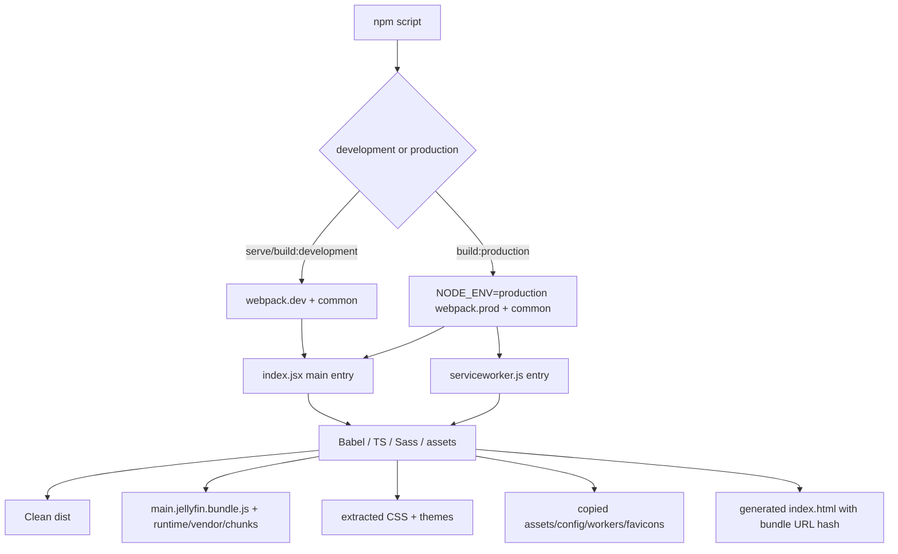
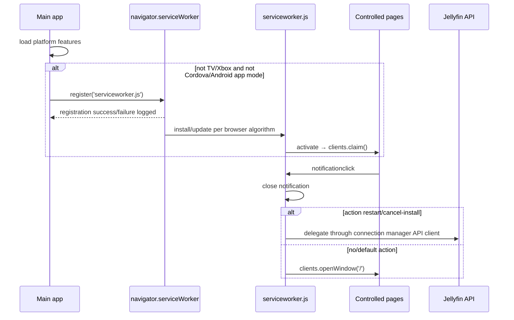

# 18 — Stock build, service worker and assets

## Reference boundary

- **Corpus:** `jellyfin/jellyfin-web` **v10.11.11**, commit **`35c0793ece3adbd247eab290ae1effab851f3d37`**. `[VERIFIED_FROM_SOURCE]` `package.json`, lines 2–5; commit identity from the Phase-1 blob inventory.
- The checked snapshot has no `.git` directory. `[VERIFIED_FROM_SOURCE]` Version is directly reproducible from `package.json`; commit provenance is corpus inventory metadata rather than something `git describe` can reproduce inside this copy.

## Build pipeline

1. Supported commands are webpack dev server, development build and production build; typecheck, ES compatibility, ESLint, Vitest and Stylelint are separate scripts. Node `>=20` and npm `>=9.6.4 <11` are declared. `[VERIFIED_FROM_SOURCE]` `package.json`, `scripts/engines`, lines 155–172.
2. Common webpack context is `src`, target is Browserslist, and entries are `main.jellyfin: ./index.jsx` plus every `src/themes/**/theme.scss`. Production adds `serviceworker: ./serviceworker.js`; development switches to webpack's `web` target only while serving. `[VERIFIED_FROM_SOURCE]` `webpack.common.js`, lines 35–55; `webpack.prod.js`, lines 1–10; `webpack.dev.js`, lines 5–28.
3. Babel applies preset-env with usage-based Core-JS 3 plus React; TypeScript targets ES5 and is strict while allowing JavaScript. `[VERIFIED_FROM_SOURCE]` `babel.config.js`, lines 1–18; `tsconfig.json`, lines 1–23.
4. Production mode extracts CSS; themes are always extracted. PostCSS applies preset-env, Autoprefixer and cssnano against the repository Browserslist. `[VERIFIED_FROM_SOURCE]` `webpack.common.js`, stylesheet rule, lines 310–352; `postcss.config.js`, lines 1–16; `package.json`, Browserslist, lines 139–154.
5. Type checking runs concurrently through `ForkTsCheckerWebpackPlugin`; JS/JSX and selected dependencies use Babel, TS/TSX use ts-loader, and `.worker.ts` uses worker-loader plus transpile-only ts-loader. `[VERIFIED_FROM_SOURCE]` `webpack.common.js`, lines 107–111 and module rules 186–309.

## Output and cache identity

| Output | Naming / identity | Source evidence |
|---|---|---|
| Main entry | `main.jellyfin.bundle.js` (stable filename) | `[VERIFIED_FROM_SOURCE]` `webpack.common.js`, `entry/output`, lines 43–49 and 122–137 |
| Service worker | `serviceworker.js` (stable filename) | `[VERIFIED_FROM_SOURCE]` `webpack.common.js`, `output.filename`, lines 122–126 |
| Runtime | one shared runtime chunk | `[VERIFIED_FROM_SOURCE]` `webpack.common.js`, `optimization.runtimeChunk`, lines 139–145 |
| Dynamic chunks | `[name].[contenthash].chunk.js` | `[VERIFIED_FROM_SOURCE]` `webpack.common.js`, `output.chunkFilename`, line 126 |
| Normal CSS | entry/chunk name plus content hash | `[VERIFIED_FROM_SOURCE]` `webpack.common.js`, `MiniCssExtractPlugin`, lines 112–120 |
| Theme CSS | `themes/<id>/theme.css` (stable path) | `[VERIFIED_FROM_SOURCE]` `webpack.common.js`, `MiniCssExtractPlugin.filename`, lines 112–119 |
| Images/fonts/audio | webpack asset resources, usually hashed; assets/themes and `manifest.json` preserve special paths | `[VERIFIED_FROM_SOURCE]` `webpack.common.js`, `output.assetModuleFilename` and asset module rules, lines 127–135 and 354–364 |
| HTML | generated `index.html`; HtmlWebpackPlugin appends a build hash query to injected bundle URLs | `[VERIFIED_FROM_SOURCE]` `webpack.common.js`, `HtmlWebpackPlugin`, lines 70–79 |

The public path is empty, so generated assets are relative to the deployed Web root. `[VERIFIED_FROM_SOURCE]` `webpack.common.js`, output, lines 122–138. Browser-visible bundle freshness combines content-hashed dynamic/CSS names with the generated HTML hash query for stable entry names. `[INFERRED]` Correct upgrades therefore require the new HTML and its asset generation to be deployed coherently.

## Static and external runtime assets

`CopyPlugin` copies:

- `src/assets/**` → `dist/assets/**`;
- `config.json` and `robots.txt`;
- favicon/touch icons from `@jellyfin/ux-web`;
- Promise, libarchive, libass, PDF, PGS and related worker/WASM/font assets from dependencies into `dist/libraries`.

`[VERIFIED_FROM_SOURCE]` `webpack.common.js`, `Assets` and `CopyPlugin`, lines 11–21 and 80–100. The libarchive worker is deliberately ignored by automatic bundling because it uses `import.meta.url`; its prebuilt artifact is copied instead. `[VERIFIED_FROM_SOURCE]` `webpack.common.js`, `IgnorePlugin`, lines 101–106.

`index.html` links `manifest.json`; the manifest launches `index.html#/home` as a standalone PWA and names fixed favicon paths. `[VERIFIED_FROM_SOURCE]` `src/index.html`, lines 3–23 and 88–91; `src/manifest.json`, lines 1–31. `config.json` supplies themes, server list and the stock frontend plugin list. `[VERIFIED_FROM_SOURCE]` `src/config.json`, lines 1–50.

## Runtime boot and asset consumers

1. HTML initially renders a splash inside `#reactRoot`; `index.jsx` clears it and mounts `RootApp`. `[VERIFIED_FROM_SOURCE]` `src/index.html`, lines 88–91; `src/index.jsx`, `renderApp`, lines 206–217.
2. The main entry imports legacy polyfills first, then the connection singleton, auto-running components and global styles. `[VERIFIED_FROM_SOURCE]` `src/index.jsx`, lines 1–47.
3. Font/style and platform chunks are dynamically imported according to TV/system-font/iOS/feature support. `[VERIFIED_FROM_SOURCE]` `src/index.jsx`, `loadFonts/loadPlatformFeatures`, lines 127–139 and 170–192.
4. Frontend plugins named by Web configuration are dynamically loaded in parallel. Remote-control and Chromecast plugins are filtered by capabilities/browser; plugin load failure is caught and logged so startup can continue. `[VERIFIED_FROM_SOURCE]` `src/index.jsx`, `loadPlugins`, lines 141–168.

## Build provenance

- Webpack runs `git describe --always --dirty` at configuration time; failure logs a warning and leaves the commit string empty. It injects commit, package name/version, Jellyfin build label, system-font and dev-server constants. `[VERIFIED_FROM_SOURCE]` `webpack.common.js`, lines 23–33 and 57–68.
- Build label is `Dev Server` when serving, otherwise `process.env.JELLYFIN_VERSION || 'Release'`. `[VERIFIED_FROM_SOURCE]` `webpack.common.js`, `buildVersion/DefinePlugin`, lines 60–67.
- Runtime boot prints package name, package version, commit and build. `[VERIFIED_FROM_SOURCE]` `src/index.jsx`, `init`, lines 49–55.
- `[INFERRED]` Building this `.git`-less snapshot produces a blank `__COMMIT_SHA__` unless the build environment restores Git metadata; there is no environment-variable fallback for commit provenance in stock configuration.

## Service-worker lifecycle

- Platform startup attempts registration only when not TV/Xbox, and the helper additionally excludes Cordova and Android app modes. Registration is not awaited; success/failure is console-only. `[VERIFIED_FROM_SOURCE]` `src/index.jsx`, `loadPlatformFeatures/registerServiceWorker`, lines 184–203.
- The worker handles notification clicks: no action opens `/`; `cancel-install` and `restart` delegate to the API client; unknown actions also open `/`. It closes the notification and uses `event.waitUntil`. `[VERIFIED_FROM_SOURCE]` `src/serviceworker.js`, `getApiClient/executeAction/notificationclick`, lines 3–37.
- Activation immediately claims clients. `[VERIFIED_FROM_SOURCE]` `src/serviceworker.js`, lines 39–40.
- `[VERIFIED_FROM_SOURCE]` There is **no** `install` handler, `fetch` handler, Cache Storage call, precache manifest, `skipWaiting`, or explicit cache purge in the stock worker (`src/serviceworker.js`, complete file, lines 1–40).
- `[INFERRED]` Consequently this service worker is a notification/action worker, not the owner of Web application asset caching or offline navigation. Normal browser/server HTTP caching and coherent deployment own bundle freshness.
- `[UNKNOWN]` Worker update cadence beyond the browser's standard registration algorithm, server `Cache-Control` headers, reverse-proxy caching and Jellyfin package deployment behavior are not defined in this repository.

## Failure, stale-generation and cleanup behavior

- `CleanWebpackPlugin` clears `dist` as part of a build. `[VERIFIED_FROM_SOURCE]` `webpack.common.js`, import/plugin, lines 3 and 69. `[UNKNOWN]` The stock repository defines no atomic production switch or rollback procedure; filesystem deployment belongs outside this build configuration.
- Main `init()` is invoked without a top-level catch. Several steps are awaited (host, localization, plugins, render), so an uncaught awaited failure terminates the remaining boot sequence; plugin loading is the explicit caught exception. `[VERIFIED_FROM_SOURCE]` `src/index.jsx`, `init/loadPlugins/init invocation`, lines 49–125, 141–168 and 219.
- Service-worker registration failure does not block application rendering and is only logged. `[VERIFIED_FROM_SOURCE]` `src/index.jsx`, lines 194–203.
- `[VERIFIED_FROM_SOURCE]` No runtime code compares a release/build manifest, checks that independently fetched chunks belong to one generation, or rolls back mixed assets. Html query hashing and content-hashed chunk names are the stock prevention mechanisms (`webpack.common.js`, lines 70–79 and 122–137).
- `[INFERRED]` A non-atomic deploy can still expose an old HTML/main bundle alongside missing new chunks, or a new HTML alongside incomplete assets; no source-level transaction closes that gap.
- `[UNKNOWN]` Server behavior for `index.html`, `serviceworker.js`, main bundle and theme cache headers must be audited in the Jellyfin host/deployment layer, not inferred from webpack.

## Durable comparison points

1. Stock production is a webpack 5 `dist` build with a fixed main/service-worker name, content-hashed lazy chunks/CSS, and an HTML bundle hash query.
2. Stock commit provenance is build-time `git describe`; a source export without `.git` loses it.
3. The service worker owns notification actions and client claiming, **not** asset caching or offline content.
4. Webpack defines artifact production but not atomic deployment, rollback, HTTP caching, or mixed-generation detection.
