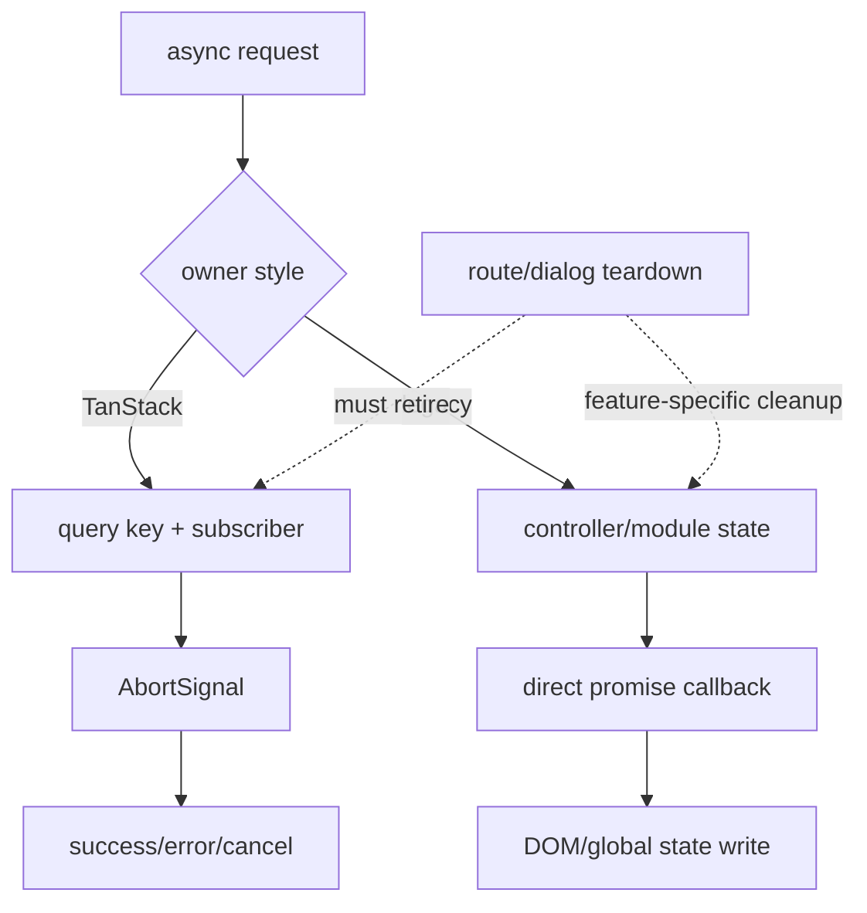

# Stock Failure, Race, and Lifecycle Behavior (Jellyfin 10.11.11)

## Baseline and interpretation

Sources are Jellyfin Web 10.11.11 @ `35c0793ece3adbd247eab290ae1effab851f3d37` (`W@35c0793`) and Jellyfin Server 10.11.11 @ `1fbd8739292cce610231be93daf43368733edf63` (`S@1fbd873`).

This chapter records source-demonstrable behavior. Absence of a local guard is labeled `INFERRED` or `UNKNOWN`; it is not proof that browsers, the SDK, or hosting middleware provide none.

## Async ownership patterns

Stock Web contains two overlapping lifecycle styles:

1. React/TanStack queries with stable keys, component subscription, and an AbortSignal passed into SDK calls.
2. Legacy controllers/components with mutable module/controller state, direct `ApiClient` promises, DOM writes, and explicit page/dialog event cleanup.

`VERIFIED_FROM_SOURCE` — W@35c0793, `src/hooks/useItem.ts`, lines 9-29; `src/hooks/useUserViews.ts`, lines 9-31; `src/controllers/music/musicalbums.js`, lines 31-65 and 83-110; `src/components/itemidentifier/itemidentifier.js`, lines 28-38 and 258-282.

## Failure matrix

| Condition | Demonstrated stock expectation | Evidence / certainty |
|---|---|---|
| Request cancellation | Newer item/views/items hooks pass TanStack's signal to SDK requests. Legacy Albums/Songs calls shown do not. | `VERIFIED_FROM_SOURCE` — W@35c0793, `useItem.ts` lines 20-27; `useUserViews.ts` 20-29; `useFetchItems.ts` 55-71; `musicalbums.js` 83-110; `songs.js` 53-80. |
| Route navigation during request | View manager can cancel a load before processing and records/restores view state; feature request retirement remains feature-owned. | `VERIFIED_FROM_SOURCE` — W@35c0793, `src/components/viewManager/viewManager.js`, `getViewEventDetail`/`loadView`, lines 101-145. Full post-load race behavior is covered in chapter 03. |
| Stale response | TanStack key/subscriber lifecycle reduces obsolete writes; legacy callbacks need local guards. Stock music/Identify examples show no generation token. | `INFERRED` from W@35c0793 files/lines above and `itemidentifier.js` lines 28-38, 471-488. |
| Server restart | In-flight HTTP can reject and WebSocket must reconnect; no source-proven guarantee makes a multi-step mutation atomic across restart. | `INFERRED`; WebSocket-specific verified behavior is in chapter 17. |
| Image 404 | Server returns NotFound for inaccessible/missing item or missing image; legacy lazy preloader has no local error handler. | `VERIFIED_FROM_SOURCE` — S@1fbd873, `ImageController.cs`, lines 570-574 and 1863-1869; W@35c0793, `imageLoader.js`, lines 108-136. |
| Missing metadata | DTO relationship arrays/names are attached conditionally; consumers must tolerate empty fields. | `VERIFIED_FROM_SOURCE` — S@1fbd873, `DtoService.cs`, lines 1030-1097. |
| Library scan in progress | Query endpoints return current repository projections; no cited Web list controller freezes a coherent snapshot across pages. | `INFERRED` from W@35c0793, `musicalbums.js`, mutable `StartIndex` lines 83-108, and Server item-query architecture in chapter 05. |
| Permission change | Server user context is authoritative per request; previously cached Web projections need invalidation/logout/user boundary. | `INFERRED` from S chapter 04 source and W@35c0793 `dashboard.js`, logout clear lines 104-111. |
| Concurrent mutation | Item update and Identify are separate endpoints without revision/ETag parameters in their shown contracts. Last completed authoritative mutation can supersede fields. | `VERIFIED_FROM_SOURCE` — S@1fbd873, `ItemUpdateController.cs`, lines 72-120; `ItemLookupController.cs`, lines 244-280. Outcome ordering is `INFERRED`. |
| Empty result | Legacy Music hides/shows sections based on item count; Identify renders the returned array. | `VERIFIED_FROM_SOURCE` — W@35c0793, `musicrecommended.js`, lines 96-120 and 138-162; `itemidentifier.js`, lines 105-120. |
| Partial result | Metadata and image refresh track failures separately but Apply has no structured partial-success payload. | `VERIFIED_FROM_SOURCE` — S@1fbd873, `MetadataService.cs`, lines 188-218; `ItemLookupController.cs`, lines 244-280. |
| Slow result | Stock calls remain pending until settle/cancel; no feature-level timeout is shown in the Music or Identify paths cited. | `VERIFIED_FROM_SOURCE` for absence in those methods — W@35c0793, `musicrecommended.js`, lines 45-174; `itemidentifier.js`, lines 88-102 and 258-282. Transport defaults outside these methods are `UNKNOWN`. |
| Component/dialog unmount | Readers explicitly remove document listeners on stop; Identify uses dialog close and module-global callbacks. | `VERIFIED_FROM_SOURCE` — W@35c0793, `bookPlayer/plugin.js`, lines 177-231; `pdfPlayer/plugin.js`, lines 132-160; `comicsPlayer/plugin.js`, lines 191-219; `itemidentifier.js`, lines 395-401. |
| Hard refresh | In-memory QueryClient/view state is rebuilt; browser/server HTTP image caches and persisted user settings may survive. | `INFERRED` from W@35c0793 `queryClient.ts` lines 1-12, `userSettings.js` 621-639; S@1fbd873 `ImageController.cs` 2019-2035. |

## Terminal-state obligations by subsystem

### Fetch/read

A safe read lifecycle needs success, empty, error, cancel/unmount, and late-response outcomes. TanStack queries provide a standardized state machine when used, while legacy controllers must implement it themselves. `INFERRED` from W@35c0793 query hooks and legacy controllers cited above.

### Mutation

Server mutation acknowledgment is not equivalent to client cache convergence. Identify and manual metadata update both return no replacement DTO. `VERIFIED_FROM_SOURCE` — S@1fbd873, `ItemLookupController.cs`, lines 244-280; `ItemUpdateController.cs`, lines 72-120.

A client that needs authoritative post-mutation state must perform/invalidate a user-scoped read and retain prior richer fields until that authority is established. The first clause is `INFERRED`; the no-DTO premise is source-verified above.

### Dialog/player

Reading players depend on `stop()` rather than `destroy()` to unbind and release resources; each `destroy()` is a no-op. `VERIFIED_FROM_SOURCE` — W@35c0793, `bookPlayer/plugin.js`, lines 63-97; `pdfPlayer/plugin.js`, lines 37-61; `comicsPlayer/plugin.js`, lines 40-65.

Identify's apply failure closes the dialog rather than keeping selections for retry, and search rejection has no local rejection callback. `VERIFIED_FROM_SOURCE` — W@35c0793, `itemidentifier.js`, lines 88-102 and 258-282.

### Images

Tagged image URLs may remain public-cacheable for one year. A mutation needs a new tag/readback to change identity; repeated retries of the same bad URL are not bounded by the legacy image loader. `VERIFIED_FROM_SOURCE` — S@1fbd873, `ImageController.cs`, lines 1872-1879 and 2019-2035; W@35c0793, `imageLoader.js`, lines 108-136.

## Cross-owner race catalogue

| Boundary | Race/breakage mode | Classification | Evidence |
|---|---|---|---|
| list DTO -> Details/item state | Sparse list projection overwrites richer relationship/media state | `RACE_RISK` | `INFERRED` from W list field selection (`musicalbums.js`, lines 36-44) and S field-gated DTO attachment (`DtoService.cs`, lines 818-882). |
| Identify candidate -> item state | Candidate lacks `UserData`, children, media sources, and image tags | `ACTIVE_CONTRACT_RISK` | `VERIFIED_FROM_SOURCE` — S@1fbd873, `RemoteSearchResult.cs`, lines 10-53 versus `BaseItemDto.cs`, lines 285-499. |
| old route request -> new route DOM | Direct promise completes after route owner changes | `RACE_RISK` | `INFERRED` from W legacy music callbacks with no generation signal, cited above. |
| user A cache -> user B | Cache key omits principal or is not cleared | `SECURITY_RISK` | Stock clears QueryClient/views on logout (`VERIFIED_FROM_SOURCE`, W `dashboard.js`, lines 104-111); any bypass is `INFERRED` risk. |
| metadata phase -> image phase | metadata commits while optional artwork fails | `PARTIAL_RESULT_RISK` | `VERIFIED_FROM_SOURCE` — S `MetadataService.cs`, lines 188-218 and `ItemImageProvider.cs`, lines 280-343. |
| image DTO -> browser cache | old tag/owner produces stale art after mutation | `STALE_CACHE_RISK` | `INFERRED` from source-verified tagged URL and one-year response behavior. |
| reader close -> async render | renderer finishes after stop | `RACE_RISK` | Cooperative flags are checked only at selected phases (`VERIFIED_FROM_SOURCE`, W EPUB lines 334-385; PDF lines 211-225; Comics lines 276-310). |
| two Identify dialogs | module globals/callbacks cross-contaminate | `RACE_RISK` | `VERIFIED_FROM_SOURCE` — W `itemidentifier.js`, lines 28-38 and 471-488. |

## Stock non-guarantees

- No global transaction spans provider metadata, artwork, Web cache invalidation, and rerender.
- No universal abort/generation mechanism covers both React and legacy controllers.

## PTV HOME-01 / NET-01 local closure contract

The stock non-guarantee above remains true globally. The current PTV worktree closes it only for the audited active legacy Home chain and coordinated PTV route requests.

1. `routeController` creates and terminally retires one immutable lifetime per PTV route family/generation.
2. `HomeTab` is the legacy Home consumer owner; pause/destroy retires before cleanup, and resume obtains a fresh lifetime.
3. `homesections`, row/container publication, Hero, cards, backdrop/image callbacks, listeners, observers, and timers require the exact current lifetime at their mutation boundary.
4. `requestPtvJson` owns the physical authenticated transport; the coordinator owns sharing, per-consumer retirement, final-consumer abort, and stale-completion rejection.
5. Shared Featured generation is application-owned rather than route-owned. The fetcher, authenticated Plugin GET cache/coalescing, dashboard readback/hydration, and Featured memory/in-flight state now use one canonical Jellyfin server/user identity. Authenticated Featured reads can try compatibility route names only on the active ApiClient root, never another server root. The Featured owner retains one active identity generation; user/server/sign-in/out retirement clears its state, captured-owner checks reject a prior identity's late completion, and queued memory hits reassert the captured owner before publishing. Missing identity fails closed at the Featured cache and disables authenticated Plugin request sharing.
6. Forced row-image loads retain exact consumer handles. Cleanup cancels the row owner's handles before lazy-image cleanup; replacement cancels only the old element/URL/owner lease, and final publication requires the exact retained entry plus the current route owner.

`[VERIFIED_BY_TEST]` The closure matrix includes delayed generation A resolving after B, same-route remount, repeated Home cycles, single/shared/all-consumer cancellation, ignored physical abort, timeout/route-cancel distinction, no-signal route rejection, coalescing, user/server separation, admin↔restricted Featured isolation, active-root-only Featured transport, late prior-user completion, queued-memory and delayed-hydrator rejection, logout/server switch, bounded response retention, and forced row-image consumer retirement. Evidence: `src/controllers/hometab.lifecycle.test.ts`; `src/ptv/pages/home/homesections.lifecycle.test.ts`; `src/ptv/pages/home/ptvRows.lifecycle.test.ts`; `src/ptv/shell/routeController.test.ts`; `src/ptv/api/client.test.ts`; `src/ptv/services/requestCoordinator.test.ts`; `src/ptv/modules/cache/featuredContentCacheIdentity.test.ts`; `src/ptv/core/pluginApiIdentityCache.test.ts`; `src/ptv/core/imageManager.test.ts`.

`[VERIFIED_BY_TEST]` The current worktree satisfies the HOME-01/NET-01 implementation closure criteria, including the former SEC-02 cache boundary and forced row-image handle follow-up. Deployment and physical acceptance remain `VALIDATION_PENDING`; this source/test result does not claim that an undeployed production generation changed.

### PTV DIAG-01 route-classification repair candidate

`[VERIFIED_FROM_SOURCE]` Production 0.5.56 allowed a stale Request presentation class to act as route authority. During Request teardown, one canonical Manga URL could therefore publish first as Request and then as Reading after class cleanup, producing two route generations for one navigation. The Web 0.5.57 local candidate makes the canonical hash authoritative: the Request route matches only `#/requests`, `#/request`, and `#/ptv/request` forms, while `ptv-request-active` no longer participates in route ownership. This is an authority correction, not a timer, debounce, or diagnostic-ledger suppression, and it adds zero requests.

`[VERIFIED_BY_TEST]` Request-before-presentation, Request→Manga teardown lag, stable Manga ownership after class removal, and the resulting single routeController generation are covered by `src/ptv/shell/routes.test.ts` and `src/ptv/shell/routeController.test.ts`. The focused DIAG-01 selection passed **6 files / 86 tests**, full PTV passed **364 files / 3056 tests**, and full repository tests passed **438 files / 3589 tests**. TypeScript, targeted and repository ESLint, Stylelint baseline, version/provenance tests, diff checks, and the production build passed (standard asset-size warnings only). The two Music `sonarjs/void-use` findings were cleared by annotating `loadMusicLibraryIndex` with its existing `Promise<null | void>` return contract; both fire-and-forget `void` call sites remain, and request, lifecycle, cache, queue, and playback behavior are unchanged. The local candidate is Web 0.5.57 and is **NOT DEPLOYED**. Physical validation remains pending, and the 0.5.56 production `FAIL/HOLD` remains authoritative operational evidence.

`[UNKNOWN]` This focused work is not evidence that every stock legacy controller, Native Home hook, or non-PTV request path now adopts the same lifetime. Those paths retain their own Atlas review requirement.
- No universal client identity map guarantees every projection of an item updates together.
- No Apply response proves relationship completeness or returns fresh image tags.
- No image loader contract shown here guarantees a terminal fallback for an HTTP error.
- No reader `destroy()` method shown here independently releases active state.

The first three are `INFERRED` from the source-separated owners; the last three are `VERIFIED_FROM_SOURCE` by the controller/image/player citations above.

## Issue #53 automatic theme retirement

`[VERIFIED_FROM_SOURCE]` The automatic-theme route key includes server, authenticated user and item. Theme lookup completion and the existing playback-start guard recheck the captured authenticated user; sign-in/out retires the route and owned automatic source. Connection listeners bind lazily on first `viewshow`, avoiding an eager connection-barrel read during bootstrap. Manual playback/queue intent relinquishes automatic ownership before route cleanup, including same-ID playback. NativeHome no longer retains a Details theme. `src/components/themeMediaPlayer.js`; `src/components/playback/playbackmanager.js`; `src/ptv/pages/home/NativeHome.tsx`.

`[VERIFIED_BY_TEST]` Focused regressions reject a late prior-user response, reload a same-server/item route for the new user, retire pending automatic starts on Home, and preserve an adopted queue while rejecting an unrelated deferred automatic replacement. This adds no universal route or identity manager: retirement still consumes established view and authentication events. An external identity change that emits none of those events is not an immediate-stop guarantee; captured-identity checks still prevent late adoption. Hosted and physical acceptance remain `[UNKNOWN]`.

## Review checklist for lifecycle changes

- Name the one authoritative owner and every derived/cache/view owner.
- Define operation identity (server, user, route, item, mutation generation).
- Specify terminal states for success, empty, partial, error, cancel, timeout, and unmount.
- Prevent sparse/older responses from replacing newer or richer state.
- Retire listeners, observers, timers, renderers, and object URLs.
- Revalidate permissions at the Server response boundary.
- Keep mutation acknowledgment separate from readback/cache convergence.
- Verify hard refresh, server restart, permission change, and cross-user transition.

These are `INFERRED` engineering controls from the stock failure model.

## Stage 4 PTV Web retirement boundaries — isolated integration candidate

- `[VERIFIED_FROM_SOURCE]` Shell geometry observers retire on `PTVShell` unmount; the published clearance is presentation state, not a new route/data owner. `src/ptv/shell/PTVShell.tsx`.
- `[VERIFIED_FROM_SOURCE]` Up Next carries current player, current item and queued-item identities across asynchronous next-item reads. Prompt advance and natural end share the active playback-generation claim. A stale item, destroyed dialog, or changed queue cannot adopt the old next result. A changed queue may reoffer its replacement; an explicit playback request retires pending autoplay even before the new item starts. `src/components/upnextdialog/upnextdialog.js`; `src/controllers/playback/video/index.js`; `src/components/playback/playbackmanager.js`.
- `[VERIFIED_FROM_SOURCE]` Search retry carries exact settled query/filter/server/user and active request/scope; abort or scope change suppresses late adoption. Update fallback does not convert an unactivated worker into a reload; failed activation is visible. `src/ptv/pages/search/NativeSearchPage.tsx`; `src/ptv/pages/search/searchGroupRetryState.ts`; `src/ptv/services/updateService.ts`.
- `[UNKNOWN]` Production Search failure origin, deployed worker/cache convergence, and Safari's native/fullscreen transition behavior require separate physical/environmental evidence.

## PTV Web 0.5.78 local diagnostic lifecycle boundary

`[VERIFIED_FROM_SOURCE]` The recommendation engine owns a generation from start
through one success, partial, failed, or cancelled terminal event. The
collector accepts terminal metrics only for the matching identity/generation;
logout and identity switch retire prior work. Rendered item count and duration
remain unavailable until actually observed. The route diagnostic store now
records whether critical work was instrumented and labels navigation departure
as supersession, while rejecting late settlement for a departed route.
`[VERIFIED_BY_TEST]` Recommendation generation, logout, diagnostic store, and
route lifecycle tests cover stale completions, recovery, Back/Forward and
long-lived uninstrumented routes. These are observer lifetimes; routeController
and the browser URL remain the route authorities. Hosted/physical convergence
remains `UNKNOWN` for this local candidate.
