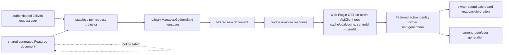
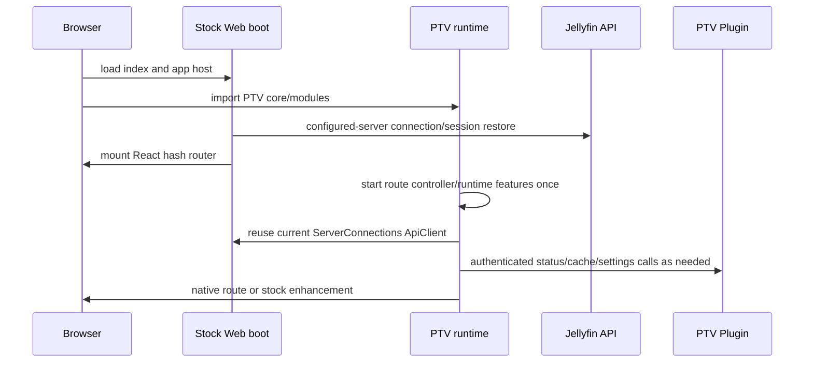

# PTV versus Stock Jellyfin 10.11.11

## Scope and snapshot identity

This chapter compares the verified Jellyfin Web/Server 10.11.11 baseline with the current PiggieTV source tree. It is a source map, not a production-deployment assertion.

| Subject | Identity used here | Evidence |
|---|---|---|
| Stock Jellyfin Web | 10.11.11, commit `35c0793ece3adbd247eab290ae1effab851f3d37` | `VERIFIED_BY_TEST` — whole-tree Git-object comparison recorded in [00-README](00-README.md). |
| Stock Jellyfin Server | 10.11.11, commit `1fbd8739292cce610231be93daf43368733edf63` | `VERIFIED_BY_TEST` — whole-tree Git-object comparison recorded in [00-README](00-README.md). |
| PTV Web | `ptv-version.json` declares `0.5.57`; worktree `HEAD` was `0e9c6284c91003fc64bbe02bf675f1ff6ffd9337` on `agent/p2-ux-user-isolation`, with pre-existing uncommitted changes | `VERIFIED_FROM_SOURCE` — PTV-WEB, `ptv-version.json`, `version`, line 2. `VERIFIED_BY_TEST` — read-only `git rev-parse`, branch, and status inspection during this audit. Because the tree is dirty, every claim below cites the inspected file rather than treating `HEAD` as the full content identity. |
| Embedded PTV Plugin | 0.5.16.0, .NET 9, compiled against Jellyfin Controller/Model 10.11.11 | `VERIFIED_FROM_SOURCE` — PTV-PLUGIN, `src/ptv/plugin/Jellyfin.Plugin.PiggieTV/Jellyfin.Plugin.PiggieTV.csproj`, `PropertyGroup`/`ItemGroup`, lines 1-21. |

A relative-path SHA-256 comparison of the two Web `src` trees found 957 unchanged stock files, 126 changed common files, one stock file absent from PTV (`components/AppHeader.tsx`), and 2,008 PTV-only files. `VERIFIED_BY_TEST` — deterministic inventory over the local verified stock snapshot and current PTV `src` tree. Generated assets and tests are included in the PTV-only count; the count is a modification-surface measure, not 2,008 independent runtime designs.

## Classification vocabulary

| Classification | Meaning in this atlas |
|---|---|
| `STOCK_UNCHANGED` | Content-identical to the verified 10.11.11 file/contract. |
| `STOCK_STYLED` | Stock behavior remains the owner; PTV changes presentation only. |
| `STOCK_WRAPPED` | Stock behavior remains authoritative, with PTV pre/post-processing or view logic around it. |
| `STOCK_EXTENDED` | PTV materially adds behavior inside or beside a stock path without removing the stock path. |
| `STOCK_REPLACED` | A PTV implementation is mounted where the stock UI/controller would normally own the surface. |
| `STOCK_BYPASSED` | PTV intentionally reaches a lower-level contract instead of the stock Web abstraction. |
| `DUPLICATE_IMPLEMENTATION` | PTV and stock each implement materially similar client behavior and can coexist. |
| `NEW_PTV_SYSTEM` | No equivalent stock 10.11.11 product subsystem exists. |

Classification describes architecture, not correctness.

## Runtime composition

```mermaid
flowchart TD
    Entry[PTV-modified stock index.jsx] --> StockBoot[stock appHost / ServerConnections / React boot]
    Entry --> PtvBoot[PTV core app + modules + shell]
    StockBoot --> Router[React hash router]
    PtvBoot --> RouteController[PTV route controller + generation]
    Router --> StockRoutes[remaining stock routes / legacy views]
    Router --> PtvRoutes[PTV native route components]
    PtvBoot --> Enhancers[DOM and event enhancers]
    Enhancers --> StockDOM[stock card / Details / dashboard DOM]
    PtvRoutes --> JellyfinApi[Jellyfin authenticated ApiClient]
    PtvRoutes --> PluginApi[/Ptv/v1 and /Ptv/v2]
    PluginApi --> JellyfinAuthority[Jellyfin users, library, config, sessions]
    PluginApi --> PtvStores[PTV settings, cache, accounts, diagnostics]
```

PTV deliberately boots alongside the stock application: `index.jsx` loads PTV styles/core/header/settings/playback, then retains app-host, configured-server, `ServerConnections`, WebSocket-resume, request-failure, React render, and platform-plugin startup. `VERIFIED_FROM_SOURCE` — PTV-WEB, `src/index.jsx`, `init`, lines 64-165.

The PTV core starts its own router bridge, performance monitor, remote-diagnostics transport, shell foundation, runtime root, and startup readiness exactly once. `VERIFIED_FROM_SOURCE` — PTV-WEB, `src/ptv/core/app.js`, `startPtvRuntimeServices`, lines 20-89. This is an `INTENTIONAL_WRAPPER`: stock still creates the server connection and React application; PTV adds a second application/runtime layer.

## Major surface comparison

Every row identifies the dominant practical implementation. A surface may contain mixed classifications.

| Surface | Stock 10.11.11 | Current PTV | Classification / risk | Breakage modes and minimum future tests | Evidence |
|---|---|---|---|---|---|
| Bootstrap and connection | `index.jsx` initializes app host, connection manager, dictionaries, React, plugins, and platform features. | Keeps the stock sequence but imports PTV runtime modules and versions lazy chunks. | `STOCK_EXTENDED` / **HIGH** because two runtime roots share boot, events, and readiness. | Duplicate initialization, early PTV requests, missing optional chunks, stale build assets. Test cold/warm start, saved/no session, server unavailable, hard refresh, lazy chunk recovery. | Stock: chapter 02. PTV: `src/index.jsx`, `init`, lines 68-165; `src/ptv/core/app.js`, `startPtvRuntimeServices`, lines 31-89. `VERIFIED_FROM_SOURCE`. |
| API client/session authority | Stock `ServerConnections`/ConnectionManager owns current server, token, current user, and sign-in/out. | PTV obtains the same current client/server/user and builds requests through it. PTV logout first retires its caches/queue, then delegates credential/session/route behavior to `Dashboard.logout` or `switchUser`. | `STOCK_WRAPPED` / **CRITICAL** security boundary. | Cross-user cache leakage, duplicate logout, redirect mismatch, request under unresolved identity. Test user A→B, logout offline, expired token, Quick Connect, multiple servers. | `src/ptv/api/client.ts`, `getCurrentPtvApiClient`/`getPtvApiUrl`, lines 63-105 and 151-167; `src/ptv/services/jellyfinLogoutAction.ts`, lines 12-61. `VERIFIED_FROM_SOURCE`. |
| Auth route UX | Stock `ConnectionRequired` gates routes; Server controllers enforce access. | PTV classifies login/signup/content/transient/admin routes and restricts post-login targets. | `STOCK_WRAPPED` / **HIGH**. Server authorization must remain independent. | Open redirect, admin target reuse, login loop, route mismatch. Test encoded/external targets, settings/admin targets, restart and account switch. | `src/ptv/shell/authenticationRoutes.ts`, route sets and `getPtvPostLoginRoute`, lines 12-72 and 116-167. `VERIFIED_FROM_SOURCE`. |
| Header and shell | Stock mounts `components/AppHeader.tsx`. | PTV removes that source file from its tree and imports `ptv/modules/header/AppHeader` into the otherwise stock router layout; shell visibility is based on PTV route classification. | `STOCK_REPLACED` / **HIGH**. | Header absent on a valid path, double navigation listeners, focus/TV remote regression, auth controls out of sync. Test every route family, dialogs, login, dashboard, keyboard/remote. | `src/RootAppRouter.tsx`, imports and `RootAppLayout`, lines 10-18 and 46-71; tree comparison missing-file result. `VERIFIED_FROM_SOURCE` / `VERIFIED_BY_TEST`. |
| Route ownership/history | Stock React Router, compatibility history, and legacy ViewManager coexist. | PTV seeds native paths, classifies native/enhanced/fallback routes from the canonical URL, creates a route key/generation, and publishes state while the stock hash router remains mounted. Presentation classes may reflect mount/teardown state but are not route authority. | `STOCK_WRAPPED` plus `DUPLICATE_IMPLEMENTATION` / **CRITICAL** lifecycle hotspot. | Two owners react to one navigation, stale presentation state claims a new URL, stale completion reaches a new route, duplicate route events, back/replace mismatch. Test forward/back, rapid A→B→A, modal history, same-path different item, Request teardown across Reading navigation, and unmount cancellation. | `src/ptv/shell/routes.js`, Request matcher lines 132-141; `src/ptv/modules/extendedFeatureRoutes.ts`, lines 5-7; `src/ptv/shell/routeController.ts`, feature sets/registry lines 51-134, mode/identity lines 217-290, generation/navigation/listener lines 538-639; `src/RootAppRouter.tsx`, lines 25-43. `VERIFIED_FROM_SOURCE`. |
| Route feature loading | Stock lazy routes load through React route modules. | PTV module index eagerly registers broad modules and separately listens to `hashchange`, `popstate`, and PTV `routechange` to lazy-load dashboard/Reading/Request features. | `STOCK_EXTENDED` / **HIGH**. | Multiple triggers start equivalent work, global listener survives wrong owner, chunk retry loop. Test one import per generation, teardown, failed chunk/retry, platform gates. | `src/ptv/modules/index.js`, module imports and loaders/listeners, lines 1-104. `VERIFIED_FROM_SOURCE`. |
| Home | Stock Home composes configured sections from user preferences and user-scoped APIs. | Stable `/home` directly mounts `NativeHome`; it composes stock Jellyfin rows with Plugin Featured, persisted row rules, recommendations, server+user-scoped Featured response state, timeouts, and route-generation guards. | `STOCK_REPLACED` / **CRITICAL**. | A future incomplete identity key could leak cached Featured, duplicated Items/User Views calls, populated state replaced by partial result, stale route publication, row disappearance. Test restricted users, cold/cache/stale paths, timeout/abort, permission change, empty libraries, unmount. | `src/apps/stable/routes/home.tsx`, lines 1-3; `src/ptv/pages/home/hooks.ts`, identity retirement/revalidation; `src/ptv/modules/cache/featuredContentCache.ts`, identity owner/generation; `src/ptv/core/pluginApi.ts`, authenticated response-cache/coalescing key. `VERIFIED_FROM_SOURCE`. |
| Movies/Shows/TV browse | Stock routes use stock library/list controllers. | Stable routes mount one PTV `NativeBrowsePage` for Movies, Shows, and TV. | `STOCK_REPLACED` / **HIGH**. | Collection-type collapse, wrong parent/library, lost paging/filter/user scope, route reuse. Test each library type, multiple same-type libraries, restricted user, paging/filter/navigation. | `src/apps/stable/routes/movies.tsx`, `shows.tsx`, and `tv.tsx`, imports/exports, lines 1-3. `VERIFIED_FROM_SOURCE`. |
| Cards | Stock Card/CardBuilder owns markup, click/menu/play/favorite/progress behavior. | PTV watches the document for stock card selectors, removes inline playback controls, adds classes, and loads the image again to derive an accent. Native PTV pages also render their own cards. | Stock cards: `STOCK_EXTENDED`; native cards: `DUPLICATE_IMPLEMENTATION` / **HIGH**. | DOM/React disagreement, duplicate image transport, enhancer re-entry, menu/focus loss, removed control without substitute. Test mutation/rerender, image error, grid virtualization, menu actions, keyboard/TV focus. | `src/ptv/modules/cards/index.js`, `init`/module registration, lines 1-35; `CardEnhancer.ts`, selectors/removal/accent/enhance, lines 1-126. `VERIFIED_FROM_SOURCE`. |
| Details | Stock Details controller loads and renders the item and emits lifecycle events. | PTV observes the stock page/`detailsrendered`, adds cinematic/episode/reader state, adopts an exact already-rendered item or performs one coordinated read, and uses a local generation/AbortController. Cinematic enrichment keeps unchanged keyed shelves and artwork nodes mounted as independent sources settle; it inserts only changed shelves and delegates their images to the existing lazy loader. A hidden empty skeleton can accept a still-current late exact relationship, while abort retires it. | `STOCK_WRAPPED` / **CRITICAL**. | DOM mutation after unmount, exact-item mismatch, duplicate readback, stale related-art completion, changed-shelf focus/scroll loss, layout cleanup failure. Test Movie/Series/Season/Episode/Music/Book, late related completion, rapid item changes, Identify, error/abort, back. | `src/ptv/modules/details/index.js`, `prepareDetailItemState`/`applyDetailItem`/`enhanceDetailItem`/lifecycle, lines 648-769 and 780-862; `src/ptv/modules/details/detailsCinematicExperience.ts`, enrichment/render/retirement. `VERIFIED_FROM_SOURCE` / `VERIFIED_BY_TEST` — `detailsCinematicExperience.test.ts`. |
| Search | Stock route has its own query/controller model. | Stable `/search` mounts `NativeSearchPage`, whose route-query state, grouped presentation, request generation/`AbortController`, and effect cleanup own the PTV search lifecycle. | `STOCK_REPLACED` / **HIGH**. | Stale term results, grouping loss, wrong user scope, result navigation mismatch. Test rapid terms, cancel/unmount, empty/error, restricted user, every item family. | `VERIFIED_FROM_SOURCE` — `src/apps/stable/routes/search.tsx`, lines 1-3; PTV-WEB `src/ptv/pages/search/NativeSearchPage.tsx`, component/state lines 849-889, request generation/grouping lines 971-1075, cleanup lines 1154-1174. |
| Music browse and relationships | Stock Music controllers issue separate Album/Artist/Audio queries and consume conditional DTO relationship fields. | PTV mounts `musicPage`, discovers the first accessible Music User View, scopes and coalesces list requests, keeps persistent/memory state, and explicitly reconciles sparse Identify DTOs. | `STOCK_REPLACED` / **CRITICAL**. | Wrong library when multiple exist, AlbumArtist/children erased by sparse adoption, fan-out, cache identity leak, older generation overwrite. Test all relationship shapes, 0/multiple libraries, direct item route, Identify generations, A→B users. | `src/apps/stable/routes/music.tsx`, lines 1-13; `src/ptv/modules/music/musicApi.ts`, scope/cache/coordinator lines 234-335, discovery lines 966-1042, item loaders lines 1319-1402; `musicIdentifyAdoption.ts`, publication guards lines 159-206 and sparse merge lines 368-471. `VERIFIED_FROM_SOURCE`. |
| Music playback/queue | Stock PlaybackManager/player/playlist owns Web playback. | PTV creates a hidden HTML audio element, owns a separate playlist/virtual queue/continuity state, builds streams, and calls stock ApiClient playback-report methods. | `STOCK_BYPASSED` plus `DUPLICATE_IMPLEMENTATION` / **CRITICAL**. | Two Now Playing owners, incorrect media-source/report method, session not stopped, queue survives wrong identity, stock remote controls diverge. Test start/progress/seek/stop, queue edits, server dashboard, WebSocket/remote control, identity change, hard refresh. | `src/ptv/modules/music/musicQueue.ts`, audio owner lines 336-358, report bridge lines 861-920, queue owner lines 1407-1444, identity retirement lines 1892-1899. `VERIFIED_FROM_SOURCE`. |
| Reading library and reader | Stock 10.11.11 treats Books through generic item routes and separate EPUB/PDF/comics player plugins. | `/books` and `/reading` mount PTV `booksPage`; PTV maps Jellyfin item/download data into one native reader, stores progress/bookmarks locally, and derives loading/populated/partial/failed/authoritative-empty presentation from the existing authoritative read outcomes. | `STOCK_REPLACED` plus `NEW_PTV_SYSTEM` / **CRITICAL**. READ-01 is local `PASS`, deployed in 0.5.56, and physically passes Books/Manga/Comics failed-timeout semantics; other physical state variants remain `UNKNOWN`. | Path/format assumption, local progress cross-user/device mismatch, object/render resource leak, Identify/image race, generic Book relation loss. Test EPUB/PDF/CBZ/CBR, unsupported format, A→B, progress restore, abort/unmount, Identify. | `src/apps/stable/routes/books.tsx` and `reading.tsx`, lines 1-3; `src/ptv/modules/books/readingHomeState.ts`; `src/ptv/modules/books/readingRouteCriticalLifecycle.ts`; `src/ptv/modules/reader/providers/jellyfinBookProvider.ts`, `createJellyfinReaderSource`, lines 129-175; `readerProgressStore.ts`, lines 4-55; `ReaderApp.tsx`, load/progress lifecycle lines 37-46 and 70-173. `VERIFIED_FROM_SOURCE` / `VERIFIED_BY_TEST`. |
| Image resolution/failure state | Stock Card/Details/image loader and server image endpoints own URL selection/cache behavior. | PTV provides a global candidate resolver/stable key and bounded five-minute failure registries; Reading, Music, Home, and Details also have specialized image state/observers. | `DUPLICATE_IMPLEMENTATION` / **CRITICAL** cross-surface hotspot. | Owner/tag mismatch, stale art after Identify, repeated fallback requests, one subsystem clears another's failure, multiple browser probes. Test every image type/owner, tagged/untagged, 404→new tag, Identity switch, hard refresh, mutation readback. | `src/ptv/api/images.ts`, failure identity/TTL lines 35-197, URL construction lines 482-527, stable key lines 702-724; `src/ptv/modules/books/readingImageFailures.ts`, registry functions lines 12-83; `src/ptv/modules/music/musicArtworkSourceCoordinator.ts`, loading/failure functions lines 10-106. `VERIFIED_FROM_SOURCE`. |
| Metadata / Identify | Stock Identify sends provider search/apply and does not receive a complete replacement DTO. | The stock `itemidentifier.js` file is materially extended with PTV authority/readback/Reading artwork logic; native Music/Reading pages also own surrounding mutation generations and item adoption. | `STOCK_EXTENDED` plus `DUPLICATE_IMPLEMENTATION` / **CRITICAL**. | Partial metadata/art result misreported, dialog never settles, sparse DTO overwrites children/UserData, old generation publishes, image tag remains stale. Test full/partial/failure/timeout, exact six-read authority policy where applicable, concurrent dialog/route, item-family relationships. | `VERIFIED_FROM_SOURCE` — PTV-WEB `src/components/itemidentifier/itemidentifier.js`, PTV imports/state lines 23-116, Reading apply/artwork/readback outcomes lines 1670-1888, generic generation/mutation/readback/settlement lines 1890-2097; `src/ptv/modules/music/musicIdentifyAdoption.ts`, publication guards lines 159-206 and sparse merge lines 368-471. Stock contract: chapter 13. |
| Recommendations | Stock exposes recommendation/Next Up/resume-like query surfaces but no PTV taste-profile product. | PTV creates an identity-scoped recommendation engine, scoring, feedback, rows, dashboard/Home caches, and Plugin ranking/settings contracts. Each run now carries one diagnostic generation through its existing provider events, so failure remains sticky until authoritative current/newer-generation recovery. | `NEW_PTV_SYSTEM` / **HIGH**. DIAG-03 is local `PASS`, deployed in 0.5.56, and a physical `PARTIAL_PASS`: observed failure stayed degraded, while authoritative complete-success recovery remains `UNKNOWN`. | Cache leaks identity, duplicate library enumeration, stale policy hash, generated rows replace core rows, low-power overload. Test restricted users, feedback, invalidation, duplicate candidates, cache expiry, low-power gate. | `src/ptv/modules/recommendations/engine/recommendationEngine.ts`; `src/ptv/modules/recommendations/providers/jellyfinRecommendationProvider.ts`; `src/ptv/services/diagnostics/webDiagnosticPlatform.ts`; focused recommendation/collector tests. `VERIFIED_FROM_SOURCE` / `VERIFIED_BY_TEST`. |
| Playback video | Stock PlaybackManager, media helper, HTML video player, session reporting, and server encoding remain present. | PTV imports a playback module at boot and changes/wraps stock playback source files with HLS session/stall-recovery and presentation controls. | `STOCK_WRAPPED` / **CRITICAL**. | Source lifecycle split, duplicate recovery, report drift, teardown leak, direct-play/transcode selection regression. Test direct play/direct stream/HLS, seek, stream selection, session reports, stop/back, error/recovery, server restart. | `VERIFIED_FROM_SOURCE` — `src/index.jsx`, playback import line 73; PTV-WEB `src/ptv/modules/playback/index.js`, initialization/destruction/module registration lines 1735-1854. `VERIFIED_BY_TEST` — changed-common-file inventory includes stock `playbackmanager.js`, media helper, and HTML video player. Detailed stock authority is chapter 14. |
| Settings/admin | Stock dashboard forms call configuration/library/task/user/plugin APIs, often with whole documents. | PTV directly replaces `/settings`, changes many dashboard routes, and adds shared server/resource-scoped query snapshots, serialized bounded saves, and dirty-route prompts. | `STOCK_REPLACED` plus `STOCK_WRAPPED` / **CRITICAL**. | Full-document lost update, stale baseline conflict, route blocker remains armed, optional refetch strands pending UI, independent page snapshots race. Test successful/failed/timed-out save, semantic-equal refetch, genuine concurrent edit, A→B pages, permissions, back. | `src/apps/stable/routes/settings.tsx`, lines 1-3; `src/ptv/modules/settings/admin/playback/useAdminPlaybackResource.ts`, lines 45-179; `configuration/useAdminConfigurationSave.ts`, lines 16-164; `configuration/useAdminUnsavedChanges.ts`, lines 4-23. `VERIFIED_FROM_SOURCE`. |
| Calendar/Request/integrations | No stock Servarr calendar or request-aggregation product. | PTV native routes call authenticated Plugin endpoints. The Plugin reads configured Servarr services, performs the provider calendar requests, aggregates results, and exposes public settings with API keys nulled and only a configured-status boolean retained. | `NEW_PTV_SYSTEM` / **HIGH**. | Capability gate disagrees with endpoint, partial provider failure hides healthy data, stale config availability, secret exposure. Test no/one/multiple providers, auth failure/timeout, cache invalidation, token redaction, route update. | `VERIFIED_FROM_SOURCE` — `src/apps/stable/routes/calendar.tsx`, lines 1-3; `src/ptv/modules/calendar/PiggieTvCalendarPage.tsx`, load/terminal/degraded state lines 183-255; PTV-PLUGIN `Api/PtvStatusController.cs`, calendar entry/aggregation lines 1448-1510 and provider request dispatch lines 1693-1735; `Models/PtvPluginSettingsDto.cs`, public settings projection lines 813-888. |
| Diagnostics | Stock logs/metrics/dashboard exist; no PTV client event ledger/remote check-in product. | PTV starts performance and remote-diagnostic services, maintains browser diagnostics, and the Plugin resolves authorization owners before accepting check-ins/reports, stores sanitized reports, and exposes administrator report/storage actions. Route diagnostics use the routeController identity/generation and route-owned terminal lifecycle; the 0.5.57 local candidate also removes transient Request DOM state from upstream route classification. Request health uses active physical transports rather than completed/coalesced consumers. | `NEW_PTV_SYSTEM` / **HIGH** because it observes every other owner. The DIAG-01 implementation and local release gates pass; production 0.5.56 DIAG-01 remains `FAIL/HOLD`, and physical validation is pending. DIAG-02 is `PASS`, DIAG-04 threshold `UNKNOWN`, and DIAG-05 remains open. | Instrumentation changes timing, sensitive payload retention, health classification diverges from actual degradation, unbounded events. Test redaction, caps/retention, disabled mode, high-volume image/API events, cross-user retirement. | `VERIFIED_FROM_SOURCE` / `VERIFIED_BY_TEST` — focused **6 files / 86 tests**, full PTV **364 / 3056**, full repository **438 / 3589**, TypeScript, targeted and repository ESLint, Stylelint baseline, version/provenance and diff checks, and production build pass. The Music lint delta was cleared by a type-only `Promise<null | void>` return annotation with both `void` call sites retained. Web 0.5.57 is **NOT DEPLOYED**; production evidence remains the 0.5.56 acceptance report sections 10–13. |
| Plugin endpoints/state | Stock plugins register DI/controllers inside Jellyfin; Jellyfin users/library/config/session APIs remain authoritative. | Embedded Plugin adds Featured, recommendations, relationships, accounts/email/signup, Reading/Music metadata, metadata quality, integrations/calendar, diagnostics, and media reports. | `NEW_PTV_SYSTEM`, generally `STOCK_WRAPPED` server-side / **CRITICAL** security and compatibility boundary. | Missing auth policy, schema drift, singleton/shared cache leaks users, Plugin/Jellyfin version mismatch, endpoint unavailable while Web gates true. Test every controller's anonymous/restricted/admin matrix, response schema, concurrency, restart, Web compatibility. | PTV-PLUGIN `PluginServiceRegistrator.cs`, route advertisement and DI registrations lines 13-68; `PtvApiRoutes.cs`, versioned routes lines 6-101; `.csproj`, lines 1-21. `VERIFIED_FROM_SOURCE`. |
| Build/service worker/assets | Stock webpack emits chunks, and the stock service worker provides its documented worker lifecycle; source does not establish a universal application-data cache. | PTV changes webpack/service-worker files and injects build/commit identity into chunk URLs; `ptv-version.json`, not `package.json`, owns PTV release version. | `STOCK_EXTENDED` / **HIGH**. | Mixed asset generations, stale service worker, provenance drift, missing lazy chunk after deploy/rollback. Test clean build identity, atomic deployment, SW update, old-tab navigation, lazy chunks, rollback. | `VERIFIED_FROM_SOURCE` — PTV-WEB `webpack.common.js`, build identity inputs/output naming lines 10, 26-34, 65-85, and 148-155; `src/serviceworker.js`, worker lifecycle lines 39-48; `src/index.jsx`, production chunk identity lines 75-80; `ptv-version.json`, line 2. Stock flow: chapter 18. |

## PTV Plugin trust boundaries

The Plugin is loaded through Jellyfin's normal Plugin DI mechanism, but its endpoints are additional security boundaries. Service registration is singleton-heavy and includes both shared caches/stores and per-request controllers. `VERIFIED_FROM_SOURCE` — PTV-PLUGIN, `PluginServiceRegistrator.cs`, `RegisterServices`, lines 13-68; stock Plugin composition is chapter 01.

Featured content demonstrates the required pattern:



`GET /Ptv/v1/featured` resolves the authenticated user, reads the shared store, applies the authorization service before returning, fails closed when user resolution fails, and sends private/no-store headers. `VERIFIED_FROM_SOURCE` — PTV-PLUGIN, `Api/PtvStatusController.cs`, `GetFeaturedContent`, lines 329-396. The projector resolves the Jellyfin user, checks every candidate with `ILibraryManager.GetItemById<BaseItem>(itemId, user)`, builds a new filtered document, and returns counts rather than modifying the source. `VERIFIED_FROM_SOURCE` — `Services/PtvFeaturedContentAuthorizationService.cs`, `AuthorizeForUser`, lines 203-305. Web transport and memory layers preserve that projection under the canonical immutable Jellyfin server/user identity: differently scoped consumers neither coalesce nor share cached responses, authenticated Featured transport cannot fall through to a different server root, owner-bound dashboard readback cannot hydrate after an identity transition, queued memory hits reassert ownership, and old identity completion cannot publish into the new owner. `VERIFIED_FROM_SOURCE` — PTV-WEB, `src/ptv/core/pluginApi.ts`, authenticated request/cache identity and active-root-only candidate discovery; `src/ptv/modules/cache/featuredContentCache.ts`, active identity generation/owner-bound resolver and hydrator; `src/ptv/modules/dashboard/PiggieTvRowsPage.tsx`, guarded Featured readback. The Web-side item reconciliation in `src/ptv/pages/home/hooks.ts` remains defense-in-depth rather than the security boundary.

For other Plugin endpoints, route presence alone does not prove an authorization policy. The controller-by-controller contract table belongs in [24-stock-api-contract-reference](24-stock-api-contract-reference.md) for stock endpoints; a complete PTV endpoint security matrix remains a required future artifact and is `UNKNOWN` in this source atlas.

## Isolated 0.5.57 candidate — configured presentation freshness

This section describes the isolated matched PATCHED candidate and its manifest-derived startup-recovery successor, not production or the working repository. Frozen PATCHED is Web `0.5.57` / Plugin `0.5.16.0`. The locally qualified successor is Web `0.5.57` unchanged / Plugin `0.5.17.0`, still compatible with Jellyfin `10.11.11`; current gate evidence is recorded in the startup-recovery report. Physical post-fix acceptance remains pending.

The server-side Featured item-access boundary above remains authoritative. Opaque configured-row associations are a separate presentation contract, not permission to access an item and not a signature over a full payload. Current protected status, administrator settings/rows, and authorized Featured projection expose response-only `currentPresentationAuthority = {version:1,scope,generation}`. Both strings are opaque lowercase hex64. Status additionally includes administrator-only `configuredPresentationBindings` containing exact issued rule/section pairs. Restricted users receive no administrator mapping. Old/untrusted disk caches cannot acquire a current binding merely because their legacy configuration hash matches. A process restart, configuration epoch transition, or trusted regeneration produces a distinct proof; no response-only metadata is persisted into row settings. `VERIFIED_FROM_SOURCE` — Plugin `PtvConfiguredRowAssociationService.CaptureCurrentPresentationProof/CreateRowsResponse/Projection.CreateAuthority`, `PtvStatusController.GetStatus/GetCurrentPresentationProofAsync`, and `PtvFeaturedContentAuthorizationService.AuthorizeForUser`.

`configuredRowFreshness.ts` is the single bounded Web **presentation** owner. It uses the existing immutable server/user identity, a private proof handle, and a local retirement revision. After both settings and Featured inputs resolve, `hooks.ts` starts a protected `getStatus({bypassCache:true,signal})` transport and verifies its directly returned authority and exact issued pairs. Existing bypass semantics avoid both response-cache reuse and joining an earlier Plugin in-flight request. Two matching cached inputs alone cannot grant CURRENT. Ordinary status/settings/Featured observations can retire a proof but cannot promote one. `VERIFIED_FROM_SOURCE` — `verifyConfiguredRowFreshness`, `isConfiguredSectionVerified`, Home verification integration, and `pluginApi.ts` authority observations.

**CURRENT means current at the final verified authoritative server read.** It is not a lease, continuously synchronized state, or knowledge of an unobserved later server change. An observed mismatch, missing/ambiguous authority, failure, connection uncertainty, route retirement, or identity transition removes configured presentation until an explicit new verification. Last-good rows, merged state, configured-derived Hero lists, focused/pending previews, delayed callbacks, and image-layer fades cannot borrow the next proof. The legacy renderer omits configured sections when it lacks the native verifier, and restores saved HTML only for explicitly captured generic rows. Independently owned Hero, Continue, and recommendation/personalization data remain independent. `VERIFIED_FROM_SOURCE` — `retainCurrentNativeHomePresentation`, `useConfiguredHomePreview`, `legacyConfiguredPresentation`, `homesections.restoreCachedVirtualRow`; `VERIFIED_BY_TEST` — the corresponding freshness, preview, legacy lifecycle, and shell-backdrop suites.

SEC-01 deliberately removes private legacy `rowConfigHash` from the per-user projection. `isFeaturedPayloadCurrentForRows` therefore permits the independently verified current private proof as an alternative to that old presentation hash check. This is not hashless unconditional adoption: configured sections still require the exact issued pair and live private proof, and matching old opaque inputs alone still fail. The actual `useNativeHomeData` integration fixture exercises the hashless authorized payload through final status and background row publication. `VERIFIED_FROM_SOURCE` — `hooks.ts`, `isFeaturedPayloadCurrentForRows`; test reference: `useNativeHomeFreshness.integration.test.tsx`.

This candidate introduces one explicit status verification per eligible configured-input verification attempt; it does not change shared request identity, TTLs, timeout ceilings, concurrency, retries, route schedules, Jellyfin authorization, item DTOs, or playback ownership. Pressure and physical acceptance must be measured separately. Stock snapshot/event non-guarantees in chapters 24–25 remain unchanged.

### Configured-row startup recovery derivative (2026-09-07)

CT103 reproduced missing Latest Movies/Shows/Music after frozen PATCHED restarted: the fresh persisted content passed the old conditional TTL check while the new-process issuer correctly had no trusted binding. Content freshness and current-process trust are independent. This was an availability defect, not evidence of item-authorization failure. Historical CONTROL/PATCHED artifacts remain frozen.

`PtvFeaturedContentRefreshService.RefreshIfNeededAsync` now checks freshness and `PtvConfiguredRowAssociationService.HasCurrentStoreBinding` **inside the existing refresh semaphore**. That predicate only observes the exact current generation/document digest; it never registers old content. Missing current binding causes normal generation through the same owner. Only the unchanged `WriteGeneratedAsync`/current captured generation path can establish trust. Concurrent conditional callers recheck after the owner completes; successful recovery makes subsequent reads no-ops. Forced refresh keeps its original independent regeneration semantics.

Failed or config-retired recovery retains ordinary authorized cached content without issuing a proof and sets a 15-minute retry through the existing hosted owner. A single replaceable asynchronous schedule signal wakes an already-sleeping owner when that deadline changes; no polling, per-read timer, recursive GET, or second generation owner is added. Successful trust recovery clears the deadline. Outside missing-trust recovery, persisted expiry and the old 60-second floor remain authoritative; normal content TTL, generation timeout, queries, provider logic, Web request policy, SEC-01 redaction and Web final-read/retirement rules are unchanged. Optional `TimeProvider` defaults to the system clock and supports deterministic scheduler tests.

`VERIFIED_FROM_SOURCE` / `VERIFIED_BY_TEST` — the two services above and `PtvConfiguredRowAssociationTests`: process-A disk -> process-B recovery; fresh/expired content; exact three rule/section mappings and synthetic item membership; concurrent readers; forced refresh; failure/retry; config change/A->B->A; empty source; partial/zero authorized survivors; hosted startup; active-wait rescheduling and ordinary-expired failure cadence. Full local evidence is in `release-recovery-20260907/startup-recovery/REPORT.md`. Component proof is not CT103 post-fix browser/restart acceptance.

## Isolated Plugin 0.5.18 persisted-recommendations authorization

This derivative changes only the v1 persisted-recommendations response boundary; Web stays at the accepted frozen 0.5.57. Attempt05's startup/configured-row acceptance remains accepted. Local implementation/test status is recorded in the derivative repair report, not inferred from historical chapter-wide deployment labels.

The required flow is authenticated principal → actual Jellyfin user → requested user/server scope → detached persisted candidate IDs → `ILibraryManager.GetItemById<BaseItem>(id, user)` → eagerly materialized authorized response. A global recommendation row is not an access grant. The null-user/GUID-only lookup is not used as authorization, and no per-user result is written back into global settings.

Stored row identifiers, headings and explanations can refer to a watched subject omitted from candidate Items. Therefore authorizing every returned item is insufficient to authorize that row text. The v1 projection uses neutral response-only labels and sequential response-local row IDs after empty-row removal; item names/types come from resolved visible Jellyfin items, and scores use survivor order. JSON fields remain compatible, duplicates survive in original order, and missing/deleted/invalid/non-library items are excluded without a reason disclosure. No synthetic persisted-media exception is established. Home's separate settings/Rows/Featured composition and v2 ranking are outside this change.

Authority evidence: stock 10.11.11 `LibraryManager.GetItemById<T>(Guid, User)` / `ItemIsVisible`; PTV producer `recommendationRows.ts` Because You Watched subject exclusion; `PtvRecommendationController.GetPersistedRecommendations`; see chapters 04, 23–25. Physical admin/restricted-user acceptance requires separate CT103 authorization; no deployment is asserted here.

## Complete PTV workflow overlays

### Application start



Stock still owns connection/session establishment; PTV owns its additional readiness, route generation, caches, and feature modules. `VERIFIED_FROM_SOURCE` — the boot/session citations above.

### Open an item

On native browse/search/Home, a PTV card navigates through the shared hash history. For a stock Details surface, stock renders the authoritative item projection and emits `detailsrendered`; PTV verifies route/item/server identity, adds its enhancement, and may fetch related artwork. `VERIFIED_FROM_SOURCE` — PTV-WEB, `src/ptv/modules/details/index.js`, lines 669-769 and 780-827. Any change to card navigation, route identity, DTO fields, Details DOM, or image resolution therefore crosses at least four owners.

### Identify an item

Provider search/apply remains a Jellyfin server metadata mutation, but PTV extends the stock dialog and adds client authority/readback/adoption. Music adoption publishes only when route, identity, generation, exact item, readback code, and mounted owner still match, then merges safe presentation/relationship/image/provider fields instead of replacing the object. `VERIFIED_FROM_SOURCE` — PTV-WEB, `src/ptv/modules/music/musicIdentifyAdoption.ts`, lines 159-206 and 368-471. This correctly addresses stock's non-guarantee that Apply returns a complete DTO; future changes must preserve the guard and richer state.

### Play a Music album

PTV Music discovers a user-visible Music view, loads albums and Audio children through Jellyfin item APIs, creates its own client queue/audio owner, derives the stream URL through the Jellyfin ApiClient, and reports start/progress/stop through Jellyfin session APIs. `VERIFIED_FROM_SOURCE` — PTV-WEB, `src/ptv/modules/music/musicApi.ts`, lines 966-1042 and 1319-1402; `src/ptv/modules/music/musicQueue.ts`, lines 336-358, 861-920, and 1407-1444. Jellyfin remains authoritative for accessible items, stream bytes, and reported server session; PTV is authoritative for this native queue and its continuity view.

### Change a user permission

The Jellyfin user policy/library manager remains authoritative on the next server request. PTV client caches are separate derived projections and must be retired or revalidated; logout currently retires Music, recommendations, Home, and Featured memory state. `VERIFIED_FROM_SOURCE` — PTV-WEB, `src/ptv/services/jellyfinLogoutAction.ts`, lines 12-26. The Featured Plugin response also applies current per-user item access before serialization. `VERIFIED_FROM_SOURCE` — Plugin citations above. Immediate same-session convergence after an administrator changes another user's policy, without logout/refetch/event, is `UNKNOWN`.

## Stabilization implementation, 0.5.56 production acceptance, and 0.5.57 DIAG-01 release candidate

| Finding | Current local contract | Evidence state | Operational state |
|---|---|---|---|
| READ-01 | Reading presentation adopts one derived state from already-loaded authoritative section/cache/library outcomes: `loading`, `populated`, `partial`, `failed`, or `authoritative-empty`. Failure and authoritative empty are mutually exclusive; cached data with refresh failure is partial. | Local `PASS` / `VERIFIED_BY_TEST` — `readingHomeState.test.ts` and `readingRouteCriticalLifecycle.test.ts`. Production failure branch `VERIFIED_BY_TEST`: Books, Manga, and Comics timeouts rendered failure and never authoritative empty. | `DEPLOYED` in Web 0.5.56; physical `PASS` for the reported failure-versus-empty invariant. True-empty, populated, cached-refresh-failure, and hard-refresh variants remain `UNKNOWN`. |
| DIAG-01 | The diagnostic collector keys a route session by canonical navigation identity plus controller generation. The 0.5.57 local release candidate fixes the upstream split by deriving Request ownership from the canonical hash rather than the transient `ptv-request-active` presentation class; removing that stale class on Manga no longer changes ownership or generation. | Implementation and local release gates `PASS` / `VERIFIED_BY_TEST`: focused **6 files / 86 tests**, full PTV **364 files / 3056 tests**, full repository **438 files / 3589 tests**, TypeScript, targeted and repository ESLint, Stylelint baseline, version/provenance and diff checks, and production build pass. Production 0.5.56 remains `FAIL`: one direct Manga navigation created Reading generations 9 and 10 (`route-69` and `route-6h`) 50 ms apart. The two Music lint errors were cleared by a semantics-preserving `Promise<null | void>` return annotation; both `void` call sites remain and no Music runtime owner changed. | Implementation `PASS`; local release `PASS`; Web 0.5.57; **NOT DEPLOYED**; physical `VALIDATION_PENDING`; production 0.5.56 physical `FAIL/HOLD`. |
| DIAG-02 | Only the matching routeController owner may publish critical pending/terminal state. Undeclared and pending routes do not settle from DOM/layout heuristics; terminal success/partial/empty/failed/cancelled is route-owned. | Local `PASS` / `VERIFIED_BY_TEST`. Production observations `PASS`: failed Reading and successful Calendar routes settled 586–694 ms after terminal state with zero active requests. The repeated global pending-image value does not establish route-scoped image accounting. | `DEPLOYED` in Web 0.5.56; physical `PASS` for the requested critical-work/settlement boundary; DIAG-05 remains separate. |
| DIAG-03 | Recommendation producers propagate one run generation through existing events; collector failure is sticky until proven current/newer-generation success and stale generations cannot overwrite it. | Local `PASS` / `VERIFIED_BY_TEST`. Production observed a source failure remain degraded with zero rows; no authoritative complete-success recovery was observed. | `DEPLOYED` in Web 0.5.56; physical `PARTIAL_PASS`; recovery path `UNKNOWN`. |
| DIAG-04 | Seven active physical transports degrade health before completion; coalesced consumers are excluded and cancellation-only retirement can recover without false request failure. | Local `PASS` / `VERIFIED_BY_TEST`. Production export separated 50 physical transports from 12 coalesced consumers, but peak physical concurrency was 5. | `DEPLOYED` in Web 0.5.56; physical seven-request threshold `UNKNOWN`. |

These changes add **zero network requests**: Reading classifies existing results, route owners emit local observability, recommendation generation annotates existing events, concurrency derives from the existing request begin/complete ledger, and the DIAG-01 candidate corrects only Request route authority. The 0.5.56 production acceptance is documented in `C:/Users/Piggie/Documents/PTV_WEB_0.5.56_PRODUCTION_DEPLOYMENT_ACCEPTANCE_REPORT.md`. DIAG-01 implementation and local release gates pass, and Web was bumped once to 0.5.57 after a type-only Music return annotation cleared the lint delta without changing runtime behavior. No deployment occurred, physical validation remains pending, and production DIAG-01 therefore remains `FAIL/HOLD`. DIAG-05 and IMG-01 remain open, so STAB-02 and STAB-03 remain open.

## Contracts PTV currently preserves correctly

- **One session authority:** PTV uses stock `ServerConnections`/ApiClient and delegates actual logout. `VERIFIED_FROM_SOURCE` — `src/ptv/api/client.ts`, lines 74-104; `jellyfinLogoutAction.ts`, lines 29-61.
- **Server-side Featured authorization:** current access is checked before the Plugin response, with unresolved users denied. `VERIFIED_FROM_SOURCE` — `PtvStatusController.cs`, lines 329-396; `PtvFeaturedContentAuthorizationService.cs`, lines 215-305.
- **Web Featured identity preservation:** authenticated Plugin GET sharing and Featured memory/in-flight adoption use the same stable Jellyfin server/user identity. Featured reads stay on the active ApiClient root while retaining same-root compatibility routes. Missing identity cannot collapse to a global cache, sign-in/out retires response state, Featured retains only one active identity owner, dashboard readback/hydration captures that owner, queued memory hits reassert it, and late prior-owner completion is rejected. `VERIFIED_FROM_SOURCE` — `src/ptv/core/pluginApi.ts`, `getPluginRootCandidates/getPluginAuthenticatedIdentity/requestPluginJson`; `src/ptv/modules/cache/featuredContentCache.ts`, `requireCurrentFeaturedCacheOwner/resolveForFeaturedCacheOwner/createFeaturedContentCacheDocumentHydrator`; `src/ptv/modules/dashboard/PiggieTvRowsPage.tsx`, guarded Featured readback helpers.
- **Identity-aware request coalescing:** coordinated GET keys include method, authorization identity, and URL; unresolved authenticated requests receive unique pending identities rather than sharing. `VERIFIED_FROM_SOURCE` — `src/ptv/api/client.ts`, lines 399-428; `src/ptv/services/requestCoordinator.ts`, `getPtvRequestCoordinatorKey`/`coordinatePtvJsonRequest`, lines 358-375 and 515-568.
- **Stale route protection in core native paths:** route key/generation helpers exist, and Native Home and Music Identify additionally validate current identity/owner. `VERIFIED_FROM_SOURCE` — `routeController.ts`, lines 538-551; `home/hooks.ts`, lines 3469-3508; `musicIdentifyAdoption.ts`, lines 173-206.
- **Sparse Identify reconciliation:** confirmed Music DTOs selectively update relationship fields and merge image/provider maps. `VERIFIED_FROM_SOURCE` — `musicIdentifyAdoption.ts`, lines 368-423.
- **Bounded admin save settlement:** the shared save hook aborts on unmount/timeout and clears `saving` in `finally`; playback resources cancel the exact query and replace the baseline only after confirmed save. `VERIFIED_FROM_SOURCE` — `useAdminConfigurationSave.ts`, lines 97-164; `useAdminPlaybackResource.ts`, lines 121-160.
- **Jellyfin package compatibility is explicit:** Plugin build references 10.11.11 Controller/Model packages. `VERIFIED_FROM_SOURCE` — Plugin `.csproj`, lines 9-21.

## Known reasons and unknown intent

Comments and source structure establish several reasons: PTV explicitly owns the visual layer, defers optional plugins until after a useful shell, protects low-power clients, retains stale Featured data on refresh failure, and preserves stock logout authority. `VERIFIED_FROM_SOURCE` — `src/index.jsx`, lines 66-80 and 156-160; `recommendationEngine.ts`, lines 66-71; `featuredContentCache.ts`, lines 1430-1490; `jellyfinLogoutAction.ts`, lines 29-35.

Historical product rationale for every changed stock file is `UNKNOWN`; Git history was not used to assign intent to pre-existing dirty changes. A classification in this chapter must therefore not be read as approval to delete a wrapper or consolidate a duplicate owner.

## Required interpretation

1. Jellyfin Server remains authoritative for authentication, user permissions, accessible library items, stored metadata, configuration, playback sources, and server sessions.
2. PTV owns many route/view/cache/queue/diagnostic projections and several Plugin-persisted domains.
3. A native PTV route can replace the stock presentation without replacing the underlying Jellyfin contract.
4. Any duplicated owner must have an explicit convergence and retirement contract; coexisting source files alone do not provide one.
5. Before changing a row above, use [22-change-impact-matrix](22-change-impact-matrix.md) and [23-before-you-modify-checklists](23-before-you-modify-checklists.md).

Statements 1-4 are `INFERRED` summaries of the source-verified ownership edges in this chapter and chapters 01-19.
