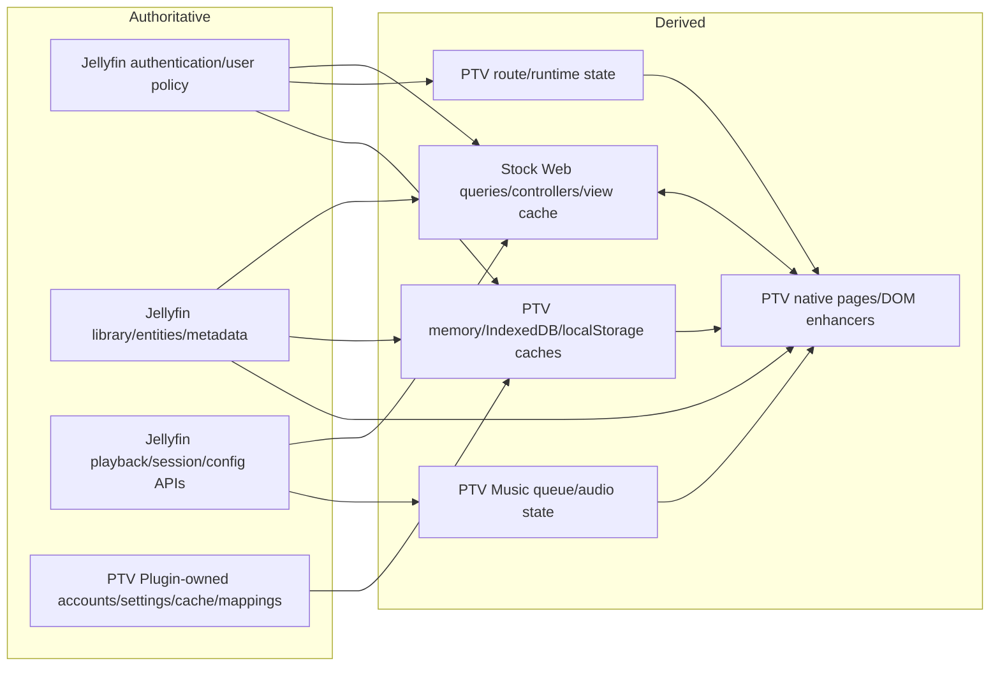

# PTV Ownership and Conflict Register

## Purpose

This register identifies where stock Jellyfin and PTV share, duplicate, or compete for state. It does **not** prescribe consolidation and it does not label every duplicate as a defect. The authoritative contracts remain the stock 10.11.11 behavior documented in chapters 01-19 and 24-25; PTV differences are source-inspected from the dirty Web 0.5.57/Plugin 0.5.16.0 tree identified in chapter 20.

## Local Web 0.5.60 stabilization Pass 01 (not deployed)

This additive record applies to `fix/web-library-isolation`, based on `4eda45c8c6bd56a8f6ab9e31fa81ddc13d5e0073`. It does not supersede historical release/physical-acceptance records or change Plugin behavior.

| Producer / owner | Classification and corrected contract |
|---|---|
| Movies/Shows/Anime/Cartoons Featured, Continue, Latest/Recently Added, genre/studio/network/tag shelves and focused pages | `LIBRARY_SCOPED`: `browseData.getPtvBrowseScopedItems` uses ordinary authenticated per-root `ParentId` reads. Multi-root reads merge bounded results; nested parents require a matching user-aware Ancestors read. Unsupported HTTP `AncestorIds` and explicit-IDs membership shortcuts are not proof. |
| Library Recommended | Formerly `BUGGY_GLOBAL`: global engine ranking was selected by heuristic Movie/Series category, losing the resolved library. Now a fresh scoped item pool is read first; ranking may order only its IDs, using the scoped DTOs. Empty/error membership never broadens. Anime's heuristic `anime` label is not membership. |
| Library fallback/cache | `LIBRARY_SCOPED`: fallback reuses only that fresh pool. Focused cache schema `library-scope-v2` retains server/user/root/route/filter/page identity; incompatible prior entries are not consumed. Directory cache remains root/identity-scoped. Library child owners retire on scope-resolution-key changes. |
| Home/hub Made For You, Hidden Gems, configured/generated Home rows, global ranking cache, Premium Collections | `GLOBAL_BY_DESIGN`: no library page may treat their global ranking/snapshots as membership. Global Home and collection semantics remain unchanged. |
| Native Home presentation and active preview | `SAFE_REDUNDANCY`: derived rows/hero authorities are memoized on state, identity and the exact freshness snapshot; repeating the same item reference/proof is a no-op. Changed DTOs remain adoptable. Old callbacks retain their captured proof and cannot borrow a new one. |

`VERIFIED_FROM_SOURCE` / focused `VERIFIED_BY_TEST`: `NativeBrowsePage.tsx`, `browseData.ts`, `browseRecommendations.ts`, `hooks.ts`, `useConfiguredHomePreview.ts`, their focused tests and `useNativeHomeFreshness.integration.test.tsx`. The reproduced Home Maximum-update-depth loop came from cloned authority maps changing a hero-effect callback, which allocated another preview on every render; it is separate from library membership. Populated Cartoons live acceptance is not established: the existing local test backend has no Cartoons library. No production acceptance is claimed.

Bounded review corrections preserve grouped stock UserViews: where physical ancestry cannot represent a projected root, only Series-to-Season navigation may prove the Series ID by ordinary recursive, paged reads of the resolved UserView. Other nested/BoxSet queries remain closed; this is not an explicit-ID shortcut or a general ancestry bypass. Multi-root Random pools interleave before deduplication/limiting. `usePtvBrowseBackdrop` binds URL and callbacks to an exact scope/availability owner; retirement resets the retained shell image layer and same-scope recovery cannot revive an old URL/callback.

## Ownership vocabulary

The ledger uses the requested ownership roles: `AUTHORITATIVE_OWNER`, `DERIVED_OWNER`, `CACHE_OWNER`, `VIEW_OWNER`, `OBSERVER`, `COMPATIBILITY_LAYER`, and `DUPLICATED_OWNER`. `DUPLICATED_OWNER` describes two implementations retaining ownership of equivalent state or behavior; it is an ownership condition, not a Phase 6 conflict verdict. The separate PTV modification label for duplicated code is `DUPLICATE_IMPLEMENTATION`.

## Conflict vocabulary

| Label | Meaning |
|---|---|
| `SAFE_REDUNDANCY` | Independent state is intentionally defensive/derived and has a demonstrated identity/retirement boundary. |
| `INTENTIONAL_WRAPPER` | PTV surrounds a stock owner while explicitly leaving authority with stock/Jellyfin. |
| `ACTIVE_CONFLICT` | Two live paths can write or render the same resource without one unambiguous arbitration point. |
| `RACE_RISK` | Multiple async/lifecycle owners exist; the inspected source includes some guards, but not a universal convergence guarantee. |
| `LEGACY_BYPASS` | PTV reaches a lower-level or DOM contract instead of the stock Web abstraction. |
| `UNKNOWN` | Source inspected here cannot prove exclusivity, convergence, or runtime activation. |

## Ownership graph

Jellyfin remains the authority for principal, access, entities, metadata, configuration, playback plans, and server sessions. PTV becomes authoritative only for PTV-specific persisted domains and client-only constructs such as its Music queue and reader progress. `INFERRED` from the source-verified edges below.

## Resource ownership ledger

The lifecycle column combines creation, reads/writes, observers, caches, invalidation, destruction, async boundaries, and concurrency protection so a future change has one compact lookup.

| Resource/state | Owner roles | Lifecycle and concurrency contract | Conflict classification | Evidence |
|---|---|---|---|---|
| Authenticated session/token | `AUTHORITATIVE_OWNER`: Jellyfin request authentication and stock ConnectionManager/credentials. `VIEW_OWNER`: stock/ PTV login shell. `OBSERVER`: PTV runtime. | Stock creates/restores the client session. PTV reads the current ApiClient/server/user, retires PTV identity state, and delegates credential deletion/events/redirect to `Dashboard.logout`. Async duplicate exits share `logoutInFlight`. | `INTENTIONAL_WRAPPER`; **CRITICAL** if bypassed. | `VERIFIED_FROM_SOURCE` — PTV-WEB, `src/ptv/api/client.ts`, `getCurrentPtvApiClient`/identity helpers, lines 63-105; `src/ptv/services/jellyfinLogoutAction.ts`, lines 4-65. Stock: chapters 02 and 04. |
| User permission/library visibility | `AUTHORITATIVE_OWNER`: Jellyfin user policy + user-aware library manager/query. `DERIVED_OWNER`: stock and PTV lists/caches. | Created/written by Jellyfin admin/config paths; enforced per server request. Client projections remain until refetch/identity retirement. Plugin Featured resolves the request user and filters every candidate before response; unresolved user fails closed. | `SAFE_REDUNDANCY` for current Featured Web revalidation; `RACE_RISK` for other long-lived client caches after an in-session permission change. | `VERIFIED_FROM_SOURCE` — PTV-PLUGIN, `Api/PtvStatusController.cs`, `GetFeaturedContent`, lines 329-396; `Services/PtvFeaturedContentAuthorizationService.cs`, `AuthorizeForUser`, lines 215-305; PTV-WEB, `src/ptv/pages/home/hooks.ts`, revalidation lines 194-230. Stock: chapters 04-05. |
| Route/history/current page | `AUTHORITATIVE_OWNER`: React hash router/browser history. `COMPATIBILITY_LAYER`: stock history/ViewManager. `LIFETIME_OWNER`: PTV `routeController` for opted-in PTV work. | Browser/React writes location. PTV's controller derives the route key and frozen family/generation/identity/signal lifetime from that canonical URL; presentation classes are not route authority. Same-family remount or route change retires the old lifetime, and route settlement accepts only a matching owner's terminal critical lifecycle. Production 0.5.56 violated this contract because stale `ptv-request-active` state briefly claimed a Manga URL before cleanup. The Web 0.5.57 local candidate matches Request by canonical hash, so class cleanup cannot create another Reading generation. | Candidate implementation and local release gates: `SAFE_REDUNDANCY` / `PASS`; production 0.5.56 diagnostic path: `ACTIVE_CONFLICT` / `FAIL`; general bridge remains `RACE_RISK`. The operational gate remains `HOLD` because the candidate is **NOT DEPLOYED** and physical acceptance is pending. | `VERIFIED_FROM_SOURCE` — `routes.js`, `extendedFeatureRoutes.ts`, routeController/critical/diagnostic/Home sources. `VERIFIED_BY_TEST` — focused candidate matrix (**6 files / 86 tests**), full PTV **364 / 3056**, full repository **438 / 3589**, and production report section 10. |
| Header/sidebar/navigation model | `VIEW_OWNER`: PTV AppHeader/sidebar. `COMPATIBILITY_LAYER`: stock router/page layout and legacy page events. | PTV header is mounted by the root router and hidden by route classification; stock `components/AppHeader.tsx` is absent from the PTV tree. PTV module/navigation state reacts to the same location. Teardown follows React for the header and PTV scopes for modules. | `ACTIVE_CONFLICT` is **not** proven because stock header source is removed; remaining overlap is `INTENTIONAL_WRAPPER` / `RACE_RISK` around route visibility and events. | `VERIFIED_FROM_SOURCE` — `src/RootAppRouter.tsx`, lines 10-18 and 46-71. `VERIFIED_BY_TEST` — relative source inventory found stock `components/AppHeader.tsx` as the sole missing stock file. |
| Library contents/item metadata | `AUTHORITATIVE_OWNER`: Jellyfin entities/repository/provider managers. `DERIVED_OWNER`: DTOs, stock queries, PTV page state. `CACHE_OWNER`: QueryClient, PTV caches. | Server scan/mutation writes entities; each endpoint returns a requested/user-scoped projection. PTV Music and Home load/cache selected projections; Identify selectively reconciles a confirmed DTO. Invalidation is feature-owned rather than one global identity map. | `RACE_RISK` for sparse/older projection replacing richer state; current Music reconciliation is `SAFE_REDUNDANCY`. | `VERIFIED_FROM_SOURCE` — PTV-WEB, `src/ptv/modules/music/musicIdentifyAdoption.ts`, guards lines 159-206 and merge lines 368-471; `src/ptv/utils/libraryIndexCache.ts`, IndexedDB TTL/scope lines 10-15 and 118-126. Stock chapters 05, 13, 16, 25. |
| Home sections/Featured | `AUTHORITATIVE_OWNER`: stock user preferences + Jellyfin query results for stock rows; Plugin settings/shared generator for PTV Featured definition. `CACHE_OWNER`: Plugin raw store, per-user Plugin response projection, identity-scoped Plugin API GET cache/coalescing, and one active Web Featured identity generation. `VIEW_OWNER`: Home/dashboard. | Plugin 0.5.16.0 projects its shared document per request user before HTTP serialization. Web authenticated transport sharing and Featured memory adoption use the same immutable Jellyfin `serverId + userId`; Featured GET candidates remain on the active ApiClient root; logout/user/server change retires state; queued memory and dashboard readback/hydration must revalidate their captured owner before publication. | Current worktree chain: `SAFE_REDUNDANCY`; `DEPLOYED` in Web 0.5.56/Plugin 0.5.16.0. The bounded 0.5.56 smoke saw no cross-user flash and preserved anonymous rejection, but stopped before a fresh raw restricted/user-switch comparison, so current-release physical proof remains `PARTIAL/UNKNOWN`. | `VERIFIED_FROM_SOURCE` — PTV-PLUGIN authorization citations above; PTV-WEB, `src/ptv/modules/cache/featuredContentCache.ts`, `requireCurrentFeaturedCacheOwner/resolveForFeaturedCacheOwner/createFeaturedContentCacheDocumentHydrator`; `src/ptv/core/pluginApi.ts`, `getPluginRootCandidates/getPluginAuthenticatedIdentity/getPluginRequestCacheKey/requestPluginJson`; `src/ptv/modules/dashboard/PiggieTvRowsPage.tsx`, Featured readback guards; `src/ptv/pages/home/ptvRows.js`, `createFeaturedContentFetcher`. `VERIFIED_BY_TEST` — `featuredContentCacheIdentity.test.ts`; `pluginApiIdentityCache.test.ts`. |
| Item card state/menu/progress | `VIEW_OWNER`: stock Card/CardBuilder on stock surfaces; native PTV card components on replacement surfaces. `OBSERVER`: PTV CardEnhancer on stock DOM. | Stock/React renders markup and state. The PTV observer scans mutations, removes playback controls, adds classes, and performs a detached image read for color; native cards separately own actions/menus. Cleanup removes a root class but React rerender remains capable of replacing enhanced DOM. | `LEGACY_BYPASS` and `RACE_RISK`; the modification classification is `DUPLICATE_IMPLEMENTATION`, though the two card implementations are not necessarily active on the same route. | `VERIFIED_FROM_SOURCE` — `src/ptv/modules/cards/index.js`, lines 1-35; `src/ptv/modules/cards/CardEnhancer.ts`, lines 1-126; `src/ptv/core/observer.js`, watcher lifecycle lines 17-37 and 52-118. Stock chapter 07. |
| Details state | `AUTHORITATIVE_OWNER`: Jellyfin item DTO for a user/request. `VIEW_OWNER`: stock Details controller/DOM. `OBSERVER`/`DERIVED_OWNER`: PTV Details enhancement. | Stock emits a rendered-item event. PTV confirms page/item/server identity, starts a local generation, uses stock DTO when exact or one coordinated item read, asynchronously loads related art/reader source, and clears state/aborts generation on destroy. | `INTENTIONAL_WRAPPER` with `RACE_RISK`; DOM and async related reads span React/legacy owners. | `VERIFIED_FROM_SOURCE` — `src/ptv/modules/details/index.js`, lines 648-769 and 780-862. Stock chapter 08. |
| Artwork URL/image failure state | `AUTHORITATIVE_OWNER`: Jellyfin image resource and current image tag. `DERIVED_OWNER`: stock resolver and PTV candidate resolver. `DUPLICATED_OWNER`/`CACHE_OWNER`: browser HTTP cache, PTV global failures, Music URL loads, Reading route registry, Home/Details view state. | PTV key includes server/item/type/index/tag/size; global URL/candidate failures expire after five minutes. Music gives one detached loader ownership per URL; Reading keeps route/item failures and retry epochs. Mutation/readback must provide new tag/owner and clear/re-key appropriate derived states. No single invalidator is established across the inspected registries; a repository-wide invalidator is `UNKNOWN`. | `RACE_RISK`; the modification classification is `DUPLICATE_IMPLEMENTATION`. Music's single-owner URL load is local `SAFE_REDUNDANCY`. | `VERIFIED_FROM_SOURCE` — `src/ptv/api/images.ts`, lines 35-197, 489-527, 702-724; `src/ptv/modules/music/musicArtworkSourceCoordinator.ts`, lines 9-106; `src/ptv/modules/books/readingImageFailures.ts`, lines 12-83. The cross-registry invalidation conclusion is `INFERRED`. Stock chapter 12. |
| Identify/mutation result | `AUTHORITATIVE_OWNER`: Jellyfin provider/entity state after mutation. `VIEW_OWNER`: stock Identify dialog (extended by PTV), native Music/Reading pages. `DERIVED_OWNER`: confirmed readback/adopted item. | Search candidate is not authoritative. Apply can settle before indexing/art/readback. PTV extends the stock dialog and native pages track generation/identity; Music adopts only exact confirmed readback and preserves omitted relationship fields. Reading/art branches have separate outcomes. | `RACE_RISK` and `ACTIVE_CONFLICT` only if a future path directly replaces current state with candidate/sparse DTO; current guarded Music path is `SAFE_REDUNDANCY`. | `VERIFIED_FROM_SOURCE` — PTV-WEB, `src/components/itemidentifier/itemidentifier.js`, PTV imports/state lines 23-116, Reading apply/artwork/readback outcomes lines 1670-1888, generic generation/mutation/readback/settlement lines 1890-2097; `src/ptv/modules/music/musicIdentifyAdoption.ts`, publication guards lines 159-206 and sparse merge lines 368-471. Stock chapter 13 documents the no-complete-DTO guarantee. |
| Music queue/Now Playing/playback state | `AUTHORITATIVE_OWNER`: PTV native queue/audio for the PTV Music UI; Jellyfin server session for reported activity. `VIEW_OWNER`: stock PlaybackManager/playlist remains available for other playback, creating a `DUPLICATE_IMPLEMENTATION` at the client layer. | PTV creates one hidden audio owner, maintains playlist/source/virtual queue/current item, reports through stock ApiClient methods, reconciles Identify across queue items, and retires on identity change. Stock playback remains active for video/other routes. | `ACTIVE_CONFLICT` is possible if both players claim one Music action/session; source alone does not prove that trigger, so current classification is `RACE_RISK` / `LEGACY_BYPASS`. | `VERIFIED_FROM_SOURCE` — `src/ptv/modules/music/musicQueue.ts`, audio lines 336-358, report lines 861-920, queue mutation lines 1407-1444 and 1880-1899. Stock chapter 14. |
| Reading progress/bookmarks | `AUTHORITATIVE_OWNER`: PTV localStorage for PTV reader progress/bookmarks. `VIEW_OWNER`: ReaderApp. Jellyfin may separately hold generic item `UserData`. | ReaderApp loads by `stableId`, writes percent/page/bookmarks locally, aborts document load on cleanup, and releases the rendered document. Keys shown do not include an explicit Jellyfin user/server field beyond whatever `stableId` embeds. Cross-user scope is therefore `UNKNOWN` without proving `stableId` composition for every provider. | `NEW_PTV_SYSTEM`; `RACE_RISK` for parallel Jellyfin `UserData` or incomplete scope. | `VERIFIED_FROM_SOURCE` — `src/ptv/modules/reader/readerProgressStore.ts`, lines 4-55; `ReaderApp.tsx`, lines 37-46 and 70-173; `providers/jellyfinBookProvider.ts`, lines 153-175. |
| Reading page load outcome | `AUTHORITATIVE_OWNER`: Jellyfin item/list responses and retained cache diagnostics. `DERIVED_OWNER`/`VIEW_OWNER`: PTV Reading aggregate state and messages. | `getPtvReadingHomeState` classifies already-loaded section/cache/library evidence as loading, populated, partial, failed, or authoritative empty. Failed reads cannot become authoritative empty; cached content plus failed refresh remains partial. The Reading route lifecycle aggregates only required branches and publishes terminal state under the captured routeController owner. | READ-01 local implementation: `SAFE_REDUNDANCY` / `PASS`; `DEPLOYED` in Web 0.5.56. Physical failure semantics passed for Books/Manga/Comics, while true-empty, populated, and cached-refresh-failure cases remain `UNKNOWN`. | `VERIFIED_BY_TEST` — local `readingHomeState.test.ts`, `readingRouteCriticalLifecycle.test.ts`; production report sections 8–9. Zero network requests were added. |
| Recommendations | `AUTHORITATIVE_OWNER`: PTV engine/settings/feedback for PTV ranking; Jellyfin item access remains authoritative for candidates. `CACHE_OWNER`: PTV dashboard/Home maps. `OBSERVER`: diagnostic collector. | Cache identity is built from server/user/config/feedback inputs; cache invalidation accepts server/user scope. Generation is abort-aware and disabled for low-power/Fire TV. Each run also propagates one diagnostic generation through existing provider events; collector failure remains sticky until a proven current/newer generation succeeds and stale completions are ignored. | `NEW_PTV_SYSTEM`; diagnostic ownership is local `SAFE_REDUNDANCY` / `PASS`, while duplicated library discovery and permission/cache convergence remain `RACE_RISK`. | `VERIFIED_BY_TEST` — recommendation engine/provider and diagnostic collector generation suites. Zero network requests were added. |
| Diagnostic route/request health | `AUTHORITATIVE_OWNER`: routeController lifecycle and physical request begin/complete ledger. `OBSERVER`/`DERIVED_OWNER`: Web diagnostic collector/store. | Route sessions consume canonical identity/generation and matching critical lifecycle states; undeclared/pending routes cannot settle from shell DOM. The Web 0.5.57 local candidate corrects the upstream Request route matcher so stale presentation teardown cannot create a second owner/generation. Request health counts active physical transports immediately, excludes coalesced consumers, and clears cancellation-only transient pressure when all active transports retire. | DIAG-01 implementation and local release gates are deterministic `PASS`, but production 0.5.56 remains `ACTIVE_CONFLICT`/`FAIL`. The candidate is **NOT DEPLOYED**, physical validation remains pending, DIAG-02 observed routes passed, the DIAG-04 threshold was not reached, and DIAG-05 remains open. | `VERIFIED_BY_TEST` — focused **6 files / 86 tests**, full PTV **364 / 3056**, full repository **438 / 3589**, targeted and repository ESLint, plus production report sections 10–13. Zero network requests were added. |
| Configuration documents/admin forms | `AUTHORITATIVE_OWNER`: Jellyfin configuration manager/documents. `VIEW_OWNER`: stock dashboard forms or PTV settings forms. `CACHE_OWNER`: TanStack snapshots keyed per server/resource. | PTV save helper serializes writes per resource set, aborts retired work, applies one deadline, and always clears `saving`; playback helper cancels the exact read query, uses cached/confirmed baseline, writes, then sets saved snapshot. Dirty guard separately blocks route/unload. Stock pages may retain their own snapshots on other routes. | `RACE_RISK`; shared PTV lifecycle is `SAFE_REDUNDANCY`, while independent stock/PTV documents have no global CAS. | `VERIFIED_FROM_SOURCE` — `src/ptv/modules/settings/admin/configuration/useAdminConfigurationSave.ts`, lines 16-164; `playback/useAdminPlaybackResource.ts`, lines 45-179; `configuration/useAdminUnsavedChanges.ts`, lines 4-23; stock chapters 15 and 25. |
| API request in-flight state | `TRANSPORT_OWNER`: `requestPtvJson` authenticated browser fetch. `SHARING_OWNER`: PTV request coordinator. `CONSUMER_OWNER`: each caller's lease/signal; route callers use the exact route lifetime signal. | Key is method + auth identity + URL. Exact concurrent reads share one physical transport; one retired consumer cannot cancel a valid peer; final-consumer retirement aborts once. Route scope without a signal fails before transport. Ignored-abort late completion is rejected rather than published/reused. The transport's 30-second deadline and route cancellation retain distinct causes. | `SAFE_REDUNDANCY` for audited coordinated PTV reads with complete identity; `RACE_RISK` remains for stock/direct callers outside this owner. | `VERIFIED_FROM_SOURCE` — `src/ptv/api/client.ts`, lines 74-103 and 405-462; `src/ptv/services/requestCoordinator.ts`, lines 515-744. `VERIFIED_BY_TEST` — `client.test.ts`, `requestCoordinator.test.ts`, `ptvRows.lifecycle.test.ts`. |
| Plugin shared stores/singletons | `AUTHORITATIVE_OWNER`: varies — PTV settings/accounts/mappings/diagnostics; derived cache for Featured/metadata quality. `OBSERVER`: hosted/scheduled services. | Plugin registers many services as singletons plus hosted/scheduled tasks. Controllers must apply request user/policy before exposing shared state. Featured proves a stateless per-request projection; equivalent isolation for every service was not exhaustively proven here. | `RACE_RISK` / security review boundary; unreviewed endpoint isolation is `UNKNOWN`, not presumed unsafe. | `VERIFIED_FROM_SOURCE` — PTV-PLUGIN, `PluginServiceRegistrator.cs`, lines 13-68; Featured projector citations above. |
| Build/chunk/service-worker state | `AUTHORITATIVE_OWNER`: deployed asset generation/build metadata. `CACHE_OWNER`: service worker/browser; `OBSERVER`: PTV chunk recovery/update service. | PTV injects build+commit into chunk asset URLs and changes stock build/SW sources. Old open tabs/service-worker caches can outlive an atomic server asset switch. Cleanup is new generation activation/cache policy, not route teardown. | `RACE_RISK` across asset generations. | `VERIFIED_FROM_SOURCE` — PTV-WEB, `src/index.jsx`, lines 75-80; changed-common inventory for `webpack.common.js`/`src/serviceworker.js`; stock chapter 18. |

## Explicit conflict register

| ID | Boundary | Finding | Classification | Failure modes | Required evidence before changing |
|---|---|---|---|---|---|
| C-01 | React Router ↔ PTV route controller ↔ legacy ViewManager | One URL still has multiple observers. The 0.5.56 production split was traced to a narrower authority violation: the Request matcher used stale `ptv-request-active` presentation state, so one Manga URL published as Request and then Reading 50 ms later. The Web 0.5.57 local candidate makes the canonical Request hash authoritative and keeps routeController as the immutable lifetime owner. | Candidate local deterministic paths: `SAFE_REDUNDANCY` / `PASS`; production 0.5.56 diagnostic path: `ACTIVE_CONFLICT` / `FAIL`; general bridge: `RACE_RISK`. | Duplicate session/mount, premature retirement, wrong header/shell, back/replace drift if any future matcher treats DOM/presentation state as URL authority. | Candidate proof: routes, routeController, Request mounting, route identity, and diagnostic lifecycle/platform suites (**6 files / 86 tests**); full PTV **364 / 3056**; full repository **438 / 3589**; TypeScript, targeted and repository ESLint, Stylelint baseline, version/provenance and diff checks, and production build pass. The Music lint delta was cleared by a type-only `Promise<null | void>` annotation that retains both `void` call sites and runtime behavior. Contradicting deployed evidence remains production report section 10 and `C:/Users/Piggie/Desktop/PTV.txt`; Web 0.5.57 is not deployed. |
| C-02 | Stock DOM ↔ PTV DOM observer | Cards and Details are mutated after stock/React rendering. The observer schedules callbacks on DOM mutations; React can later replace nodes. | `LEGACY_BYPASS`, `RACE_RISK` | Reappearing controls, duplicate nodes/probes, stale dataset flags, focus/menu loss. | Mutation/rerender/unmount tests and observer count/cleanup. Evidence: `CardEnhancer.ts` 1-126; `details/index.js` 648-862; `core/observer.js` 52-118. |
| C-03 | Stock card components ↔ native PTV cards | Both implement item presentation/actions/images on different route families. Shared item semantics can drift even when not simultaneously mounted. | `SAFE_REDUNDANCY` only when route-exclusive; otherwise `RACE_RISK` | Different favorite/progress/menu/play behavior; image owner mismatch. | Contract suite run against each card implementation and route ownership proof. Evidence: stable native routes in chapter 20 plus stock chapter 07. |
| C-04 | Global PTV image failures ↔ Music coordinator ↔ Reading registry ↔ Home/Details state | At least three explicit failure registries/load owners use different keys/lifetimes; UI surfaces also retain local candidate index/error state. Modification class: `DUPLICATE_IMPLEMENTATION`. | `RACE_RISK` | Known-bad retry fan-out, stale suppression after new art, one owner advances while another stays failed. | Item/type/index/tag matrix; mutation→new tag; clear/invalidate map for all consumers; request counts. Evidence: `api/images.ts` 35-197; `musicArtworkSourceCoordinator.ts` 9-106; `readingImageFailures.ts` 12-83. |
| C-05 | Plugin Featured cache ↔ Web Featured memory ↔ Plugin API GET cache ↔ Home/dashboard state | Server raw cache is shared and HTTP response is per-user. The Web Plugin GET response/in-flight key adds canonical server+user authorization identity, authenticated Featured candidates stay on the active ApiClient root, and Featured memory/in-flight state retains one active identity generation. Missing identity cannot share; identity events retire response state; queued memory, dashboard hydration and late owners revalidate their captured owner before publication. Plugin API identity-transition listeners bind on the first runtime client access rather than at module evaluation, preserving retirement without eagerly dereferencing the partially initialized Jellyfin connection barrel. | Current worktree: `SAFE_REDUNDANCY`; `DEPLOYED` in Web 0.5.56/Plugin 0.5.16.0. Current-release bounded smoke is `PARTIAL/UNKNOWN` because the DIAG-01 stop condition prevented a fresh raw restricted/user-switch matrix. | A future caller that omits either immutable identity dimension, reintroduces a cross-root Featured fallback, or moves the transition listeners back to module scope could reopen disclosure or break Web bootstrap; same-session permission changes still depend on authoritative refetch/invalidation. | Preserve the exact key/root/owner contract and runtime-lazy listener boundary; rerun admin↔restricted, server, active-root-only, concurrent, queued-memory, delayed-hydrator, stale-completion, logout, bound and partial-barrel bootstrap tests. Evidence: local identity suites and production report section 14. |
| C-06 | Stock query/client calls ↔ PTV request coordinator ↔ feature coordinators | Audited PTV Home/User Views/library reads enter one owned `requestPtvJson` transport and route consumers carry lifetime signals. Coordinator coalescing and per-consumer leases arbitrate shared work. The second Featured response-cache layer now preserves the same server/user identity and captured-owner publication contract. Stock/direct callers and other feature queues remain outside this local closure. | Audited transport and Featured response reads: `SAFE_REDUNDANCY`; global boundary: `RACE_RISK` | Direct/unmigrated callers can outlive a route; duplicate discovery across different URLs. | Current proof: `requestCoordinator.test.ts`, `client.test.ts`, `ptvRows.lifecycle.test.ts`, `featuredContentCacheIdentity.test.ts`, and `pluginApiIdentityCache.test.ts`. |
| C-07 | Stock Identify dialog ↔ PTV extensions ↔ native Music/Reading adoption | The stock file is extended and surrounding native pages add separate generations/readback/cache invalidation. No single atomic server mutation spans metadata and art. | `RACE_RISK`; a path without exact/generation checks would be `ACTIVE_CONFLICT`. | Partial success mislabeled; dialog stuck; sparse result erases relationships/children; old result wins. | Full/partial/error/timeout/close tests, exact item+identity+generation, relationship preservation, image-tag readback. `VERIFIED_FROM_SOURCE` — `src/components/itemidentifier/itemidentifier.js`, imports/state lines 23-116, Reading apply/artwork/readback outcomes lines 1670-1888, generic generation/mutation/readback/settlement lines 1890-2097; `src/ptv/modules/music/musicIdentifyAdoption.ts`, lines 159-206 and 368-471; stock chapters 13/25. |
| C-08 | Stock PlaybackManager ↔ PTV native Music player ↔ PTV video wrappers | Stock remains for video/other media; PTV Music has its own HTML audio/queue/reporting; PTV also wraps stock video lifecycle. | `RACE_RISK`, `LEGACY_BYPASS` | Two active sources/sessions, mismatched Now Playing, incomplete stop, reports with wrong method/source. | One-player ownership assertions, server session evidence, queue/remote/WebSocket/identity matrix. Evidence: `musicQueue.ts` 336-358 and 861-920; chapter 20 playback row; stock chapter 14. |
| C-09 | Jellyfin `UserData` ↔ PTV reader local progress | Generic Jellyfin item progress/favorite data and PTV local reader progress are distinct stores. Source here does not prove a bidirectional synchronization contract. | `UNKNOWN`, `RACE_RISK` | Progress differs across device/user; logout retains another user's local key; favorite/progress surfaces disagree. | Prove stable-ID scope and intended cross-device contract before mutation. Evidence: `readerProgressStore.ts` 4-55; `ReaderApp.tsx` 37-46, 155-173. |
| C-10 | Stock configuration forms ↔ PTV native settings snapshots | Both can write Jellyfin documents. PTV serializes its own saves, but stock Server configuration has no revision/CAS guarantee. | `RACE_RISK` | Last writer loses fields; false/stale conflict; route remains dirty; unrelated page writes old full document. | Two-tab/page concurrent change, semantic canonicalization, exact server readback, terminal state. Evidence: PTV save files above; stock chapters 15/25. |
| C-11 | PTV recommendations/Home/library discovery | Recommendations build their own data bundle and cache while Home/Music/Reading have separate user-view and Items discovery. The current diagnostic repair adds generation identity only to existing observability events and adds no requests. | `RACE_RISK` for discovery/fan-out; DIAG-03 ownership is local `PASS` and physical `PARTIAL_PASS`: the observed failure stayed degraded, while complete-success recovery remains `UNKNOWN`. | Request fan-out, inconsistent selected libraries, stale permission projection, low-power pressure remain outside this repair. | Diagnostic proof: recommendation engine/provider and collector suites plus production report section 12. Discovery still requires a cold-route transport matrix, identity/cache keys, and shared-discovery decision. |
| C-12 | Shared Plugin singleton ↔ per-user HTTP response | Plugin DI stores are often singletons. A controller that serializes shared content before applying Jellyfin user policy creates a security boundary failure. Featured now filters first; other endpoints require their own proof. | Featured: `SAFE_REDUNDANCY`; general boundary: `RACE_RISK` / `UNKNOWN`. | Cross-user disclosure, filtered result poisons shared cache, admin/restricted cross-contamination. | Anonymous/admin/restricted/concurrent/cache-prepopulated integration tests per endpoint. Evidence: `PluginServiceRegistrator.cs` 13-68; Featured service/controller citations above. |
| C-13 | PTV version/build provenance ↔ service worker/browser cache | `ptv-version.json`, build ID/commit, output files, service worker, and deployed asset generation are related but separate identities. | `RACE_RISK` | Runtime version and commit disagree; old HTML loads new chunk or reverse; lazy route breaks. | Clean production build, manifest/chunk hash, served LAN/public asset, old tab/SW, rollback. Evidence: `ptv-version.json` line 2; `src/index.jsx` 75-80; stock chapter 18. |

Current status: READ-01 and DIAG-02–04 remain deployed in Web 0.5.56 with their prior evidence. DIAG-01 production evidence remains `FAIL/HOLD`, while its Web 0.5.57 URL-authoritative implementation passes the focused matrix (**6 files / 86 tests**), full PTV (**364 files / 3056 tests**), full repository (**438 files / 3589 tests**), TypeScript, targeted and repository ESLint, Stylelint baseline, version/provenance and diff checks, and production build. The Music lint delta was cleared by a semantics-preserving return-type annotation with both fire-and-forget call sites unchanged. Web 0.5.57 is not deployed; physical validation is pending and the operational gate remains `HOLD`. The DIAG-01 change adds zero network requests. DIAG-03 complete-success recovery, DIAG-04's seven-request threshold, DIAG-05, and IMG-01 remain open or unknown, so STAB-02 and STAB-03 remain `OPEN`.

## Isolated candidate ownership addition — configured Home presentation

The historical ledger above is not a claim that the isolated candidate has deployed. This addition is `VERIFIED_FROM_SOURCE`; local release/physical acceptance is still `VALIDATION_PENDING`.

| Owner | Authority and retirement contract | Must not become |
|---|---|---|
| Plugin configuration issuer + trusted generated store binding | Response-only opaque scope/generation and administrator issued pairs; status captures both from one issuer snapshot; missing/untrusted binding emits no usable proof | A permission model, item allowlist, legacy hash retrofit, or public raw configuration projection |
| `configuredRowFreshness.ts` | One active server/user, private non-restorable proof handle, local revision; final status transport begins after both inputs; matching authority plus exact issued pairs can establish point-in-time CURRENT | A generic response cache, polling owner, timer-based permission grant, or continuous remote-state oracle |
| `hooks.ts` | Tags verified configured rows; fences publication, cache/last-good reads, merges and derived Hero state; ordinary observations only retire | Matching old settings + old Featured as self-validating current configuration |
| `useConfiguredHomePreview` / NativeHome | Render-time guards bind focus/pending/active and carousel callbacks to the exact captured proof; retired configured image origins reset only backdrop children | A retained old callback borrowing a newer snapshot or a configured focus silently reclassified as generic |
| Legacy Home | Omits configured rows without the verifier; caches/restores HTML only with explicit generic provenance | Opaque/malformed configured metadata normalized into an ordinary Featured shelf |

Conflict **C-14 — configured presentation generation**: a server/user-isolated, item-authorized payload may still describe an obsolete configured row generation. This is a presentation freshness boundary, distinct from SEC-01/SEC-02 item non-disclosure. Matching stale cached pairs and last-good/HTML/Hero retention were insufficient. The candidate adds the point-in-time verifier and observed-retirement chain; absent any observation, a change after the final server read is not detectible and is not represented as a guarantee. Classification: `RACE_RISK`, implementation present with full gates/physical acceptance pending. Required tests: stale matching pairs; final-read ordering; bypass of pre-input in-flight/cache; malformed/unissued pairs; A→B→A; restart/regeneration; timeout/401/403; observed changes before/after DOM; late callbacks; warm/back/restore; generic preservation. See chapter 23.

### C-14 startup availability correction

Frozen PATCHED physically failed on CT103 after restart: old persisted content remained fresh but could not issue a new-process configured binding. The isolated startup-recovery derivative changes only the existing `PtvFeaturedContentRefreshService` generation/schedule owner plus a read-only issuer binding predicate. Current binding is checked under the existing refresh semaphore; a missing binding requires normal generated persistence, never retrospective registration. One bounded 15-minute missing-trust retry and a replaceable schedule signal prevent both retry storms and a sleeping worker missing the new deadline. Ordinary expiry/failure cadence and forced refresh semantics remain unchanged. No new authorization, Web cache, polling, or configuration owner is introduced.

Required regression evidence: fresh/expired process restart, exact Latest rule pairs and item membership, concurrent conditional/forced callers, failed/retired writes, A->B->A, empty/partial authorization, existing hosted startup, active long-wait replacement, normal trusted-expired failure floor, and zero retained timers after worker retirement. Source review found no remaining material owner conflict; local results live in `release-recovery-20260907/startup-recovery/REPORT.md`. C-14 physical post-fix gate remains `VALIDATION_PENDING`; old CT103 failure is retained, not overwritten as PASS.

## Persisted recommendations response owner — Plugin 0.5.18 derivative

The inherited v1 recommendations response exposed shared item snapshots and free-text row metadata after caller-scope checks only. Its repair keeps Jellyfin user/library services authoritative and the existing controller as the sole response projector. Global settings remain read-only candidate input; the configured-row issuer's existing configuration gate may protect a short read snapshot only, never item authorization or a mutation. Response state is detached and materialized before serialization, with no shared permission/denial cache.

Row headings are a separate disclosure channel: an inaccessible watched subject can appear in the heading/row ID without appearing among candidate items. Neutral response-only row metadata is therefore intentional, not an attempt to authorize by title or historic ownership. This change does not alter v2 ranking, Featured SEC-01, configured-row trust or the startup refresh owner. Permission changes take effect on a subsequent resolver-backed request; no atomic permission lease through serialization or immediate eviction of existing browser data is claimed.

Classification: `STOCK_WRAPPED` item authorization inside a `NEW_PTV_SYSTEM` endpoint. Required proof: actual-controller serialized payload, current user-aware resolver invocation, two-user concurrency, no global mutation, permission changes, hidden row-subject metadata, and separately authorized lab acceptance. Local/physical status belongs to the derivative report and `apiContracts.persistedRecommendations`.

## Bypasses and assumptions requiring explicit review

1. **DOM selectors are an internal stock markup dependency.** PTV Card/Details enhancers depend on stock class names, dataset fields, lifecycle events, and nodes rather than a typed public component contract. `VERIFIED_FROM_SOURCE` — `CardEnhancer.ts`, lines 1-33 and 100-126; `details/index.js`, lines 725-827. Classification: `LEGACY_BYPASS`.
2. **Native Music bypasses stock PlaybackManager as the immediate player owner.** It still reports through Jellyfin ApiClient, but queue and HTML audio lifecycle are PTV state. `VERIFIED_FROM_SOURCE` — `musicQueue.ts`, lines 336-358, 861-920, 1407-1444. Conflict classification: `LEGACY_BYPASS` / `RACE_RISK`; modification classification: `DUPLICATE_IMPLEMENTATION`.
3. **Reader progress is not shown writing Jellyfin `UserData`.** Local storage is the demonstrated writer; cross-device/user convergence is `UNKNOWN`. `VERIFIED_FROM_SOURCE` — `readerProgressStore.ts`, lines 4-55.
4. **DTO completeness cannot be assumed.** PTV's guarded Music adoption acknowledges this by updating relationship fields only when confirmed values are present. `VERIFIED_FROM_SOURCE` — `musicIdentifyAdoption.ts`, lines 368-423. Any other full-object replacement must be audited rather than assumed safe.
5. **The first accessible Music view is selected.** Multiple Music libraries are enumerated, but the current scope chooses `musicLibraries[0]`; intent for multi-library aggregation is `UNKNOWN`. `VERIFIED_FROM_SOURCE` — `musicApi.ts`, `getPtvMusicLibrary`, lines 966-1015.
6. **A per-user Featured response may never enter an identity-agnostic Web cache.** The current worktree enforces this by adding the canonical immutable Jellyfin server/user identity to authenticated Plugin GET response/coalescing keys and by retaining only one active Featured identity generation. Missing identity cannot share or read a global fallback; transition and captured-owner checks prevent stale adoption. `VERIFIED_FROM_SOURCE` / `VERIFIED_BY_TEST` — `featuredContentCache.ts`; `pluginApi.ts`; `featuredContentCacheIdentity.test.ts`; `pluginApiIdentityCache.test.ts`. Classification: current worktree `SAFE_REDUNDANCY`; deployment acceptance `VALIDATION_PENDING`.

## Highest-risk boundaries

| Priority | Boundary | Why it is broad |
|---|---|---|
| 1 | Identity + permission + cache | A mistake can cross users and expose metadata; it affects Home, recommendations, Music, Reading, requests, and every Plugin response. |
| 2 | Route + lifecycle + async generation | React, legacy pages, PTV modules, DOM observers, and players can all outlive one another. |
| 3 | Item adoption + Identify | One sparse or stale DTO can erase relationships, children, `UserData`, playback references, queue/Now Playing state, and image tags. |
| 4 | Playback ownership | Client player, queue, source, report, WebSocket, and server encoding/session state must agree. |
| 5 | Image identity/failure/cache | Every major page consumes art; URL owner/tag and multiple failure stores create cross-surface invalidation work. |
| 6 | Configuration whole-document writes | Independent pages/tabs can overwrite server-authoritative documents without a revision contract. |
| 7 | Build/SW/deployment identity | A correct source change can still fail as mixed assets or stale provenance. |

This ordering is `INFERRED` from blast radius and security impact in the source-verified conflict rows, not runtime incident frequency.

## Change discipline

Before modifying any owner:

1. Name the authoritative owner and all derived/cache/view/observer/compatibility owners from the ledger.
2. State the operation identity: server, user, route, item, image generation, mutation generation, playback session, or config resource.
3. Define terminal success, empty, partial, failure, cancel, timeout, unmount, and stale-result behavior.
4. Show which event/readback invalidates every affected cache.
5. Prove a restricted user at the HTTP boundary, not only in the Web view.
6. Run the affected rows in [22-change-impact-matrix](22-change-impact-matrix.md) and the relevant [23-before-you-modify-checklists](23-before-you-modify-checklists.md).

These controls are `INFERRED` from the documented conflict model.
