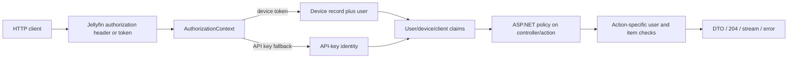
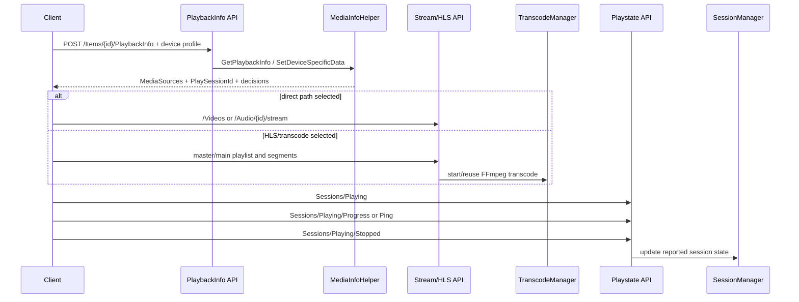

# Stock Jellyfin API contract reference

## Scope and evidence convention

This is a targeted contract map of pristine Jellyfin Server `10.11.11` at official commit `1fbd8739292cce610231be93daf43368733edf63`. It records the endpoints that a PTV client or server extension is most likely to depend on; it is not a generated OpenAPI transcription. `VERIFIED_FROM_SOURCE` denotes direct implementation evidence, `INFERRED` a bounded consequence of cited code, and `UNKNOWN` an unestablished behavior. Every architectural claim cites the source ledger.

## Routing, identity, and authorization envelope

`BaseJellyfinApiController` supplies `[ApiController]`, default `[Route("[controller]")]`, and JSON response media types. A controller can replace that prefix with `[Route("")]` or an explicit prefix, so paths must be derived from both the controller and action attributes, not the class name alone. `VERIFIED_FROM_SOURCE` [S24-01]

The authorization parser accepts Jellyfin authorization parameters for client, device, device ID, and version, then resolves a token first as a device access token and second as an API key. It also accepts legacy token/header/query locations. The result is cached in the request context. `VERIFIED_FROM_SOURCE` [S24-02]

Authenticated user requests become claims containing user ID, device ID, device name, client, version, token, and permission/role information. An API-key identity is granted the administrator role by the custom handler; default authorization also explicitly succeeds for API keys. `VERIFIED_FROM_SOURCE` [S24-03] [S24-04]

For endpoints that accept an optional `userId`, `RequestHelpers.GetUserId` defaults to the authenticated user's ID and permits selecting another user only for an administrator. This helper is part of the endpoint contract wherever cited; it is not automatically applied to every controller. `VERIFIED_FROM_SOURCE` [S24-05]

The policy check and the action-specific resource check are separate layers. An `[Authorize]` action can still resolve a requested user, parent, item, or session and return `403`/`404`; conversely, a controller action without an authorization attribute is not made authenticated merely by inheriting from `BaseJellyfinApiController`. `VERIFIED_FROM_SOURCE` [S24-01] [S24-05] [S24-10] [S24-11]

## Authentication, tokens, and device/session contracts

| Method and path | Access | Request identity / payload | Success semantics | Boundary and failure behavior | Evidence |
|---|---|---|---|---|---|
| `POST /Users/AuthenticateByName` | No `[Authorize]` on action/controller | JSON username/password plus client, version, device ID, and device name parsed from request authorization metadata | Returns `AuthenticationResult` from `AuthenticateNewSession`, including the newly issued access token/session result | Invalid credentials and policy/device/session-limit failures surface as security failures; supplied device identity participates in token/session ownership | `VERIFIED_FROM_SOURCE` [S24-06] [S24-07] |
| `GET /QuickConnect/Enabled` | Public action | None | Returns the server Quick Connect enabled flag | Availability is configuration state, not proof a pending request exists | `VERIFIED_FROM_SOURCE` [S24-08] |
| `POST /QuickConnect/Initiate` | Public action | Client/device authorization metadata; no authenticated user required | Returns a new secret/code state | Returns `401` when Quick Connect is disabled; legacy `GET /QuickConnect/Initiate` remains but is obsolete | `VERIFIED_FROM_SOURCE` [S24-08] |
| `GET /QuickConnect/Connect?secret=...` | Public action | Pending secret | Returns current pending/authorized state | Unknown secret gives `404`; disabled gives `401`; polling does not itself create a user token | `VERIFIED_FROM_SOURCE` [S24-08] |
| `POST /QuickConnect/Authorize?code=...&userId=...` | Authenticated | Code; current user by default, another user only for admin | Returns authorization boolean after binding the request to a user | Disabled gives `401`; user selection is constrained by `GetUserId` | `VERIFIED_FROM_SOURCE` [S24-05] [S24-08] |
| `POST /Users/AuthenticateWithQuickConnect` | Public action | JSON Quick Connect secret | Returns the already-authorized `AuthenticationResult` | Unknown/invalid state is a security failure; it consumes no separate browser-side permission model | `VERIFIED_FROM_SOURCE` [S24-06] [S24-09] |
| `GET /Auth/Keys` | Elevated | Current elevated identity | Returns all API-key records | API keys are server-wide privileged credentials in the inspected policy path | `VERIFIED_FROM_SOURCE` [S24-03] [S24-10] |
| `POST /Auth/Keys?app=...` | Elevated | Application name | Creates a key and returns `204` | The new key is not returned by this action body; callers must reread key state if they need it | `VERIFIED_FROM_SOURCE` [S24-10] |
| `DELETE /Auth/Keys/{key}` | Elevated | Key value in route | Deletes the key and returns `204` | Route placement means clients and access logs must treat the URL as secret-bearing | `VERIFIED_FROM_SOURCE` [S24-10] |
| `POST /Sessions/Logout` | Authenticated | Token claim from the current request | Calls `SessionManager.Logout(token)` and returns `204` | The action reports completion after the server logout call; client-side credential deletion is still a client responsibility | `VERIFIED_FROM_SOURCE` [S24-11] |

The stock Quick Connect manager holds pending requests in process memory, generates a six-digit code, gives requests a ten-minute lifetime, and creates the authorized session through the same session authentication service. `VERIFIED_FROM_SOURCE` [S24-09]

## Users, policies, and user-scoped reads

| Method and path | Access | Contract | Evidence |
|---|---|---|---|
| `GET /Users` | Authenticated | Returns users visible to the requesting principal according to controller/user-manager behavior. | `VERIFIED_FROM_SOURCE` [S24-12] |
| `GET /Users/Public` | Public | Returns public user records only. It is deliberately not the authenticated `/Users` result. | `VERIFIED_FROM_SOURCE` [S24-12] |
| `GET /Users/{userId}` | `IgnoreParentalControl` policy | Returns a selected user or `404`; policy selection is explicit on the action. | `VERIFIED_FROM_SOURCE` [S24-12] |
| `POST /Users/New`, `DELETE /Users/{userId}`, `POST /Users/{userId}/Policy` | Elevated | Create, delete, or replace persisted user policy. | `VERIFIED_FROM_SOURCE` [S24-12] |
| `POST /Users/Configuration` | Authenticated | Updates current-user configuration. | `VERIFIED_FROM_SOURCE` [S24-12] |
| `POST /Users/{userId}/Configuration` | Authenticated plus action validation | Updates selected-user configuration subject to current-user/admin checks. | `VERIFIED_FROM_SOURCE` [S24-05] [S24-12] |
| `GET /UserViews?userId=...` | Authenticated | Resolves the current/authorized selected user, computes user views, and returns DTOs. | `VERIFIED_FROM_SOURCE` [S24-13] |
| `GET /Items/{itemId}?userId=...` | Authenticated | Resolves user, loads the item through the user-aware library lookup, optionally refreshes on demand, and returns a DTO; unknown/inaccessible user/item yields `404`. | `VERIFIED_FROM_SOURCE` [S24-14] |

`/UserViews` is a user-specific presentation/root contract, while elevated `/Library/VirtualFolders` is the server configuration inventory. They are not interchangeable library-authority APIs. `VERIFIED_FROM_SOURCE` [S24-13] [S24-20]

## Item query, relationship, and user-data contracts

| Method and path | Access | Request/response contract | Important semantics | Evidence |
|---|---|---|---|---|
| `GET /Items` | Authenticated | Large query surface returning `QueryResult<BaseItemDto>` | Resolves request user, checks a supplied parent through user-aware lookup, constructs `InternalItemsQuery(user)`, then materializes DTOs; requested fields/images/user data control DTO shape | `VERIFIED_FROM_SOURCE` [S24-15] |
| `GET /Items/{itemId}` | Authenticated | One `BaseItemDto` | User-aware lookup and `404` for missing/inaccessible item; response completeness still depends on `DtoOptions` and item kind | `VERIFIED_FROM_SOURCE` [S24-14] [S24-16] |
| `GET /Items/Latest` | Authenticated | Latest DTO sequence, default limit `20` | Uses `LatestItemsQuery` with the resolved user; grouping may replace a child with album/parent DTO and explicitly sets returned `ChildCount` | `VERIFIED_FROM_SOURCE` [S24-17] |
| `GET /UserItems/Resume` | Authenticated | User-scoped resumable `QueryResult<BaseItemDto>` | Builds `InternalItemsQuery(user)` with `IsResumable`, excludes configured roots and optionally currently playing items | `VERIFIED_FROM_SOURCE` [S24-18] |
| `GET /UserItems/{itemId}/UserData` | Authenticated | `UserItemDataDto` | Enforces current/authorized user selection, preference access, and user-aware item lookup; failures are `403` or `404` | `VERIFIED_FROM_SOURCE` [S24-18] |
| `POST /UserItems/{itemId}/UserData` | Authenticated | `UpdateUserItemDataDto`, returns reread `UserItemDataDto` | Saves current user data synchronously in the action and returns the repository projection | `VERIFIED_FROM_SOURCE` [S24-18] |
| `POST /Items/{itemId}/Refresh` | Elevated | Refresh-mode flags in query, returns `204` | Queues a high-priority metadata/image refresh; `204` means queued, not completed | `VERIFIED_FROM_SOURCE` [S24-19] |
| `POST /Library/Refresh` | Elevated | No body, returns `204` | Awaits `ValidateMediaLibrary`, but catches and logs any exception and still returns `204` | `VERIFIED_FROM_SOURCE` [S24-21] |

Legacy `/Users/{userId}/Items...` aliases remain for several current routes but are explicitly obsolete/hidden from API exploration. A new client should use current user-scoped routes unless it has a compatibility requirement. `VERIFIED_FROM_SOURCE` [S24-14] [S24-18]

## Metadata, Identify, and image contracts

| Method and path | Access | Contract | Completion meaning | Evidence |
|---|---|---|---|---|
| `POST /Items/{itemId}` | Elevated | Accepts a `BaseItemDto` as editable metadata | Updates supported fields/people, persists metadata, and returns `204`; a series display-order change separately queues a full refresh | `VERIFIED_FROM_SOURCE` [S24-22] |
| `POST /Items/RemoteSearch/{kind}` | Authenticated (except explicit elevated Person action) | Accepts the kind-specific search DTO and returns remote search results | Search only; it does not apply a chosen result | `VERIFIED_FROM_SOURCE` [S24-23] |
| `POST /Items/RemoteSearch/Apply/{itemId}?replaceAllImages=...` | Elevated | Chosen `RemoteSearchResult` | Sets provider IDs, awaits a full metadata/image refresh with replace/remove options, then returns `204` | `VERIFIED_FROM_SOURCE` [S24-23] |
| `GET /Items/{itemId}/RemoteImages` | Authenticated | Image filters/paging/provider selector | User-aware item lookup, then provider discovery; returns providers, count, and results | `VERIFIED_FROM_SOURCE` [S24-24] |
| `POST /Items/{itemId}/RemoteImages/Download` | Elevated | Image type plus optional remote URL | Awaits image save and item repository image update, then returns `204` | `VERIFIED_FROM_SOURCE` [S24-24] |
| `POST /Items/{itemId}/Images/{imageType}` | Elevated | Supported image content type and request body | Validates content type, saves image, persists image update, returns `204`; bad type gives `400`, missing/inaccessible item `404` | `VERIFIED_FROM_SOURCE` [S24-25] |

The Identify/apply endpoint's `204` follows completion of the provider refresh it invokes, while the ordinary item refresh endpoint's `204` follows queue admission. These endpoints therefore have materially different completion semantics despite both returning `204`. `VERIFIED_FROM_SOURCE` [S24-19] [S24-23]

## Playback negotiation, streaming, and reporting contracts

| Method and path | Access | Contract | Boundary | Evidence |
|---|---|---|---|---|
| `GET /Items/{itemId}/PlaybackInfo` | Authenticated | Basic playback information for an item | Does not accept the full POST device-profile negotiation payload | `VERIFIED_FROM_SOURCE` [S24-26] |
| `POST /Items/{itemId}/PlaybackInfo` | Authenticated | Item, user/session context, media source, live stream, profile, start position, and playback flags | Returns media-source negotiation and a newly generated `PlaySessionId`; it is a plan/capability result, not evidence playback started | `VERIFIED_FROM_SOURCE` [S24-26] [S24-27] |
| `POST /LiveStreams/Open`, `POST /LiveStreams/Close` | Authenticated | Open/close negotiated live media source | Live-source lifecycle is separate from generic VOD stream URLs | `VERIFIED_FROM_SOURCE` [S24-26] |
| `GET /Videos/{itemId}/stream[.{container}]`, `GET /Audio/{itemId}/stream[.{container}]` | Stream controllers | Query describes direct/direct-stream/transcode request | Returns a direct file/range result or invokes the encoding path according to stream state; the URL alone does not prove which path will be used | `VERIFIED_FROM_SOURCE` [S24-28] |
| `GET /Videos/{itemId}/master.m3u8`, `/main.m3u8`, `/hls1/{playlistId}/{segmentId}.{container}` and audio counterparts | Authenticated HLS controller | HLS negotiation/playlist/segment query | Segment production may start or wait on FFmpeg/transcode state; playlist receipt is not end-to-end playback success | `VERIFIED_FROM_SOURCE` [S24-29] [S24-30] |
| `POST /Sessions/Playing` | Authenticated | `PlaybackStartInfo` | Reports playback start into session state | `VERIFIED_FROM_SOURCE` [S24-31] |
| `POST /Sessions/Playing/Progress` | Authenticated | `PlaybackProgressInfo` | Reports current position/state | `VERIFIED_FROM_SOURCE` [S24-31] |
| `POST /Sessions/Playing/Ping` | Authenticated | `playSessionId` query value | Pings active transcode/session lifecycle | `VERIFIED_FROM_SOURCE` [S24-31] |
| `POST /Sessions/Playing/Stopped` | Authenticated | `PlaybackStopInfo` | Reports stop and permits session/user-data finalization | `VERIFIED_FROM_SOURCE` [S24-31] |
| `GET /Sessions` | Authenticated | Optional device/activity/controllability filters | Returns sessions filtered using requester identity and API-key status | `VERIFIED_FROM_SOURCE` [S24-32] |
| `POST /Sessions/Capabilities[/Full]` | Authenticated | Query or DTO capabilities, optional session ID | Updates the server's model of client commands/media support and returns `204` | `VERIFIED_FROM_SOURCE` [S24-32] |

The server-side media helper can disable an HTTP direct-stream option unless `ForceDirectStream` applies, and sorts candidate sources after applying device-specific decisions. Clients must consume the returned source/transcoding decision rather than infer Direct Play from container/codec alone. `VERIFIED_FROM_SOURCE` [S24-27]

## Administrative mutation contracts

| Method and path | Access | Contract | Completion/race meaning | Evidence |
|---|---|---|---|---|
| `GET /System/Configuration` | Authenticated | Returns current in-memory `ServerConfiguration` | Snapshot has no revision/ETag in this action | `VERIFIED_FROM_SOURCE` [S24-33] |
| `POST /System/Configuration` | Elevated | Replaces full `ServerConfiguration`, returns `204` | Blind replacement action; no request precondition or compare-and-swap parameter | `VERIFIED_FROM_SOURCE` [S24-33] |
| `GET/POST /System/Configuration/{key}` | Read authenticated / write elevated | Named configuration object selected by key | POST deserializes by registered type, saves, then returns `204`; no revision precondition | `VERIFIED_FROM_SOURCE` [S24-33] |
| `GET /Library/VirtualFolders` | First-setup-or-elevated controller | Returns server virtual-folder inventory | This is administrative configuration, not a user visibility result | `VERIFIED_FROM_SOURCE` [S24-20] |
| `POST/DELETE /Library/VirtualFolders` and subroutes | First-setup-or-elevated controller | Add/remove/rename paths/options | Some operations optionally request a subsequent library refresh; `204` describes the mutation action, not convergence of every scan/provider. Isolated Jellyfin 12 `refreshLibrary=false` rename returned while the renamed folder had no ItemId/UserView; the original identities returned after reversal. Do not infer identity continuity from the rename response. | `VERIFIED_FROM_SOURCE` [S24-20] plus isolated local observation |
| `GET /ScheduledTasks[/{taskId}]` | Elevated controller | Task information | Snapshot of worker state | `VERIFIED_FROM_SOURCE` [S24-34] |
| `POST /ScheduledTasks/Running/{taskId}` | Elevated | Starts known task | Calls task manager execute and returns `204`; it does not wait for task completion | `VERIFIED_FROM_SOURCE` [S24-34] |
| `DELETE /ScheduledTasks/Running/{taskId}` | Elevated | Requests cancellation | Calls task manager cancel and returns `204`; cancellation is cooperative in the worker | `VERIFIED_FROM_SOURCE` [S24-34] [S24-35] |
| `GET /Plugins`, `GET /Plugins/{id}/Configuration` | Elevated controller | Installed plugin/status or current configuration | Plugin inventory/configuration snapshot | `VERIFIED_FROM_SOURCE` [S24-36] |
| enable/disable/delete `/Plugins/{id}/{version}` | Elevated controller | Changes plugin manifest/install state | Returns `204` after manager action; runtime unload/reload boundaries depend on plugin lifecycle | `VERIFIED_FROM_SOURCE` [S24-36] [S24-37] |
| `POST /Plugins/{id}/Configuration` | Elevated controller | Plugin-defined configuration JSON | Deserializes the plugin type and calls `UpdateConfiguration`; `204` is returned even when a JSON body deserializes to null | `VERIFIED_FROM_SOURCE` [S24-36] |
| `/LiveTv/Channels`, `/Programs`, `/Timers`, `/SeriesTimers` | `LiveTvAccess` or `LiveTvManagement` by action | Guide/query and timer/series-timer lifecycle | Permissions distinguish viewing from management | `VERIFIED_FROM_SOURCE` [S24-38] |
| `/LiveTv/TunerHosts`, `/ListingProviders`, `/ChannelMappings` | Elevated | Administrative backend/provider/mapping mutation | Provider-specific work remains behind the Live TV manager; HTTP acceptance is not a guarantee of external provider convergence | `VERIFIED_FROM_SOURCE` / `INFERRED` [S24-38] |

## WebSocket/event contract

The server diverts any recognized WebSocket upgrade to its WebSocket manager. The manager resolves an authenticated identity before accepting the socket, invokes registered listeners, and runs a receive loop; it is not a public anonymous event stream. `VERIFIED_FROM_SOURCE` [S24-39]

Wire messages use `SessionMessageType`; server messages include session/playback commands, user data, library changes, task snapshots, activity, refresh progress, timer events, restart/shutdown, and keepalive. Periodic subscriptions are initiated with start/stop messages and are maintained per connection. `VERIFIED_FROM_SOURCE` [S24-40] [S24-41]

Library and user-data notifiers translate/filter changes for active users before sending user-scoped event payloads. The inspected transport contains no durable replay cursor or client acknowledgement protocol; reconnecting clients must reconcile authoritative HTTP state. `VERIFIED_FROM_SOURCE` / `INFERRED` [S24-42]

See [17-websocket-events.md](17-websocket-events.md) for the complete stock event workflow and failure model.

## Status and completion interpretation

| Observed result | Safe interpretation | Unsafe interpretation | Evidence |
|---|---|---|---|
| `200` DTO/query | This action completed and serialized a snapshot under its own lookup/field rules. | The DTO is a complete, immutable, globally current entity. | `VERIFIED_FROM_SOURCE` / `INFERRED` [S24-14] [S24-15] [S24-16] |
| `204` item remote-search apply | The awaited refresh call returned. | Every dependent client cache has refreshed. | `VERIFIED_FROM_SOURCE` / `INFERRED` [S24-23] |
| `204` item refresh | A refresh was queued. | Metadata/images are already updated. | `VERIFIED_FROM_SOURCE` [S24-19] |
| `204` scheduled-task start | Execution was requested for a known worker. | The task completed successfully. | `VERIFIED_FROM_SOURCE` [S24-34] |
| `204` scheduled-task stop | Cancellation was requested. | The worker has terminated. | `VERIFIED_FROM_SOURCE` [S24-34] [S24-35] |
| `204` global library refresh | The action reached its terminal response. | The scan succeeded: the action catches/logs scan exceptions and still responds `204`. | `VERIFIED_FROM_SOURCE` [S24-21] |
| PlaybackInfo response | The server produced candidate media sources/decisions and a play-session identity. | Decoder startup, first frame, or future HLS segment delivery succeeded. | `VERIFIED_FROM_SOURCE` / `INFERRED` [S24-26] [S24-27] [S24-29] |
| WebSocket event | A live connection received one event envelope. | Exactly-once, ordered, durable delivery or a complete authoritative snapshot. | `INFERRED` [S24-39] [S24-40] [S24-42] |

## End-to-end client workflows

### Sign in, restore, browse, and play

1. Client supplies stable app/version/device identity and calls `POST /Users/AuthenticateByName` or completes the Quick Connect initiate/approve/connect/authenticate chain. `VERIFIED_FROM_SOURCE` [S24-06] [S24-08] [S24-09]
2. Client stores the returned access token and presents it on future requests; the server resolves it to a device/user record on each authorization path. `VERIFIED_FROM_SOURCE` [S24-02] [S24-07]
3. Client requests `GET /UserViews`, then queries `GET /Items` or user-specific list endpoints. Those endpoints resolve the current user and apply their own user/item query rules. `VERIFIED_FROM_SOURCE` [S24-13] [S24-15] [S24-17] [S24-18]
4. Client requests `POST /Items/{id}/PlaybackInfo` with its device profile, follows the returned media source/transcoding decision, then reports start/progress/stop. `VERIFIED_FROM_SOURCE` [S24-26] [S24-27] [S24-28] [S24-31]
5. A WebSocket can reduce polling latency, but reconnect/readback must use HTTP because the inspected event transport provides no durable replay. `INFERRED` [S24-39] [S24-42]

### Safe administrative read/edit/write

1. Read the exact configuration or entity immediately before editing. `INFERRED` [S24-12] [S24-20] [S24-33] [S24-36]
2. Preserve fields outside the intended edit because full configuration writes are blind replacement and DTOs can be shaped/sparse. `INFERRED` [S24-16] [S24-33]
3. Send the mutation once and interpret its endpoint-specific completion semantics rather than treating all `204` responses alike. `INFERRED` [S24-19] [S24-21] [S24-23] [S24-34]
4. Perform an authoritative readback or observe the appropriate task/event state; never let a failed refetch keep the UI permanently pending. The bounded-UI recommendation is client policy, while the need for readback follows from the stock response semantics. `INFERRED` [S24-19] [S24-21] [S24-33] [S24-34]

## Explicit unknowns

- The stock source inspected here does not establish a universal access-token expiry/refresh-token contract. `UNKNOWN` [S24-02] [S24-07]
- The controller implementations do not establish a global idempotency-key facility or exactly-once semantics for mutations. `UNKNOWN` [S24-01] [S24-19] [S24-33] [S24-34]
- Provider/plugin/external Live TV side effects cannot be declared converged solely from generic controller status codes; that depends on the concrete provider implementation and follow-up state. `UNKNOWN` [S24-36] [S24-38]
- Client retry, cache invalidation, autoplay policy, and route lifecycle are not defined by these server endpoints. `UNKNOWN` [S24-26] [S24-31] [S24-39]

## Practical client rules

1. Treat authentication as identity establishment, not blanket authorization to every item; use user-aware endpoints and never serialize server-wide candidates before applying current-user visibility. `INFERRED` [S24-03] [S24-05] [S24-14] [S24-15]
2. Keep API keys server-side: in this version they are privileged identities, not constrained end-user tokens. `INFERRED` [S24-03] [S24-04] [S24-10]
3. Keep device ID stable within one installed client identity and do not share one token between distinct logical devices. `INFERRED` [S24-02] [S24-07]
4. Interpret endpoint-specific completion: queued, requested, awaited, and persisted are different states. `INFERRED` [S24-19] [S24-21] [S24-23] [S24-34]
5. Merge or reread authoritative item state deliberately; a returned `BaseItemDto` is not a promise that every relationship/child/image/user-data field is populated. `INFERRED` [S24-14] [S24-16] [S24-17]
6. After WebSocket reconnect or event loss, invalidate narrowly and reconcile through authenticated HTTP. `INFERRED` [S24-39] [S24-42]

## PTV extension overlay — persisted recommendations (Plugin 0.5.18 derivative)

This is a PTV overlay, not a change to the stock 10.11.11 contracts above. `GET /Ptv/v1/recommendations` retains optional server/user scope and its v1 response envelope. Authentication and matching scope are necessary but do not authorize global stored media snapshots. Before serialization, the controller must resolve a non-null current Jellyfin user and call the user-aware library item resolver for every candidate. Invalid/deleted/inaccessible/non-library items are omitted, not exposed with removal reasons.

The projected response retains fields but intentionally replaces unproven stored row IDs/headings/explanations with neutral response-local metadata. A stored heading may name a hidden watched subject outside the row's Items, so an all-visible candidate list cannot validate that text. Authorized item ID/name/type come from the resolved item; survivor/duplicate order is stable, scores are based on survivors, and zero-survivor rows are omitted. Projection is eager, detached, private/no-store and read-only with respect to global configuration. V2 ranking and Featured contracts are unchanged. Current source/test and future CT103 status are explicitly recorded in the derivative report.

## PTV extension overlay — configured Home row library scope

This earlier scoped-row PTV contract uses existing routes; it does not alter the stock 10.11.11 endpoints above. The later controlled transition adds PTV routes below. Administrator `GET/POST /Ptv/v1/rows` and settings expose Row Builder schema 3 with each rule's `libraryScope`: `global`, `defaultLibrary` (`defaultKey` and optional pinned `virtualFolderId`), or `virtualFolder` (pinned `virtualFolderId`). A built-in default may acquire its first exact ID only through a unique name/collection-type match and the Plugin's normal configuration write. Neither display name nor collection type alone remains a library identity after pinning. `VERIFIED_FROM_SOURCE` — `PluginConfiguration.cs`, `PtvPluginSettingsNormalizer.cs`, `PtvHomeLibraryScopeResolver.cs`, `PtvPluginSettingsService.cs`, and `PtvStatusController.cs`.

The final controlled-transition Featured document is cache version 9 with payload `scopeSchemaVersion: 2` (the initial scoped-row phase used v8/schema 1); owned sections carry `scopeType: library`, pinned `libraryId`, optional `bindingKey`, and `resolvedScopeHash`. The existing administrator Featured write rejects client-authored library-owned sections. `GET /Ptv/v1/featured` projects the shared generated document for the actual Jellyfin user, validates current scope claims, and applies user-aware library/item access before serializing owned sections. Earlier/versionless content supplies no current scope authority. A scope hash and configured presentation association are correlation evidence, not Jellyfin item authorization or a guarantee that a later library mutation has already reached every cache. `VERIFIED_FROM_SOURCE` — `PtvFeaturedContentRefreshService.cs`, `PtvFeaturedContentStore.cs`, `PtvFeaturedContentValidator.cs`, `PtvFeaturedContentAuthorizationService.cs`, and `PtvStatusController.cs`.

Restricted users cannot read administrator rows/settings. A fresh authenticated per-user Featured response can supply the server-issued, redacted scope and association claim for their Home presentation; a cached response is insufficient. Web Home then uses current user-view and ordinary user-scoped recursive Items reads to admit only positively proven library-owned candidate IDs, bound to the active Home visit. `/UserViews` is the stock user presentation/root contract and `/Library/VirtualFolders` is elevated configuration inventory, as specified above; neither endpoint alone proves an item's membership in the pinned library. The Web proof is bounded and transient, and local source/tests do not establish hosted physical acceptance or continuous cross-endpoint currentness. See chapters 20–23 and the stock non-guarantees in chapter 25.

## PTV extension overlay — controlled Home authority routes (Canonical Tasks 7–8 checkpoint)

These are administrator-only PTV routes in `PtvApiRoutes`, layered over stock user policy and library-folder mutations; they do not change the stock 10.11.11 API contracts. `VERIFIED_FROM_SOURCE` — `PtvHomeUserAccessController.cs`, `PtvHomeTransitionsController.cs`, `PtvHomeUserAccessLedger.cs`, `PtvHomeTopologyLedger.cs`.

| PTV route | Contract |
|---|---|
| `GET /Ptv/v1/home-user-access/current?userId=…`; `POST /begin`; `POST /{operationId}/complete` | Read current per-user authority; durably hold a known existing user before a controlled stock policy write; complete only after intended policy, current topology epoch, and exact user-aware accessible-library readback agree. |
| `POST /Ptv/v1/home-user-access/verification-batches`; `GET /verification-batches/current`; `POST /verification-batches/{batchId}/users/{userId}/verify` | Freeze at most 1,000 exact existing IDs and individually prove each current user. Later IDs cannot enter the batch. `POST /verification-batches/new` handles the separately bounded new-user verification path. |
| `POST /Ptv/v1/home-user-access/creations/reserve`; `POST /creations/{creationOperationId}/bind`; `GET /creations/current`; `POST /creations/{creationOperationId}/recover` | Reserve a controlled account creation against migration capture; bind only after Jellyfin supplies the ID. Reservation is not a pre-ID user hold. Preserve administrator recovery on failure. |
| `GET /Ptv/v1/home-user-access/verification-summary`; `POST /recover-corrupt` | Show per-user verified/needs-verification counts and recover a corrupt ledger through restrictive re-verification. No broad/default access fallback. |
| `GET /Ptv/v1/home-transitions/current`; `POST /begin`; `POST /{operationId}/complete` | Persist the topology hold/tombstones before controlled stock library write; inspect bounded natural convergence; release only after fresh final proof. Selected rebind and release are one durable ledger replacement; no selected binding leaves affected tombstones. Same-operation retry does not repeat the stock write. |

`GET /Ptv/v1/featured` and protected status additionally read current per-user access proof. Missing, corrupt, stale-epoch, policy-mismatched, or accessible-set-mismatched proof withholds all PTV Featured rows and Hero, including global PTV shelves. Web Home rejects cached or late PTV rows when current user access epoch, topology, library revision, route, or identity does not agree, and it separately proves owned item membership. Independently sourced native/generic Home content may remain. `VERIFIED_FROM_SOURCE` / local `VERIFIED_BY_TEST` — `PtvStatusController.cs`, `PtvFeaturedTopology.cs`, `featuredContentCache.ts`, `hooks.ts`.

The administrator's natural-convergence read uses `GetVirtualFolders(false)` and a nonrecursive `ILibraryManager.GetItemList` under `GetUserRootFolder().Id` with `Limit=129`; more than 128 configured folders or active top children is unproven. Exact `GetItemById`, direct-child path, name, type, old-child absence, and stable canonical roots/options must agree in a final snapshot immediately before release. At most three immediate read-only attempts are made. No PTV call to `ValidateTopLibraryFolders`, provider refresh, global scan, or `refreshLibrary=true` is part of this protocol. The retained exact Jellyfin 12 source documents the read path and disqualifies `ValidateTopLibraryFolders` because it invokes provider work (`UPSTREAM_NEWER_THAN_10.11.11`); isolated Jellyfin 12 rename readback lacked a new authoritative CollectionFolder ID through bounded completion/retries. The hold and affected row remained unavailable: `SAFE_FAIL_CLOSED`, automatic recovery `UNPROVEN`, administrator recovery required. Initial `GetUserRootFolder()` may lazily initialize its views directory.

`NEW_USER_PREWRITE_HOLD = NOT_APPLICABLE`: Jellyfin must create the account before its ID is known. New-account owned Home stays unavailable until intended/restrictive policy write, authoritative policy readback, current-epoch durable proof, and fresh user-aware membership. First installation seeds no trusted existing-user cohort. The Canonical checkpoint locally recorded `EXISTING_USER_CONTROLLED_ACCESS = PASS` and `NEW_USER_BOOTSTRAP_FAIL_CLOSED = PASS`. Arbitrary out-of-band Jellyfin changes cannot guarantee retirement of every already-mounted remote client before a fresh authority signal. Stage 2 integration remains unverified; `NOT RELEASE READY`.

## Source ledger

All entries below refer to repository `jellyfin-server-stock-10.11.11`, version `10.11.11`, commit `1fbd8739292cce610231be93daf43368733edf63`.

| ID | File, symbol, practical line range |
|---|---|
| S24-01 | `Jellyfin.Api/BaseJellyfinApiController.cs`, `BaseJellyfinApiController`, lines 9-18. |
| S24-02 | `Jellyfin.Server.Implementations/Security/AuthorizationContext.cs`, `GetAuthorizationInfo` / `GetAuthorization` / token resolution, lines 43-217. |
| S24-03 | `Jellyfin.Api/Auth/CustomAuthenticationHandler.cs`, `HandleAuthenticateAsync`, lines 43-88. |
| S24-04 | `Jellyfin.Api/Auth/DefaultAuthorizationPolicy/DefaultAuthorizationHandler.cs`, `HandleRequirementAsync`, lines 41-93. |
| S24-05 | `Jellyfin.Api/Helpers/RequestHelpers.cs`, `GetUserId` / `AssertCanUpdateUser` / session helpers, lines 61-153. |
| S24-06 | `Jellyfin.Api/Controllers/UserController.cs`, `AuthenticateUserByName` / `AuthenticateWithQuickConnect`, lines 169-257. |
| S24-07 | `Emby.Server.Implementations/Session/SessionManager.cs`, `AuthenticateNewSession` / token and session creation, lines 1570-1746. |
| S24-08 | `Jellyfin.Api/Controllers/QuickConnectController.cs`, enabled/initiate/connect/authorize actions, lines 35-128. |
| S24-09 | `Emby.Server.Implementations/QuickConnect/QuickConnectManager.cs`, request creation/status/authorization/session result, lines 21-34 and 57-229. |
| S24-10 | `Jellyfin.Api/Controllers/ApiKeyController.cs`, `/Auth/Keys` actions, lines 16-74. |
| S24-11 | `Jellyfin.Api/Controllers/SessionController.cs`, `ReportSessionEnded`, lines 414-425. |
| S24-12 | `Jellyfin.Api/Controllers/UserController.cs`, user list/public/read/delete/update/policy/config/create action attributes and bodies, lines 37-166 and 372-553. |
| S24-13 | `Jellyfin.Api/Controllers/UserViewsController.cs`, `GetUserViews`, lines 27-95; `Emby.Server.Implementations/Library/UserViewManager.cs`, `GetUserViews`, lines 45-159. |
| S24-14 | `Jellyfin.Api/Controllers/UserLibraryController.cs`, `GetItem` and legacy alias, lines 31-116. |
| S24-15 | `Jellyfin.Api/Controllers/ItemsController.cs`, `GetItems`, lines 30-31 and 160-534. |
| S24-16 | `Emby.Server.Implementations/Dto/DtoService.cs`, `GetBaseItemDtoInternal` field/relationship population, lines 470-525 and 920-1235; `MediaBrowser.Model/Dto/BaseItemDto.cs`, DTO fields, lines 250-467. |
| S24-17 | `Jellyfin.Api/Controllers/UserLibraryController.cs`, `GetLatestMedia`, lines 505-585. |
| S24-18 | `Jellyfin.Api/Controllers/ItemsController.cs`, `GetResumeItems`, `GetItemUserData`, `UpdateItemUserData`, lines 804-1053. |
| S24-19 | `Jellyfin.Api/Controllers/ItemRefreshController.cs`, `RefreshItem`, lines 21-91. |
| S24-20 | `Jellyfin.Api/Controllers/LibraryStructureController.cs`, controller policy and virtual-folder actions, lines 29-145 and 223-357. |
| S24-21 | `Jellyfin.Api/Controllers/LibraryController.cs`, `RefreshLibrary`, lines 326-345. |
| S24-22 | `Jellyfin.Api/Controllers/ItemUpdateController.cs`, `UpdateItem`, lines 32-33 and 64-135. |
| S24-23 | `Jellyfin.Api/Controllers/ItemLookupController.cs`, remote-search actions and `ApplySearchCriteria`, lines 28-29, 87-245, and 248-280. |
| S24-24 | `Jellyfin.Api/Controllers/RemoteImageController.cs`, get providers/images and `DownloadRemoteImage`, lines 50-170. |
| S24-25 | `Jellyfin.Api/Controllers/ImageController.cs`, delete/set item image actions, lines 282-420. |
| S24-26 | `Jellyfin.Api/Controllers/MediaInfoController.cs`, playback-info and live-stream actions, lines 28-30, 72-248, and 269-319. |
| S24-27 | `Jellyfin.Api/Helpers/MediaInfoHelper.cs`, playback info/device-specific negotiation/source ordering, lines 87-145, 170-396. |
| S24-28 | `Jellyfin.Api/Controllers/VideosController.cs`, stream actions, lines 312-557; `Jellyfin.Api/Controllers/AudioController.cs`, stream actions, lines 89-160 and 256-327. |
| S24-29 | `Jellyfin.Api/Controllers/DynamicHlsController.cs`, HLS master/main/segment routes and segment workflow, lines 39-41, 408-584, 755-1102, and 1287-1567. |
| S24-30 | `MediaBrowser.MediaEncoding/Transcoding/TranscodeManager.cs`, FFmpeg start/reuse/kill/report lifecycle, lines 118-245 and 323-715. |
| S24-31 | `Jellyfin.Api/Controllers/PlaystateController.cs`, playing/progress/ping/stopped actions, lines 193-257; `Emby.Server.Implementations/Session/SessionManager.cs`, playback state/report processing, lines 746-1113. |
| S24-32 | `Jellyfin.Api/Controllers/SessionController.cs`, session query and capability/report actions, lines 44-68 and 335-425. |
| S24-33 | `Jellyfin.Api/Controllers/ConfigurationController.cs`, system/named configuration actions, lines 23-107; `Emby.Server.Implementations/AppBase/BaseConfigurationManager.cs`, replace/save implementation, lines 94-197 and 270-362. |
| S24-34 | `Jellyfin.Api/Controllers/ScheduledTasksController.cs`, elevated task list/start/stop/trigger actions, lines 14-159. |
| S24-35 | `Emby.Server.Implementations/ScheduledTasks/ScheduledTaskWorker.cs`, execute/cancellation lifecycle, lines 284-396. |
| S24-36 | `Jellyfin.Api/Controllers/PluginsController.cs`, elevated inventory/state/config actions, lines 22-207. |
| S24-37 | `Emby.Server.Implementations/Updates/InstallationManager.cs`, uninstall state/restart boundary, lines 378-403; `Emby.Server.Implementations/Plugins/PluginManager.cs`, manifest/status handling, lines 313-342 and 507-523. |
| S24-38 | `Jellyfin.Api/Controllers/LiveTvController.cs`, access/management/elevated actions for channels/programs/timers/providers/mappings, lines 109-147, 459-568, 797-946, and 985-1147. |
| S24-39 | `Jellyfin.Api/Middleware/WebSocketHandlerMiddleware.cs`, `Invoke`, lines 29-38; `Emby.Server.Implementations/HttpServer/WebSocketManager.cs`, authenticate/accept/dispatch lifecycle, lines 37-95. |
| S24-40 | `MediaBrowser.Model/Session/SessionMessageType.cs`, message enumeration, lines 8-49; `Emby.Server.Implementations/HttpServer/WebSocketConnection.cs`, frame/envelope processing, lines 48-280. |
| S24-41 | `MediaBrowser.Controller/Net/BasePeriodicWebSocketListener.cs`, subscription/periodic/coalescing lifecycle, lines 25-56 and 98-285. |
| S24-42 | `Emby.Server.Implementations/EntryPoints/LibraryChangedNotifier.cs`, user-scoped library events, lines 100-330; `Emby.Server.Implementations/EntryPoints/UserDataChangeNotifier.cs`, user-scoped data events, lines 48-155. |

## Stage 3 PTV extension — administrator Reading identity reassessment

The stock endpoint table remains a 10.11.11 reference. The PTV Plugin adds `POST /Ptv/v1/reading/metadata/reassess` for the explicit administrator Reading Identify workflow. Authentication plus `Policies.RequiresElevation` are required server-side; the Plugin derives the administrator identity from the current Jellyfin request. The request carries exact item ID, bounded signed candidate context and the displayed archive/assessment revision. Search issues the context bound to administrator, item, stable provider identity and scope, typed candidate provenance and search generation; it expires within 15 minutes and is invalid after Plugin restart. The route validates it, resolves the current Jellyfin item/path and performs fresh bounded inspection without reusing the 30-second Reading search cache or refetching a provider. `VERIFIED_FROM_SOURCE` for the Reading lineage's controller, codec and identification service; integrated runtime acceptance remains separate.

HTTP `200` carries source-labeled identity/conflict evidence, independent archive state/reason and an opaque authenticated revision. `Unverified` is a typed inspectable state that can be explicitly acknowledged; `Absent` after a successful root-ComicInfo inspection alone needs no unverified acknowledgment. Missing/expired/tampered context, ambiguous administrator identity, denied access, missing item, route absence, malformed response and infrastructure/transport failures block Web Apply and never fall back to stale search evidence. No server path, raw ComicInfo XML, archive bytes or signing material is transported to Web. The context protects selection integrity, not provider freshness or stock item-writer authorization. The existing manual `POST /Items/{id}` and exact authoritative readback remain separate operations, so no atomic file-to-metadata transaction is claimed.

The Web's previous nonrecursive Book Scan branch could take a saved Reading provider ID, perform PTV exact-provider search and call the manual item-update path without this reassessment route. Stage 3 rejects that branch before requests and directs the administrator to Identify. No new Plugin endpoint is introduced for Scan. Explicit recursive Scan and stock Jellyfin refresh remain separate stock contracts outside this route's guarantee.
