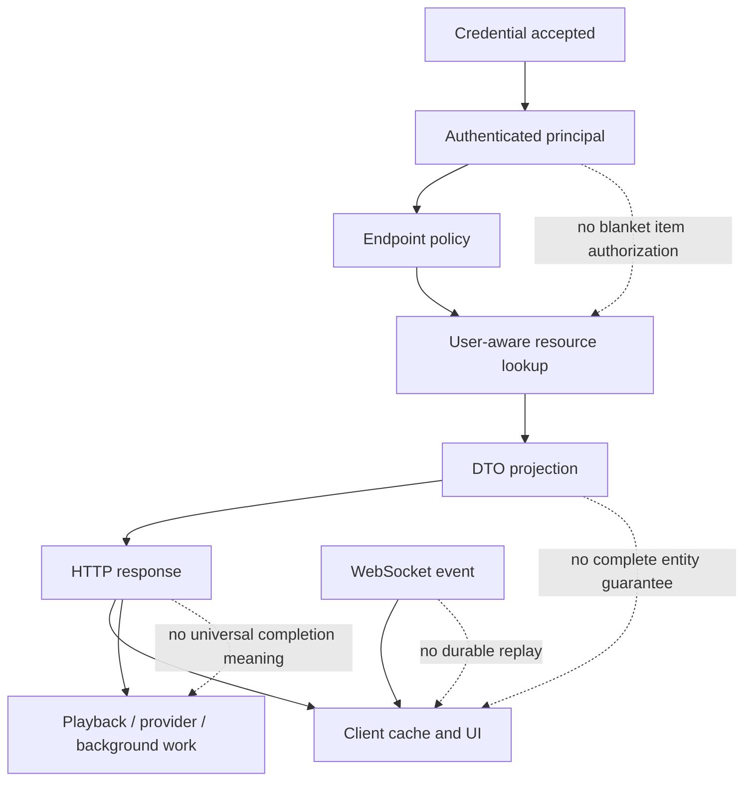

# Known stock Jellyfin non-guarantees

## Scope and evidence convention

This chapter records limits that a client, plugin, proxy, or PTV service must not silently promote into guarantees. The source baseline is pristine Jellyfin Server `10.11.11` at official commit `1fbd8739292cce610231be93daf43368733edf63`. `VERIFIED_FROM_SOURCE` means the implementation directly exhibits the behavior, `INFERRED` means a bounded consequence of cited source, and `UNKNOWN` means the requested property is not established by the inspected source.

A non-guarantee is not necessarily a Jellyfin defect. It marks a responsibility that remains with the caller, a weaker endpoint completion boundary, an intentionally lossy projection, or behavior that depends on runtime/provider/client state.

## Boundary map

| Stock boundary | What stock owns | What stock does **not** guarantee | Evidence |
|---|---|---|---|
| Authentication | Resolve device token/API key and build request claims | That every authenticated code path has applied current-user item visibility | `VERIFIED_FROM_SOURCE` / `INFERRED` [S25-01] [S25-02] [S25-03] |
| User policy | Folder, parental, tag, remote-access, schedule, device, and permission decisions where invoked | A second permission model based on names, paths, collection labels, or client filtering | `VERIFIED_FROM_SOURCE` [S25-04] [S25-05] |
| Item/query DTO | User-aware query and requested DTO projection | A complete entity snapshot containing every relationship, child, image, media source, and user-data field | `VERIFIED_FROM_SOURCE` [S25-06] [S25-07] |
| Configuration mutation | Validate/replace/save the submitted object | Revision tokens, merge semantics, or automatic concurrent-editor conflict detection | `INFERRED` [S25-08] [S25-09] |
| Scan/refresh/task action | Queue, request, or await work according to that action | One universal meaning for HTTP `204`, or that all background work completed successfully | `VERIFIED_FROM_SOURCE` [S25-10] [S25-11] [S25-12] |
| Playback negotiation | Produce media-source decisions and play-session identity | Decoder startup, first frame, uninterrupted HLS production, or correct client reporting | `VERIFIED_FROM_SOURCE` / `INFERRED` [S25-13] [S25-14] [S25-15] |
| WebSocket transport | Authenticated live messages and subscriptions | Durable replay, exactly-once delivery, acknowledgement, or authoritative state after reconnect | `INFERRED` [S25-16] [S25-17] [S25-18] |
| Plugin lifecycle | Manifest/install/config state transitions | That an accepted state mutation implies code was hot-unloaded/reloaded or external integration health converged | `VERIFIED_FROM_SOURCE` / `INFERRED` [S25-19] |

## Authentication, tokens, and security boundaries

### Authentication is not item authorization

The authorization context can resolve either a device access token or an API key and cache the result for the request. The authentication handler then constructs claims and roles. Neither step by itself enumerates which library items the user can see. `VERIFIED_FROM_SOURCE` [S25-01] [S25-02]

User-aware item protection occurs later: collection folders consult enabled/blocked folders, item visibility walks parents and collection folders, and user-aware library lookup returns null when the item is not visible. Therefore a shared raw candidate set must be filtered with the current Jellyfin user before serialization; client-side filtering after a server response is not an authorization boundary. `VERIFIED_FROM_SOURCE` / `INFERRED` [S25-04] [S25-05] [S25-06]

The low-level `LibraryManager.GetItemById(id, Guid userId)` converts an empty GUID to a null user, and its visibility helper treats a null user as visible. This does **not** mean every public API leaks items; it means internal/plugin code must never use an empty/unresolved user as though it were a restricted user. `VERIFIED_FROM_SOURCE` / `INFERRED` [S25-06]

### API keys are not constrained end-user identities

The custom authentication handler gives an API-key principal the administrator role, and the default policy explicitly succeeds API-key requests. An API key therefore must not be used to model a restricted household user, nor may an API-key-backed shared response be assumed safe for that user's browser. `VERIFIED_FROM_SOURCE` / `INFERRED` [S25-02] [S25-03]

### Access-token expiry/refresh is not established

Device access tokens are random GUID strings persisted on a device record with created/modified/activity timestamps, but the inspected entity and request-resolution paths expose no token expiry field or refresh-token exchange. A universal TTL or refresh-token lifecycle is therefore `UNKNOWN`; clients must handle server rejection/logout rather than assume timed renewal semantics. `VERIFIED_FROM_SOURCE` / `UNKNOWN` [S25-01] [S25-20]

Authenticating a new session for the same user/device ID logs out existing device records before creating a new token. Token continuity is therefore not guaranteed across reauthentication with the same logical device identity. `VERIFIED_FROM_SOURCE` [S25-21]

Logout deletes the device record and ends matching device sessions, but deleting the client's locally stored credential is outside this server method. Conversely, clearing local storage without calling logout does not prove server revocation. `VERIFIED_FROM_SOURCE` / `INFERRED` [S25-21]

### Quick Connect is not durable workflow storage

Pending Quick Connect requests and authorized secrets live in in-process concurrent dictionaries. Requests have a ten-minute expiry, and the approved request is shortened so clients can observe it before expiry. A server-process restart therefore cannot be assumed to preserve an in-flight Quick Connect request. `VERIFIED_FROM_SOURCE` / `INFERRED` [S25-22]

The approval path calls direct session authentication for the selected user; it does not mint a distinct lower-privilege Quick Connect credential class. After completion, normal device-token rules apply. `VERIFIED_FROM_SOURCE` [S25-22] [S25-21]

## User, library, and item projection boundaries

### Administrative libraries are not user views

`GET /Library/VirtualFolders` returns the elevated server virtual-folder configuration, whereas `/UserViews` resolves one user and constructs that user's grouped/ordered roots. Neither the count nor identity of virtual folders is guaranteed to match user-visible navigation entries. `VERIFIED_FROM_SOURCE` [S25-23] [S25-24]

Collection folder visibility checks blocked folders first and otherwise requires either `EnableAllFolders` or an enabled-folder ID. Item standalone visibility also checks ancestors and whether at least one owning collection folder is present in the user's roots. Filtering by display name, filesystem path, or only one guessed parent ID is not equivalent to these rules. `VERIFIED_FROM_SOURCE` / `INFERRED` [S25-04] [S25-05]

### `BaseItemDto` is a projection, not a replaceable aggregate

`DtoService` includes many properties only when `DtoOptions` requests the corresponding field or enables user/image data. Other relationships are populated by item interfaces and lookups, and list endpoints may deliberately shape/group parent and child results. A DTO obtained from one endpoint must not be treated as authoritative proof that omitted fields were deleted. `VERIFIED_FROM_SOURCE` / `INFERRED` [S25-07] [S25-25]

For music relationships, the DTO service copies artist names, then emits `ArtistItems`/`AlbumArtists` only when its artist lookup resolves matching library artist entities. A nonempty textual artist relationship and an empty ID-pair projection can therefore coexist. `VERIFIED_FROM_SOURCE` [S25-07]

For episodes, relationship fields such as series/season IDs are item-specific, while additional values such as series studio or special episode numbers depend on options/lookup. A generic merge that replaces a rich DTO with a sparse readback can erase client-held relationship state even though the server item still owns it. `VERIFIED_FROM_SOURCE` / `INFERRED` [S25-07]

### `ChildCount` is not uniformly exact

For a top-level collection folder or user view, stock returns a random value from 1 through 9 when `ChildCount` is requested, explicitly to avoid an expensive per-user calculation while preventing clients from treating the folder as empty. Such a `ChildCount` is an existence hint, not an inventory total. `VERIFIED_FROM_SOURCE` [S25-25]

For music albums, seasons, and playlists, `ChildCount` may instead come from recursive count or linked children, while `/Items/Latest` grouping explicitly assigns the number of grouped children. Clients must interpret count provenance by endpoint/item context. `VERIFIED_FROM_SOURCE` [S25-25] [S25-26]

### Read freshness and ordering are endpoint-scoped

The inspected item/query contracts return current projections but contain no entity-wide revision number, vector clock, or cross-endpoint snapshot transaction. A details response, child list, user-data response, and image response obtained at different times are not guaranteed to represent one atomic generation. `INFERRED` [S25-07] [S25-27] [S25-28]

List ordering is guaranteed only to the extent a specific action constructs `OrderBy` or grouping semantics; no global natural ordering across `/Items`, `/Items/Latest`, views, and relationship projections is established. `INFERRED` [S25-24] [S25-26] [S25-27]

## Refresh, scan, and background-task boundaries

### HTTP `204` has action-specific meaning

`POST /Items/{id}/Refresh` queues a high-priority refresh and immediately returns `204`; the response means queue admission, not metadata/image completion. `VERIFIED_FROM_SOURCE` [S25-10]

`POST /Items/RemoteSearch/Apply/{id}` sets provider IDs and awaits `RefreshFullItem` before returning `204`. That is a stronger server-side completion boundary than queued refresh, but it still does not guarantee that every client cache, image URL, or relationship projection has been reread. `VERIFIED_FROM_SOURCE` / `INFERRED` [S25-29]

`POST /Library/Refresh` awaits the library validation call, catches any exception, logs it, and still returns `204`. Success status from that action does not guarantee scan success. `VERIFIED_FROM_SOURCE` [S25-11]

### Cancellation is cooperative

Starting a scheduled task returns after task-manager execution is requested. Stopping a task calls `Cancel`, which signals the worker's `CancellationTokenSource`; the worker reaches `Cancelled` only when its asynchronous task observes cancellation and unwinds. A `204` stop response does not prove the worker or a subprocess is already gone. `VERIFIED_FROM_SOURCE` [S25-12] [S25-30]

The task manager deduplicates an immediate execution while a worker is non-idle in one path, but its explicit queue path can enqueue another execution when the task is busy. There is no global promise that repeated callers produce exactly one future execution. `VERIFIED_FROM_SOURCE` / `INFERRED` [S25-30]

### Provider and filesystem convergence remain separate

Virtual-folder operations may optionally request a library refresh; item updates may separately queue a series refresh after persisting metadata. HTTP completion of the initiating mutation is not a guarantee that subsequent filesystem monitoring, provider downloads, relationship rebuilding, or client invalidation has converged. `VERIFIED_FROM_SOURCE` / `INFERRED` [S25-23] [S25-31]

## Configuration and administrative mutation boundaries

### No revision/CAS contract

The system configuration action accepts a full `ServerConfiguration` and calls `ReplaceConfiguration`; named configuration accepts a typed JSON document and calls `SaveConfiguration`. The actions expose no ETag, revision, `If-Match`, or expected-baseline argument. Server-side automatic concurrent-editor conflict detection is therefore not established. `VERIFIED_FROM_SOURCE` / `INFERRED` [S25-08] [S25-09]

`ReplaceConfiguration` swaps the in-memory configuration reference and then serializes it under a lock. Two editors that read the same baseline can each submit full objects, and the later replacement can overwrite unrelated earlier fields. A client that needs conflict protection must compare a meaningful baseline/readback rather than object identity or timestamps invented outside this contract. `VERIFIED_FROM_SOURCE` / `INFERRED` [S25-09]

### Named configuration can transiently diverge on write failure

`SaveConfiguration(key, value)` validates and fires an updating event, updates the in-memory concurrent dictionary, and only then serializes the file. If serialization throws, the implementation order permits new in-memory state with old/on-disk state until recovery/restart/another save; atomic cache-and-file commit is not guaranteed. `VERIFIED_FROM_SOURCE` / `INFERRED` [S25-09]

### `204` is not a serialized readback

System, named, user-policy, virtual-folder, task, and plugin configuration writes commonly return no entity body. A caller cannot infer server normalization/default insertion merely by retaining its submitted object; authoritative post-save state requires a readback where correctness depends on normalization. `VERIFIED_FROM_SOURCE` / `INFERRED` [S25-08] [S25-23] [S25-32]

The plugin configuration action returns `204` even when deserialization yields null and no `UpdateConfiguration` call occurs. Generic `204` handling must not be promoted to proof that a plugin's effective configuration changed. `VERIFIED_FROM_SOURCE` [S25-19]

Plugin enable/disable/uninstall actions alter manager/manifest/install state. Uninstall can require restart cleanup, so the state transition does not guarantee that every loaded type, endpoint, or external resource disappeared synchronously. `VERIFIED_FROM_SOURCE` / `INFERRED` [S25-19]

## Playback, transcoding, and session boundaries

### PlaybackInfo is a plan, not proof of playback

`POST /Items/{id}/PlaybackInfo` constructs candidate media-source decisions and a fresh `PlaySessionId`. It does not start a decoder on the client or prove a first frame was rendered. `VERIFIED_FROM_SOURCE` / `INFERRED` [S25-13]

Device-specific negotiation can reject candidates, populate transcoding reasons, and disable HTTP direct-stream unless `ForceDirectStream` applies. Container/codec matching in client code is not equivalent to the server's Direct Play/Direct Stream decision. `VERIFIED_FROM_SOURCE` [S25-13]

Direct Play, Direct Stream, and Transcode describe the server delivery path; none guarantees the network, device decoder, renderer, audio sink, subtitle pipeline, or display remains healthy. `INFERRED` [S25-13] [S25-14]

### HLS segment readiness is coupled to FFmpeg lifecycle

For a requested HLS segment, stock may reuse an existing file/job or decide the segment gap/backward request requires killing matching transcodes and starting FFmpeg at a new point. Seeking/re-requesting is therefore not guaranteed to preserve one uninterrupted FFmpeg process. `VERIFIED_FROM_SOURCE` [S25-14]

The segment readiness loop waits in 100 ms intervals until the segment/next segment is ready, the request is cancelled, or the transcoding job exits. There is no independent fixed timeout in that loop. A slow or stuck encoder can hold the request until another lifecycle boundary intervenes. `VERIFIED_FROM_SOURCE` / `INFERRED` [S25-14]

An on-disk segment is treated as ready under several state-dependent conditions, and when no job exists the controller can still fall through to a static-file result for the requested path. Playlist generation or an earlier segment does not guarantee every later segment will exist. `VERIFIED_FROM_SOURCE` / `INFERRED` [S25-14]

### Session truth depends on client reports

Playback start, progress, and stopped calls update server session/user-data state from client-supplied reports. Start and stop use strict session lookup, while progress requests return silently when their session no longer exists. A successful media transfer is not itself a guarantee that session progress was recorded. `VERIFIED_FROM_SOURCE` / `INFERRED` [S25-15]

When stop lacks a position, the session manager comments that it must make an assumption; played/resume truth is therefore not fully server-observed. Missing, delayed, duplicated, or out-of-order client reports can affect practical session/user-data accuracy, and an exactly-once reporting contract is not present in these methods. `VERIFIED_FROM_SOURCE` / `INFERRED` [S25-15]

The remote-play path expands folders/mixes into items, can shuffle, checks play access, and may append next episodes when the user's server setting allows. This server expansion applies to a remote play command; it does not define every local client's autoplay/queue policy. `VERIFIED_FROM_SOURCE` / `INFERRED` [S25-33]

## WebSocket and event-stream boundaries

The WebSocket manager authenticates before acceptance, invokes listeners, and reads frames until close/error. Authentication of the socket does not guarantee continuous connectivity. `VERIFIED_FROM_SOURCE` / `INFERRED` [S25-16]

The wire enum and connection implementation have message types and generated message IDs, but the inspected server connection has no client acknowledgement, replay cursor, durable event log, or resume-from-sequence path. Exactly-once delivery, gap-free replay, and durable ordering across reconnect are `UNKNOWN` and must not be assumed. `VERIFIED_FROM_SOURCE` / `UNKNOWN` [S25-16] [S25-17]

Periodic listeners use per-connection subscriptions and coalesce forced/due sends through a channel consumer. Library and user-data notifiers debounce/batch updates before sending. The transport is therefore optimized for timely state notification, not a one-message-per-underlying-mutation audit log. `VERIFIED_FROM_SOURCE` / `INFERRED` [S25-18] [S25-34]

Library events are translated for each active user and user-data events are scoped to affected users, but a reconnecting client still needs authenticated HTTP reconciliation because missed events are not replayed by these components. `VERIFIED_FROM_SOURCE` / `INFERRED` [S25-34]

## Cross-boundary race and failure matrix

| Scenario | Stock behavior established | Non-guarantee | Safe consumer behavior | Evidence |
|---|---|---|---|---|
| User permission changes while shared candidates are cached | Current user policy/visibility can be applied at lookup/serialization time | A previously filtered response cache is safe for another user or later policy generation | Cache raw data only if never exposed; filter per request, or key final responses by authoritative security scope and invalidate on policy change | `VERIFIED_FROM_SOURCE` / `INFERRED` [S25-04] [S25-05] [S25-06] |
| Two admins save the same config | Each request replaces/saves its submitted object under local locking | Field merge or conflict warning | Maintain a semantic baseline, re-read before save where needed, and refresh baseline after success | `INFERRED` [S25-08] [S25-09] |
| Named config file write fails | In-memory dictionary update occurs before serialization | Atomic rollback of in-memory state | Surface failure, release UI pending state, and perform bounded authoritative health/readback | `VERIFIED_FROM_SOURCE` / `INFERRED` [S25-09] |
| Item refresh returns `204` | High-priority refresh was queued | Metadata/artwork ready | Observe readback/image tag/event with a bounded timeout | `VERIFIED_FROM_SOURCE` / `INFERRED` [S25-10] |
| Library refresh returns `204` | Action reached its response, even after caught validation exception | Successful scan | Inspect task/library evidence; never claim completion from status alone | `VERIFIED_FROM_SOURCE` [S25-11] |
| Task cancel returns `204` | Cancellation token was signaled | Worker/subprocess stopped | Poll task/process state with bounds; treat `Stopping` as distinct | `VERIFIED_FROM_SOURCE` / `INFERRED` [S25-12] [S25-30] |
| PlaybackInfo says Direct Play | Source/profile negotiation accepted that path | Device renders without stalls | Confirm real playback and reporting; retain fallback only according to a bounded client policy | `INFERRED` [S25-13] [S25-15] |
| HLS seek requests a distant/backward segment | Controller may kill/restart the matching transcode | One continuous encoder generation | Keep play-session/source ownership stable and tolerate generation turnover without mixing stale segments | `VERIFIED_FROM_SOURCE` / `INFERRED` [S25-14] |
| WebSocket drops during updates | Connection closes; live notifier state is process/connection scoped | Replay after reconnect | Reconnect, refetch authoritative narrow state, discard stale generations | `INFERRED` [S25-16] [S25-18] [S25-34] |
| Sparse item readback arrives after richer state | DTO reflects its requested endpoint/options | Omitted relationship means deletion | Merge only authoritative fields or issue a bounded relationship-aware read; use generation ownership | `INFERRED` [S25-07] [S25-25] [S25-27] |

## Properties that remain `UNKNOWN`

- Universal access-token TTL, refresh-token rotation, and proactive expiry notification are `UNKNOWN` in the inspected token entity/resolution/session paths. [S25-01] [S25-20] [S25-21]
- A global mutation idempotency-key contract and exactly-once behavior are `UNKNOWN`; inspected controllers expose no common idempotency parameter. [S25-08] [S25-10] [S25-12] [S25-29]
- A universal HTTP response cache-consistency window across items, images, user data, providers, and views is `UNKNOWN`. [S25-07] [S25-27] [S25-28]
- Durable WebSocket replay, cross-reconnect order, and delivery acknowledgement are `UNKNOWN`. [S25-16] [S25-17]
- External provider latency, retry, atomicity, and availability guarantees are `UNKNOWN` without inspecting the concrete provider implementation and runtime. [S25-29] [S25-31]
- Client renderer behavior, local autoplay, queue persistence, background suspension, and device codec reliability are `UNKNOWN` from stock server source. [S25-13] [S25-33]
- A plugin's business-level health cannot be inferred from installed/enabled manifest state alone. `UNKNOWN` [S25-19]

## Canonical checkpoint PTV Home transition limits (Tasks 7–8)

The Plugin's durable topology and per-user access ledgers are PTV authority, not a stock Jellyfin transaction across policy, virtual-folder configuration, active top children, generated Featured data, and Web presentation. For controlled **existing-user** policy and library mutations, PTV can establish a pre-write hold. It releases only after authoritative readback and, for library writes, bounded natural convergence with a fresh final snapshot. A failed, interrupted, ambiguous, or delayed proof retains the hold or affected rule tombstones. `VERIFIED_FROM_SOURCE` / local `VERIFIED_BY_TEST` — `PtvHomeUserAccessLedger.cs`, `PtvHomeTransitionsController.cs`, `PtvHomeTopologyLedger.cs`.

For a **new account**, Jellyfin's ID is unavailable until stock creation returns. Thus `NEW_USER_PREWRITE_HOLD = NOT_APPLICABLE`, not `PASS`. The account begins unproven for PTV owned Home, even if stock temporarily grants broad/default access. Intended/restrictive policy write and authoritative readback, current-epoch durable per-user proof, and fresh membership are required before eligibility. First-install existing users likewise begin unverified and need individual administrator verification; no startup cohort is trusted. Missing/corrupt/stale or changed policy/membership proof withholds PTV Featured, including PTV global rows; independently sourced native/generic Home may remain. `VERIFIED_FROM_SOURCE` / local `VERIFIED_BY_TEST` — `PtvSignupUserAccessBootstrap.cs`, `PtvHomeUserAccessController.cs`, `PtvFeaturedTopology.cs`, `featuredContentCache.ts`, `hooks.ts`.

The revised Task 8 bounded read path is established in the retained exact Jellyfin 12 source (`UPSTREAM_NEWER_THAN_10.11.11`): `GetVirtualFolders(false)` observes configured virtual folders, while the nonrecursive repository `GetItemList` observes active UserRoot top children; exact `GetItemById` and path checks constrain identity. That source also shows `ValidateTopLibraryFolders` invokes provider work, so PTV excludes it. Normal stock library creation can itself invoke intrinsic validation even when PTV requests `refreshLibrary=false`; the first `GetUserRootFolder()` may create the views directory. Therefore a universal zero-provider-work or zero-filesystem-write guarantee is not claimed. Isolated Jellyfin 12 rename readback did not expose a new authoritative CollectionFolder ID through the bounded completion window and explicit retries; the hold and row remained unavailable. This is `SAFE_FAIL_CLOSED` with automatic recovery `UNPROVEN` and administrator recovery required. Hosted restricted-user and Stage 2 candidate acceptance remain unverified.

The **remote mounted-client limitation remains**: an arbitrary out-of-band Jellyfin mutation cannot be guaranteed to invalidate every already-mounted remote client before that client sees a fresh Plugin authority signal. Web retires on observed mismatch, uncertainty, identity/route change, or late-result rejection; it cannot turn separate server observations into a continuous cross-client lease. Do not weaken fail-closed behavior to mask this limit. The Canonical checkpoint locally passed existing-user controlled access and new-user bootstrap fail-closed, while `NEW_USER_PREWRITE_HOLD = NOT_APPLICABLE`. Stage 2 integration and full release acceptance are unverified: `NOT RELEASE READY`.

## Design rules for PTV comparisons

1. Draw the authorization boundary at the final server response. Resolve the authenticated Jellyfin user and apply Jellyfin item access before DTO serialization; fail closed when the user cannot be resolved. `INFERRED` [S25-01] [S25-04] [S25-06]
2. Never expose an API-key-generated server-wide payload as if it were a restricted user's payload. `INFERRED` [S25-02] [S25-03]
3. Treat rich item/relationship state as independently owned from sparse metadata readback; omission is not deletion. `INFERRED` [S25-07] [S25-25]
4. Encode endpoint-specific lifecycle states such as `QUEUED`, `RUNNING`, `CANCEL_REQUESTED`, `COMPLETED`, and `FAILED`; do not map every `204` to “complete.” `INFERRED` [S25-10] [S25-11] [S25-12] [S25-29]
5. Add conflict protection in the client/plugin contract when needed, because the stock configuration write endpoints do not supply revision/CAS semantics. `INFERRED` [S25-08] [S25-09]
6. Reconcile WebSocket notifications with narrow HTTP reads and generation checks; do not use events as durable authoritative storage. `INFERRED` [S25-16] [S25-18] [S25-34]
7. Validate playback on the physical target. PlaybackInfo and FFmpeg speed are server evidence, not proof of renderer continuity. `INFERRED` [S25-13] [S25-14] [S25-15]

## Source ledger

All entries below refer to repository `jellyfin-server-stock-10.11.11`, version `10.11.11`, commit `1fbd8739292cce610231be93daf43368733edf63`.

| ID | File, symbol, practical line range |
|---|---|
| S25-01 | `Jellyfin.Server.Implementations/Security/AuthorizationContext.cs`, request metadata and device-token/API-key resolution, lines 43-217. |
| S25-02 | `Jellyfin.Api/Auth/CustomAuthenticationHandler.cs`, claim/role construction, lines 43-88. |
| S25-03 | `Jellyfin.Api/Auth/DefaultAuthorizationPolicy/DefaultAuthorizationHandler.cs`, API-key/default policy behavior, lines 41-93; `Jellyfin.Api/Auth/UserPermissionPolicy/UserPermissionHandler.cs`, API-key permission handling, lines 28-53. |
| S25-04 | `MediaBrowser.Controller/Entities/Folder.cs`, collection-folder visibility and user post-filtering, lines 232-255 and 766-805. |
| S25-05 | `MediaBrowser.Controller/Entities/BaseItem.cs`, ancestor/collection standalone visibility, lines 1337-1370; parental/tag visibility, lines 1591-1750. |
| S25-06 | `Emby.Server.Implementations/Library/LibraryManager.cs`, user-aware lookup and `ItemIsVisible`, lines 1380-1406 and 3355-3367. |
| S25-07 | `Emby.Server.Implementations/Dto/DtoService.cs`, optional fields, user data, artist/album relationships, and episode relationships, lines 455-525 and 900-1235; `MediaBrowser.Model/Dto/BaseItemDto.cs`, DTO surface, lines 250-467. |
| S25-08 | `Jellyfin.Api/Controllers/ConfigurationController.cs`, full/named get and post actions, lines 23-107. |
| S25-09 | `Emby.Server.Implementations/AppBase/BaseConfigurationManager.cs`, common replace/save and named cache/save ordering, lines 94-197 and 270-362. |
| S25-10 | `Jellyfin.Api/Controllers/ItemRefreshController.cs`, `RefreshItem`, lines 45-91. |
| S25-11 | `Jellyfin.Api/Controllers/LibraryController.cs`, `RefreshLibrary`, lines 326-345. |
| S25-12 | `Jellyfin.Api/Controllers/ScheduledTasksController.cs`, start/stop actions, lines 88-133. |
| S25-13 | `Jellyfin.Api/Controllers/MediaInfoController.cs`, playback-info actions, lines 72-248; `Jellyfin.Api/Helpers/MediaInfoHelper.cs`, media-source/device-profile decisions, lines 87-145 and 170-396. |
| S25-14 | `Jellyfin.Api/Controllers/DynamicHlsController.cs`, dynamic segment start/reuse/restart/readiness workflow, lines 1448-1567 and 1945-2036; `MediaBrowser.MediaEncoding/Transcoding/TranscodeManager.cs`, job lifecycle, lines 118-245 and 323-715. |
| S25-15 | `Emby.Server.Implementations/Session/SessionManager.cs`, playback start/progress/stop reporting, lines 740-831, 865-950, and 1005-1130; `Jellyfin.Api/Controllers/PlaystateController.cs`, reporting routes, lines 193-257. |
| S25-16 | `Jellyfin.Api/Middleware/WebSocketHandlerMiddleware.cs`, upgrade dispatch, lines 29-38; `Emby.Server.Implementations/HttpServer/WebSocketManager.cs`, authenticate/accept/receive lifecycle, lines 37-95. |
| S25-17 | `Emby.Server.Implementations/HttpServer/WebSocketConnection.cs`, frame handling and message envelope, lines 48-280; `MediaBrowser.Model/Session/SessionMessageType.cs`, wire message kinds, lines 8-49. |
| S25-18 | `MediaBrowser.Controller/Net/BasePeriodicWebSocketListener.cs`, per-connection subscription/coalescing lifecycle, lines 25-56 and 98-285. |
| S25-19 | `Jellyfin.Api/Controllers/PluginsController.cs`, plugin state/config actions, lines 22-207; `Emby.Server.Implementations/Plugins/PluginManager.cs`, manifest status, lines 313-342 and 507-523; `Emby.Server.Implementations/Updates/InstallationManager.cs`, pending-restart uninstall behavior, lines 378-403. |
| S25-20 | `src/Jellyfin.Database/Jellyfin.Database.Implementations/Entities/Security/Device.cs`, device token/identity/timestamp entity, lines 11-105; `Jellyfin.Server.Implementations/Devices/DeviceManager.cs`, persisted device cache/query/delete, lines 42-63, 98-108, 136-167, and 210-218. |
| S25-21 | `Emby.Server.Implementations/Session/SessionManager.cs`, authenticate, same-device token replacement, logout and revoke, lines 1570-1746. |
| S25-22 | `Emby.Server.Implementations/QuickConnect/QuickConnectManager.cs`, in-process request stores, expiry, authorize/direct authentication and result retrieval, lines 21-34 and 57-229. |
| S25-23 | `Jellyfin.Api/Controllers/LibraryStructureController.cs`, elevated virtual-folder actions, lines 29-145 and 223-357. |
| S25-24 | `Jellyfin.Api/Controllers/UserViewsController.cs`, user-view route/action, lines 27-95; `Emby.Server.Implementations/Library/UserViewManager.cs`, user-specific view construction, lines 45-159. |
| S25-25 | `Emby.Server.Implementations/Dto/DtoService.cs`, `AttachUserSpecificInfo` / `GetChildCount`, lines 455-526. |
| S25-26 | `Jellyfin.Api/Controllers/UserLibraryController.cs`, latest-media grouping and child count, lines 505-585. |
| S25-27 | `Jellyfin.Api/Controllers/ItemsController.cs`, user-aware list/resume/user-data projections, lines 160-534 and 804-1053. |
| S25-28 | `Jellyfin.Api/Controllers/ImageController.cs`, item image mutation/read routes, lines 282-461 and 546-702; `Jellyfin.Api/Controllers/RemoteImageController.cs`, remote image projection/mutation, lines 50-170. |
| S25-29 | `Jellyfin.Api/Controllers/ItemLookupController.cs`, `ApplySearchCriteria`, lines 232-280. |
| S25-30 | `Emby.Server.Implementations/ScheduledTasks/TaskManager.cs`, dedupe/queue behavior, lines 52-173; `Emby.Server.Implementations/ScheduledTasks/ScheduledTaskWorker.cs`, run and cooperative cancellation, lines 284-396. |
| S25-31 | `Jellyfin.Api/Controllers/ItemUpdateController.cs`, metadata persistence plus conditional queued refresh, lines 64-135. |
| S25-32 | `Jellyfin.Api/Controllers/UserController.cs`, user policy/configuration writes, lines 372-553; `Jellyfin.Api/Controllers/PluginsController.cs`, plugin configuration write, lines 178-207. |
| S25-33 | `Emby.Server.Implementations/Session/SessionManager.cs`, remote play expansion, access check, shuffle and next-episode addition, lines 1282-1365. |
| S25-34 | `Emby.Server.Implementations/EntryPoints/LibraryChangedNotifier.cs`, debounced user-translated library events, lines 100-330; `Emby.Server.Implementations/EntryPoints/UserDataChangeNotifier.cs`, debounced user-data events, lines 48-155. |

For endpoint paths and positive contract details, see [24-stock-api-contract-reference.md](24-stock-api-contract-reference.md). For deeper subsystem evidence, see [04-user-permissions-library-access.md](04-user-permissions-library-access.md), [05-library-item-relationships.md](05-library-item-relationships.md), [14-playback-session-transcoding.md](14-playback-session-transcoding.md), [15-settings-admin-mutations.md](15-settings-admin-mutations.md), and [17-websocket-events.md](17-websocket-events.md).
